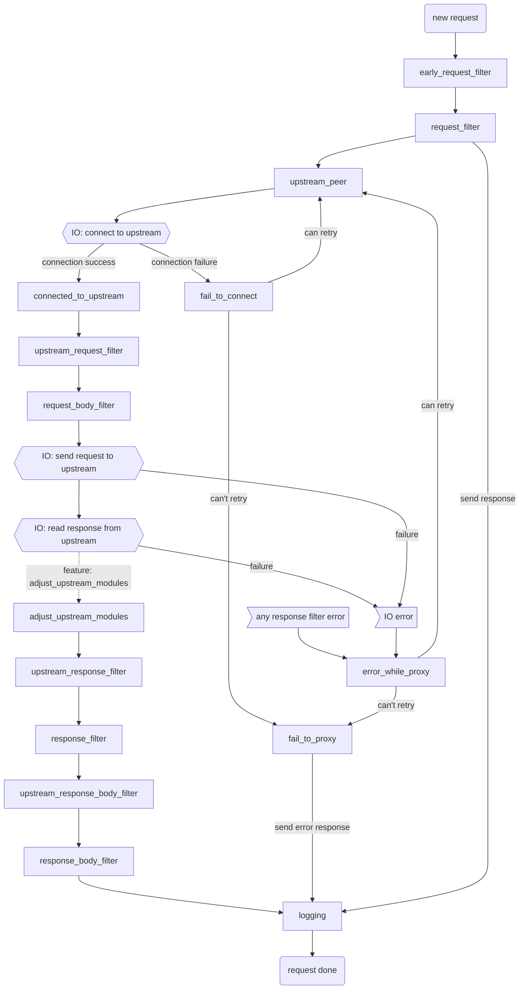
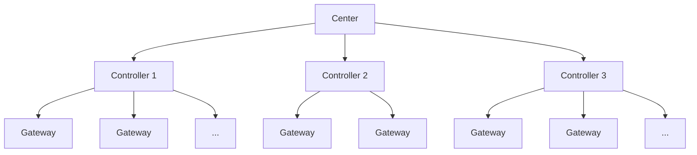

# Edgion

[Chinese](docs/zh-CN/README.md) | English

## What is Edgion?

A high-performance API Gateway built on [Pingora](https://github.com/cloudflare/pingora) and [Gateway API](https://gateway-api.sigs.k8s.io/). Designed for both Kubernetes and standalone (bare-metal / VM) environments. It delivers NGINX/Envoy-level raw performance and OpenResty-like high programmability, all while enjoying the compile-time memory safety guaranteed by Rust. It serves as a modern Rust-native alternative to Kong, APISIX, Traefik, Envoy, and HAProxy.

## Feature Highlights

- **Rust-native performance** — Built on Cloudflare's Pingora and Tokio. Memory-safe, no GC pauses, predictable latency under load.
- **Gateway API support** — Native implementation of the Kubernetes Gateway API standard. Runs in Kubernetes or standalone mode from the same binary.
  - `v1` GA: GatewayClass · Gateway · HTTPRoute · GRPCRoute · TLSRoute · ReferenceGrant · BackendTLSPolicy
  - `v1` Standard: TCPRoute · UDPRoute
- **Multi-protocol** — HTTP/1.1, HTTP/2, gRPC, TCP, UDP, WebSocket, SNI proxy.
- **Dynamic hot reload** — Every change to routes, backends, plugins, or certificates propagates across all gateways instantly. No restart.
- **Production-ready Kubernetes controller** — Full reconciliation loop, status reporting, and CRD lifecycle management out of the box.
- **High-performance routing** — Radix tree with cache optimization and path variable support for Exact/Prefix matching. Priority-based rule evaluation per Gateway API spec.
- **Advanced TLS** — mTLS, ACME auto-provisioning (HTTP-01), per-domain TLS version and cipher suite control.
- **Traffic management** — Weighted canary routing; multiple load balancing algorithms (Round Robin, EWMA, Least Connections, Consistent Hashing, Weighted).
- **Powerful plugin system** — Composable via plugin reference, with a built-in DSL for custom logic.
  - HTTP plugins: Authentication · Security · Traffic management · Observability (25+)
  - Stream plugins: TCP/UDP traffic control
  - DSL: OpenResty/Lua-level expressiveness with native Rust performance
- **Deep observability** — Structured logs across the full request lifecycle. One line, full picture. AI friendly.
  - Access log: routing/upstream details and per-plugin behaviors in a single JSON line
  - TLS log: SSL handshake and certificate details per connection
  - Stream log: connection lifecycle events for long-lived connections (WebSocket, TCP)
  - Flexible output: local file or remote Kafka / Elasticsearch
- **Kubernetes-free deployment** — Runs standalone on bare-metal or VMs. Local file or etcd as the config backend — no Kubernetes required.
- **Federated cluster design** — A stateless Center connects multiple Controllers across regions, enabling cluster-wide and region-level advanced routing control.
- For full documentation, see [English Docs](docs/en/README.md) · [Chinese Docs](docs/zh-CN/README.md).

## Architecture

### Gateway API Configuration

Edgion implements the Kubernetes Gateway API spec. Currently supports **v1.6.2**.

#### Gateway API Support

- [`v1.HTTPRoute`](docs/en/user-guide/http-route/overview.md)
- [`v1.GRPCRoute`](docs/en/user-guide/grpc-route/overview.md)
- [`v1.TLSRoute`](docs/en/ops-guide/gateway/tls/tls-termination.md)
- [`v1.ReferenceGrant`](docs/en/ops-guide/infrastructure/reference-grant.md)
- [`v1.BackendTLSPolicy`](docs/en/user-guide/http-route/backends/backend-tls.md)
- [`v1.TCPRoute`](docs/en/user-guide/tcp-route/overview.md)
- [`v1.UDPRoute`](docs/en/user-guide/udp-route/overview.md)

#### Edgion Custom Resources

- [`edgion.io/v1.EdgionTls`](docs/en/ops-guide/gateway/tls/edgion-tls.md)
- [`edgion.io/v1.EdgionPlugins`](docs/en/user-guide/http-route/filters/edgion-plugins/README.md)
- [`edgion.io/v1.EdgionStreamPlugins`](docs/en/user-guide/tcp-route/stream-plugins.md)


### Pingora Request Lifecycle

Edgion's data plane is built on Pingora, Cloudflare's battle-tested Rust proxy framework. Pingora models each request as a pipeline of well-defined phases, giving precise control over every step — from connection acceptance to access log emission. Each phase is an async hook that runs in order; any phase can short-circuit the pipeline and send a response directly.

Edgion hooks into the following phases:

| Phase | What Edgion does |
|-------|-----------------|
| `early_request_filter` | Client timeout and keepalive setup; graceful shutdown detection |
| `request_filter` | Route matching; full HTTP/gRPC plugin chain execution (auth, rate limit, rewrite, etc.) |
| `upstream_peer` | Backend selection via load balancing; session persistence; retry deadline check |
| `upstream_request_filter` | Upstream request header modification |
| `request_body_filter` | Request body plugins (e.g. bandwidth limit) |
| `upstream_response_filter` | Upstream response header inspection and rewrite |
| `response_filter` | Response plugin chain; gRPC-Web bridging |
| `logging` | Structured access log emission (local file / Kafka / Elasticsearch) |



### Components & Cluster Topology

| Component | Binary | Role |
|-----------|--------|------|
| **Center** | `edgion-center` *(separate repo: **EdgionCenter**)* | Federated control plane. Connects multiple Controllers across clusters or regions, enabling global routing policies and cross-cluster visibility. Maintained and built in the standalone EdgionCenter repository; this repo's Controller connects to it as a federation client. |
| **Controller** | `edgion-controller` | Watches Kubernetes CRDs or local YAML, validates and pre-parses resources, streams configuration to Gateways via gRPC. Handles ACME and status updates. |
| **Gateway** | `edgion-gateway` | Stateless data plane built on Pingora. Receives config from Controller, executes routing, plugin chains, load balancing, TLS, and access logging. |
| **CLI** | `edgion-cli` | Management tool for inspecting and operating Controller and Gateway instances. |



## Configuration Examples

A minimal end-to-end setup: route HTTPS traffic, enforce JWT authentication and rate limiting, and attach a TLS certificate — each as a standalone Kubernetes resource.

### HTTPRoute — path-based routing

```yaml
apiVersion: gateway.networking.k8s.io/v1
kind: HTTPRoute
metadata:
  name: my-api
  namespace: default
spec:
  parentRefs:
    - name: my-gateway
  hostnames:
    - "api.example.com"
  rules:
    - matches:
        - path:
            type: PathPrefix
            value: /api/
      filters:
        - type: ExtensionRef
          extensionRef:
            group: edgion.io
            kind: EdgionPlugins
            name: api-plugins
      backendRefs:
        - name: api-service
          port: 8080
```

### EdgionPlugins — JWT auth + rate limiting

```yaml
apiVersion: edgion.io/v1
kind: EdgionPlugins
metadata:
  name: api-plugins
  namespace: default
spec:
  requestPlugins:
    - enable: true
      type: JwtAuth
      config:
        secret: "your-jwt-secret"
    - enable: true
      type: RateLimitLocal
      config:
        key:
          - type: remoteIp
        limit: 100
        window: "60s"
```

### EdgionTls — HTTPS certificate binding

```yaml
apiVersion: edgion.io/v1
kind: EdgionTls
metadata:
  name: api-tls
  namespace: default
spec:
  hosts:
    - "api.example.com"
  secretRef:
    name: api-tls-secret   # kubernetes.io/tls Secret
    namespace: default
```

## Plugins

### Built-in Plugins

25+ built-in plugins via [EdgionPlugins](docs/en/user-guide/http-route/filters/overview.md) CRD, composable through [Plugin Composition](docs/en/user-guide/http-route/filters/plugin-composition.md):

**Authentication** — [Basic Auth](docs/en/user-guide/http-route/filters/edgion-plugins/basic-auth.md) · [JWT Auth](docs/en/user-guide/http-route/filters/edgion-plugins/jwt-auth.md) · [Key Auth](docs/en/user-guide/http-route/filters/edgion-plugins/key-auth.md) · [HMAC Auth](docs/en/user-guide/http-route/filters/edgion-plugins/hmac-auth.md) · [LDAP Auth](docs/en/user-guide/edgion-plugins/ldap-auth.md) · [Forward Auth](docs/en/user-guide/edgion-plugins/forward-auth.md) · [OpenID Connect](docs/en/user-guide/edgion-plugins/openid-connect.md) · [JWE Decrypt](docs/en/user-guide/edgion-plugins/jwe-decrypt.md) · [Header Cert Auth](docs/en/user-guide/http-route/filters/edgion-plugins/header-cert-auth.md)

**Security** — [CORS](docs/en/user-guide/http-route/filters/edgion-plugins/cors.md) · [CSRF](docs/en/user-guide/http-route/filters/edgion-plugins/csrf.md) · [IP Restriction](docs/en/user-guide/http-route/filters/edgion-plugins/ip-restriction.md) · [Request Restriction](docs/en/user-guide/http-route/filters/edgion-plugins/request-restriction.md)

**Traffic Management** — [Rate Limit (Local)](docs/en/user-guide/http-route/filters/edgion-plugins/rate-limit-local.md) · [Rate Limit (Redis)](docs/en/user-guide/http-route/filters/edgion-plugins/rate-limit-redis.md) · [Proxy Rewrite](docs/en/user-guide/http-route/filters/edgion-plugins/proxy-rewrite.md) · [Response Rewrite](docs/en/user-guide/http-route/filters/edgion-plugins/response-rewrite.md) · [Bandwidth Limit](docs/en/user-guide/http-route/filters/edgion-plugins/bandwidth-limit.md) · [Request Mirror](docs/en/user-guide/http-route/filters/edgion-plugins/request-mirror.md) · [Direct Endpoint](docs/en/user-guide/http-route/filters/edgion-plugins/direct-endpoint.md) · [Dynamic Upstream](docs/en/user-guide/http-route/filters/edgion-plugins/dynamic-upstream.md)

**Observability & Utilities** — [Real IP](docs/en/user-guide/edgion-plugins/real-ip.md) · [Ctx Setter](docs/en/user-guide/edgion-plugins/ctx-setter.md) · [Mock](docs/en/user-guide/http-route/filters/edgion-plugins/mock.md)

**Gateway API Standard Filters** — [Request Header Modifier](docs/en/user-guide/http-route/filters/gateway-api/request-header-modifier.md) · [Response Header Modifier](docs/en/user-guide/http-route/filters/gateway-api/response-header-modifier.md) · [Request Redirect](docs/en/user-guide/http-route/filters/gateway-api/request-redirect.md) · [URL Rewrite](docs/en/user-guide/http-route/filters/gateway-api/url-rewrite.md)

**Stream Plugins (TCP/UDP)** — [IP Restriction](docs/en/user-guide/tcp-route/stream-plugins.md)

### DSL Extension

OpenResty achieves gateway extensibility by embedding Lua scripts into Nginx phases via LuaJIT. This works well but carries inherent trade-offs: Lua is a separate runtime, scripts share the process memory space without isolation, and resource consumption is difficult to bound per request.

Edgion takes a different approach. The DSL plugin runs scripts in a **sandboxed VM written in Rust**, isolated from the host process. Each script execution is strictly bounded by configurable limits:

| Limit | Default | Description |
|-------|---------|-------------|
| `maxSteps` | 10,000 | Total execution steps |
| `maxLoopIterations` | 100 | Per-loop iterations |
| `maxCallCount` | 500 | Function call count |
| `maxStackDepth` | 128 | Call stack depth |
| `maxStringLen` | 8,192 | String length |

Scripts can be deployed as source code or pre-compiled to **bytecode** (Base64) for faster startup and obfuscation.

**Request phase — enforce an API token:**

```yaml
apiVersion: edgion.io/v1
kind: EdgionPlugins
metadata:
  name: require-token
  namespace: default
spec:
  requestPlugins:
    - enable: true
      type: Dsl
      config:
        name: "require-api-token"
        errorPolicy: Deny
        source: |
          let token = req.header("X-Api-Token")
          if token == nil {
            return deny(401, "missing X-Api-Token header")
          }
          ctx.set("api_token", token)
          return next()
```

**Request phase — inject routing tag from query param:**

```yaml
        source: |
          let region = req.query("region")
          if region != nil {
            req.set_header("X-Route-Region", region)
          }
          return next()
```

**Response phase — append upstream timing header:**

```yaml
  upstreamResponseFilterPlugins:
    - enable: true
      type: Dsl
      config:
        name: "add-timing-header"
        source: |
          let token = ctx.get("api_token")
          if token != nil {
            resp.set_header("X-Authenticated-Token", token)
          }
          return next()
```

For full DSL API reference and advanced usage, see the [DSL Plugin Documentation](docs/en/user-guide/http-route/filters/edgion-plugins/dsl/README.md).

## Deployment

All deployment manifests, Helm charts, and scripts are maintained in a dedicated repository: **[Pandaala/edgion-deploy](https://github.com/Pandaala/edgion-deploy)**.

The following deployment modes are supported:

- **Kubernetes** — Standard production deployment. Runs Controller and Gateway as separate workloads in a Kubernetes cluster, watching CRDs via the Kubernetes API.

- **Standalone (Bare-Metal / VM)** — Runs Controller and Gateway as native processes without Kubernetes. Configuration is sourced from local YAML files or etcd.

- **Controller-Gateway Container** — A single container image bundling Controller and Gateway. Designed for quick evaluation, demos, and single-node environments. The management frontend is deployed separately.

## Documentation

| | Guide | Description |
|---|-------|-------------|
| 📘 | [User Guide](docs/en/user-guide/README.md) | HTTPRoute, GRPCRoute, plugins, load balancing, resilience, and traffic management |
| 🔧 | [Ops Guide](docs/en/ops-guide/README.md) | Gateway configuration, TLS, observability, ACME, and production operations |
| 🛠️ | [Dev Guide](docs/en/dev-guide/README.md) | Architecture internals, adding resources/plugins, coding conventions |
| 🚀 | [Getting Started](docs/en/getting-started/README.md) | Installation, first gateway, and core concepts |

## Roadmap

- [ ] **Body Cache & Processing** — Request/response body caching and transformation support
- [ ] **HTTP/3** — Native HTTP/3 support across the gateway stack
- [ ] **WAF** — Web Application Firewall integration
- [ ] **edgion-cli AI Enhance** — AI-powered inspection, diagnostics, and operation assistance in the CLI
- [ ] **Mesh** — Service mesh capabilities

## Contributing

Contributions are welcome! Please check out:

- [Developer Documentation](docs/en/dev-guide/README.md)
- [Adding New Resources Guide](docs/en/dev-guide/add-new-resource-guide.md)

## License

Edgion is licensed under the [Apache License, Version 2.0](LICENSE).
