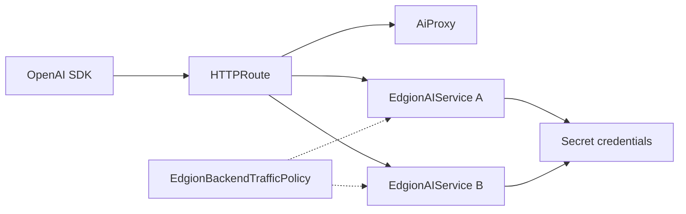

# AI Gateway Concepts

Edgion AI Gateway is assembled from four contracts. Keep each concern on the resource that owns it.

## Ownership split

| Concern | Owner |
|---------|-------|
| Provider candidates, declaration order, weights | HTTPRoute `backendRefs` |
| Total and per-attempt deadlines; retry permission | HTTPRoute `timeouts` / `retry` |
| One provider endpoint, model catalog, credential pool | `EdgionAIService` |
| Request translation, selection algorithm, quota, usage | Rule-level `AiProxy` |
| Connect timeout, outlier, circuit, retry budget | `EdgionBackendTrafficPolicy` targeting that AI service |

AiProxy does **not** carry `aiServiceRef`, a provider list, backend weights, or retry attempt counts.
HTTPRoute is the only candidate source. EBTP never attaches to the route and never invents backends.

## Request path (high level)

1. The route matches `/v1/chat/completions` (or your configured path) and runs rule-level AiProxy.
2. AiProxy resolves the client model/alias to a logical model and admits optional token quota.
3. `backendSelection` picks an eligible positive-weight EdgionAIService that supports that model.
4. Within the service, Edgion picks an eligible credential by weight (skipping RPM/TPM/cooldown).
5. Edgion installs the Secret credential, dials the provider, and streams the response.
6. On a retryable failure before response commitment, Edgion prefers another credential in the
   same service, then another route backend, within one shared attempt ceiling.

## Attachment rules

- AiProxy must appear exactly once on the rule through an EdgionPlugins `ExtensionRef`.
- Do not attach AiProxy globally or as a backendRef filter.
- An AiProxy rule may forward only to `edgion.io/EdgionAIService` backends.
- AI backendRef filters allow only `RequestHeaderModifier` and `ResponseHeaderModifier` in this
  version. Request modifiers rebuild per attempt; response modifiers apply only to the final
  non-retried response.

## Invalid backend share

Missing, denied, or unsupported refs keep their Gateway API weighted invalid-traffic share. If that
invalid share is selected, Edgion returns 500 without AI failover to another service.

## Next

- [EdgionAIService](./edgion-ai-service.md)
- [Routing and Selection](./routing.md)
- [Resilience and Failover](./resilience.md)
