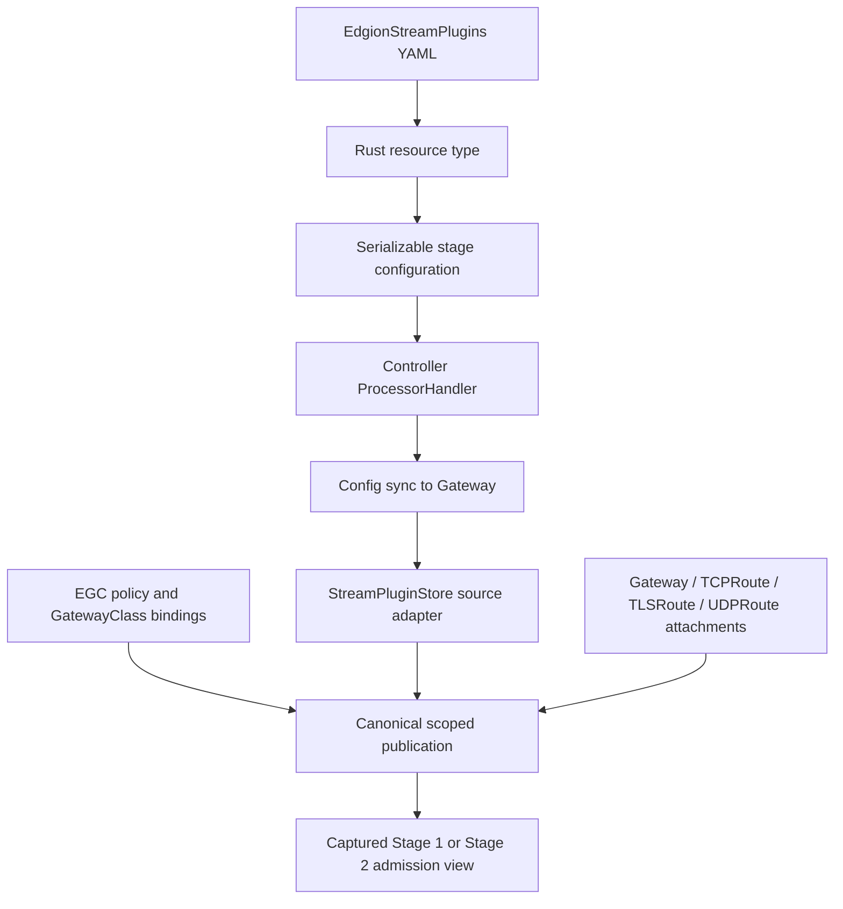

# Stream Plugin Development Guide

This document is for contributors who need to extend `EdgionStreamPlugins`. It explains where stream plugins fit in Edgion, how the two-stage runtime works, and which wiring points humans most often miss.

> The primary AI / agent workflow now lives in [https://github.com/Pandaala/Edgion/blob/main/skills/01-architecture/02-gateway/13-stream-plugin-dev.md](https://github.com/Pandaala/Edgion/blob/main/skills/01-architecture/02-gateway/13-stream-plugin-dev.md).
> This document remains the human-facing background guide, implementation boundary explanation, and manual review checklist.

## Adding plugin types without CRD edits

Connection-stage and TLSRoute-stage plugin names are open strings in the CRD. Implement and
register the new Rust variant without adding a YAML whitelist entry. Unsupported names produce
`Accepted=False` and deny traffic through the affected resource, even for disabled entries or
policy bypass. Known configuration types remain strictly typed. The internal `Unsupported`
sentinel is excluded from supported-plugin catalogs and discards the unknown config content.
New common entry fields can still require a CRD schema update.

## What This Plugin Family Is For

`EdgionStreamPlugins` is Edgion's L4 extension mechanism. It lets the gateway
apply extra logic before HTTP parsing, when admitting a UDP session, or after
TLSRoute matching.

Compared with HTTP plugins, stream plugins focus on different problems:

- they run earlier and can reject a connection before higher-layer processing
- they work with connection context such as client IP, listener port, SNI, and mTLS state
- failures usually terminate or reject the connection instead of returning an HTTP response

The most mature current implementation is IP restriction, with code under:

- `edgion-gateway/src/plugins/stream/ip_restriction/`

## The Current Two-Stage Model

Edgion currently splits stream plugins into two stages.

### Stage 1: connection-context runtime

Characteristics:

- runs before TLS handshake and HTTP parsing for TCP-based listeners, or before
  forwarding the first datagram of a new UDPRoute session
- only has access to client IP, listener port, and remote address style context
- best for early connection-level allow/deny decisions

Gateway attachments use Pingora's listener `ConnectionFilter`, but UDP listeners
are independent Tokio tasks and do not use that bridge. UDPRoute attachments
execute the same `spec.plugins` runtime in the UDP proxy at session admission.

Typical cases:

- IP allow/deny
- listener-specific connection gating

### Stage 2: TlsRoute

Characteristics:

- runs after `TLSRoute` matching: after the handshake for Terminate, before forwarding the end-to-end handshake for Passthrough
- sees SNI and matched route identity; negotiated TLS identity and mTLS status are available only for Terminate
- best for policies that depend on TLS-specific context

Typical cases:

- policies based on SNI or mTLS state
- logic that should run only after a specific `TLSRoute` matches

#### TLSRoute stage contract

TLSRoute executes only `spec.tlsRoutePlugins`, in both Terminate and Passthrough modes.
It never runs `spec.plugins` as a fallback.

- An absent or null `tlsRoutePlugins` with a nonempty `plugins` list rejects the connection,
  even if those Stage-1 entries are disabled or Bypass. This detects a wrong-stage attachment.
- Explicit `tlsRoutePlugins: []`, or Stage-2 entries all disabled or Bypass, means no route-stage
  policy. Both fields absent/empty also allow. A Stage-2 Block entry denies when enabled.
- A referenced resource that is missing still rejects the connection.
- Move TLSRoute IP restrictions from `plugins` to `tlsRoutePlugins`. For GeoIP,
  ConnectionRateLimit or ConnectionLimit, attach `plugins` to the Gateway listener; they are not Stage-2 plugins.
  A shared resource may declare both fields, each consumed only by its own attachment stage.
- Configuration updates affect new connections; established connections are not re-authorized.
- TLS access-log diagnostics report `tls route plugin allowed` / `tls route plugin denied`,
  or the missing-resource/wrong-stage error. No connection-path `tracing` or `(compat)` event is emitted.

For an intentional no-op route stage on a resource that also has connection policies, declare
`tlsRoutePlugins: []` explicitly; do not use it when the route is meant to enforce an IP policy.

## Key Architecture Path



The usual failure is not “forgot to implement a trait.” It is one of the middle segments:

- Gateway scoped publication did not demand/construct the selected stage
- Gateway did not actually cache and hot-reload `EdgionStreamPlugins`
- the `Gateway` / `TCPRoute` / `TLSRoute` / `UDPRoute` annotation path never reached the runtime

## Resource-Side Code Locations

When adding or extending a stream plugin, start with:

- `edgion-resources/src/resources/edgion_stream_plugins/mod.rs`
- `edgion-resources/src/resources/edgion_stream_plugins/stream_plugins.rs`
- `edgion-resources/src/resources/edgion_stream_plugins/tls_route_plugins.rs`
- `edgion-resources/src/resource/meta/impls.rs`

These currently own:

- the CRD structure, status, and serializable stage entries
- the Stage 1 plugin enum
- the Stage 2 plugin enum
- schema-level resource metadata behavior

One important fact:

- Gateway `StreamPluginStore` forwards source inputs to the canonical publisher; `StreamPluginGeneration` constructs only demanded, permitted stage entries and shares their instances across class views. The Controller transports resolved source configuration and reports intrinsic status; it never stamps execution-policy actions

So changing only the handler is not enough. Gateway may receive the resource but still miss an executable runtime.

## Gateway Runtime Code Locations

The most important Gateway-side files are:

- `edgion-gateway/src/plugins/stream/stream_plugin_trait.rs`
- `edgion-gateway/src/plugins/stream/stream_plugin_runtime.rs`
- `edgion-gateway/src/plugins/stream/stream_plugin_store.rs`
- `edgion-gateway/src/runtime/server/listener_builder.rs`
- `edgion-gateway/src/routes/tcp/conf_handler_impl.rs`
- `edgion-gateway/src/routes/tls/proxy.rs`
- `edgion-gateway/src/routes/udp/route_unit.rs`
- `edgion-gateway/src/routes/udp/edgion_udp.rs`

A simple mental model:

- trait / runtime: how the plugin executes
- store: how Gateway hot-reloads the latest resource
- listener / route binding: which listener or route actually invokes the resource

## Annotation Binding Rule

The current primary key is:

```yaml
metadata:
  annotations:
    edgion.io/edgion-stream-plugins: "policy-name"
```

It is currently used on:

- `Gateway`
- `TCPRoute`
- `TLSRoute`
- `UDPRoute`

This is not just a documentation convention; it is the key the current implementation reads.
The repository historically had older forms such as `edgion.io/stream-plugins`. New work should not keep copying that legacy key forward.

On a `Gateway`, the value must be an unqualified name and resolves in the Gateway's own namespace.
Slash-containing values are rejected by the Controller and fail closed defensively in the Gateway.
`TCPRoute`, `TLSRoute`, and `UDPRoute` retain their separate `name` or `namespace/name` contract.
Gateway attachment does not cover a UDP listener; attach the resource directly
to `UDPRoute` for UDP session admission. That route check runs once for a new
source-address session, not once per datagram, and executes only `spec.plugins`.
For centralized data with per-namespace plugin ownership, keep a local `EdgionStreamPlugins` wrapper
and reference shared `EdgionConfigData` through its existing authorization controls.

## Recommended Development Order

1. Decide whether the plugin belongs in Stage 1, Stage 2, or both.
2. Decide whether the config can reuse an existing type instead of duplicating nearly identical schema.
3. Add the new type to `EdgionStreamPlugin` or `TlsRouteStreamPlugin`.
4. Register runtime construction in the matching runtime module.
5. Confirm scoped publication constructs the permitted selected stage before admission.
6. Confirm the referencing `Gateway` / `TCPRoute` / `TLSRoute` / `UDPRoute` really resolves a store key and uses the correct lifecycle.
7. Add tests and example YAML last.

If you want an AI tool to implement it, start from the skill entry instead:

- [https://github.com/Pandaala/Edgion/blob/main/skills/01-architecture/02-gateway/13-stream-plugin-dev.md](https://github.com/Pandaala/Edgion/blob/main/skills/01-architecture/02-gateway/13-stream-plugin-dev.md)

## Testing And Verification

At minimum, cover three layers.

### 1. Resource Layer

- controller accepts the resource and writes the expected status
- Gateway publishes the current class policy and demanded stage runtimes together

### 2. Reference Layer

- `Gateway` annotations accept only a same-namespace `name`; `TCPRoute` / `TLSRoute` / `UDPRoute` annotations resolve both `name` and `namespace/name`
- the store and subsequent admissions stop resolving a deleted resource; an
  already-established UDP session remains pinned and is not immediately revoked

### 3. Runtime Layer

- behavior is correct when the plugin matches
- unrelated traffic is not blocked accidentally
- hot reload affects subsequent connections and UDP session admissions without
  leaving a stale store generation; it does not re-authorize established UDP sessions

Existing examples and integration fixtures are mainly under:

- `edgion-tests/integration/conf/Gateway/StreamPlugins/`
- `edgion-tests/integration/conf/TCPRoute/StreamPlugins/`
- `edgion-tests/integration/conf/TLSRoute/StreamPlugins/`
- `edgion-tests/integration/conf/UDPRoute/StreamPlugins/`

## Manual Review Checklist

- is this really a Stage 1 plugin, a Stage 2 plugin, or both
- are enum, runtime, and module exports all wired
- does the annotation still use `edgion.io/edgion-stream-plugins`
- did the change reuse an existing config structure where appropriate
- does Gateway actually hot-reload subsequent admissions after resource update / delete, without assuming established UDP sessions are revoked
- do tests cover add, update, and delete

## Related Docs

- [Annotations Guide](./annotations-guide.md)
- [AI Collaboration and Skill Usage Guide](./ai-agent-collaboration.md)
- [TCPRoute Stream Plugins User Guide](../user-guide/tcp-route/stream-plugins.md)
- [Knowledge Source Map and Maintenance Rules](./knowledge-source-map.md)
