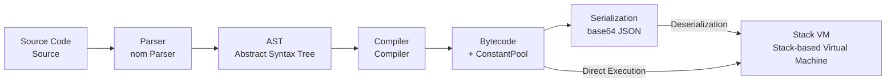

# Edgion Technical Whitepaper

> This document is intended for architects and technical decision-makers. It covers the core architecture design, the rationale behind key technology choices (Rust / Pingora / Gateway API), and the implementation principles of each subsystem. For a product feature overview, see the [GitHub README](../../../README.md).

---

## 1. Abstract

Edgion is a fully open-source, cloud-native API gateway built on the Rust programming language and the Cloudflare Pingora framework. It natively complies with the Kubernetes Gateway API v1 standard, employs a Controller-Gateway separated architecture, and achieves real-time configuration synchronization and hot-reload via the gRPC List/Watch mechanism. Edgion includes a self-developed DSL scripting engine that provides a complete compilation pipeline from source code to bytecode and a multi-layer sandbox security model, enabling operators to flexibly orchestrate request-processing logic without modifying gateway code. The project ships 28 plugins (26 HTTP plugins + 2 Stream plugins), covering core scenarios such as authentication, security, and traffic management. It offers production-grade capabilities including millisecond-level configuration propagation, zero-restart hot updates, and Panic isolation.

---

## 2. Background and Motivation

### 2.1 API Gateway Market Landscape and Pain Points

As microservice architectures and cloud-native technologies have become mainstream, the API gateway has become critical infrastructure for modern distributed systems. However, the leading solutions on the market today share several common pain points:

**Limited extensibility.** Traditional gateways typically extend through embedded scripts or native plugin development. The former is constrained by scripting language performance and debugging bottlenecks; the latter has a steep learning curve and long development cycles. When teams need to implement custom logic quickly, they often face the dilemma of "minor requirement, major project," and a fragmented plugin ecosystem compounds integration costs further.

**Technical debt.** Some traditional solutions use C/C++ to implement core modules. Long-lived codebases accumulate memory-safety issues—buffer overflows, use-after-free, and data races—that remain difficult to eliminate fundamentally even with rigorous code review and fuzzing. Other solutions embed Lua scripting at runtime; while this offers flexibility, Lua scripts lack native sandbox isolation, meaning a malicious or runaway script can crash the entire gateway process.

**Configuration fragmentation.** Different gateway products define their own configuration models and CRD formats, lacking a unified standard. Operations teams face configuration fragmentation across multi-cluster, multi-gateway environments. The Kubernetes Ingress API provides a basic routing abstraction, but its limited capabilities—no TCP/UDP routing, no complex match expressions, no standard request/response transformation—have led vendors to extend it through annotations, creating de facto "dialects."

**Observability gaps.** Traditional solutions typically treat observability as an add-on module rather than an intrinsic architectural capability. Insufficient metric granularity, high cost of integrating distributed tracing, and low structure in access logs all degrade the efficiency of troubleshooting and performance tuning.

### 2.2 Why Rust + Pingora

Edgion chose Rust as its core language and built on Cloudflare's open-source Pingora framework based on the following considerations:

**Memory safety, guaranteed at compile time.** Rust's ownership system and borrow checker eliminate data races, null-pointer dereferences, and use-after-free issues at compile time. For an API gateway that must run stably 24/7, this means an entire class of runtime crashes is eliminated at the language level. Compared to C/C++ solutions that rely on tools like ASan and Valgrind to detect memory issues at runtime, Rust moves safety checks to the compilation phase.

**Asynchronous, high performance.** Rust's zero-cost abstractions and async/await coroutine model provide near-C runtime performance while maintaining code readability. The Pingora framework is built on the Tokio async runtime, enabling efficient handling of massive concurrent connections; its event-driven architecture is naturally suited to the proxy and forwarding workloads of a gateway.

**Production-grade validation.** Pingora was developed by Cloudflare and deployed in production across its global CDN edge network, handling trillions of requests per day. Cloudflare's published performance data shows that Pingora significantly outperforms its predecessor Nginx-based solution in both resource consumption and latency. Edgion stands on Pingora's shoulders, inheriting a battle-tested network I/O and connection management capability validated at massive production scale.

**Comparison with other technology stacks.** Lua-embedded solutions (such as many Nginx extensions) are flexible, but the Lua runtime's GC pauses and lack of a type system introduce non-deterministic latency under high concurrency. Go-based solutions perform well for concurrent programming, but the presence of a garbage collector makes tail latency (P99) less controllable than Rust in extreme latency-sensitive scenarios. C/C++ solutions offer excellent performance but at an unacceptable cost in developer productivity and safety. The Rust + Pingora combination achieves the best balance among safety, performance, and engineering efficiency.

### 2.3 Why Gateway API v1

Edgion chose Kubernetes Gateway API v1 as its core configuration model rather than the traditional Ingress API or a custom proprietary format:

**Standards over proprietary formats.** Gateway API is an official standard led by Kubernetes SIG-Network and represents the community consensus on the next-generation traffic management API. Adhering to this standard means users' configuration knowledge is portable across different gateway products, avoiding vendor lock-in.

**Role separation model.** Gateway API introduces layered resources—GatewayClass, Gateway, HTTPRoute, GRPCRoute—that natively support a separation of responsibilities among three roles: infrastructure provider, cluster administrator, and application developer. This design aligns closely with enterprise team collaboration patterns: platform teams manage Gateway instances and global policies, while application teams independently manage routing rules for their own services.

**Future-proof.** The Ingress API has been GA since Kubernetes 1.19, but its functional limitations—no TCP/UDP routing, inability to express complex match conditions, no standard request/response transformation capability—have forced implementations to rely heavily on non-standard annotations for extension. Gateway API was designed from the outset with these advanced scenarios in mind. Its extensible Policy Attachment mechanism and ExtensionRef model leave ample room for future feature evolution. Edgion's native support for Gateway API ensures its configuration model remains aligned with the long-term evolution of the Kubernetes ecosystem.

---

## 3. Architecture Design

### 3.1 Controller-Gateway Separated Architecture

Edgion employs a classic control-plane/data-plane separated architecture:

- **Controller (Control Plane)** is responsible for watching configuration sources (Kubernetes CRDs, YAML files, etc.), and for validating, transforming, and distributing configurations. The Controller is the single source of truth for configuration; all configuration changes go through the Controller's validation pipeline before being pushed to the data plane.
- **Gateway (Data Plane)** is a stateless proxy node focused on receiving, routing, executing plugins, and forwarding requests. The Gateway obtains its configuration from the Controller and does not access configuration sources directly. The stateless nature of the data plane enables horizontal scaling, and node failure does not result in configuration loss.

The core advantage of this separation is that the complexity of configuration management is encapsulated in the Controller while the data plane remains lean and efficient. The Controller can be upgraded independently without affecting in-flight traffic proxying.

### 3.2 gRPC List/Watch Configuration Synchronization

Configuration synchronization between the Controller and Gateway is implemented over gRPC using a List/Watch pattern similar to Kubernetes Informers:

1. **Full sync (List).** When a Gateway node starts or reconnects, it issues a ListRequest to the Controller to obtain a complete snapshot of all current configuration resources. This ensures the Gateway always begins from a consistent configuration state.
2. **Incremental push (Watch).** After the full sync completes, the Gateway maintains a long-lived gRPC stream with the Controller. The Controller pushes incremental updates to the Gateway as configurations change—no polling required—achieving near-real-time configuration propagation.
3. **Reconnection recovery.** When the connection between the Gateway and Controller is interrupted, the Gateway continues serving traffic using its locally cached configuration. After reconnection, a full sync (List) is automatically performed to restore the latest configuration state. The entire process is completely transparent to business traffic.

### 3.3 Unified Resource Registry and Handlers

The Controller internally uses a unified resource-handling architecture:

- **ResourceController.** Each Kubernetes resource type (Kind) has a corresponding ResourceController instance responsible for watching, event handling, and state management for that type.
- **Workqueue.** Resource change events enter a Workqueue for queuing and deduplication, preventing redundant processing caused by bursts of changes in a short time window.
- **PROCESSOR_REGISTRY.** A global handler registry that maps resource types to their corresponding processing functions. Adding a new resource type requires only implementing a handler and registering it in the Registry—no changes to framework code are needed.
- **ConfigSyncServer.** Processed configurations are pushed to downstream Gateway nodes via the gRPC ConfigSyncServer.

### 3.4 Configuration Flow Overview

```mermaid
flowchart LR
    subgraph Configuration Sources
        CRD["K8s CRD"]
        YAML["YAML Files"]
    end

    subgraph Controller - Control Plane
        CC["ConfCenter<br/>Config Center"]
        RC["ResourceController<br/>per Kind"]
        WQ["Workqueue<br/>Queue & Dedup"]
        PR["PROCESSOR_REGISTRY<br/>Handler Registry"]
        CSS["ConfigSyncServer<br/>gRPC Server"]
    end

    subgraph Gateway - Data Plane
        GC["ConfigClient<br/>gRPC Client"]
        Cache["ClientCache<br/>Local Cache"]
        CH["ConfHandler<br/>Config Callback"]
        RS["Runtime Stores<br/>Routes / Plugins / TLS / Backends"]
        PP["Pingora Pipeline<br/>Request Processing Pipeline"]
    end

    CRD --> CC
    YAML --> CC
    CC --> RC
    RC --> WQ
    WQ --> PR
    PR --> CSS
    CSS -->|"gRPC Stream<br/>List + Watch"| GC
    GC --> Cache
    Cache --> CH
    CH -->|"Atomic Update"| RS
    RS --> PP
```



### 3.5 Hot-Reload Mechanism

Edgion's configuration hot-reload mechanism requires no process restart:

1. The ConfigClient receives an incremental configuration update from the Controller.
2. The update is written to the ClientCache, triggering the ConfHandler callback.
3. The ConfHandler parses the new configuration into runtime objects (Routes, Plugins, TLS certificates, Backend lists, etc.) and replaces the old configuration in the Runtime Store via atomic operations (`Arc::swap` / `ArcSwap`).
4. Subsequent requests read the new configuration and it takes effect immediately. Requests already in flight continue using the old configuration to completion, unaffected.

The entire process is free of lock contention (the read path is lock-free), and the impact on request-processing latency is on the order of nanoseconds.

---

## 4. Deep Dive: DSL Engine

### 4.1 Why Build a Custom DSL

Embedding programmable capabilities into an API gateway is driven by real production requirements—standardized plugins cannot cover every business scenario. After evaluating the following options, Edgion decided to build a domain-specific language (DSL) in-house:

**Limitations of Lua embedding.** Lua is the most common scripting approach in the gateway space, but it has fundamental security flaws: the Lua runtime provides no sandbox isolation by default, so scripts can access the filesystem, network, and OS APIs. While some restriction is possible by stripping the standard library, this "blocklist" approach is error-prone, and Lua's GC mechanism can introduce unpredictable latency spikes under high concurrency.

**Trade-offs of WASM.** WebAssembly provides good sandbox isolation and language agnosticism, but its toolchain is complex (source languages must be compiled to WASM modules), cold-start overhead is significant (module instantiation, memory allocation), and it is overkill for simple request-handling logic.

**Positioning of the Edgion DSL.** The custom DSL is designed specifically for API gateway request-processing scenarios, with the following characteristics:
- **Concise, intuitive syntax**—no need to learn the complex features of a general-purpose programming language
- **Compile-time + runtime dual-layer safety**—defensive measures at every stage from parsing to execution
- **Zero external dependencies**—the DSL engine is implemented entirely in Rust with no FFI calls
- **Lightweight bytecode**—compiled scripts are stored as base64-encoded JSON and can be distributed across versions

### 4.2 Language Design

EdgionDSL's syntax is inspired by Rust and JavaScript conventions to minimize the learning curve:

**Variable declaration.** Both immutable and mutable variables are supported:

```
let ip = req.client_ip()
let mut count = 0
count = count + 1
```

**Control flow.** Supports `if/else if/else`, `for...in`, `for...in range()`, and `while` loops, as well as `break`/`continue`:

```
if req.method() == "POST" && req.path().starts_with("/api") {
    let token = req.header("Authorization")
    if token == nil {
        return deny(401, "Unauthorized")
    }
} else {
    return next()
}

for name in req.header_names() {
    if name.starts_with("x-internal-") {
        req.remove_header(name)
    }
}
```

**Expressions.** Supports arithmetic operators (`+`, `-`, `*`, `/`), comparison operators (`==`, `!=`, `<`, `>`, `<=`, `>=`), logical operators (`&&`, `||`, `!`), and string concatenation (`+`). Supports method calls (`obj.method(args)`), field access (`req.path`, equivalent to a zero-argument method call), and free function calls (`log("msg")`, `len(s)`).

**Termination statements.** Two ways to end script execution:
- `return next()` — allow the request to pass through and continue executing subsequent plugins
- `return deny(status, body)` — reject the request and return the specified status code and response body

**47 built-in functions.** Organized into six categories by responsibility:

| Category | Count | Representative Functions |
|----------|-------|--------------------------|
| Request read | 15 | `req.header()`, `req.method()`, `req.path()`, `req.query()`, `req.cookie()`, `req.client_ip()`, `req.remote_ip()`, `req.path_param()`, `req.header_names()`, `req.scheme()`, `req.host()`, `req.uri()`, `req.content_type()`, `req.has_header()`, `req.query_string()` |
| Request modify | 6 | `req.set_header()`, `req.append_header()`, `req.remove_header()`, `req.set_uri()`, `req.set_host()`, `req.set_method()` |
| Response read | 3 | `resp.status()`, `resp.header()`, `resp.has_header()` |
| Response modify | 3 | `resp.set_header()`, `resp.append_header()`, `resp.remove_header()` |
| Context operations | 3 | `ctx.get()`, `ctx.set()`, `ctx.remove()` |
| Utility functions | 17 | `log()`, `len()`, `substr()`, `to_int()`, `to_str()`, `to_upper()`, `to_lower()`, `base64_encode()`, `base64_decode()`, `url_encode()`, `url_decode()`, `sha256()`, `md5()`, `time_now()`, `regex_find()`, `regex_replace()`, `range()` |

In addition, string objects support `.starts_with()`, `.ends_with()`, `.contains()`, and `.matches()` methods. The `.matches()` method accepts a regular expression literal and validates the regex syntax at compile time.

### 4.3 Compilation Pipeline

EdgionDSL uses a classic multi-stage compilation pipeline to transform human-readable source code into efficient bytecode:



**Stage 1: Parsing (Parser).** Built with nom combinator parsers using the Pratt parsing algorithm (precedence climbing) to handle operator precedence. The parser includes four built-in safeguards:
- **Source size limit**: maximum 64 KB (`MAX_SOURCE_LEN`)
- **Parse budget**: a global step counter (default 50,000 steps) to prevent CPU exhaustion from pathological backtracking
- **Nesting depth limit**: maximum 64 levels to prevent stack overflow
- **AST node count limit**: maximum 2,000 nodes to prevent maliciously crafted oversized ASTs

**Stage 2: AST.** The abstract syntax tree is composed of three core types: `Program` (top-level statement list), `Stmt` (statement), and `Expr` (expression). Statement types include `Let` (variable declaration), `Assign` (assignment), `If` (conditional branch), `ForIn` (iteration loop), `ForRange` (range loop), `While` (conditional loop), `ReturnDeny` (deny termination), `ReturnNext` (pass-through termination), `Break`, `Continue`, and `ExprStmt` (expression statement).

**Stage 3: Compilation (Compiler).** The compiler traverses the AST and generates a flat sequence of bytecode instructions. Key techniques include:
- **Local variable resolution**: scope tracking + slot allocation, with mutability constraints checked at compile time
- **Short-circuit evaluation**: `&&` and `||` operators implement short-circuit semantics via conditional jumps
- **Jump backpatching**: jump offsets for `if/else/while/for` constructs are backpatched in a later compilation pass
- **Namespace method resolution**: `req.header("X")` is compiled to `CallBuiltin(ReqHeader, 1)`, directly mapped to a built-in function ID
- **Constant pool deduplication**: identical string and integer constants share a single constant pool entry

**Stage 4: Bytecode.** The compilation artifact `CompiledScript` contains four fields: an instruction sequence (`code: Vec<OpCode>`), a constant pool (`constants: Vec<Constant>`), a local variable slot count (`local_count`), and a maximum loop nesting depth (`max_loop_depth`). Bytecode carries a version number (currently `BYTECODE_VERSION = 1`) and is serialized to base64-encoded JSON format for safe transmission between the Controller and Gateway and for persistent storage. Deserialization strictly validates version compatibility and payload size (maximum 256 KB decoded).

**Stage 5: Execution.** A stack-based VM executes bytecode instructions one by one. The instruction set includes stack operations (LoadConst, LoadNil, LoadTrue, LoadFalse, Pop), local variable operations (GetLocal, SetLocal), arithmetic, comparison, and logical operators, string methods (StartsWith, EndsWith, Contains, Matches), control-flow jumps, list operations, and built-in function calls.

### 4.4 Sandbox Security Model

EdgionDSL's security design spans every stage from parsing to execution, employing a defense-in-depth strategy:

**Zero-capability principle.** DSL scripts cannot access the filesystem, network, environment variables, or OS APIs. The entire external surface accessible to a script is limited to the 47 audited built-in functions, which operate only on metadata of the current request/response—headers, path, query parameters, and so on.

**Runtime resource limits.** VM execution is constrained by the following configurable parameters:

| Parameter | Config Field | Default | Purpose |
|-----------|-------------|---------|---------|
| Maximum execution steps | `maxSteps` | 10,000 | Prevent infinite loops and excessive computation |
| Maximum loop iterations | `maxLoopIterations` | 100 | Per-loop iteration upper bound |
| Maximum built-in call count | `maxCallCount` | 500 | Prevent excessive resource consumption via built-in function calls |
| Maximum stack depth | `maxStackDepth` | 128 | Prevent deeply nested expressions from exhausting stack space |
| Maximum string length | `maxStringLen` | 8,192 bytes | Prevent string concatenation from consuming excessive memory |

In addition, regex pattern length is limited to 1,024 characters, and regex syntax is validated at compile time (not at runtime), eliminating ReDoS (regular expression denial-of-service) attacks.

**Error-handling policy.** When a DSL script execution fails (a runtime error or VM panic), the behavior is governed by the `errorPolicy` configuration:

| Policy | Behavior |
|--------|---------|
| `Ignore` (default) | Ignore the error, allow the request to pass through and continue executing subsequent plugins (fail-open) |
| `Deny` | Return a 500 error response to the client |
| `DenyWith { status, body }` | Return a custom status code and response body to the client |

**Panic isolation.** The VM's `execute_safe` function wraps the entire execution in Rust's `std::panic::catch_unwind`. Even if an unexpected panic occurs inside the VM, it does not propagate to the gateway's main process; instead, it degrades gracefully according to the `errorPolicy`.

### 4.5 Real-World Use Cases

**Use case 1: Request authentication and conditional routing.** Validate an API key, immediately reject unauthenticated requests, and set context variables for specific paths to be consumed by downstream plugins:

```
let key = req.header("X-API-Key")
if key == nil {
    return deny(401, "Missing API key")
}

if key != "expected-secret-key" {
    return deny(403, "Invalid API key")
}

// Mark as authenticated for downstream plugins to read
ctx.set("authenticated", "true")

if req.path().starts_with("/admin") {
    ctx.set("role", "admin")
}

return next()
```

**Use case 2: Response header manipulation.** Add cache-control headers for static assets based on request path, and strip internal debug headers:

```
if req.path().starts_with("/static/") {
    resp.set_header("Cache-Control", "public, max-age=86400")
    resp.set_header("X-Cache-Policy", "static-assets")
} else if req.path().starts_with("/api/") {
    resp.set_header("Cache-Control", "no-store")
}

// Remove internal debug headers to prevent information leakage
resp.remove_header("X-Debug-Trace-Id")
resp.remove_header("X-Internal-Server")

return next()
```

**Use case 3: Internal IP rate-limit bypass.** Determine from the client IP whether a request is internal; if so, mark it via a context variable so that a downstream RateLimit plugin can skip rate limiting:

```
let ip = req.client_ip()

// Simple CIDR prefix matching for internal networks
if ip.starts_with("10.") || ip.starts_with("192.168.") || ip.starts_with("172.") {
    ctx.set("rate_limit_bypass", "true")
    req.set_header("X-Internal-Request", "true")
}

// Log the request source for auditing
let method = req.method()
let path = req.path()
log("request from " + ip + ": " + method + " " + path)

return next()
```
## 5. Plugin System Design

### 5.1 HTTP Plugin Async Trait Lifecycle

Edgion's HTTP plugin framework is designed around Pingora's request processing pipeline, dividing plugin execution into four phases, each corresponding to a dedicated trait:

**RequestFilter (Request Phase, Async).** Executed before the request is forwarded to the upstream. This is the most commonly used plugin hook point; authentication, authorization, rate limiting, and request rewriting plugins all run in this phase. Trait definition:

```rust
#[async_trait]
pub trait RequestFilter: Send + Sync {
    fn name(&self) -> &str;
    async fn run_request(
        &self,
        session: &mut dyn PluginSession,
        log: &mut PluginLog,
    ) -> PluginRunningResult;
}
```

`PluginRunningResult` is an enum representing the plugin execution return value, including: `GoodNext` (allow, continue to the next plugin), `ErrResponse { status, body }` (interrupt the plugin chain and return an error response directly to the client), `ErrTerminateRequest` (terminate request processing), and others.

**UpstreamResponseFilter (Upstream Response Header Phase, Sync).** Executed after receiving upstream response headers and before sending them to the client. Used for response header modification (adding CORS headers, security headers, cache control headers, etc.). This phase is synchronous because response header processing is typically a pure computation operation that requires no async I/O.

**UpstreamResponseBodyFilter (Upstream Response Body Phase, Sync).** Executed when each chunk of the upstream response body arrives. Used for streaming processing scenarios such as bandwidth limiting (the BandwidthLimit plugin controls downstream rate in this phase).

**UpstreamResponse (Upstream Response Phase, Async).** Executed after the complete upstream response has been received. Used for plugins that require complete response information to function, such as conditional logic based on response status codes.

All phases share the same `PluginSession` trait as the session abstraction. `PluginSession` provides a unified read/write interface for requests and responses, including header reading (`header_value`, `get_path`, `get_query_param`, `get_cookie`), header modification (`set_request_header`, `set_response_header`, `remove_request_header`), context variables (`get_ctx_var`, `set_ctx_var`), client information (`client_addr`, `remote_addr`, `client_cert_info`), and other methods. This design ensures that the DSL engine and native Rust plugins share the same session interface, guaranteeing behavioral consistency.

### 5.2 Stream Plugin Framework

In addition to HTTP plugins, Edgion also supports Stream plugins at the TCP/UDP layer for traffic processing of non-HTTP protocols (such as database proxies, message queue protocols, etc.). Stream plugins have their own dedicated trait definitions and runtime, architecturally parallel to the HTTP plugin framework with no mutual interference.

### 5.3 Plugin Chain Composition and Execution Order

Each routing rule (HTTPRoute/GRPCRoute) can be associated with an `EdgionPlugins` resource, which defines the list of plugins to be executed for that route. Plugins are executed sequentially in declaration order, forming a plugin chain.

Key mechanisms:
- **Sequential execution.** Plugins are executed strictly in the declaration order of the `requestPlugins`, `upstreamResponseFilterPlugins`, `upstreamResponsePlugins`, and `upstreamResponseBodyFilterPlugins` lists in EdgionPlugins.
- **Short-circuit interruption.** If any plugin returns `ErrResponse` or `ErrTerminateRequest`, the plugin chain is immediately interrupted and no subsequent plugins are executed. This allows authentication plugins to be placed at the head of the chain so that unauthenticated requests never reach downstream business plugins.
- **Conditional execution.** Each plugin entry supports a `conditions` configuration; at runtime, conditions are evaluated before executing the plugin (based on request method, path, header, cookie, etc.), and the plugin is skipped if conditions are not met. This is equivalent to adding a preceding `if` check to each plugin.
- **Enable/disable.** Each plugin entry supports an `enabled` field; plugins set to false are completely skipped when building the PluginRuntime.
- **Nested references.** Through the `ExtensionRef` mechanism, one EdgionPlugins can reference another EdgionPlugins resource to enable reuse of plugin configurations. The runtime uses `push_plugin_ref` / `has_plugin_ref` for circular reference detection to prevent infinite recursion.

### 5.4 Panic Isolation

Edgion takes a defensive design approach to plugin execution to ensure that an exception in a single plugin does not affect the entire gateway process:

- **DSL plugin** execution is wrapped with `std::panic::catch_unwind`. When a VM panic is caught, subsequent behavior is determined by the `errorPolicy` configuration (ignore / reject / custom response), and the panic is not propagated to the Pingora worker thread.
- **Native Rust plugins** use Rust's type system and the `Result` error handling pattern to pass predictable errors through the `PluginRunningResult` return value, avoiding panics.
- **FFI boundary protection.** In scenarios crossing FFI boundaries such as BoringSSL mTLS verification callbacks, `catch_unwind` is likewise used to prevent Rust panics from crossing the C FFI boundary and causing undefined behavior.

### 5.5 Complete Plugin Catalog

Edgion provides 28 built-in plugins (26 HTTP + 2 Stream), categorized by function as follows:

| Category | Count | Plugin Names |
|----------|-------|--------------|
| **Authentication** | 7 | BasicAuth, KeyAuth, JwtAuth, HmacAuth, LdapAuth, ForwardAuth, OpenidConnect |
| **Security** | 6 | Cors, Csrf, IpRestriction, RequestRestriction, JweDecrypt, HeaderCertAuth |
| **Traffic Control** | 7 | RateLimit, RateLimitRedis, BandwidthLimit, ProxyRewrite, Mock, DirectEndpoint, RequestMirror |
| **Programmable** | 1 | DslPlugin (supports both request and upstream_response phases) |
| **Request/Response Transformation** | 4 | RequestHeaderModifier, ResponseHeaderModifier, URLRewrite, ResponseRewrite |
| **Routing and Upstream** | 3 | DynamicInternalUpstream, DynamicExternalUpstream, RealIp |
| **Utility** | 2 | CtxSet, AllEndpointStatus |
| **Debugging** | 1 | DebugAccessLogToHeader |

In addition, Gateway API standard Filters (RequestHeaderModifier, ResponseHeaderModifier, RequestRedirect, URLRewrite, RequestMirror, ExtensionRef) are integrated as first-class citizens directly at the routing layer and require no additional configuration as EdgionPlugins.

---

## 6. Observability Framework

Observability is a native architectural capability of Edgion, not a peripheral module tacked on after the fact. From request ingestion to response delivery, every hop is structured, recorded, and measured. Edgion's observability framework is organized around four dimensions: unified JSON access logs, a Prometheus metrics system, per-Listener independent logs, and an async channel dispatch mechanism.

### 6.1 Unified JSON Access Logs

Edgion compresses the complete lifecycle of each request into a single line of JSON. The `AccessLogEntry` struct (defined in `observe/access_log/entry.rs`) contains the following core fields:

| Field | Type | Description |
|-------|------|-------------|
| `ts` | i64 | UTC timestamp in milliseconds (`chrono::Utc::now().timestamp_millis()`) |
| `request_info` | RequestInfo | Request metadata: method, path, status, client IP, protocol, X-Trace-Id, etc. |
| `match_info` | RouteMatchInfo | Route match result, supporting both HTTP and gRPC route types (`#[serde(untagged)]` enum) |
| `errors` | \[EdgionStatus\] | List of errors accumulated during the request lifecycle |
| `backend_context` | BackendContext | Backend upstream information: service name, namespace, upstream IP/port, response body size, write wait time |
| `stage_logs` | \[StageLogs\] | Execution logs for each plugin phase — which plugins were executed, how long they took, and what results they returned |
| `conn_est` | bool | Whether the connection was successfully established |
| `ctx` | HashMap | Context variable map, written by plugins and DSL scripts |

Each log line is a complete record of a single request. The `stage_logs` field is particularly critical — it records the execution state of each plugin in the plugin chain, enabling operators to precisely pinpoint "at which plugin was the request intercepted" or "which plugin had abnormal latency." All fields use `#[serde(skip_serializing_if)]` for conditional serialization; empty fields are not output, reducing log volume.

In the `logging` function in `pg_logging.rs`, log entries are built from the request context in a single call to `AccessLogEntry::from_context(ctx)`, then serialized to a JSON string and asynchronously dispatched via `access_logger.send()`, without blocking the request processing pipeline.

### 6.2 Prometheus Metrics System

Edgion defines 21 Prometheus metrics covering Google SRE's Four Golden Signals (Latency, Traffic, Errors, Saturation), implemented using the `metrics` crate for thread-safe, high-performance collection. All metrics are managed in a single global `GatewayMetrics` singleton, lazily initialized via `LazyLock`.

#### Latency

| Metric Name | Type | Description |
|-------------|------|-------------|
| `edgion_gateway_request_duration_ms` | Histogram | End-to-end request latency histogram, supporting configurable labels (gateway/route/backend/protocol/status); specific dimensions can be disabled as needed to reduce cardinality |

> Mirror requests expose only a counter (`edgion_mirror_requests_total{status}`); per-request latency is recorded in the mirror access log (`et` field) rather than as a histogram — mirror is fire-and-forget and its tail latency does not affect user traffic.

The labels for `edgion_gateway_request_duration_ms` are driven by the `RequestDurationConfig.labels` configuration; each label dimension can be independently enabled or disabled. Labels that are not enabled are not written (rather than written as empty strings), controlling time-series cardinality at the source. Histogram bucket boundaries also support custom configuration and cold time series are automatically cleaned up via `idle_timeout`.

#### Traffic

| Metric Name | Type | Description |
|-------------|------|-------------|
| `edgion_requests_total` | Counter | Total number of processed requests |
| `edgion_ctx_created_total` | Counter | Total number of request contexts created |
| `edgion_backend_requests_total` | Counter | Total number of backend requests, with multi-dimensional labels including gateway/route/backend/protocol/status |
| `edgion_mirror_requests_total` | Counter | Total number of mirror requests, grouped by status label |
| `edgion_gateway_request_bytes_total` | Counter | Total request bytes sent downstream to upstream |
| `edgion_gateway_response_bytes_total` | Counter | Total response bytes sent from upstream to downstream |
| `edgion_config_reload_signals_total` | Counter | Total number of configuration reload signals received from the Controller |
| `edgion_config_relist_total` | Counter | Number of full configuration re-fetches |
| `edgion_status_update_total` | Counter | Total number of K8s Status update attempts |
| `edgion_status_update_skipped_total` | Counter | Number of K8s Status update skips (no changes) |

`edgion_backend_requests_total` is the richest traffic metric, with a label set including `gateway_namespace`, `gateway_name`, `route_namespace`, `route_name`, `backend_namespace`, `backend_name`, `protocol`, and `status`. It can answer fine-grained questions such as "how many 5xx responses did a specific backend on a specific route return."

#### Errors

| Metric Name | Type | Description |
|-------------|------|-------------|
| `edgion_requests_failed_total` | Counter | Total number of failed requests |
| `edgion_status_update_failed_total` | Counter | Total number of K8s Status update failures |
| `edgion_access_log_dropped_total` | Counter | Number of HTTP access log entries dropped (channel full) |
| `edgion_ssl_log_dropped_total` | Counter | Number of SSL log entries dropped |
| `edgion_tcp_log_dropped_total` | Counter | Number of TCP log entries dropped |
| `edgion_tls_log_dropped_total` | Counter | Number of TLS log entries dropped |
| `edgion_udp_log_dropped_total` | Counter | Number of UDP log entries dropped |
| `edgion_controller_schema_validation_errors_total` | Counter | Total number of Controller Admin API schema validation failures |

The five `*_log_dropped_total` metrics serve as the "health barometer" of the logging subsystem — when they begin to increment, it indicates that log channel capacity is insufficient and capacity needs to be increased or downstream write bottlenecks need to be investigated.

#### Saturation

| Metric Name | Type | Description |
|-------------|------|-------------|
| `edgion_ctx_active` | Gauge | Number of currently active request contexts (concurrent request count) |
| `edgion_controller_connected_gateways` | Gauge | Number of Gateway instances connected to the Controller via gRPC long-polling connections |

`edgion_ctx_active` is a real-time indicator of system load. It increments by 1 when each request enters and decrements by 1 when completed, directly reflecting the current concurrent processing volume. `edgion_controller_connected_gateways` reflects cluster scale from the control plane perspective.

All metrics are exposed at the `/metrics` endpoint in Prometheus text format (`text/plain; version=0.0.4`), and can be directly integrated with mainstream monitoring stacks such as Prometheus, Grafana, and VictoriaMetrics.

### 6.3 Per-Listener Independent Logs

Edgion maintains independent log channels and log files for each protocol Listener:

| Listener | Log Module | Initialization Function | Drop Metric |
|----------|------------|------------------------|-------------|
| HTTP | `access_log` | `init_access_logger` | `edgion_access_log_dropped_total` |
| SSL | `ssl_log` | `init_ssl_logger` | `edgion_ssl_log_dropped_total` |
| TCP | `tcp_log` | `init_tcp_logger` | `edgion_tcp_log_dropped_total` |
| TLS | `tls_log` | `init_tls_logger` | `edgion_tls_log_dropped_total` |
| UDP | `udp_log` | `init_udp_logger` | `edgion_udp_log_dropped_total` |

This isolation design ensures that a write bottleneck in one protocol's log channel does not cascade and affect other protocols. Slow TCP log writes will not cause HTTP access log drops. Each log channel has an independent buffer (`LogBuffer`/`ULogBuffer`) using `SmallVec` for stack allocation, reducing heap memory pressure.

### 6.4 Async Channel Dispatch

Log writes must never block request processing. Edgion completely decouples log production from log consumption through an async channel mechanism:

1. **Producer side.** After request processing completes, the `logging` function serializes the `AccessLogEntry` to a JSON string and calls `access_logger.send()` to push it into the channel. The `send` operation is non-blocking — if the channel is full, the log entry is dropped and the corresponding `*_log_dropped_total` counter is incremented.
2. **Consumer side.** `AccessLogger` internally maintains a set of `DataSender` instances; logs are sent to the first healthy Sender. Senders can be pluggable backends such as local file writers or remote log services.
3. **Backpressure awareness.** The `*_log_dropped_total` metrics enable operators to detect backpressure — when the drop count continues to grow, it indicates that the log consumption rate cannot keep up with the production rate, and channel capacity needs to be adjusted or the log backend needs to be optimized.

This architecture guarantees that even if the log backend is completely unavailable, the gateway's request forwarding capability is not affected in any way.

---

## 7. Security Design

Security is the primary responsibility of an API gateway. Edgion builds a multi-layered defense-in-depth system spanning transport-layer encryption, application-layer authentication, and script sandbox isolation.

### 7.1 TLS Defense in Depth

Edgion's TLS implementation covers the complete chain from certificate management to handshake control:

**Multi-backend support.** Edgion supports three TLS backends through Cargo feature flags: `boringssl` (default, Google's maintained OpenSSL fork, widely used in production by Cloudflare and Google), and `openssl` (the traditional OpenSSL library). Both backends share a unified TLS Store abstraction layer (`store.rs`), so upper-layer code is unaware of the underlying implementation differences. In addition, the Pingora framework level also supports rustls as a pure-Rust TLS implementation, providing a deployment option with no C dependencies.

**Per-domain TLS control.** Through the `EdgionTls` CRD, operators can independently configure the TLS version range (TLS 1.2/1.3), cipher suite list, and ALPN protocols for each domain. Different domains can adopt different security policies — public-facing domains enforce TLS 1.3, while internal services allow TLS 1.2 for compatibility with legacy clients.

**mTLS mutual authentication.** The BoringSSL backend implements `mtls_verify_callback`, which validates client certificate validity during the TLS handshake. The verification callback is protected with `catch_unwind`, ensuring that any exception in the certificate verification logic does not cross the C FFI boundary and cause undefined behavior. Client certificate information is exposed to the plugin layer via the `client_cert_info()` method of `PluginSession`; the `HeaderCertAuth` plugin uses this to implement certificate-based authentication.

**Certificate hot reload.** TLS certificates are stored in the global TLS Store and replaced atomically via `ArcSwap`. When the Controller pushes new certificates, the Gateway can apply them without restarting. In-flight TLS connections continue to use the old certificate to complete the handshake, while new connections use the new certificate, achieving zero-disruption rotation.

**Gateway TLS Matcher.** Edgion implements `GatewayTlsMatcher`, which matches the corresponding certificate and TLS configuration based on the domain name at the TLS SNI stage. It supports both exact matching and wildcard matching. The matching logic is pre-compiled whenever configuration changes (`rebuild_gateway_tls_matcher`), minimizing overhead on the handshake path.

### 7.2 Authentication Matrix

Edgion provides 7 authentication plugins covering authentication scenarios from simple to enterprise-grade:

| Plugin Name | Authentication Method | Use Case | Configuration Complexity |
|-------------|----------------------|----------|--------------------------|
| BasicAuth | HTTP Basic (username/password) | Internal tools, simple API protection | Low |
| KeyAuth | API Key (Header/Query) | Third-party API integration, SaaS services | Low |
| JwtAuth | JWT Token verification (RS256/HS256, etc.) | Inter-microservice authentication, frontend applications | Medium |
| HmacAuth | HMAC signature verification | Open platform APIs, tamper-proof scenarios | Medium |
| ForwardAuth | Forward to external authentication service | Integrating existing authentication systems (e.g., OAuth2 Proxy) | Medium |
| HeaderCertAuth | Client certificate header extraction and verification | Certificate identity mapping in mTLS environments | Medium |
| LdapAuth | LDAP/AD directory service authentication | Enterprise intranets, Active Directory environments | High |

All authentication plugins implement the `RequestFilter` trait and execute in the request phase. On authentication failure, they return `ErrResponse`, short-circuiting the plugin chain so that unauthenticated requests never reach backend services. Multiple authentication plugins can be combined — for example, using `KeyAuth` to verify the API Key first, then using `JwtAuth` to verify permission claims in the token.

### 7.3 Sandbox Isolation

The security design of the DSL engine is detailed in Section 4.4; this section provides a supplementary summary from a security architecture perspective:

**Zero-capability principle.** DSL scripts run in a completely sealed sandbox with no filesystem access, no network I/O, no process operations, and no environment variable reads. The only external capabilities accessible to scripts are 47 security-audited built-in functions, which operate solely on the metadata of the current request/response.

**Configurable resource limits.** Parameters such as maximum execution steps (default 10,000), maximum loop iterations (default 100), maximum stack depth (default 128), and maximum string length (default 8,192 bytes) can all be adjusted via CRD configuration, accommodating both the low-overhead needs of simple scripts and providing sufficient headroom for complex logic.

**Compile-time safety.** Regular expression patterns have their syntax validity and length limits (maximum 1,024 characters) validated at compile time, eliminating ReDoS attack vectors at the source. Variable mutability constraints are checked at compile time, so no accidental variable overwriting occurs at runtime.

**Panic isolation.** `std::panic::catch_unwind` wraps the entire VM execution; when a panic is caught, the system gracefully degrades according to the `errorPolicy` without propagating to the gateway main process. The same protection is applied to cross-language boundary scenarios such as BoringSSL FFI callbacks.
## 8. Performance Characteristics

Edgion's performance advantages stem from careful technology selection and engineering optimization at every layer of the stack, not from any single silver bullet.

### 8.1 Rust Zero-Cost Abstractions + Pingora Event-Driven Architecture

Rust's zero-cost abstractions mean that high-level language features — generics, traits, iterator adapters, async/await — compile down to machine code of equivalent efficiency to hand-written C, introducing no runtime overhead. The absence of a garbage collector ensures deterministic request-processing latency: no GC pauses cause P99 tail latency spikes.

Pingora's event-driven architecture is built on epoll/kqueue multiplexing, enabling a single thread to efficiently manage thousands of concurrent connections. A work-stealing scheduler balances load across worker threads, eliminating the context-switching overhead inherent in traditional per-connection thread models.

### 8.2 Selectable Memory Allocators

Memory allocation is a critical hot path for high-concurrency network services. Edgion supports three memory allocators, selectable via compile-time feature flags:

| Allocator | Feature Flag | Characteristics | Recommended Use Case |
|-----------|-------------|-----------------|----------------------|
| jemalloc | default | Multi-thread optimized, low fragmentation, built-in arena partitioning reduces lock contention | General production environments (recommended) |
| mimalloc | `mimalloc` | Developed by Microsoft, extremely low allocation latency, compact memory layout | Scenarios with extreme sensitivity to allocation latency |
| System allocator | `system` | OS default (glibc malloc / macOS libmalloc) | Debugging and performance benchmarking |

jemalloc, as the default allocator, has a per-thread arena design that aligns naturally with Pingora's multi-worker-thread model — each thread allocates within its own arena, producing virtually no cross-thread lock contention. mimalloc excels in small-object allocation (≤ 1 KB) scenarios and is well-suited for workloads with small request bodies and extremely high QPS.

### 8.3 Bytecode Pre-Compilation

DSL scripts are compiled during the configuration distribution phase; at runtime, the gateway executes bytecode directly, eliminating the overhead of per-request parsing:

1. **Controller-side compilation.** DSL source code is compiled on the Controller side through a Parser → AST → Compiler pipeline into a `CompiledScript`.
2. **Serialized transport.** The compiled artifact is serialized to base64 JSON format and delivered to the Gateway via gRPC. This format is cross-version and cross-platform portable, and can be persisted to configuration storage.
3. **Gateway-side execution.** The Gateway deserializes the artifact and immediately obtains the bytecode instruction sequence and constant pool, requiring no parsing steps whatsoever. A stack-based virtual machine executes instructions one by one; each instruction dispatch is a single `match` branch, with overhead in the nanosecond range.
4. **Constant pool deduplication.** Identical string constants share a single constant pool entry, reducing memory usage.

Compared to interpreted approaches — where source code must be parsed on every request — bytecode pre-compilation reduces script execution overhead by an order of magnitude.

### 8.4 Fully Asynchronous End-to-End Pipeline

From connection acceptance to response delivery, Edgion's entire request-processing pipeline runs on the Tokio async runtime with no blocking points:

- **Connection acceptance.** `tokio::net::TcpListener::accept()` awaits new connections asynchronously.
- **TLS handshake.** Asynchronous TLS handshake; worker threads are never blocked.
- **Request parsing.** Pingora's HTTP parser reads request headers and bodies asynchronously with zero-copy semantics.
- **Plugin execution.** The `run_request` method of the `RequestFilter` trait is an `async fn`; plugins can perform async I/O (e.g., the ForwardAuth plugin issues HTTP requests to an external authentication service).
- **Upstream forwarding.** Connection pool management, request dispatch, and response reading are all asynchronous operations.
- **Log writing.** Dispatched via an async channel; the request path is never blocked.
- **Metrics recording.** Counter/Gauge/Histogram operations from the `metrics` crate are lock-free atomic operations.

The entire pipeline contains no `std::thread::sleep`, no mutex waits, and no synchronous file I/O. Worker threads are never blocked by a single slow request and always remain responsive to new incoming requests.

---

## 9. Comparison with Traditional Solutions

The following table compares Edgion against three categories of traditional gateway solutions across multiple dimensions. To remain objective, specific product names are omitted; solutions are categorized by their core technology approach.

| Dimension | Edgion | Traditional Gateway A (Lua-based) | Traditional Gateway B (Go-based) | Traditional Gateway C (C++-based) |
|-----------|--------|-----------------------------------|----------------------------------|-----------------------------------|
| **Core Language** | Rust (compile-time memory safety, zero GC) | C + Lua (Lua runtime has GC pause risk) | Go (GC-managed memory; P99 tail latency affected by GC) | C++ (manual memory management; memory safety relies on developer discipline) |
| **Extension Mechanism** | Native Rust plugins + DSL sandbox scripts + Gateway API ExtensionRef | Lua scripting (no native sandbox; standard library must be restricted manually) | Go plugins or WASM (complex toolchain, high cold-start overhead) | C++ filter chain (high development barrier; long compile-deploy cycle) |
| **Configuration Management** | Native Gateway API v1 support, real-time sync via gRPC List/Watch | Custom CRDs + annotation extensions, partial Gateway API compatibility | Partial Gateway API support, relies on xDS protocol | xDS protocol primary; limited Gateway API support |
| **Deployment Model** | Controller-Gateway separation; Gateway is stateless and horizontally scalable | Monolithic or control-plane/data-plane separation (distribution-dependent) | Control-plane/data-plane separation | Sidecar or standalone deployment; configuration depends on control plane |
| **Observability** | 21 Prometheus metrics + structured JSON logs + per-Listener log isolation | Basic Prometheus metrics; log structure quality varies | Prometheus metrics relatively complete; logging depends on external components | Rich metrics but high integration cost; requires dedicated Admin API |
| **TLS Granularity** | Per-domain TLS version/cipher suite, mTLS, hot certificate reload, multiple backend TLS implementations | Primarily global TLS configuration; per-domain requires additional setup | Per-domain support with Secret Discovery Service dependency | Per-domain support complete but configuration complexity is high |
| **Plugin Coverage** | 28 plugins covering auth/security/rate limiting/observability, ready out of the box | Plugin ecosystem rich but scattered; some plugins require community maintenance | Core plugins complete; advanced scenarios require custom development | Filter ecosystem mature but high development barrier |
| **Custom Logic** | DSL scripts: compile-time type checking + runtime sandbox + resource limits + panic isolation | Lua scripts: flexible but no sandbox; errors can crash the process | Go/WASM: type-safe but complex toolchain | C++ filters: best performance but highest development cost |

Edgion's core differentiator is that it is one of the few open-source API gateways built entirely on Rust, providing a structural, language-level advantage in memory safety and performance determinism. At the same time, its self-developed DSL engine strikes a unique balance between extension flexibility and runtime safety.

---

## 10. Roadmap

Edgion is under active development. The following are key priorities for the near and medium term:

**OpenTelemetry Tracing Integration.** Embed the OpenTelemetry SDK into the request-processing pipeline to generate distributed tracing spans for every request, covering the complete path from gateway ingress to upstream forwarding. Trace IDs will be correlated with existing JSON access logs, unifying the three observability pillars — Metrics, Logs, and Traces.

**Circuit Breaker.** Introduce a circuit breaker plugin that automatically cuts traffic to a backend service when its error rate exceeds a threshold, entering a half-open state and gradually restoring traffic. Supports sliding-window error rate statistics and configurable trip/recovery policies to prevent cascading failures.

**gRPC Health Checking (already implemented).** The gRPC Health Checking Protocol (`grpc.health.v1.Health`) is already implemented, enabling the Gateway to perform active health checks against gRPC upstreams. Configured via `type: grpc`, it supports an optional `grpcServiceName` parameter to specify which service to check. Operates alongside HTTP/TCP probes; the probe type is selected via the `type` field in the annotation.

**Request Latency Histogram Enhancements.** Building on the existing `edgion_gateway_request_duration_ms` metric, introduce Native Histogram (Prometheus native histogram) support for higher-precision latency distribution data. Additional per-phase histograms will be added for upstream connection establishment time and TLS handshake time.

**Federated Management Center.** Build a multi-cluster unified configuration synchronization platform (Edgion Center) that connects multiple Controller instances via gRPC bidirectional streams, enabling cross-cluster configuration distribution, state aggregation, and unified operations. The federated center exposes an HTTP Admin API for global configuration management and includes a built-in scheduler that periodically audits configuration consistency across clusters.

---

Edgion is a continuously evolving open-source project. We believe that Rust's memory-safety guarantees, Pingora's production-grade networking engine, the Gateway API's standardized configuration model, and the safe programmability of the self-developed DSL engine together position Edgion to deliver an answer to cloud-native API gateway requirements that is secure, performant, and flexible.

Return to [Edgion Promotion Home](./README.md) | [Project Home](../../../README.md)
