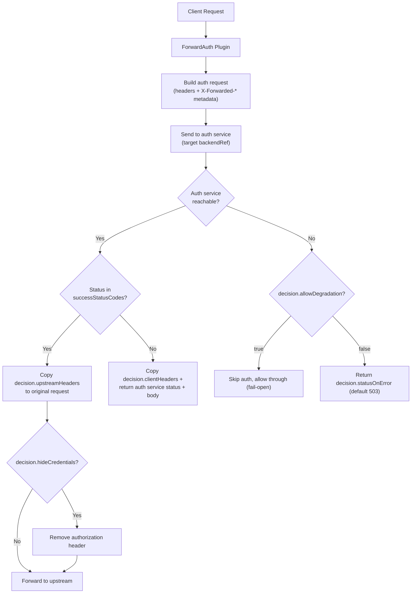

# ForwardAuth Plugin

> **Edgion extension**
>
> ForwardAuth is an external authentication plugin provided by the `EdgionPlugins` CRD, not part of the standard Gateway API.

## Overview

The ForwardAuth plugin delegates authentication to an external service. For each incoming request it builds an outbound auth request (forwarding headers and injecting `X-Forwarded-*` metadata) and sends it to the configured backend. If the auth service responds with a success status code (2xx by default, or the codes listed in `successStatusCodes`), the original request is forwarded to upstream. Otherwise the auth service response is returned to the client.

This is the classic external auth pattern, comparable to:
- **Traefik**: `forwardAuth` middleware
- **nginx**: `auth_request` module
- **APISIX**: `forward-auth` plugin
- **Kong**: `forward-auth` plugin

## Features

- **External authentication delegation** — authentication logic lives entirely in an external service; the gateway needs no knowledge of auth details
- **Header forwarding** — forward all non-hop-by-hop headers by default (`forwardAll: true`), or select a specific subset
- **Bidirectional header passing** — on success, copy identity headers to the upstream request; on failure, copy error headers to the client response
- **Secret injection** — inject Kubernetes Secret values as custom request headers via `${secretRef:ns/name:key}` templates
- **Graceful degradation** — when the auth service is unreachable, allow requests through (fail-open) or return a custom error status (fail-close)
- **Custom success status codes** — not limited to 2xx; configure exactly which status codes count as auth success
- **SSRF protection** — target is a Kubernetes Service `backendRef`; resolved pod IPs are validated by `validate_endpoint_backend_addr` before dialing
- **Brute-force mitigation** — optional `authFailureDelayMs` delay on auth failure responses
- **Hot reload** — configuration changes take effect immediately without a gateway restart

## Core Flow



## Configuration

### Full Configuration Example

```yaml
apiVersion: edgion.io/v1
kind: EdgionPlugins
metadata: { name: forward-auth-basic, namespace: edgion-default }
spec:
  requestPlugins:
    - enable: true
      type: ForwardAuth
      config:
        target: { name: auth-svc, namespace: edgion-default, port: 30040 }
        timeoutMs: 5000                    # connection-level, default 5000
        successStatusCodes: [200, 204]     # connection-level, default: any 2xx
        tls: { verify: true }              # connection-level, optional
        request:
          path:   { template: "/verify" }
          method: { template: "GET" }
          headers:
            forwardAll: true               # default for forward_auth
            origin:
              - { name: Authorization, presence: skipIfMissing }
            custom:
              - { name: X-Source, value: edgion }
        decision:
          upstreamHeaders: [X-User-ID, X-User-Role]
          clientHeaders:   [WWW-Authenticate]
          allowDegradation: false
          statusOnError:    503
          hideCredentials:  true
          authFailureDelayMs: 0
```

### Field Reference

#### Connection-level fields (top-level)

| Field | Type | Default | Description |
|-------|------|---------|-------------|
| `target` | object | required | Kubernetes Service backend: `{name, namespace, port}`. Port is required. Namespace defaults to the plugin namespace. |
| `timeoutMs` | integer | `5000` | Request timeout in milliseconds. |
| `successStatusCodes` | array\<integer\> | `null` | Status codes treated as auth success. Default: any 2xx (200–299). |
| `tls` | object | `null` | TLS settings for the outbound auth request. Fields: `verify` (default `true`; `false` is honored, operator responsibility); `validation.caCertificateRefs` (list of `{kind, name, namespace}` refs — Secret or ConfigMap — each holding a `ca.crt` key); `validation.wellKnownCACertificates: System` (built-in webpki roots); `clientCertificateRef` (Secret with `tls.crt`/`tls.key` for client mTLS). Inline CA is no longer supported; use a Secret or ConfigMap with a `ca.crt` key. Phase 1 note: `validation.hostname` and `validation.subjectAltNames` (SAN pinning) are schema-exposed but not enforced; configuring them causes `Accepted=False`. |
| `retry` | object | `null` | Retry configuration: `maxRetries`, `retryDelayMs`, `retryOnTimeout`, `retryOnConnectError`, `retryOnStatus`. |
| `rateLimit` | object | `null` | Outbound call rate limit: `rate` (calls per window) + `windowSec`. |
| `healthCheck` | object | `null` | Health check: `active` (probe path + interval) and/or `passive` (failure threshold). |

#### `request` — outbound request spec

| Field | Type | Default | Description |
|-------|------|---------|-------------|
| `request.path` | object | `null` | Override the auth request path. `{ template: "/verify" }`. Omit to reuse the incoming path. |
| `request.method` | object | `null` | Override the HTTP method. `{ template: "GET" }`. Omit to reuse the incoming method. |
| `request.headers.forwardAll` | boolean | **`true`** | Forward all non-hop-by-hop headers from the original request. This is the forward_auth default. |
| `request.headers.origin` | array | `[]` | Specific headers forwarded from the original request. Each entry: `{ name, presence }`. Presence policy: `skipIfMissing` (default), `required`, `warnIfMissing`. |
| `request.headers.custom` | array | `[]` | Headers injected from config or resolved secrets. Each entry: `{ name, value: "..." }` for a literal, or `{ name, template: "..." }` for a template (may contain `${secretRef:ns/name:key}`). |

#### `decision` — post-auth behavior

| Field | Type | Default | Description |
|-------|------|---------|-------------|
| `decision.upstreamHeaders` | array\<string\> | `[]` | Headers copied from the auth response to the upstream request on success. Example: `[X-User-ID, X-User-Role]`. |
| `decision.clientHeaders` | array\<string\> | `[]` | Headers copied from the auth response to the client response on auth failure. Example: `[WWW-Authenticate]`. |
| `decision.allowDegradation` | boolean | `false` | Fail-open: when `true`, requests pass through if the auth service is unreachable. |
| `decision.statusOnError` | integer | `503` | Status code returned when the auth service is unreachable and `allowDegradation` is `false`. Range: 200–599. |
| `decision.hideCredentials` | boolean | `false` | Remove the `authorization` header from the upstream request after successful auth. |
| `decision.authFailureDelayMs` | integer | `0` | Delay in milliseconds before sending an auth failure response. Increases the cost of brute-force attacks. |

### `request.headers.forwardAll` Default Semantics

`ForwardAuthConfig` defaults to `request.headers.forwardAll: true`. The auth service therefore receives **all** non-hop-by-hop headers from the original request (including `Authorization`, `Cookie`, custom headers, etc.), unchanged. This preserves the classic "transparent passthrough" behavior expected by most auth services and matches Traefik / Envoy defaults.

To use selective forwarding instead, explicitly set `forwardAll: false` and enumerate the headers you need in `request.headers.origin`.

### Automatically Injected X-Forwarded-* Headers

Regardless of the `forwardAll` setting, the plugin always injects the following metadata headers into the auth request:

| Header | Description | Example |
|--------|-------------|---------|
| `X-Forwarded-Host` | Original request Host | `api.example.com` |
| `X-Forwarded-Uri` | Original request URI path | `/api/v1/users` |
| `X-Forwarded-Method` | Original request HTTP method | `POST` |
| `X-Forwarded-Query` | Original request query string | `page=1&size=20` |

### Hop-by-Hop Header Filtering

When `forwardAll: true`, the following RFC 2616/7230 hop-by-hop headers are automatically excluded:

`connection`, `keep-alive`, `proxy-authenticate`, `proxy-authorization`,
`te`, `trailers`, `transfer-encoding`, `upgrade`

### Secret Injection

To inject a Kubernetes Secret value as a custom header, use the `template` source with a `${secretRef:namespace/name:key}` variable:

```yaml
request:
  headers:
    custom:
      - name: X-Api-Key
        template: "${secretRef:edgion-default/auth-credentials:apiKey}"
```

The controller resolves the secret reference at config sync time and ships the value to the gateway over conf_sync. The value appears as `[redacted]` in admin API output.

The secret namespace and name follow the pattern `namespace/secretName` (e.g. `edgion-default/auth-credentials`). The key is the key within the Secret's `data` map.

### Fail-Open vs Fail-Close

When the auth service is unreachable (connection refused, timeout, rate-limited, health check failed):

| `decision.allowDegradation` | Behavior |
|-----------------------------|----------|
| `false` (default) | Return `decision.statusOnError` (default 503) to the client — **fail-close** |
| `true` | Skip auth and forward the request to upstream — **fail-open** |

For security-critical APIs, keep `allowDegradation: false`. Use `allowDegradation: true` only when authentication is not on the critical security path (for example, analytics or low-sensitivity APIs where availability takes priority).

### SSRF Protection

`target` is a Kubernetes Service `backendRef` (name, namespace, port) — not a free-form URI. At runtime the gateway resolves the Service to pod endpoints via EndpointSlice and runs `validate_endpoint_backend_addr` on each resolved IP before dialing. This guard rejects loopback (`127.x.x.x`) and link-local (`169.254.x.x`) addresses. The same protection is used by `request_mirror` backends.

Cluster-local DNS names (e.g. `auth-svc.edgion-default.svc.cluster.local`) cannot be classified as loopback or link-local at config time, so they bypass the IP-layer guard — the appropriate defense for those paths is Kubernetes NetworkPolicy.

## Usage Examples

### Example 1: Basic — Forward All Headers

```yaml
apiVersion: edgion.io/v1
kind: EdgionPlugins
metadata:
  name: forward-auth-basic
  namespace: production
spec:
  requestPlugins:
    - type: ForwardAuth
      config:
        target:
          name: auth-service
          namespace: production
          port: 8080
        request:
          path: { template: "/verify" }
        decision:
          upstreamHeaders:
            - X-User-ID
            - X-User-Role
            - X-User-Email
```

All original request headers are forwarded to the auth service (hop-by-hop headers excluded). On auth success, `X-User-ID`, `X-User-Role`, and `X-User-Email` are copied from the auth response to the upstream request.

### Example 2: Selective Header Forwarding

```yaml
apiVersion: edgion.io/v1
kind: EdgionPlugins
metadata:
  name: forward-auth-selective
  namespace: production
spec:
  requestPlugins:
    - type: ForwardAuth
      config:
        target:
          name: auth-service
          namespace: production
          port: 8443
        tls:
          verify: true
        timeoutMs: 5000
        successStatusCodes: [200, 204]
        request:
          path: { template: "/verify" }
          method: { template: "POST" }
          headers:
            forwardAll: false
            origin:
              - { name: Authorization, presence: skipIfMissing }
              - { name: Cookie, presence: skipIfMissing }
              - { name: X-Request-ID, presence: skipIfMissing }
        decision:
          upstreamHeaders: [X-User-ID, X-User-Role]
          clientHeaders:   [WWW-Authenticate, X-Auth-Error-Code]
```

Only `Authorization`, `Cookie`, and `X-Request-ID` are forwarded to the auth service. Uses POST with a 5-second timeout. Status codes 200 and 204 are treated as success. On failure, `WWW-Authenticate` and `X-Auth-Error-Code` are returned to the client.

### Example 3: Secret Injection

```yaml
apiVersion: edgion.io/v1
kind: EdgionPlugins
metadata:
  name: forward-auth-with-secret
  namespace: production
spec:
  requestPlugins:
    - type: ForwardAuth
      config:
        target:
          name: auth-service
          namespace: production
          port: 8080
        request:
          path: { template: "/verify" }
          headers:
            custom:
              - name: X-Gateway-Token
                template: "${secretRef:production/gateway-token:token}"
        decision:
          upstreamHeaders: [X-User-ID]
```

Injects a Kubernetes Secret value as the `X-Gateway-Token` header on every auth request. Create the secret: `kubectl create secret generic gateway-token -n production --from-literal=token=<value>`.

### Example 4: Graceful Degradation

```yaml
apiVersion: edgion.io/v1
kind: EdgionPlugins
metadata:
  name: forward-auth-degraded
  namespace: production
spec:
  requestPlugins:
    - type: ForwardAuth
      config:
        target:
          name: auth-service
          namespace: production
          port: 8080
        decision:
          allowDegradation: true
          statusOnError: 503
          upstreamHeaders: [X-User-ID]
```

When the auth service is unavailable (network errors, timeouts), the request passes through without authentication. Suitable for scenarios where the auth service is not on the critical security path and availability takes priority over strict auth enforcement.

### Example 5: Custom Error Status Code

```yaml
apiVersion: edgion.io/v1
kind: EdgionPlugins
metadata:
  name: forward-auth-custom-error
  namespace: production
spec:
  requestPlugins:
    - type: ForwardAuth
      config:
        target:
          name: auth-service
          namespace: production
          port: 8080
        decision:
          allowDegradation: false
          statusOnError: 502
          upstreamHeaders: [X-User-ID]
```

Returns 502 instead of the default 503 when the auth service is unreachable.

### Example 6: With HTTPRoute

```yaml
apiVersion: gateway.networking.k8s.io/v1
kind: HTTPRoute
metadata:
  name: api-route
  namespace: production
spec:
  parentRefs:
    - name: edgion-gateway
  hostnames:
    - "api.example.com"
  rules:
    - matches:
        - path:
            type: PathPrefix
            value: /api
      filters:
        - type: ExtensionRef
          extensionRef:
            group: edgion.io
            kind: EdgionPlugins
            name: forward-auth-basic
      backendRefs:
        - name: api-backend
          port: 8080
```

## Comparison with Other Gateways

| Feature | Edgion | Traefik | APISIX | nginx |
|---------|--------|---------|--------|-------|
| Forward all headers | `request.headers.forwardAll: true` | default | only listed headers | subrequest |
| Selective headers | `request.headers.origin` | `authRequestHeaders` | `request_headers` | no |
| Custom injected headers | `request.headers.custom` | no | no | no |
| Secret injection | `${secretRef:ns/name:key}` | no | no | no |
| Upstream header passing | `decision.upstreamHeaders` | `authResponseHeaders` | `upstream_headers` | `auth_request_set` |
| Client header passing | `decision.clientHeaders` | no | `client_headers` | limited |
| Custom success codes | `successStatusCodes` | no (2xx only) | no (2xx only) | no (2xx only) |
| Graceful degradation | `decision.allowDegradation` | no | `allow_degradation` | no |
| Custom error status | `decision.statusOnError` | no | `status_on_error` | no |
| Hide credentials | `decision.hideCredentials` | no | no | no |
| Brute-force delay | `decision.authFailureDelayMs` | no | no | no |
| SSRF protection | backendRef + IP guard | no | no | no |
| Cookie forwarding | via `forwardAll` or `origin` | yes | yes | yes |
| TLS support | yes (`tls` block) | yes | yes | yes |
| Forward body | no | `forwardBody` | no | no |

## Auth Service Development Guide

### Interface Contract

**Request from gateway to auth service:**
- Method: `request.method.template` (default: reuse incoming method)
- Path: `request.path.template`
- Headers: original request headers (or a selected subset) + `X-Forwarded-*` metadata + `request.headers.custom`

**Response from auth service to gateway:**
- **Success** (status in `successStatusCodes`, default 2xx): authentication passed
  - Headers listed in `decision.upstreamHeaders` are copied to the upstream request
  - Response body is ignored
- **Failure** (any other status): authentication denied
  - Status code and body are returned as-is to the client
  - Headers listed in `decision.clientHeaders` are copied to the client response

### Example Auth Service (Go)

```go
func authHandler(w http.ResponseWriter, r *http.Request) {
    token := r.Header.Get("Authorization")

    user, err := validateToken(token)
    if err != nil {
        w.Header().Set("WWW-Authenticate", "Bearer")
        w.WriteHeader(http.StatusUnauthorized)
        json.NewEncoder(w).Encode(map[string]string{
            "error":   "invalid_token",
            "message": err.Error(),
        })
        return
    }

    // Auth passed: return identity headers for upstream
    w.Header().Set("X-User-ID", user.ID)
    w.Header().Set("X-User-Role", user.Role)
    w.Header().Set("X-User-Email", user.Email)
    w.WriteHeader(http.StatusOK)
}
```

## Notes

1. **backendRef target**: the `target` field is a Kubernetes Service reference (`name`/`namespace`/`port`), not a URI. The gateway resolves pod endpoints at call time via EndpointSlice.
2. **SSRF guard**: each resolved pod IP is validated by `validate_endpoint_backend_addr` before dialing. Loopback and link-local IPs are rejected.
3. **No redirect following**: the HTTP client does not follow redirects. A 301/302 from the auth service is treated as an auth failure.
4. **Body not forwarded**: the original request body is not forwarded to the auth service. Most auth scenarios do not need it.
5. **Hot reload**: updating the `EdgionPlugins` resource triggers an automatic hot reload; no gateway restart is required.
6. **forwardAll default**: `request.headers.forwardAll` defaults to `true` for forward_auth (unlike the webhook plugin where it defaults to `false`).

## FAQ

### Q: Should I use forwardAll or selective forwarding?

A:
- **`forwardAll: true`** (default): the auth service can inspect any header. Simple; suitable for internal auth services and scenarios with relaxed security requirements.
- **`forwardAll: false` + `origin` list**: only listed headers are forwarded. Reduces data transferred; suitable for external auth services and scenarios requiring the principle of least privilege.

### Q: How do I forward cookies?

A: With `forwardAll: true` (the default), the `Cookie` header is automatically included. With `forwardAll: false`, add `{ name: Cookie }` to `request.headers.origin`.

### Q: Is the auth service response body returned to the client?

A: On auth **failure**, the auth service body is passed through to the client unchanged (useful for returning error details in JSON). On auth **success**, the body is ignored.

### Q: Can multiple ForwardAuth plugins be chained?

A: Yes. List multiple plugins in `requestPlugins`; they execute in order. Any non-success response short-circuits the chain and terminates the request.

### Q: Is `allowDegradation: true` safe?

A: Not for security-critical APIs. With `allowDegradation: true`, a network partition between the gateway and auth service will allow all requests through without authentication. Use it only when authentication is not a hard security requirement (for example, A/B testing infrastructure or internal analytics APIs).

## Related Documentation

- [BasicAuth Plugin](../http-route/filters/edgion-plugins/basic-auth.md) — basic username/password authentication
- [JwtAuth Plugin](../http-route/filters/edgion-plugins/jwt-auth.md) — JWT token authentication
- [OpenID Connect Plugin](openid-connect.md) — OIDC/OAuth2 authentication
- [HTTPRoute Overview](../http-route/overview.md) — HTTPRoute configuration overview
