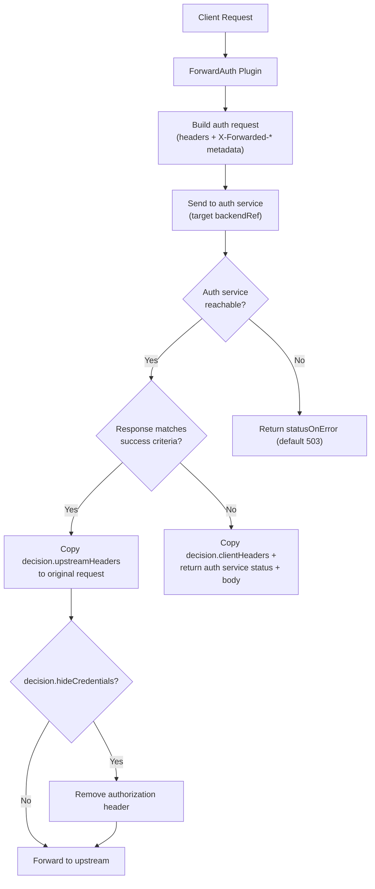

# ForwardAuth Plugin

> **Edgion extension**
>
> ForwardAuth is an external authentication plugin provided by the `EdgionPlugins` CRD, not part of the standard Gateway API.

> ⚠️ **Breaking change: `successStatusCodes` → `success.statusCodes`. Forward auth now always fails closed with `statusOnError`.**
>
> - `successStatusCodes` is no longer a recognized field. `ForwardAuthConfig`'s connection block (`ExternalHttpConnection`) is `#[serde(flatten)]`-ed with no `deny_unknown_fields`, so a YAML that still sets `successStatusCodes` is accepted at admission with **no error and no warning** — the field is silently dropped and success falls back to "any 2xx". For ForwardAuth this means **any 200 response from the auth service is treated as auth success**, even if the operator intended to restrict success to a narrower set of codes or a body condition — a fail-open authentication gap that produces no admission error and no log line. Migrate every ForwardAuth config to the nested `success:` block (see [Field Reference](#connection-level-fields-top-level) below).
> - `allowDegradation` (fail-open mode) and `allowDegradationTemplate` (per-request degradation) have been removed. Forward auth now **always fails closed**: when the auth service is unreachable or times out, the gateway returns `statusOnError` (default 503) to the client. The fail-open behavior is no longer supported; configure your auth service with appropriate redundancy and failover if needed.

## Overview

The ForwardAuth plugin delegates authentication to an external service. For each incoming request it builds an outbound auth request (forwarding headers and injecting `X-Forwarded-*` metadata) and sends it to the configured backend. If the auth service's response matches the connection's `success` criteria (2xx by default, or the criteria configured in `success.statusCodes` / `success.body`), the original request is forwarded to upstream. Otherwise the auth service response is returned to the client.

This is the classic external auth pattern, comparable to:
- **Traefik**: `forwardAuth` middleware
- **nginx**: `auth_request` module
- **APISIX**: `forward-auth` plugin
- **Kong**: `forward-auth` plugin

## Features

- **External authentication delegation** — authentication logic lives entirely in an external service; the gateway needs no knowledge of auth details
- **Header forwarding** — forward all non-hop-by-hop headers by default (`forwardAll: true`), or select a specific subset
- **Bidirectional header passing** — on success, copy identity headers to the upstream request; on failure, copy error headers to the client response
- **Secret injection** — inject Kubernetes Secret values as custom request headers via `${secretRef:ns/name:key}` templates
- **Fail-close on service unavailability** — when the auth service is unreachable, the gateway returns `statusOnError` (default 503) to the client; configure your auth service with appropriate redundancy for high availability
- **Declarative success predicate** — not limited to 2xx status; optionally require specific JSON body fields via `success.body` (for auth services that return `200 OK` with an error payload)
- **Configurable retry backoff** — exponential or fixed backoff, jitter, a `Retry-After`-aware opt-in, and (for ForwardAuth) retrying on timeout by default, since an auth check is idempotent
- **Service or URL target** — `target` is a Kubernetes Service `backendRef` by default, or an external URL (`target.url`); see [Target](#target) below
- **SSRF protection** — a Service target's resolved pod IPs are validated by `validate_endpoint_backend_addr` before dialing; a URL target has its own egress guard (see [Target](#target))
- **Brute-force mitigation** — optional `authFailureDelayMs` delay on auth failure responses
- **Hot reload** — configuration changes take effect immediately without a gateway restart

## Core Flow



## Configuration

### Full Configuration Example

```yaml
apiVersion: edgion.io/v1
kind: EdgionPlugins
metadata: { name: forward-auth-basic, namespace: edgion-default }
spec:
  requestPlugins:
    - enable: true
      type: ForwardAuth
      config:
        target: { name: auth-svc, namespace: edgion-default, port: 30040 }
        timeoutMs: 5000                    # connection-level, default 5000
        success:
          statusCodes: [200, 204]          # connection-level, default: any 2xx
        statusOnError:    503              # connection-level, returned when auth service unavailable (default 503)
        tls: { verify: true }              # connection-level, optional
        request:
          path:   { template: "/verify" }
          method: { template: "GET" }
          headers:
            forwardAll: true               # default for forward_auth
            origin:
              - { name: Authorization, presence: skipIfMissing }
            custom:
              - { name: X-Source, value: edgion }
        decision:
          upstreamHeaders: [X-User-ID, X-User-Role]
          clientHeaders:   [WWW-Authenticate]
          hideCredentials:  true
          authFailureDelayMs: 0
```

### Field Reference

#### Connection-level fields (top-level)

| Field | Type | Default | Description |
|-------|------|---------|-------------|
| `target` | object | required | Either a Kubernetes Service backend `{name, namespace, port}` (port required; namespace defaults to the plugin namespace), or an external URL target `{url, blockPrivate}`. The two forms are mutually exclusive. See [Target](#target). |
| `timeoutMs` | integer | `5000` | Request timeout in milliseconds. |
| `forwardBody` | boolean | `false` | Forward the exact buffered incoming request body to the auth service. Mutually exclusive with `request.body`. When enabled, the gateway removes `Transfer-Encoding` and sets the outbound `Content-Length` to the buffered size. |
| `timeoutMsTemplate` | string | `null` | Template rendering a per-request timeout, e.g. `"${ctx:desired_timeout_ms}"`. **Only `${ctx:...}`, `${clientIp}`, and matched-route variables are accepted** — a client-controlled source (`header`/`query`/`cookie`/`path`/`method`/`uri`) is rejected at admission, because it would let an attacker pin the auth-service deadline low enough to force every call to time out. A non-numeric, empty, or below-floor (< 50 ms) render falls back to `timeoutMs`; the rendered value is clamped to 60000 ms regardless. Compiled and validated at admission. |
| `success` | object | `null` | Success criteria: `statusCodes` (array, omitted or present-but-non-empty → any 2xx; an explicit empty list is rejected at admission) plus optional `body` predicates (`pointer` + **exactly one** of `equals`/`notEquals`/`exists`/`in`, enforced at admission). ANDed. **Replaces the removed `successStatusCodes`** — see the breaking-change note above and [Ops guide → Connectors → Success](../../ops-guide/infrastructure/connectors.md#success) for the full schema, strict-typing rule, missing-pointer semantics, and the `maxResponseBytes >= 4096` requirement when `body` is set. |
| `statusOnError` | integer | `503` | Status code returned when the auth service is unreachable (connection failure, timeout, service down). Range: 200–599. Always fail-close; there is no fail-open mode. |
| `tls` | object | `null` | TLS settings for the outbound auth request. Fields: `verify` (default `true`; `false` is honored, operator responsibility); `validation.caCertificateRefs` (list of `{kind, name, namespace}` refs — Secret or ConfigMap — each holding a `ca.crt` key); `validation.wellKnownCACertificates: System` (built-in webpki roots); `clientCertificateRef` (Secret with `tls.crt`/`tls.key` for client mTLS). Inline CA is no longer supported; use a Secret or ConfigMap with a `ca.crt` key. Phase 1 note: `validation.hostname` and `validation.subjectAltNames` (SAN pinning) are schema-exposed but not enforced; configuring them causes `Accepted=False`. |
| `retry` | object | `null` | Retry configuration: `maxRetries`, `retryDelayMs` (base delay of the backoff curve, not a fixed interval), `backoffPolicy` (`exponential` default \| `fixed`), `maxDelayMs` (default 1000, ceiling 10000), `jitter` (default `true`), `honorRetryAfter` (default `false`), `retryOnTimeout` (**per-consumer default: ForwardAuth `true`**, since an auth check is idempotent), `retryOnConnectError` (default `true`), `retryOnStatus` (default `[]`), `retryOnBodyFailure` (default `false`). Full schema: [Ops guide → Connectors → Retry](../../ops-guide/infrastructure/connectors.md#retry). |
| `rateLimit` | object | `null` | Outbound call rate limit: `rate` (calls per window) + `windowSec`. |
| `healthCheck` | object | `null` | Health check: `active` (probe path + interval) and/or `passive` (failure threshold). |

#### `request` — outbound request spec

| Field | Type | Default | Description |
|-------|------|---------|-------------|
| `request.path` | object | `null` | Override the auth request path. `{ template: "/verify" }`. Omit to reuse the incoming path. |
| `request.method` | object | `null` | Override the HTTP method. `{ template: "GET" }`. Omit to reuse the incoming method. |
| `request.headers.forwardAll` | boolean | **`true`** | Forward all non-hop-by-hop, non-framing headers from the original request. This is the forward_auth default. |
| `request.headers.origin` | array | `[]` | Specific headers forwarded from the original request. Each entry: `{ name, presence }`. Presence policy: `skipIfMissing` (default), `required`, `warnIfMissing`. `Content-Length` and `Transfer-Encoding` are rejected because the proxy owns outbound framing. |
| `request.headers.custom` | array | `[]` | Headers injected from config or resolved secrets. Each entry: `{ name, value: "..." }` for a literal, or `{ name, template: "..." }` for a template (may contain `${secretRef:ns/name:key}`). `Content-Length` and `Transfer-Encoding` are rejected because the proxy owns outbound framing. |

#### `decision` — post-auth behavior

`decision` holds only the following fields:

| Field | Type | Default | Description |
|-------|------|---------|-------------|
| `decision.upstreamHeaders` | array\<string\> | `[]` | Headers copied from the auth response to the upstream request on success. Example: `[X-User-ID, X-User-Role]`. |
| `decision.clientHeaders` | array\<string\> | `[]` | Headers copied from the auth response to the client response on auth failure. Example: `[WWW-Authenticate]`. |
| `decision.hideCredentials` | boolean | `false` | Remove the `authorization` header from the upstream request after successful auth. |
| `decision.authFailureDelayMs` | integer | `0` | Delay in milliseconds before sending an auth failure response. Increases the cost of brute-force attacks. |

### `request.headers.forwardAll` Default Semantics

`ForwardAuthConfig` defaults to `request.headers.forwardAll: true`. The auth service therefore receives **all** non-hop-by-hop, non-framing headers from the original request (including `Authorization`, `Cookie`, custom headers, etc.). This preserves the classic "transparent passthrough" behavior expected by most auth services and matches Traefik / Envoy defaults.

To use selective forwarding instead, explicitly set `forwardAll: false` and enumerate the headers you need in `request.headers.origin`.

### Automatically Injected X-Forwarded-* Headers

Regardless of the `forwardAll` setting, the plugin always injects the following metadata headers into the auth request:

| Header | Description | Example |
|--------|-------------|---------|
| `X-Forwarded-Host` | Original request Host | `api.example.com` |
| `X-Forwarded-Uri` | Original request URI path | `/api/v1/users` |
| `X-Forwarded-Method` | Original request HTTP method | `POST` |
| `X-Forwarded-Query` | Original request query string | `page=1&size=20` |

### Hop-by-Hop Header Filtering

When `forwardAll: true`, the following RFC 2616/7230 hop-by-hop headers are automatically excluded:

`connection`, `keep-alive`, `proxy-authenticate`, `proxy-authorization`,
`te`, `trailers`, `transfer-encoding`, `upgrade`

`Content-Length` and `Transfer-Encoding` describe one HTTP message, so they are never inherited
from the client request or accepted in `origin`/`custom`. The gateway derives framing from the
actual auth-request body: a bodyless request declares neither header, while a buffered configured
or forwarded body receives its exact `Content-Length`.

`Expect` is likewise withheld under `forwardAll`. It is not hop-by-hop, but it states an
expectation about the client's request, which the gateway settles itself when it buffers the
body. Relaying it onto an auth request that sends no body of its own asks the auth service to
wait for content that never arrives; a service that enforces the expectation replies
`417 Expectation Failed`, which ForwardAuth treats as a denied request. Unlike the framing
headers, naming `Expect` explicitly in `origin` is still allowed and forwards it.

Avoid combining that explicit listing with `presence: required` when `forwardBody: true`:
buffering the body consumes the expectation and removes the header, so the required lookup
finds nothing and the auth call fails closed with `statusOnError`.

### Secret Injection

To inject a Kubernetes Secret value as a custom header, use the `template` source with a `${secretRef:namespace/name:key}` variable:

```yaml
request:
  headers:
    custom:
      - name: X-Api-Key
        template: "${secretRef:edgion-default/auth-credentials:apiKey}"
```

The controller resolves the secret reference at config sync time and ships the value to the gateway over conf_sync. The value appears as `[redacted]` in admin API output.

The secret namespace and name follow the pattern `namespace/secretName` (e.g. `edgion-default/auth-credentials`). The key is the key within the Secret's `data` map.

### Target

`target` addresses the auth service in one of two mutually exclusive forms:

- **Kubernetes Service** (`{name, namespace, port}`, the default form shown above) — at runtime the
  gateway resolves the Service to pod endpoints via EndpointSlice and runs
  `validate_endpoint_backend_addr` on each resolved IP before dialing. This guard rejects loopback
  (`127.x.x.x`) and link-local (`169.254.x.x`) addresses. The same protection is used by
  `request_mirror` backends. Cluster-local DNS names (e.g. `auth-svc.edgion-default.svc.cluster.local`)
  cannot be classified as loopback or link-local at dial time, so they bypass this IP-layer guard —
  the appropriate defense for those names is Kubernetes NetworkPolicy.
- **External URL** (`{url, blockPrivate}`) — lets ForwardAuth call an auth service outside the
  cluster. `target` is shared with the LinkSys Webhook connector's target field
  (`ExternalHttpConnection.target`), so the origin-only rule, the mutual exclusion with the Service
  fields, the `http://` + `tls.enabled` rejection, the dedicated connection pool, and the
  `blockPrivate` / gateway-wide egress-policy guard are all documented once, in
  [Connectors (LinkSys) → Webhook connector → URL target](../../ops-guide/infrastructure/connectors.md#url-target-external-services)
  and [→ Egress policy (SSRF protection)](../../ops-guide/infrastructure/connectors.md#egress-policy-ssrf-protection).
  Everything there applies to ForwardAuth unchanged.

```yaml
config:
  target:
    url: https://auth.example.com
    blockPrivate: true
  request:
    path: { template: "/verify" }
```

## Usage Examples

### Example 1: Basic — Forward All Headers

```yaml
apiVersion: edgion.io/v1
kind: EdgionPlugins
metadata:
  name: forward-auth-basic
  namespace: production
spec:
  requestPlugins:
    - type: ForwardAuth
      config:
        target:
          name: auth-service
          namespace: production
          port: 8080
        request:
          path: { template: "/verify" }
        decision:
          upstreamHeaders:
            - X-User-ID
            - X-User-Role
            - X-User-Email
```

All original request headers are forwarded to the auth service (hop-by-hop headers excluded). On auth success, `X-User-ID`, `X-User-Role`, and `X-User-Email` are copied from the auth response to the upstream request.

### Example 2: Selective Header Forwarding

```yaml
apiVersion: edgion.io/v1
kind: EdgionPlugins
metadata:
  name: forward-auth-selective
  namespace: production
spec:
  requestPlugins:
    - type: ForwardAuth
      config:
        target:
          name: auth-service
          namespace: production
          port: 8443
        tls:
          verify: true
        timeoutMs: 5000
        success:
          statusCodes: [200, 204]
        request:
          path: { template: "/verify" }
          method: { template: "POST" }
          headers:
            forwardAll: false
            origin:
              - { name: Authorization, presence: skipIfMissing }
              - { name: Cookie, presence: skipIfMissing }
              - { name: X-Request-ID, presence: skipIfMissing }
        decision:
          upstreamHeaders: [X-User-ID, X-User-Role]
          clientHeaders:   [WWW-Authenticate, X-Auth-Error-Code]
```

Only `Authorization`, `Cookie`, and `X-Request-ID` are forwarded to the auth service. Uses POST with a 5-second timeout. Status codes 200 and 204 are treated as success. On failure, `WWW-Authenticate` and `X-Auth-Error-Code` are returned to the client.

### Example 3: Secret Injection

```yaml
apiVersion: edgion.io/v1
kind: EdgionPlugins
metadata:
  name: forward-auth-with-secret
  namespace: production
spec:
  requestPlugins:
    - type: ForwardAuth
      config:
        target:
          name: auth-service
          namespace: production
          port: 8080
        request:
          path: { template: "/verify" }
          headers:
            custom:
              - name: X-Gateway-Token
                template: "${secretRef:production/gateway-token:token}"
        decision:
          upstreamHeaders: [X-User-ID]
```

Injects a Kubernetes Secret value as the `X-Gateway-Token` header on every auth request. Create the secret: `kubectl create secret generic gateway-token -n production --from-literal=token=<value>`.

### Example 4: With HTTPRoute

```yaml
apiVersion: gateway.networking.k8s.io/v1
kind: HTTPRoute
metadata:
  name: api-route
  namespace: production
spec:
  parentRefs:
    - name: edgion-gateway
  hostnames:
    - "api.example.com"
  rules:
    - matches:
        - path:
            type: PathPrefix
            value: /api
      filters:
        - type: ExtensionRef
          extensionRef:
            group: edgion.io
            kind: EdgionPlugins
            name: forward-auth-basic
      backendRefs:
        - name: api-backend
          port: 8080
```

## Comparison with Other Gateways

| Feature | Edgion | Traefik | APISIX | nginx |
|---------|--------|---------|--------|-------|
| Forward all headers | `request.headers.forwardAll: true` | default | only listed headers | subrequest |
| Selective headers | `request.headers.origin` | `authRequestHeaders` | `request_headers` | no |
| Custom injected headers | `request.headers.custom` | no | no | no |
| Secret injection | `${secretRef:ns/name:key}` | no | no | no |
| Upstream header passing | `decision.upstreamHeaders` | `authResponseHeaders` | `upstream_headers` | `auth_request_set` |
| Client header passing | `decision.clientHeaders` | no | `client_headers` | limited |
| Custom success codes / body predicate | `success.statusCodes` / `success.body` | no (2xx only) | no (2xx only) | no (2xx only) |
| Error status on auth service unavailable | `statusOnError` (always fail-close) | no | `status_on_error` | no |
| Hide credentials | `decision.hideCredentials` | no | no | no |
| Brute-force delay | `decision.authFailureDelayMs` | no | no | no |
| SSRF protection | Service backendRef IP guard, or URL target egress guard (`blockPrivate`) | no | no | no |
| Cookie forwarding | via `forwardAll` or `origin` | yes | yes | yes |
| TLS support | yes (`tls` block) | yes | yes | yes |
| Forward body | `forwardBody` | `forwardBody` | no | no |

## Auth Service Development Guide

### Interface Contract

**Request from gateway to auth service:**
- Method: `request.method.template` (default: reuse incoming method)
- Path: `request.path.template`
- Headers: original request headers (or a selected subset) + `X-Forwarded-*` metadata + `request.headers.custom`
- Body: empty by default; the exact buffered incoming body when `forwardBody: true`

**Response from auth service to gateway:**
- **Success** (matches `success` criteria — status in `success.statusCodes`, default any 2xx, ANDed with any `success.body` predicates): authentication passed
  - Headers listed in `decision.upstreamHeaders` are copied to the upstream request
  - Response body is ignored
- **Failure** (any other status): authentication denied
  - Status code and body are returned as-is to the client
  - Headers listed in `decision.clientHeaders` are copied to the client response

### Example Auth Service (Go)

```go
func authHandler(w http.ResponseWriter, r *http.Request) {
    token := r.Header.Get("Authorization")

    user, err := validateToken(token)
    if err != nil {
        w.Header().Set("WWW-Authenticate", "Bearer")
        w.WriteHeader(http.StatusUnauthorized)
        json.NewEncoder(w).Encode(map[string]string{
            "error":   "invalid_token",
            "message": err.Error(),
        })
        return
    }

    // Auth passed: return identity headers for upstream
    w.Header().Set("X-User-ID", user.ID)
    w.Header().Set("X-User-Role", user.Role)
    w.Header().Set("X-User-Email", user.Email)
    w.WriteHeader(http.StatusOK)
}
```

## Notes

1. **Two target forms**: `target` is either a Kubernetes Service reference (`name`/`namespace`/`port`) or an external URL (`url`/`blockPrivate`); see [Target](#target). The gateway resolves pod endpoints at call time via EndpointSlice for a Service target.
2. **SSRF guard**: a Service target's resolved pod IPs are validated by `validate_endpoint_backend_addr` before dialing (loopback and link-local rejected). A URL target has its own guard, documented in [Connectors (LinkSys) → Egress policy](../../ops-guide/infrastructure/connectors.md#egress-policy-ssrf-protection).
3. **No redirect following**: the HTTP client does not follow redirects. A 301/302 from the auth service is treated as an auth failure.
4. **Optional body forwarding**: the original request body is omitted by default. Set `forwardBody: true` only when the auth decision requires it; this activates request buffering and its gateway-wide size limit.
5. **Hot reload**: updating the `EdgionPlugins` resource triggers an automatic hot reload; no gateway restart is required.
6. **forwardAll default**: `request.headers.forwardAll` defaults to `true` for forward_auth (unlike the webhook plugin where it defaults to `false`).

## FAQ

### Q: Should I use forwardAll or selective forwarding?

A:
- **`forwardAll: true`** (default): the auth service can inspect any header. Simple; suitable for internal auth services and scenarios with relaxed security requirements.
- **`forwardAll: false` + `origin` list**: only listed headers are forwarded. Reduces data transferred; suitable for external auth services and scenarios requiring the principle of least privilege.

### Q: How do I forward cookies?

A: With `forwardAll: true` (the default), the `Cookie` header is automatically included. With `forwardAll: false`, add `{ name: Cookie }` to `request.headers.origin`.

### Q: Is the auth service response body returned to the client?

A: On auth **failure**, the auth service body is passed through to the client unchanged (useful for returning error details in JSON). On auth **success**, the body is ignored.

### Q: Can multiple ForwardAuth plugins be chained?

A: Yes. List multiple plugins in `requestPlugins`; they execute in order. Any non-success response short-circuits the chain and terminates the request.

## Related Documentation

- [BasicAuth Plugin](../http-route/filters/edgion-plugins/basic-auth.md) — basic username/password authentication
- [JwtAuth Plugin](../http-route/filters/edgion-plugins/jwt-auth.md) — JWT token authentication
- [OpenID Connect Plugin](openid-connect.md) — OIDC/OAuth2 authentication
- [HTTPRoute Overview](../http-route/overview.md) — HTTPRoute configuration overview
