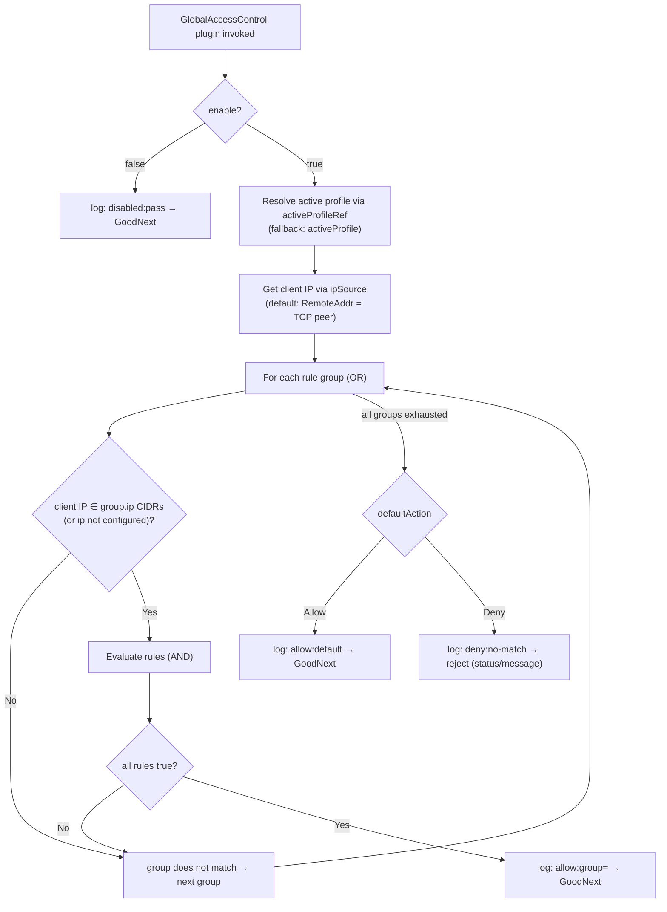

# Global Access Control Plugin

> **Edgion extension**
>
> GlobalAccessControl is a request-phase allow-list plugin provided by the `EdgionPlugins` CRD and is not part of the standard Gateway API.

## Overview

The `GlobalAccessControl` plugin enforces composite allow-list rules at the HTTP request phase. A request is admitted only when it satisfies **at least one** configured rule group; each group requires **all** of its conditions (IP CIDR AND request-attribute rules) to hold simultaneously.

Primary use case: **CDN/origin lockdown** — an origin server accepts only traffic that genuinely comes from a known CDN's IP range AND carries a CDN-injected secret header or cookie. Multiple CDNs can be configured as separate rule groups (OR'd together); requests that do not match any group are denied.

Unlike `IpRestriction` (IP-only, no profiles) or `RequestRestriction` (request attributes only, no CIDR, no profiles), this plugin combines:
- IP/CIDR matching (radix-tree, O(log n))
- Request-attribute matching (header, cookie, query, path, method) including **SecretRef** for secret values stored in K8s Secrets
- Profile hot-swap via a `Selector` `EdgionConfigData` reference
- Configurable fail-safe defaults

## Decision model

```
For each rule group (OR across groups):
    group matches ⟺ (no ip configured OR client_ip ∈ CIDR)
                   AND all rules evaluate to true

If any group matches → ALLOW (return GoodNext)
If no group matches → apply profile's defaultAction:
    Allow → ALLOW
    Deny  → reject with configured status/message
```

Rules within a group use AND semantics; groups use OR semantics (disjunctive normal form).

## Three attach methods

GlobalAccessControl (and any `EdgionPlugins`) can be attached at three scopes, executed in order from widest to narrowest:

| Scope | Mechanism | Applies to |
|-------|-----------|------------|
| **GatewayClass-wide** | `EdgionGatewayConfig.spec.globalPluginsRef` | All HTTP routes under that GatewayClass |
| **Gateway-wide** | Gateway annotation `edgion.io/edgion-plugins: "ns/name, ..."` | All HTTP routes under that Gateway |
| **HTTPRoute-level** | `HTTPRoute` filter `ExtensionRef` | Only the matched routes |

All three layers execute in order; any layer can terminate the request.

## Configuration parameters

### GlobalAccessControlConfig (top-level)

| Parameter | Type | Default | Description |
|-----------|------|---------|-------------|
| `enable` | Boolean | `true` | Kill-switch. `false` disables the plugin entirely (pass-through); access log records `disabled:pass`. |
| `activeProfile` | String | **Required** | Name of the baseline/default profile. Must exist in `profiles`. |
| `profiles` | Map\<String, AllowProfile\> | **Required** | Named profiles. Supports hot-swap via `activeProfileRef`. |
| `activeProfileRef` | EdgionConfigDataRef | none | Reference to a `Selector` `EdgionConfigData` that overrides which profile is active. Overrides `activeProfile` at runtime. On any error, falls back to `activeProfile` and logs `selector miss: base`. |
| `status` | Integer | `403` | HTTP status code returned on denial. |
| `message` | String | none | Optional response body on denial. |
| `ipSource` | Enum | `RemoteAddr` | IP source for CIDR matching. `RemoteAddr` = TCP peer (un-forgeable). `ClientIp` = RealIp/XFF-derived (see Security notes). |

### AllowProfile

| Parameter | Type | Default | Description |
|-----------|------|---------|-------------|
| `defaultAction` | Enum | `Deny` | Action when no rule group matches. `Allow` = pass through (open baseline); `Deny` = reject with `status`/`message` (lockdown). |
| `ruleGroups` | Array\<AllowRuleGroup\> | `[]` | Rule groups combined with OR. Empty list means no group can match; outcome is always `defaultAction`. |

### AllowRuleGroup

| Parameter | Type | Default | Description |
|-----------|------|---------|-------------|
| `name` | String | none | Group name, recorded in the access log on match (`allow:group=<name>`). |
| `ip` | Array\<IpGroup\> | none | Optional IP CIDR pre-condition. If omitted, any source IP satisfies this condition. A group matches only when the client IP is within **at least one** listed group's CIDRs. |
| `rules` | Array\<RestrictionRule\> | `[]` | Request-attribute predicates combined with AND. |

### IpGroup

| Parameter | Type | Description |
|-----------|------|-------------|
| `name` | String | Group name (for readability). |
| `cidrs` | Array\<String\> | CIDR blocks in standard notation, e.g. `"173.245.48.0/20"`. |

### RestrictionRule (predicate)

| Parameter | Type | Default | Description |
|-----------|------|---------|-------------|
| `source` | Enum | **Required** | Value source: `Header` / `Cookie` / `Query` / `Path` / `RequestPath` / `Method` / `Referer` |
| `key` | String | none | Key name. Required for `Header`, `Cookie`, `Query`; ignored for the others. |
| `values` | Array\<String\> | none | Exact-match values. Predicate is true if the extracted value appears in this list. |
| `regex` | Array\<String\> | none | Regex patterns. Predicate is true if the value matches (patterns merged with `\|`). |
| `secretRef` | SecretObjectReference | none | K8s Secret reference. All string values in the Secret become accepted tokens (union). Used for CDN secret headers. |
| `caseSensitive` | Boolean | `true` | Whether exact matching (`values`) is case-sensitive. |
| `onMissing` | Enum | `NoMatch` | Predicate result when the source value is absent. `Match` / `NoMatch` / `Skip`. **A `secretRef` rule forces `onMissing: NoMatch` at validation** (see Security notes). |

> **Value matching**: `values`, `regex`, and `secretRef`-resolved values are evaluated as a **union** — the predicate is true if any of the three sources matches.

> **`secretRef` note**: the referenced Secret must contain only credential string values. ALL values in the Secret become accepted tokens (to support key rotation). Secret values are matched **raw, exact, case-sensitive, without trimming** — a trailing newline will never match.

### EdgionConfigDataRef (for activeProfileRef)

| Parameter | Type | Description |
|-----------|------|-------------|
| `name` | String | Name of the `EdgionConfigData` resource (`type: Selector`). |
| `namespace` | String | Namespace. Defaults to the `EdgionPlugins` namespace. |

The referenced `EdgionConfigData` must be of type `Selector` with a `config.active` field naming the profile to activate:

```yaml
apiVersion: edgion.io/v1
kind: EdgionConfigData
metadata:
  name: origin-lockdown-selector
  namespace: edgion-system
spec:
  data:
    type: Selector
    config:
      active: lockdown   # change to "normal" for an instant one-shot unlock
```

## Access-log decisions

The plugin writes exactly one decision per request to the plugin's access-log slot (`stage_logs[].filters[].log[]`):

| Decision string | Meaning |
|-----------------|---------|
| `allow:group=<name>` | Request matched the named rule group — admitted. |
| `allow:default` | No group matched but `defaultAction: allow` — admitted. |
| `deny:no-match` | No group matched and `defaultAction: deny` — rejected. |
| `disabled:pass` | Plugin is disabled (`enable: false`) — pass-through. |
| `selector miss: base` | `activeProfileRef` resolution failed; fell back to `activeProfile`. |
| `init fail: fail-open` | Plugin failed to initialize (bad config at gateway startup) — **all traffic admitted**. See Security notes. |

## Full CDN-lockdown example

The scenario: an origin server sits behind Cloudflare and CloudFront. Only requests that arrive from a known CDN CIDR AND carry the CDN-injected secret header should reach the backend. Any other traffic is rejected with 403.

### Secret (one per CDN)

```yaml
apiVersion: v1
kind: Secret
metadata:
  name: cf-origin-secret
  namespace: edgion-system
type: Opaque
stringData:
  # No trailing newline. This exact value must match the X-CF-Origin-Secret header.
  token: "my-cloudflare-secret-value"
---
apiVersion: v1
kind: Secret
metadata:
  name: cloudfront-origin-secret
  namespace: edgion-system
type: Opaque
stringData:
  token: "my-cloudfront-secret-value"
```

### Selector (for hot-swap)

```yaml
apiVersion: edgion.io/v1
kind: EdgionConfigData
metadata:
  name: origin-lockdown-selector
  namespace: edgion-system
spec:
  data:
    type: Selector
    config:
      active: lockdown   # change to "normal" to disable lockdown without redeploying the plugin
```

### EdgionPlugins

```yaml
apiVersion: edgion.io/v1
kind: EdgionPlugins
metadata:
  name: origin-lockdown
  namespace: edgion-system
spec:
  requestPlugins:
    - type: GlobalAccessControl
      config:
        enable: true
        activeProfile: lockdown          # baseline; overridden by activeProfileRef at runtime
        status: 403
        message: "forbidden: origin accepts CDN traffic only"
        # ipSource defaults to RemoteAddr (TCP peer, un-forgeable) — do not change for CDN lockdown
        activeProfileRef:
          name: origin-lockdown-selector
          namespace: edgion-system
        profiles:
          # Open baseline — used by fail-to-base and selectable for maintenance windows
          normal:
            defaultAction: allow
            ruleGroups: []
          # Lockdown — only Cloudflare or CloudFront + their respective secrets
          lockdown:
            defaultAction: deny
            ruleGroups:
              - name: cloudflare
                ip:
                  - name: cf-v4
                    cidrs:
                      - "173.245.48.0/20"
                      - "103.21.244.0/22"
                      - "103.22.200.0/22"
                      - "103.31.4.0/22"
                      - "141.101.64.0/18"
                      - "108.162.192.0/18"
                      - "190.93.240.0/20"
                      - "188.114.96.0/20"
                      - "197.234.240.0/22"
                      - "198.41.128.0/17"
                      - "162.158.0.0/15"
                      - "104.16.0.0/13"
                      - "104.24.0.0/14"
                      - "172.64.0.0/13"
                      - "131.0.72.0/22"
                rules:
                  - source: Header
                    key: "X-CF-Origin-Secret"
                    secretRef:
                      name: cf-origin-secret
                      namespace: edgion-system
                    onMissing: NoMatch   # missing header → this rule is false → group does not match
              - name: cloudfront
                ip:
                  - name: cfront-v4
                    cidrs:
                      - "120.52.22.96/27"
                      - "205.251.249.0/24"
                      - "180.163.57.128/26"
                      - "204.246.168.0/22"
                rules:
                  - source: Header
                    key: "X-Origin-Verify"
                    secretRef:
                      name: cloudfront-origin-secret
                      namespace: edgion-system
                    onMissing: NoMatch
```

### Attach to a Gateway (locks down all HTTP routes under that Gateway)

```yaml
apiVersion: gateway.networking.k8s.io/v1
kind: Gateway
metadata:
  name: public-gw
  namespace: edgion-system
  annotations:
    edgion.io/edgion-plugins: "edgion-system/origin-lockdown"
spec:
  gatewayClassName: edgion
  listeners:
    - name: http
      port: 80
      protocol: HTTP
```

If you prefer to attach it to a specific HTTPRoute instead of the whole Gateway, use `ExtensionRef`:

```yaml
# Inside an HTTPRoute rule:
filters:
  - type: ExtensionRef
    extensionRef:
      group: edgion.io
      kind: EdgionPlugins
      name: origin-lockdown
```

To apply it GatewayClass-wide (all routes across all Gateways in the class), reference it in `EdgionGatewayConfig`:

```yaml
# Inside EdgionGatewayConfig.spec:
globalPluginsRef:
  - name: origin-lockdown
    namespace: edgion-system
```

## Execution flow



## Security and operational notes

### 1. IP source: RemoteAddr vs ClientIp

`ipSource` defaults to `RemoteAddr`, which reads the **TCP peer address** — the actual network-layer source, which cannot be forged by the client. This is the correct choice for CDN lockdown, because a CDN will always connect from its own IP range.

**Only set `ipSource: ClientIp`** when:
- Edgion's Gateway sits behind a **trusted L4 load balancer** (not the CDN itself), AND
- The `RealIp` plugin is correctly configured on the same route to extract the real client IP from a trusted XFF or `X-Real-IP` header.

If you set `ClientIp` without a trusted L4 LB + proper RealIp configuration, an attacker can forge an XFF header that bypasses your CIDR check entirely.

### 2. Fail-open on initialization error

If the plugin fails to initialize at gateway startup (for example, due to a malformed CIDR that slipped past controller validation in an edge case), it **does NOT lock down** — instead it **allows all traffic** and writes `init fail: fail-open` to the access log.

This is a deliberate trade-off: a global plugin that crashes on init would take down all traffic under that Gateway/GatewayClass. The fail-open behavior preserves availability, but means a bad config silently disables the lockdown.

**Mitigation**: configure alerts on access-log entries containing `init fail: fail-open`. The controller already rejects malformed configs at admission (`Accepted=False`), so this path should only be reachable in extreme edge cases (races, federation sync, etc.).

### 3. Dangling Gateway-attach reference

If the `edgion.io/edgion-plugins` annotation on a Gateway references an `EdgionPlugins` resource that does not exist (or has been deleted), the data plane **silently does not run the plugin** for traffic through that Gateway. The Gateway is NOT locked down.

The only signal is the Gateway resource's status condition:
```
ResolvedRefs = False
reason: InvalidPluginsRef
```

**Mitigation**: alert on `ResolvedRefs=False` for Gateways that are expected to have lockdown plugins attached.

### 4. SecretRef: dedicated Secret, no trailing whitespace

The K8s Secret referenced by `secretRef` must be **dedicated to this credential**. Every string value in the Secret (across all keys) becomes an accepted token. This is intentional — it allows key rotation by adding a new value before removing the old one, with no downtime.

Consequences:
- Do not share the Secret with unrelated resources.
- **Secret values must not have trailing newlines or whitespace.** Values are matched raw, exact, and case-sensitive. Using `kubectl create secret --from-file` encodes the file content verbatim, and a file ending with a newline will produce a token that never matches. Use `--from-literal` or verify the Secret values manually.

### 5. onMissing on a secretRef rule is forced to NoMatch

If a rule uses `secretRef`, the controller forces `onMissing: NoMatch` at validation time. Setting `onMissing: Match` or `onMissing: Skip` on a `secretRef` rule would allow a request to pass on IP-match alone (with the secret header absent), defeating the CDN lockdown. This is rejected at admission with `Accepted=False`.

## Profile hot-swap (Selector)

The `activeProfileRef` field points to a `Selector` `EdgionConfigData` that specifies which profile is active. Updating the `EdgionConfigData` triggers an immediate hot-reload via the standard conf_sync path — no redeploy or restart required.

Common patterns:
- **Maintenance window**: switch selector from `lockdown` to `normal` → all traffic admitted → do maintenance → switch back.
- **Gradual lockdown**: start with `defaultAction: allow` in the active profile, then update the selector to `lockdown` once the CDN IP ranges are validated.
- **Fail-to-base**: if the Selector resolution fails (missing `EdgionConfigData`, wrong type, selector `enable=false`), the plugin falls back to `activeProfile` and logs `selector miss: base`. Design your `activeProfile` to be a safe default.

## Notes

1. **Group evaluation order**: groups are evaluated in configuration order; evaluation stops at the first matching group.
2. **Empty ruleGroups**: with `ruleGroups: []`, no group can ever match, so the outcome is always `defaultAction`. A `normal` profile with `defaultAction: allow` and empty `ruleGroups` is a common open-baseline pattern.
3. **ip field omitted**: if a group has no `ip` field, the IP condition is satisfied for any source IP — only the `rules` need to match.
4. **Multiple IpGroups per group**: the IP condition is satisfied if the client IP falls within any of the listed `IpGroup`'s CIDRs (OR across IpGroups within the `ip` array).
5. **values, regex, and secretRef are unioned**: within a single rule, any of these three can satisfy the value match.
6. **Attach ordering**: GatewayClass plugins run first, then Gateway-level, then route-level. Any layer can terminate the request. A lockdown plugin at the Gateway level runs before route-level plugins.

## FAQ

### Q1: How do I allow all traffic temporarily without removing the plugin?

Switch the `EdgionConfigData` selector to a profile with `defaultAction: allow` and `ruleGroups: []` (e.g. the `normal` profile in the example). This takes effect via hot-reload within seconds.

### Q2: How do I support multiple CDNs?

Add one rule group per CDN, each with its own `ip` CIDRs and `rules`. Groups are OR'd — a request matching any CDN group is admitted.

### Q3: Can I use this without a SecretRef (IP-only lockdown)?

Yes. Omit the `rules` field from a group (or set `rules: []`). Then only the IP CIDR condition applies. Note that IP-only is weaker than IP+secret: if an attacker has a source address within the CDN's CIDR, they can bypass the check without a SecretRef.

### Q4: What happens if the EdgionConfigData referenced by activeProfileRef is deleted?

The plugin falls back to `activeProfile` and logs `selector miss: base`. The controller also sets `ResolvedRefs=False` on the `EdgionPlugins` resource.

### Q5: How do I verify the plugin is running?

Check the access-log for the decision string (`allow:group=<name>`, `deny:no-match`, etc.). Under a well-configured lockdown, legitimate CDN traffic should log `allow:group=cloudflare` (or the group name you chose), and direct traffic should log `deny:no-match`.

---

## Get help

If you run into problems:

1. Check the access-log decision strings described above.
2. Check the Gateway and EdgionPlugins status conditions (`ResolvedRefs`).
3. Check the gateway logs for `warn` entries about `init fail`.
4. Open an issue on GitHub.

---

## Related links

- [IpRestriction](./ip-restriction.md) — IP-only allowlist/denylist (no profiles, no secret headers)
- [RequestRestriction](./request-restriction.md) — Request-attribute filtering (no CIDR, no profiles)
- [RealIp](./real-ip.md) — Client real IP extraction (required when using `ipSource: ClientIp`)
