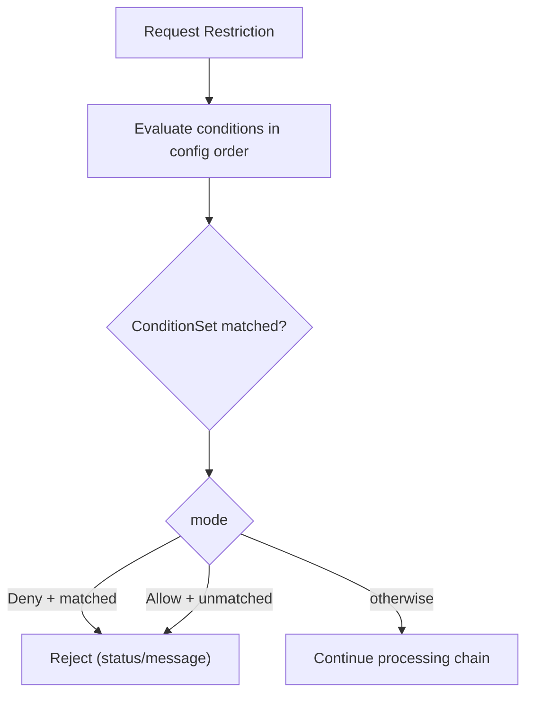

# Request Restriction Plugin

> **🔌 Edgion extension**
>
> RequestRestriction is a request restriction plugin provided by the `EdgionPlugins` CRD and is not part of the standard Gateway API.

## Overview

The `RequestRestriction` plugin restricts access using the shared `Condition` enum. Unlike `IpRestriction`, which focuses on IP addresses, this plugin matches request attributes (header, cookie, query, path, method) and **post-authentication identity** — mTLS client-certificate subject / SAN / CN (`mtlsMatch`) and verified JWT claims (`jwtClaimMatch`). Inline IP sets (`directPeerIpMatch` / `remoteIpMatch` with `ips`) can sit in the same group as a path match.

It remains a **local allow/deny matcher**, not a full RBAC orchestration layer: a condition is still a pure predicate, and a single required `mode` decides whether a match means admit or reject.

## Model: bounded ConditionSet + `mode`

The required `conditions` field uses the shared bounded-DNF ConditionSet:

- A top-level `allOf` contains direct Conditions and matches when all match.
- A top-level `anyOf` contains direct Conditions or one-level
  `{ name?, allOf: [...] }` groups and matches when any alternative matches.
- Evaluation follows configuration order and short-circuits. Recursive or
  empty sets and mixed `allOf`/`anyOf` objects are rejected.
- **`mode` is required** and decides what a match means:
  - `Deny`: a matching set ⇒ **reject**; an unmatched set passes.
  - `Allow`: a matching set ⇒ **pass**; an unmatched set is rejected.

`mode` has **no default**. Omitting it is a validation error, not a silent fallback.

A **condition is a pure predicate**. It carries no per-condition allow/deny —
the polarity lives entirely at `mode`. RequestRestriction and plugin
`conditions.run`/`skip` use the same ConditionSet grammar; their surrounding
fields decide different actions.

A missing value is **false** for `keyMatch` / identity matches. In `mode: Deny`,
use `keyExist` with `negate: true` to match a missing header and reject it.

## Features

- **Shared Condition vocabulary**: the same `Condition` types used by plugin `run`/`skip`
- **Request attributes**: header, cookie, query, path, requestPath, method
- **Identity matches**: `mtlsMatch` (subject / CN / SAN, optional `sanType`) and `jwtClaimMatch`
- **Inline and referenced IP sets**: `directPeerIpMatch` / `remoteIpMatch` with `ips` and `ipRefs` (IpList ConfigData)
- **Exact and regex matching**: `values` for exact matching, `regex` for regex matching
- **Automatic performance optimization**: Exact match lists exceeding 16 values automatically use HashSet (O(1) lookup)
- **Boolean composition**: explicit flat `allOf`, flat `anyOf`, or OR-of-AND
- **Explicit polarity**: `mode: Deny | Allow` (required, no default)
- **Custom responses**: Configurable status code and message on denial

## Difference from Plugin Conditions

Plugin `run`/`skip` predicates are documented in [Plugin Conditions](./conditions.md). Both surfaces use the same `Condition` enum.

| Dimension | Plugin Conditions | Request Restriction |
|-----------|------------------|---------------------|
| **Purpose** | Conditional execution framework, decides whether to run a plugin | Standalone plugin, directly rejects non-compliant requests |
| **Combination** | `run` and `skip` each contain a ConditionSet | `config.conditions` contains the same ConditionSet |
| **Return behavior** | Skips the plugin (continues processing chain) | Rejects the request (returns error response) |
| **Configuration location** | Attached to other plugins as conditions | Configured as a standalone plugin |
| **Use cases** | Canary releases, A/B testing, conditional execution | Access control, security protection |

## Configuration Parameters

### RequestRestrictionConfig

| Parameter | Type | Default | Description |
|-----------|------|---------|-------------|
| `mode` | Enum (`Deny` \| `Allow`) | **Required** | Polarity. `Deny`: a matching group rejects. `Allow`: a matching group passes, otherwise reject. No default — omitting it is a validation error. |
| `conditions` | ConditionSet | **Required** | Exactly one top-level `allOf` or `anyOf` expression |
| `status` | Integer | `403` | HTTP status code on denial |
| `message` | String | `Access denied...` | Response message on denial |

### ConditionSet

| Parameter | Type | Default | Description |
|-----------|------|---------|-------------|
| `allOf` | Array\<Condition\> | mutually exclusive | Direct Conditions combined with AND |
| `anyOf` | Array\<Condition \| AllOfGroup\> | mutually exclusive | Direct Conditions and one-level AND groups combined with OR |

An `AllOfGroup` has a required non-empty `allOf` and an optional nonblank
`name` used for attribution. All arrays must be non-empty. Each leaf is a
shared `Condition` (`type: keyMatch`, `keyExist`, `mtlsMatch`,
`jwtClaimMatch`, `directPeerIpMatch`, …). HMAC
`validateRequestBody: true` is accepted here.

## Migrated data-source spellings

The eleven former restriction sources are still expressible:

| Old source | New spelling |
|------------|----------------|
| Header | `keyMatch` / `keyExist` + `key: { type: header, name }` |
| Cookie | same with `cookie` |
| Query | same with `query` |
| Path | `keyMatch` + `key: { type: path }` (values still normalized) |
| RequestPath | `keyMatch` + `key: { type: requestPath }` (not normalized) |
| Method | `keyMatch` + `key: { type: method }` |
| Referer | `keyMatch` + `key: { type: header, name: Referer }` |
| MtlsSubject | `mtlsMatch` + `field: subject` |
| MtlsCn | `mtlsMatch` + `field: cn` |
| MtlsSan | `mtlsMatch` + `field: san` (+ optional `sanType`) |
| JwtClaim | `jwtClaimMatch` + `claim: <path>` |

A missing header that used to use a presence-only match is now `keyExist` + `negate: true`.

### Identity sources

#### mTLS (`mtlsMatch`)

- `field: subject` — the full subject **DN string** of the client certificate.
- `field: cn` — the subject **CN** only.
- `field: san` — the certificate **SAN** list, evaluated as "any entry matches". An optional `sanType` of `DNS` / `URI` / `Email` scopes the match:
  - **Untyped** (`sanType` omitted): the raw stored SAN entries are whole-string matched, including their type prefix (e.g. `uri:spiffe://…`, `email:alice@example.com`; DNS entries are bare).
  - **Typed**: only SAN entries of that kind are considered, and matching is done on the **prefix-stripped** value (e.g. `sanType: URI` matches `spiffe://…`, not `uri:spiffe://…`). `sanType: DNS` matches unprefixed entries only, so `IP:`, `uri:`, `email:`, and `otherName:` strings are excluded.

> **Exposure gate (asymmetric).** The client certificate is only visible to this plugin when it has been exposed to the plugin layer:
> - On the **EdgionTls** path, exposure requires the `edgion.io/expose-client-cert` annotation. Without it the mTLS conditions are always missing (false).
> - On the **Gateway `frontendValidation` mTLS** path, the certificate is exposed **without any annotation**.
>
> If the certificate is not exposed (or the connection is not mTLS), every mTLS condition evaluates as missing (false).

> **Prefer `field: cn` / `field: san` over `subject`.** `subject` matches the gateway's specific DN serialization (e.g. `CN=foo, O=bar` — attribute short-names, `, `-joined, in certificate-entry order). It is **order- and spacing-sensitive**, so a small formatting difference breaks an exact match. Reserve `subject` for `regex` matching; use `cn` or a typed SAN for exact identity checks.

#### JWT claims (`jwtClaimMatch`)

- `claim` is a **dot-nested claim path**, e.g. `realm_access.roles` or `sub`.
- A **list** claim is matched with "any element matches"; scalar string/number/bool claims yield a single candidate.
- Values are read from the **verified** JWT claims stored in the request context by an upstream auth plugin: `jwt_auth` writes `jwt_claims`, `openid_connect` writes `oidc_claims`. Lookup precedence is `jwt_claims` then `oidc_claims`.
- **Plugin-chain ordering requirement.** The authenticating plugin (`jwt_auth` or `openid_connect`) must run **earlier in the chain** with `store_claims_in_ctx: true`. Otherwise no claims are in context and the condition is false.

### Matching Methods

| Configuration | Matching Method | Description | Example |
|---------------|----------------|-------------|---------|
| `values` | Exact match | Full string equality | `"GET"`, `"/health"` |
| `regex` | Regex match | Using regular expressions | `"(?i).*Bot.*"`, `"^/api/v[0-9]+/.*"` |

> **Tip**: Use the `(?i)` prefix in regex for case-insensitive matching, e.g., `(?i).*bot.*`.

## Execution Logic



## Use Cases

### 1. Block Crawlers and Bots

```yaml
apiVersion: edgion.io/v1
kind: EdgionPlugins
metadata:
  name: block-bots
spec:
  requestPlugins:
    - type: RequestRestriction
      config:
        mode: Deny
        conditions:
          anyOf:
            - type: keyMatch
              key:
                type: header
                name: "User-Agent"
              regex:
                - "(?i).*Bot.*"
                - "(?i).*Spider.*"
                - "(?i).*Crawler.*"
            - type: keyExist
              key:
                type: header
                name: "User-Agent"
              negate: true
        status: 403
        message: "Bot access denied"
```

### 2. Path Allowlist (API Paths Only)

```yaml
apiVersion: edgion.io/v1
kind: EdgionPlugins
metadata:
  name: api-whitelist
spec:
  requestPlugins:
    - type: RequestRestriction
      config:
        mode: Allow
        conditions:
          anyOf:
            - allOf:
                - type: keyMatch
                  key:
                    type: path
                  values:
                    - "/health"
                    - "/ready"
                  regex:
                    - "^/api/.*"
        status: 404
        message: "Not found"
```

### 3. Read-Only API (GET/HEAD Only)

```yaml
apiVersion: edgion.io/v1
kind: EdgionPlugins
metadata:
  name: readonly-api
spec:
  requestPlugins:
    - type: RequestRestriction
      config:
        mode: Allow
        conditions:
          allOf:
            - type: keyMatch
              key:
                type: method
              values:
                - "GET"
                - "HEAD"
                - "OPTIONS"
        status: 405
        message: "Method not allowed"
```

### 4. Require Authentication Header

Reject when the token is a known-bad value **or** the header is missing — two groups combined with OR.

```yaml
apiVersion: edgion.io/v1
kind: EdgionPlugins
metadata:
  name: require-auth
spec:
  requestPlugins:
    - type: RequestRestriction
      config:
        mode: Deny
        conditions:
          anyOf:
            - allOf:
                - type: keyMatch
                  key:
                    type: header
                    name: "X-Auth-Token"
                  values:
                    - "invalid"
                    - "expired"
            - allOf:
                - type: keyExist
                  key:
                    type: header
                    name: "X-Auth-Token"
                  negate: true
        status: 401
        message: "Authentication required"
```

### 5. Referer Restriction (Hotlink Protection)

Allow only internal referers — `mode: Allow`, with a missing Referer treated as not allowed.

```yaml
apiVersion: edgion.io/v1
kind: EdgionPlugins
metadata:
  name: referer-check
spec:
  requestPlugins:
    - type: RequestRestriction
      config:
        mode: Allow
        conditions:
          anyOf:
            - allOf:
                - type: keyMatch
                  key:
                    type: header
                    name: Referer
                  regex:
                    - ".*example\\.com.*"
                    - ".*example\\.org.*"
        status: 403
        message: "Invalid referer"
```

### 6. Block Debug Parameters

Block a debug flag set via query **or** cookie — two single-condition groups (OR).

```yaml
apiVersion: edgion.io/v1
kind: EdgionPlugins
metadata:
  name: block-debug
spec:
  requestPlugins:
    - type: RequestRestriction
      config:
        mode: Deny
        conditions:
          anyOf:
            - allOf:
                - type: keyMatch
                  key:
                    type: query
                    name: "debug"
                  values:
                    - "true"
                    - "1"
            - allOf:
                - type: keyMatch
                  key:
                    type: cookie
                    name: "debug"
                  values:
                    - "true"
                    - "1"
        status: 403
        message: "Debug mode not allowed in production"
```

### 7. AND within a group: deny only DELETE to /admin

A single group with two conditions combined with AND — the request is denied only when **both** hold.

```yaml
apiVersion: edgion.io/v1
kind: EdgionPlugins
metadata:
  name: protect-admin-writes
spec:
  requestPlugins:
    - type: RequestRestriction
      config:
        mode: Deny
        conditions:
          anyOf:
            - allOf:
                - type: keyMatch
                  key:
                    type: method
                  values: ["DELETE"]
                - type: keyMatch
                  key:
                    type: path
                  regex: [".*/admin/.*"]
        status: 403
        message: "Deleting admin resources is not allowed"
```

### 8. IP and path in one group

Deny admin paths only from an inline peer IP set.

```yaml
apiVersion: edgion.io/v1
kind: EdgionPlugins
metadata:
  name: local-admin-deny
spec:
  requestPlugins:
    - type: RequestRestriction
      config:
        mode: Deny
        conditions:
          anyOf:
            - allOf:
                - type: directPeerIpMatch
                  ips: ["127.0.0.1", "::1"]
                - type: keyMatch
                  key:
                    type: path
                  regex: [".*/admin/.*"]
        status: 403
        message: "Admin access denied from local peer"
```

### 9. Identity allowlist (mTLS SAN OR JWT claim)

```yaml
apiVersion: edgion.io/v1
kind: EdgionPlugins
metadata:
  name: identity-allowlist
spec:
  requestPlugins:
    - type: RequestRestriction
      config:
        mode: Allow
        conditions:
          anyOf:
            - type: mtlsMatch
              field: san
              sanType: URI
              values: ["spiffe://edgion.io/ns/payments/sa/checkout"]
            - type: jwtClaimMatch
              claim: "realm_access.roles"
              values: ["admin"]
        status: 403
        message: "Identity not allowed"
```

## Comparison with Other Gateways

| Feature | APISIX | Kong | Edgion |
|---------|--------|------|--------|
| **User-Agent restriction** | ✅ ua-restriction | ✅ bot-detection | ✅ RequestRestriction |
| **Path/URI restriction** | ✅ uri-blocker | ❌ | ✅ RequestRestriction |
| **Referer restriction** | ✅ referer-restriction | ❌ | ✅ RequestRestriction |
| **Cookie restriction** | ❌ | ❌ | ✅ RequestRestriction |
| **Query restriction** | ❌ | ❌ | ✅ RequestRestriction |
| **Method restriction** | ✅ consumer-restriction | ❌ | ✅ RequestRestriction |
| **Unified plugin** | ❌ (multiple separate) | ❌ (multiple separate) | ✅ (single plugin) |

Edgion's `RequestRestriction` plugin unifies multiple restriction capabilities into a single plugin, resulting in simpler configuration and easier maintenance.

## Notes

1. **Set order**: Conditions and alternatives are evaluated in configuration order with `allOf`/`anyOf` short-circuiting.
2. **Polarity is global**: A condition is a pure predicate. Whether a match means allow or deny is decided once by `mode`.
3. **Case sensitivity**: Exact matching (`values`) is case-sensitive by default; use `caseSensitive: false` to disable; for regex, use the `(?i)` prefix.
4. **Regex performance**: Multiple regex patterns are merged into a single regex (joined with `|`), reducing matching overhead.
5. **HashSet optimization**: Exact match lists exceeding 16 values automatically use HashSet for O(1) lookup.
6. **Path vs requestPath**: `key: { type: path }` is compared against the normalized current path (and `values` are normalized at load time); `key: { type: requestPath }` is the entry-time raw path. Regex is never normalized.
7. **Missing values**: `keyMatch` / identity matches are false when the value is absent. Use `keyExist` + `negate: true` to match absence.
8. **ipRefs**: conditions may use inline `ips` and `ipRefs` (IpList ConfigData). The Controller expands `ipRefs` onto `resolvedIps` on apply. A missing, disabled, wrong-type, or unpermitted IpList reference is fail-closed (`ResolvedRefs=False`); the gateway does not compile an empty matcher from unresolved operator `ipRefs`.

## FAQ

### Q1: How do I express a blacklist vs a whitelist?

**A**: Set `mode`. `Deny` rejects a request when the set matches; `Allow` rejects a request unless the set matches. `mode` is required — there is no default to fall back on.

### Q2: How do I express `(A AND B) OR C`?

**A**: Use `conditions.anyOf`, place `A` and `B` in one nested `allOf`, and put `C` directly beside that group.

### Q3: When is a key name required?

**A**: For `header`, `cookie`, and `query` keys. `path`, `requestPath`, and `method` have no name. `jwtClaimMatch` uses `claim`. `mtlsMatch` uses `field`.

### Q4: How do I deny when a header is missing?

**A**: Add `keyExist` + `negate: true` for that header as a direct `anyOf` alternative or in an `allOf` group. Under `mode: Deny`, an absent header makes the set match and the request is rejected.

### Q5: How do I make exact matching case-insensitive?

**A**: Set `caseSensitive: false` on the condition (it applies to `values` exact matching). For regex matching use the `(?i)` inline flag, e.g. `(?i).*bot.*`.

---

## Get help

If you run into problems:

1. Check the FAQ section of this document
2. Check the gateway logs
3. Open an issue on GitHub

---

## Related Links

- [IpRestriction](./ip-restriction.md) — IP access control
- [RateLimitLocal](./rate-limit-local.md) — Rate limiting
- [Plugin Conditions](./conditions.md) — shared Condition vocabulary
