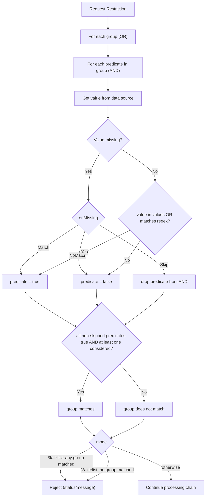

# Request Restriction Plugin

> **🔌 Edgion extension**
> 
> RequestRestriction is a request restriction plugin provided by the `EdgionPlugins` CRD and is not part of the standard Gateway API.

## Overview

The `RequestRestriction` plugin restricts access based on request attributes, supporting multiple data sources and matching methods. Unlike the `IpRestriction` plugin which focuses on IP addresses, this plugin supports access control based on Header, Cookie, Query parameters, Path, Method, and Referer, plus **post-authentication identity** — mTLS client-certificate subject / SAN / CN (`MtlsSubject` / `MtlsSan` / `MtlsCn`) and verified JWT claims (`JwtClaim`).

It remains a **local allow/deny matcher**, not a full RBAC orchestration layer: a rule is still a pure predicate, and a single global `mode` decides whether a match means admit or reject. The identity sources let you match on *who* the caller is (in addition to *what* they are sending) without turning the plugin into a role/principal engine.

## Model: rule groups (OR-of-AND) + global mode

The plugin evaluates a list of **rule groups** in disjunctive normal form (DNF):

- **`ruleGroups` is an array combined with OR** — the policy fires if **any** group matches.
- **Each group's `rules` is combined with AND** — a group matches only when **all** of its (non-skipped) predicates are true.
- A single global **`mode`** decides the outcome polarity for the whole config:
  - `Blacklist` (default): any matching group ⇒ **reject**; otherwise pass.
  - `Whitelist`: any matching group ⇒ **pass**; otherwise reject.

A **rule is a pure predicate**: it is true when the extracted value is in `values` **or** matches `regex`. It carries no per-rule allow/deny — the polarity lives entirely at the global `mode`. This lets you express `(A AND B) OR C` while keeping the model flat (two levels, no deeper nesting and no negation).

## Features

- **Multiple data sources**: Header, Cookie, Query, Path, RequestPath, Method, Referer
- **Identity sources**: mTLS client-cert subject / SAN / CN (`MtlsSubject` / `MtlsSan` / `MtlsCn`, with optional `sanType`) and verified JWT claims (`JwtClaim`)
- **Exact and regex matching**: `values` for exact matching, `regex` for regex matching (a predicate is true if either matches)
- **Automatic performance optimization**: Exact match lists exceeding 16 values automatically use HashSet (O(1) lookup)
- **Boolean composition**: AND within a group, OR across groups (DNF)
- **Global polarity**: `mode: Blacklist | Whitelist`
- **Missing value handling**: Configurable predicate behavior when the target value is missing (`Match` / `NoMatch` / `Skip`)
- **Custom responses**: Configurable status code and message on denial

## Difference from Plugin Conditions

| Dimension | Plugin Conditions | Request Restriction |
|-----------|------------------|---------------------|
| **Purpose** | Conditional execution framework, decides whether to run a plugin | Standalone plugin, directly rejects non-compliant requests |
| **Return behavior** | Skips the plugin (continues processing chain) | Rejects the request (returns error response) |
| **Configuration location** | Attached to other plugins as conditions | Configured as a standalone plugin |
| **Use cases** | Canary releases, A/B testing, conditional execution | Access control, security protection |

## Configuration Parameters

### RequestRestrictionConfig

| Parameter | Type | Default | Description |
|-----------|------|---------|-------------|
| `mode` | Enum | `Blacklist` | Global polarity. `Blacklist`: any matching group rejects. `Whitelist`: any matching group passes, otherwise reject. |
| `ruleGroups` | Array\<RuleGroup\> | **Required** | List of rule groups, combined with OR |
| `status` | Integer | `403` | HTTP status code on denial |
| `message` | String | `Access denied...` | Response message on denial |

### RuleGroup

| Parameter | Type | Default | Description |
|-----------|------|---------|-------------|
| `name` | String | none | Group name (for logging) |
| `rules` | Array\<RestrictionRule\> | **Required** | Predicates combined with AND |

### RestrictionRule (predicate)

| Parameter | Type | Default | Description |
|-----------|------|---------|-------------|
| `name` | String | none | Rule name (for logging) |
| `source` | Enum | **Required** | Data source: `Header` / `Cookie` / `Query` / `Path` / `RequestPath` / `Method` / `Referer` / `MtlsSubject` / `MtlsCn` / `MtlsSan` / `JwtClaim` |
| `key` | String | none | Key name (**Required** for `Header` / `Cookie` / `Query`; the dot-nested claim path for `JwtClaim`; ignored for the others) |
| `values` | Array\<String\> | none | Exact-match values. Predicate is true if the value is in this list. |
| `regex` | Array\<String\> | none | Regex patterns. Predicate is true if the value matches (patterns merged with `\|`). |
| `sanType` | Enum | none | Only valid for `MtlsSan`. Scopes matching to one SAN kind: `DNS` / `URI` / `Email`. When omitted, raw SAN entries are whole-string matched. |
| `caseSensitive` | Boolean | `true` | Whether exact matching is case-sensitive |
| `onMissing` | Enum | `NoMatch` | Predicate result when the value is missing. Allowed values: `Match` / `NoMatch` / `Skip` |

> **Note**: A predicate must declare at least one of `values` or `regex`, **unless** `onMissing: Match` is used as a pure presence/absence check.

### Data Source Reference

| Data Source | Description | `key` required |
|-------------|-------------|----------------|
| `Header` | HTTP request header | Yes |
| `Cookie` | HTTP Cookie | Yes |
| `Query` | URL query parameter | Yes |
| `Path` | Request path (normalized) | No |
| `RequestPath` | Entry-time raw path (frozen, not normalized) | No |
| `Method` | HTTP method | No |
| `Referer` | Referer request header | No |
| `MtlsSubject` | mTLS client-certificate subject DN string | No |
| `MtlsCn` | mTLS client-certificate subject CN | No |
| `MtlsSan` | mTLS client-certificate SAN list ("any entry matches"); optional `sanType` | No |
| `JwtClaim` | Verified JWT claim, addressed by a dot-nested `key` | Yes (`key` = claim path) |

### Identity sources

In addition to request attributes, the plugin can match on **post-authentication identity**: the mTLS client certificate and verified JWT claims. These are still pure predicates — `mode` decides admit/reject, and a missing value follows `onMissing` (default `NoMatch`).

#### mTLS sources (`MtlsSubject` / `MtlsCn` / `MtlsSan`)

- `MtlsSubject` — the full subject **DN string** of the client certificate.
- `MtlsCn` — the subject **CN** only.
- `MtlsSan` — the certificate **SAN** list, evaluated as "any entry matches". An optional `sanType` of `DNS` / `URI` / `Email` scopes the match:
  - **Untyped** (`sanType` omitted): the raw stored SAN entries are whole-string matched, including their type prefix (e.g. `uri:spiffe://…`, `email:alice@example.com`; DNS entries are bare).
  - **Typed**: only SAN entries of that kind are considered, and matching is done on the **prefix-stripped** value (e.g. `sanType: URI` matches `spiffe://…`, not `uri:spiffe://…`).

> **Exposure gate (asymmetric).** The client certificate is only visible to this plugin when it has been exposed to the plugin layer:
> - On the **EdgionTls** path, exposure requires the `edgion.io/expose-client-cert` annotation. Without it the mTLS sources are always **missing** (→ `onMissing`).
> - On the **Gateway `frontendValidation` mTLS** path, the certificate is exposed **without any annotation**.
>
> If the certificate is not exposed (or the connection is not mTLS), every mTLS source evaluates as missing.

> **Prefer `MtlsCn` / `MtlsSan` over `MtlsSubject`.** `MtlsSubject` matches the gateway's specific DN serialization (e.g. `CN=foo, O=bar` — attribute short-names, `, `-joined, in certificate-entry order). It is **order- and spacing-sensitive**, so a small formatting difference breaks an exact match. Reserve `MtlsSubject` for `regex` matching; use `MtlsCn` or a typed `MtlsSan` for exact identity checks.

#### JWT claims (`JwtClaim`)

- `key` is a **dot-nested claim path**, e.g. `realm_access.roles` or `sub`.
- A **list** claim is matched with "any element matches"; scalar string/number/bool claims yield a single candidate.
- Values are read from the **verified** JWT claims stored in the request context by an upstream auth plugin: `jwt_auth` writes `jwt_claims`, `openid_connect` writes `oidc_claims`. Lookup precedence is `jwt_claims` then `oidc_claims`: whichever blob is present is used in full — there is no per-claim fallback to the other blob.
- **Plugin-chain ordering requirement.** The authenticating plugin (`jwt_auth` or `openid_connect`) must run **earlier in the chain** with `store_claims_in_ctx: true`. Otherwise no claims are in context and the `JwtClaim` source is always **missing** (→ `onMissing`).

> **Out of scope: source IP / CIDR.** This plugin does not match on client IP or CIDR — use `IpRestriction` or `RequestAccessPolicy` for that. For the same reason `sanType` deliberately omits `IP`.

### Matching Methods

| Configuration | Matching Method | Description | Example |
|---------------|----------------|-------------|---------|
| `values` | Exact match | Full string equality | `"GET"`, `"/health"` |
| `regex` | Regex match | Using regular expressions | `"(?i).*Bot.*"`, `"^/api/v[0-9]+/.*"` |

> **Tip**: Use the `(?i)` prefix in regex for case-insensitive matching, e.g., `(?i).*bot.*`.

### `onMissing` semantics

| Value | Predicate result when value is absent |
|-------|----------------------------------------|
| `Match` | predicate is **true** (e.g. "deny when the header is absent") |
| `NoMatch` (default) | predicate is **false** |
| `Skip` | predicate is **dropped** from the group's AND; if every predicate in a group is dropped, the group does not match |

> **A `Match`-only predicate matches *only when absent*.** A rule with `onMissing: Match` and no
> `values`/`regex` is true iff the value is **missing** — when the value is present it has nothing to
> match against and the predicate is false. (This is how the "require auth" example's
> `missing-token` group works.)
>
> **Whitelist + `Skip` is a foot-gun.** Under `mode: Whitelist`, a group whose predicates are all
> `Skip`-dropped (because their sources are absent) does **not** match, so it cannot grant access —
> the request is denied. A whitelist group built only from `Skip` predicates therefore rejects every
> request. Use `NoMatch`/`Match`, not `Skip`, when the source may be absent in a whitelist.

## Execution Logic



## Use Cases

### 1. Block Crawlers and Bots

```yaml
apiVersion: edgion.io/v1
kind: EdgionPlugins
metadata:
  name: block-bots
spec:
  requestPlugins:
    - type: RequestRestriction
      config:
        mode: Blacklist
        ruleGroups:
          - rules:
              - name: "block-bots"
                source: Header
                key: "User-Agent"
                regex:
                  - "(?i).*Bot.*"
                  - "(?i).*Spider.*"
                  - "(?i).*Crawler.*"
                  - "(?i).*curl.*"
                  - "(?i).*wget.*"
                onMissing: Match  # Also deny requests without a UA header
        status: 403
        message: "Bot access denied"
```

### 2. Path Allowlist (API Paths Only)

```yaml
apiVersion: edgion.io/v1
kind: EdgionPlugins
metadata:
  name: api-whitelist
spec:
  requestPlugins:
    - type: RequestRestriction
      config:
        mode: Whitelist
        ruleGroups:
          - rules:
              - name: "api-only"
                source: Path
                values:
                  - "/health"
                  - "/ready"
                regex:
                  - "^/api/.*"
        status: 404
        message: "Not found"
```

### 3. Read-Only API (GET/HEAD Only)

```yaml
apiVersion: edgion.io/v1
kind: EdgionPlugins
metadata:
  name: readonly-api
spec:
  requestPlugins:
    - type: RequestRestriction
      config:
        mode: Whitelist
        ruleGroups:
          - rules:
              - name: "readonly"
                source: Method
                values:
                  - "GET"
                  - "HEAD"
                  - "OPTIONS"
        status: 405
        message: "Method not allowed"
```

### 4. Require Authentication Header

Reject when the token is a known-bad value **or** the header is missing — two groups combined with OR.

```yaml
apiVersion: edgion.io/v1
kind: EdgionPlugins
metadata:
  name: require-auth
spec:
  requestPlugins:
    - type: RequestRestriction
      config:
        mode: Blacklist
        ruleGroups:
          - rules:
              - name: "bad-token"
                source: Header
                key: "X-Auth-Token"
                values:
                  - "invalid"
                  - "expired"
                onMissing: NoMatch
          - rules:
              - name: "missing-token"
                source: Header
                key: "X-Auth-Token"
                onMissing: Match  # absent header => this group matches => deny
        status: 401
        message: "Authentication required"
```

### 5. Referer Restriction (Hotlink Protection)

Allow only internal referers — whitelist mode, with a missing Referer treated as not allowed.

```yaml
apiVersion: edgion.io/v1
kind: EdgionPlugins
metadata:
  name: referer-check
spec:
  requestPlugins:
    - type: RequestRestriction
      config:
        mode: Whitelist
        ruleGroups:
          - rules:
              - name: "allow-internal"
                source: Referer
                regex:
                  - ".*example\\.com.*"
                  - ".*example\\.org.*"
                onMissing: NoMatch  # no Referer => no group matches => deny
        status: 403
        message: "Invalid referer"
```

### 6. Block Debug Parameters

Block a debug flag set via query **or** cookie — two single-predicate groups (OR).

```yaml
apiVersion: edgion.io/v1
kind: EdgionPlugins
metadata:
  name: block-debug
spec:
  requestPlugins:
    - type: RequestRestriction
      config:
        mode: Blacklist
        ruleGroups:
          - rules:
              - name: "block-debug-query"
                source: Query
                key: "debug"
                values:
                  - "true"
                  - "1"
          - rules:
              - name: "block-debug-cookie"
                source: Cookie
                key: "debug"
                values:
                  - "true"
                  - "1"
        status: 403
        message: "Debug mode not allowed in production"
```

### 7. AND within a group: deny only DELETE to /admin

A single group with two predicates combined with AND — the request is denied only when **both** hold.

```yaml
apiVersion: edgion.io/v1
kind: EdgionPlugins
metadata:
  name: protect-admin-writes
spec:
  requestPlugins:
    - type: RequestRestriction
      config:
        mode: Blacklist
        ruleGroups:
          - rules:
              - name: "is-delete"
                source: Method
                values: ["DELETE"]
              - name: "is-admin-path"
                source: Path
                regex: [".*/admin/.*"]
        status: 403
        message: "Deleting admin resources is not allowed"
```

### 8. Comprehensive Security Policy (multiple OR groups)

```yaml
apiVersion: edgion.io/v1
kind: EdgionPlugins
metadata:
  name: security-policy
spec:
  requestPlugins:
    - type: RequestRestriction
      config:
        mode: Blacklist
        ruleGroups:
          # Block crawlers
          - rules:
              - name: "block-bots"
                source: Header
                key: "User-Agent"
                regex:
                  - "(?i).*Bot.*"
                  - "(?i).*Spider.*"
          # Block sensitive paths
          - rules:
              - name: "block-sensitive"
                source: Path
                regex:
                  - ".*/admin/.*"
                  - ".*/internal/.*"
                  - ".*\\.php$"
                  - ".*\\.asp$"
          # Block SQL injection attempts
          - rules:
              - name: "block-sqli"
                source: Query
                key: "id"
                regex:
                  - ".*('|--|;|/\\*).*"
        status: 403
        message: "Access denied by security policy"
```

### 9. Identity allowlist (mTLS SAN OR JWT claim)

Admit only callers proven by a SPIFFE URI SAN **or** an `admin` role in the verified JWT — two single-predicate groups combined with OR under `Whitelist`. For the `JwtClaim` group to work, an auth plugin (`jwt_auth` / `openid_connect`) must run earlier in the chain with `store_claims_in_ctx: true`; for the `MtlsSan` group the client cert must be exposed (see the exposure gate above).

```yaml
apiVersion: edgion.io/v1
kind: EdgionPlugins
metadata:
  name: identity-allowlist
spec:
  requestPlugins:
    - type: RequestRestriction
      config:
        mode: Whitelist
        ruleGroups:
          - rules:
              - source: MtlsSan
                sanType: URI
                values: ["spiffe://edgion.io/ns/payments/sa/checkout"]
                onMissing: NoMatch
          - rules:
              - source: JwtClaim
                key: "realm_access.roles"
                values: ["admin"]
                onMissing: NoMatch
        status: 403
        message: "Identity not allowed"
```

## Comparison with Other Gateways

| Feature | APISIX | Kong | Edgion |
|---------|--------|------|--------|
| **User-Agent restriction** | ✅ ua-restriction | ✅ bot-detection | ✅ RequestRestriction |
| **Path/URI restriction** | ✅ uri-blocker | ❌ | ✅ RequestRestriction |
| **Referer restriction** | ✅ referer-restriction | ❌ | ✅ RequestRestriction |
| **Cookie restriction** | ❌ | ❌ | ✅ RequestRestriction |
| **Query restriction** | ❌ | ❌ | ✅ RequestRestriction |
| **Method restriction** | ✅ consumer-restriction | ❌ | ✅ RequestRestriction |
| **Unified plugin** | ❌ (multiple separate) | ❌ (multiple separate) | ✅ (single plugin) |

Edgion's `RequestRestriction` plugin unifies multiple restriction capabilities into a single plugin, resulting in simpler configuration and easier maintenance.

## Notes

1. **Group order**: Groups are evaluated in configuration order; in `Blacklist` mode processing stops at the first matching group (deny), and in `Whitelist` mode at the first matching group (pass).
2. **Polarity is global**: A rule is a pure predicate. Whether a match means allow or deny is decided once by `mode`, not per rule.
3. **Case sensitivity**: Exact matching (`values`) is case-sensitive by default; use `caseSensitive: false` to disable; for regex, use the `(?i)` prefix.
4. **Regex performance**: Multiple regex patterns are merged into a single regex (joined with `|`), reducing matching overhead.
5. **HashSet optimization**: Exact match lists exceeding 16 values automatically use HashSet for O(1) lookup.
6. **Path vs RequestPath**: `Path` is compared against the normalized current path (and `values` are normalized at load time); `RequestPath` is the entry-time raw path (use it for audit-style raw-form matching). Regex is never normalized.
7. **Missing value handling**: Choose the appropriate `onMissing` behavior — for "deny when absent" use `Match`; for "ignore when absent" use `NoMatch`; to drop the predicate from the group's AND use `Skip`.

## FAQ

### Q1: How do I express a blacklist vs a whitelist?

**A**: Set the global `mode`. `Blacklist` (default) rejects a request when any group matches; `Whitelist` rejects a request unless some group matches. A rule itself never carries allow/deny — it is just a predicate.

### Q2: How do I express `(A AND B) OR C`?

**A**: Put `A` and `B` as two predicates in one group (AND), and `C` as a separate group (OR). The plugin supports exactly this two-level DNF — no deeper nesting and no negation.

### Q3: When is the `key` field required?

**A**: For the `Header`, `Cookie`, and `Query` sources, which look up a named value, and for `JwtClaim`, where `key` is the dot-nested claim path. For `Path`, `RequestPath`, `Method`, `Referer`, and the mTLS sources (`MtlsSubject` / `MtlsCn` / `MtlsSan`) the value is intrinsic to the request/connection, so `key` is ignored.

### Q4: What does `onMissing: Match` do?

**A**: It makes the predicate true when the value is absent — useful for "deny when this header/parameter is missing". Combined with the default `Blacklist` mode, an absent value then causes the group to match and the request to be rejected.

### Q5: How do I make exact matching case-insensitive?

**A**: Set `caseSensitive: false` on the rule (it applies to `values` exact matching). For regex matching use the `(?i)` inline flag, e.g. `(?i).*bot.*`.

---

## Get help

If you run into problems:

1. Check the FAQ section of this document
2. Check the gateway logs
3. Open an issue on GitHub

---

## Related Links

- [IpRestriction](./ip-restriction.md) — IP access control
- [RateLimit](./rate-limit.md) — Rate limiting
