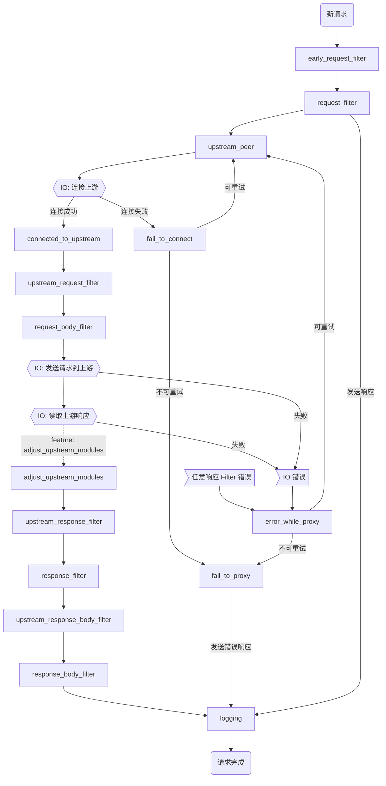
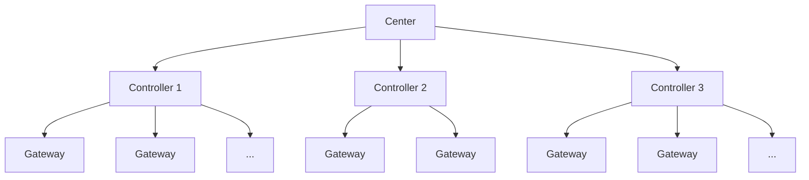

# Edgion

中文 | [English](../../README.md)

## Edgion 是什么？

基于 [Pingora](https://github.com/cloudflare/pingora) 和 [Gateway API](https://gateway-api.sigs.k8s.io/) 构建的高性能 API 网关。同时支持 Kubernetes 和独立部署（裸金属 / 虚拟机）环境。一个现代的 Rust 原生替代方案，对标 Kong、APISIX、Traefik、Envoy 和 HAProxy。

## 功能亮点

- **Rust 原生性能** — 基于 Cloudflare 的 Pingora 和 Tokio 构建。内存安全，无 GC 停顿，高负载下延迟可预测。
- **Gateway API 支持** — 原生实现 Kubernetes Gateway API 标准。同一二进制文件可运行于 Kubernetes 或独立模式。
  - `v1` GA: GatewayClass · Gateway · HTTPRoute · GRPCRoute · TLSRoute · ReferenceGrant
  - `v1alpha2` 实验性: TCPRoute · UDPRoute
- **多协议** — HTTP/1.1、HTTP/2、gRPC、TCP、UDP、WebSocket、SNI 代理。
- **动态热加载** — 路由、后端、插件、证书的任何变更都会即时传播到所有网关，无需重启。
- **生产就绪的 Kubernetes 控制器** — 开箱即用的完整协调循环、状态上报和 CRD 生命周期管理。
- **高性能路由** — 基数树 + 缓存优化，支持路径变量的 Exact/Prefix 匹配。按 Gateway API 规范进行优先级规则评估。
- **高级 TLS** — mTLS、ACME 自动签发（HTTP-01 / DNS-01）、按域名的 TLS 版本和密码套件控制。
- **流量管理** — 加权金丝雀路由；多种负载均衡算法（Round Robin、EWMA、最少连接、一致性哈希、加权）。
- **强大的插件系统** — 通过插件引用组合，内置 DSL 支持自定义逻辑。
  - HTTP 插件：认证 · 安全 · 流量管理 · 可观测性（25+）
  - Stream 插件：TCP/UDP 流量控制
  - DSL：OpenResty/Lua 级别的表达能力，Rust 原生性能
- **深度可观测性** — 覆盖完整请求生命周期的结构化日志。一行日志，全貌尽收。AI 友好。
  - Access log：单行 JSON 包含路由/上游详情和各插件行为
  - TLS log：每连接的 SSL 握手和证书详情
  - Stream log：长连接（WebSocket、TCP）的连接生命周期事件
  - 灵活输出：本地文件或远程 Kafka / Elasticsearch
- **无需 Kubernetes 部署** — 可独立运行于裸金属或虚拟机。本地文件或 etcd 作为配置后端，无需 Kubernetes。
- **联邦集群设计** — 无状态的 Center 连接多个跨地域的 Controller，实现集群级和区域级的高级路由控制。
- 完整文档请参见 [English Docs](../en/README.md) · [中文文档导航](#文档)。

## 架构

### Gateway API 配置

Edgion 实现了 Kubernetes Gateway API 规范，当前支持 **v1.5.1**。

#### Gateway API 支持

- [`v1.HTTPRoute`](../en/user-guide/http-route/overview.md)
- [`v1.GRPCRoute`](../en/user-guide/grpc-route/overview.md)
- [`v1.TLSRoute`](../en/ops-guide/gateway/tls/tls-termination.md)
- [`v1.ReferenceGrant`](../en/ops-guide/infrastructure/reference-grant.md)
- [`v1alpha2.TCPRoute`](../en/user-guide/tcp-route/overview.md)
- [`v1alpha2.UDPRoute`](../en/user-guide/udp-route/overview.md)

#### Edgion 自定义资源

- [`edgion.io/v1.EdgionTls`](../en/ops-guide/gateway/tls/edgion-tls.md)
- [`edgion.io/v1.EdgionPlugins`](../en/user-guide/http-route/filters/edgion-plugins/README.md)
- [`edgion.io/v1.EdgionStreamPlugins`](../en/user-guide/tcp-route/stream-plugins.md)


### Pingora 请求生命周期

Edgion 的数据面基于 Pingora 构建——Cloudflare 久经考验的 Rust 代理框架。Pingora 将每个请求建模为一系列定义明确的阶段流水线，从连接接受到 Access Log 输出，每一步都有精确控制。每个阶段是一个按顺序执行的异步 Hook，任何阶段都可以短路流水线并直接发送响应。

Edgion Hook 了以下阶段：

| 阶段 | Edgion 的处理 |
|------|--------------|
| `early_request_filter` | 客户端超时和 Keepalive 设置；优雅关闭检测 |
| `request_filter` | 路由匹配；完整的 HTTP/gRPC 插件链执行（认证、限流、重写等） |
| `upstream_peer` | 负载均衡选择后端；会话保持；重试截止时间检查 |
| `upstream_request_filter` | 上游请求头修改 |
| `request_body_filter` | 请求体插件（如带宽限制） |
| `upstream_response_filter` | 上游响应头检查和重写 |
| `response_filter` | 响应插件链；gRPC-Web 桥接 |
| `logging` | 结构化 Access Log 输出（本地文件 / Kafka / Elasticsearch） |



### 组件与集群拓扑

| 组件 | 二进制 | 职责 |
|------|--------|------|
| **Center** | `edgion-center` | 联邦控制面。连接多个跨集群或跨地域的 Controller，实现全局路由策略和跨集群可见性。 |
| **Controller** | `edgion-controller` | 监听 Kubernetes CRD 或本地 YAML，验证并预解析资源，通过 gRPC 向 Gateway 流式同步配置。处理 ACME 和状态更新。 |
| **Gateway** | `edgion-gateway` | 基于 Pingora 的无状态数据面。从 Controller 接收配置，执行路由、插件链、负载均衡、TLS 和 Access Log。 |
| **CLI** | `edgion-cli` | 用于检查和操作 Controller 及 Gateway 实例的管理工具。 |



## 插件

### 内置插件

25+ 内置插件，通过 [EdgionPlugins](../en/user-guide/http-route/filters/overview.md) CRD 配置，支持 [插件组合](../en/user-guide/http-route/filters/plugin-composition.md)：

**认证** — [Basic Auth](../en/user-guide/http-route/filters/edgion-plugins/basic-auth.md) · [JWT Auth](../en/user-guide/http-route/filters/edgion-plugins/jwt-auth.md) · [Key Auth](../en/user-guide/http-route/filters/edgion-plugins/key-auth.md) · [HMAC Auth](../en/user-guide/http-route/filters/edgion-plugins/hmac-auth.md) · [LDAP Auth](../en/user-guide/edgion-plugins/ldap-auth.md) · [Forward Auth](../en/user-guide/edgion-plugins/forward-auth.md) · [OpenID Connect](../en/user-guide/edgion-plugins/openid-connect.md) · [JWE Decrypt](../en/user-guide/edgion-plugins/jwe-decrypt.md) · [Header Cert Auth](../en/user-guide/http-route/filters/edgion-plugins/header-cert-auth.md)

**安全** — [CORS](../en/user-guide/http-route/filters/edgion-plugins/cors.md) · [CSRF](../en/user-guide/http-route/filters/edgion-plugins/csrf.md) · [IP Restriction](../en/user-guide/http-route/filters/edgion-plugins/ip-restriction.md) · [Request Restriction](../en/user-guide/http-route/filters/edgion-plugins/request-restriction.md)

**流量管理** — [Rate Limit](../en/user-guide/http-route/filters/edgion-plugins/rate-limit.md) · [Rate Limit (Redis)](../en/user-guide/edgion-plugins/rate-limit.md) · [Proxy Rewrite](../en/user-guide/http-route/filters/edgion-plugins/proxy-rewrite.md) · [Response Rewrite](../en/user-guide/http-route/filters/edgion-plugins/response-rewrite.md) · [Bandwidth Limit](../en/user-guide/http-route/filters/edgion-plugins/bandwidth-limit.md) · [Request Mirror](../en/user-guide/http-route/filters/edgion-plugins/request-mirror.md) · [Direct Endpoint](../en/user-guide/http-route/filters/edgion-plugins/direct-endpoint.md) · [Dynamic Upstream](../en/user-guide/http-route/filters/edgion-plugins/dynamic-upstream.md)

**可观测性与工具** — [Real IP](../en/user-guide/edgion-plugins/real-ip.md) · [Ctx Setter](../en/user-guide/edgion-plugins/ctx-setter.md) · [Mock](../en/user-guide/http-route/filters/edgion-plugins/mock.md)

**Gateway API 标准 Filter** — [Request Header Modifier](../en/user-guide/http-route/filters/gateway-api/request-header-modifier.md) · [Response Header Modifier](../en/user-guide/http-route/filters/gateway-api/response-header-modifier.md) · [Request Redirect](../en/user-guide/http-route/filters/gateway-api/request-redirect.md) · [URL Rewrite](../en/user-guide/http-route/filters/gateway-api/url-rewrite.md)

**Stream 插件 (TCP/UDP)** — [IP Restriction](../en/user-guide/tcp-route/stream-plugins.md)

### DSL 扩展

OpenResty 通过 LuaJIT 将 Lua 脚本嵌入 Nginx 各阶段来实现网关可扩展性。这种方式效果良好，但存在固有取舍：Lua 是独立运行时，脚本共享进程内存空间且无隔离，资源消耗难以按请求限制。

Edgion 采用了不同的方案。DSL 插件在一个**用 Rust 编写的沙箱 VM** 中运行脚本，与宿主进程隔离。每次脚本执行都受可配置限制的严格约束：

| 限制项 | 默认值 | 说明 |
|--------|--------|------|
| `maxSteps` | 10,000 | 总执行步数 |
| `maxLoopIterations` | 100 | 单循环最大迭代次数 |
| `maxCallCount` | 500 | 函数调用次数 |
| `maxStackDepth` | 128 | 调用栈深度 |
| `maxStringLen` | 8,192 | 字符串长度 |

脚本可以源码形式部署，也可预编译为**字节码**（Base64）以加速启动并混淆代码。一个简单示例：

```yaml
requestPlugins:
  - enable: true
    type: Dsl
    config:
      name: "require-api-token"
      source: |
        let token = req.header("X-Api-Token")
        if token == nil {
          return deny(403, "missing X-Api-Token header")
        }
```

完整的 DSL API 参考和高级用法请参见 [DSL 插件文档](../en/user-guide/http-route/filters/edgion-plugins/dsl/README.md)。

## 部署

所有部署清单、Helm Chart 和脚本维护在独立仓库：**[Pandaala/edgion-deploy](https://github.com/Pandaala/edgion-deploy)**。

支持以下部署模式：

- **Kubernetes** — 标准生产部署。Controller 和 Gateway 作为 Kubernetes 集群中的独立工作负载运行，通过 Kubernetes API 监听 CRD。

- **独立部署（裸金属 / 虚拟机）** — Controller 和 Gateway 作为原生进程运行，无需 Kubernetes。配置来源为本地 YAML 文件或 etcd。

- **All-in-One 容器** — 单个容器镜像打包 Controller、Gateway 和管理前端。适用于快速评估、演示和单节点环境。

## 文档

| | 文档 | 说明 |
|---|------|------|
| 📘 | [用户指南](user-guide/README.md) | HTTPRoute、GRPCRoute、插件、负载均衡、弹性能力和流量管理 |
| 🔧 | [运维指南](ops-guide/README.md) | Gateway 配置、TLS、可观测性、ACME 和生产运维 |
| 🛠️ | [开发指南](dev-guide/README.md) | 架构内部实现、新增资源/插件、编码规范 |
| 🚀 | [快速开始](getting-started/README.md) | 安装部署、第一个网关、核心概念 |

## 路线图

- [ ] **Body 缓存与处理** — 请求/响应体缓存和转换支持
- [ ] **HTTP/3** — 全网关栈原生 HTTP/3 支持
- [ ] **WAF** — Web 应用防火墙集成
- [ ] **edgion-cli AI 增强** — CLI 中的 AI 驱动检查、诊断和运维辅助
- [ ] **Mesh** — 服务网格能力

## 贡献

欢迎贡献！请参见：

- [开发文档](../en/dev-guide/README.md)
- [新增资源指南](../en/dev-guide/add-new-resource-guide.md)

## 许可证

Edgion 采用 [Apache License, Version 2.0](../../LICENSE) 许可。
