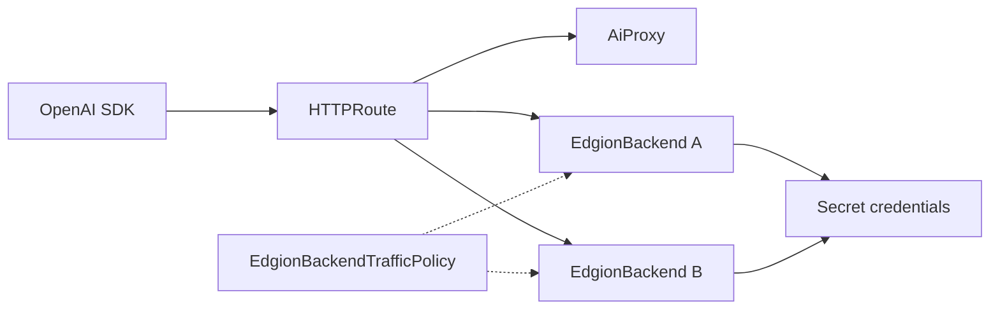

# AI Gateway 概念

Edgion AI Gateway 由四份契约拼装而成。把每项职责放在拥有它的资源上。

## 职责划分

| 关注点 | 所有者 |
|--------|--------|
| 提供商候选、声明顺序、权重 | HTTPRoute `backendRefs` |
| 总超时 / 单次超时；是否允许重试 | HTTPRoute `timeouts` / `retry` |
| 单个提供商 Endpoint、模型目录、凭据池 | `EdgionBackend` |
| 请求转换、选择算法、配额、用量 | Rule 级 `AiProxy` |
| 建连超时、outlier、熔断、重试预算 | 指向该 AI Service 的 `EdgionBackendTrafficPolicy` |

AiProxy **不**携带 `aiServiceRef`、提供商列表、后端权重或重试次数。HTTPRoute 是唯一候选来源。
EBTP 不挂到 Route，也不发明后端。

## 请求路径（高层）

1. Route 匹配 `/v1/chat/completions`（或你配置的路径）并运行 Rule 级 AiProxy。
2. AiProxy 保留客户端请求中的原始模型名/别名作为逻辑模型，并做可选的 token 配额准入。
3. `backendSelection` 在支持该模型、权重为正的 EdgionBackend 中选择一个。
4. 选中的 Service 把逻辑名映射为 provider model，再按权重选择可用凭据（跳过 RPM/TPM/冷却）。
5. Edgion 安装 Secret 凭据、拨号提供商，并流式返回响应。
6. 在响应承诺之前若发生可重试失败，优先换同 Service 的其他凭据，再换其他 Route 后端，且共用
   一个尝试上限。

## 挂载规则

- AiProxy 必须通过 EdgionPlugins `ExtensionRef` 在 Rule 上恰好出现一次。
- 不要全局挂载 AiProxy，也不要作为 backendRef Filter。
- 使用 AiProxy 的 Rule 只能转发到 `edgion.io/EdgionBackend`。
- 本版本 AI backendRef Filter 仅允许 `RequestHeaderModifier` 与 `ResponseHeaderModifier`。请求
  修改会在每次尝试重建；响应修改只作用于最终、不再重试的响应。

## 无效后端份额

缺失、未授权或不支持的 ref 仍保留 Gateway API 加权后的无效流量份额。若选中该份额，Edgion 返回
500，且不会向其他 AI Service 故障切换。

## 下一步

- [EdgionBackend](./edgion-backend.md)
- [路由与选择](./routing.md)
- [弹性与故障切换](./resilience.md)
