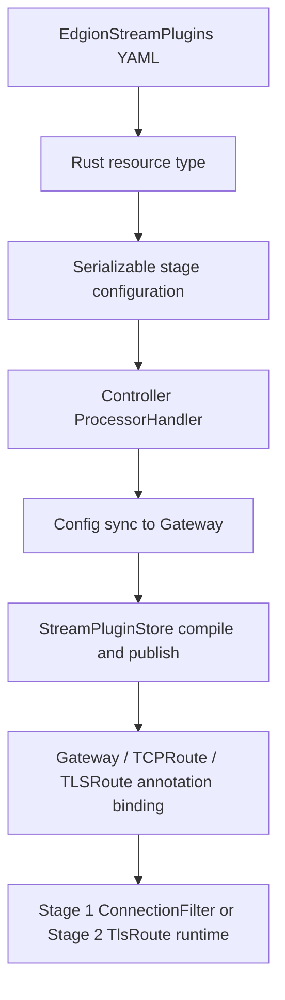

# Stream Plugin 开发指南

本文档面向需要扩展 `EdgionStreamPlugins` 的贡献者，解释 stream plugin 在 Edgion 中的定位、两阶段运行模型，以及人类开发时最容易漏掉的接线点。

> 面向 AI / Agent 的主 workflow 入口现在是 [https://github.com/Pandaala/Edgion/blob/main/skills/01-architecture/02-gateway/13-stream-plugin-dev.md](https://github.com/Pandaala/Edgion/blob/main/skills/01-architecture/02-gateway/13-stream-plugin-dev.md)。
> 本文档保留给人看的背景说明、实现边界和手工核对清单。

## 这类插件解决什么问题

`EdgionStreamPlugins` 是 Edgion 的连接层扩展机制，用来在 HTTP 解析之前或 TLSRoute 匹配之后，对 TCP/TLS 连接做额外处理。

和 HTTP 插件相比，它的关注点不同：

- 作用层级更早，可以在握手前直接拒绝连接
- 主要处理 IP、监听端口、SNI、mTLS 这类连接上下文
- 失败动作通常不是返回 HTTP 响应，而是直接拒绝或终止连接

当前最成熟的实现是 IP 限制插件，代码入口在：

- `edgion-gateway/src/plugins/stream/ip_restriction/`

## 当前两阶段模型

Edgion 现在把 stream plugin 分成两个阶段：

### Stage 1：ConnectionFilter

特点：

- 运行在 TLS 握手和 HTTP 解析之前
- 只有客户端 IP、监听端口、远端地址等信息
- 适合做尽早拒绝的连接级判断

典型场景：

- IP allow/deny
- 对特定监听端口的连接门禁

### Stage 2：TlsRoute

特点：

- 运行在 `TLSRoute` 匹配之后：Terminate 在握手完成后执行，Passthrough 在转发端到端握手之前执行
- 可以看到 SNI、匹配到的 Route；协商后的 TLS 身份和 mTLS 状态仅在 Terminate 下可用
- 适合依赖 TLS 上下文的策略判断

典型场景：

- 按 SNI 或 mTLS 状态做限制
- 只在某条 `TLSRoute` 命中后执行策略

#### TLSRoute 阶段契约

Terminate 和 Passthrough 模式下，TLSRoute 都只执行 `spec.tlsRoutePlugins`，不会回退执行 `spec.plugins`。

- 未声明 `tlsRoutePlugins` 或将其设为 null，同时 `plugins` 非空时，拒绝连接。即使 Stage-1 条目全部禁用或 Bypass 也如此：这是阶段绑定错误。
- 显式 `tlsRoutePlugins: []`、Stage-2 条目全部禁用或 Bypass，表示不执行路由阶段策略；两个字段都缺失或为空也允许连接。启用的 Stage-2 Block 条目仍然拒绝连接。
- 引用的资源不存在时仍然拒绝连接。
- TLSRoute 的 IP 限制应从 `plugins` 移至 `tlsRoutePlugins`。GeoIP、ConnectionRateLimit 应通过 Gateway 监听器绑定 `plugins`，它们不属于 Stage-2。共享资源可以同时声明两个字段，各绑定阶段只执行自己的字段。
- 热更新影响新连接，不会重新校验已建立的连接。
- TLS 访问日志记录 `tls route plugin allowed` / `tls route plugin denied`，或资源缺失、阶段绑定错误；连接路径不产生 `tracing` 或 `(compat)` 事件。

如果资源同时包含连接阶段策略，而路由阶段确实需要无策略放行，请显式声明 `tlsRoutePlugins: []`；需要执行 IP 限制时不能以空列表替代策略。

## 当前架构里的关键链路



最容易漏的不是“写 trait”，而是中间这几段：

- Gateway 的 `compile_stream_plugins` 是否构造了对应阶段的 runtime
- Gateway 是否真的缓存并热更新了 `EdgionStreamPlugins`
- `Gateway` / `TCPRoute` / `TLSRoute` 的注解引用是否真正接到运行时

## 和资源定义相关的代码位置

如果你要新增或扩展 stream plugin，通常先看这些文件：

- `edgion-resources/src/resources/edgion_stream_plugins/mod.rs`
- `edgion-resources/src/resources/edgion_stream_plugins/stream_plugins.rs`
- `edgion-resources/src/resources/edgion_stream_plugins/tls_route_plugins.rs`
- `edgion-resources/src/resource/meta/impls.rs`

这里分别负责：

- CRD 结构、status 和可序列化的阶段配置条目
- Stage 1 插件枚举
- Stage 2 插件枚举
- 资源元数据的 schema 层行为

一个重要事实是：

- Gateway 的 `StreamPluginStore` 调用 `compile_stream_plugins`，构造两个阶段的 runtime 后再发布不可变配置；Controller 传输配置，不传输 runtime 对象

所以只改 Controller handler 并不够：还需要在 Gateway 的构造逻辑中接入插件，资源同步后才有对应的可执行 runtime。

## 和 Gateway 运行时相关的代码位置

Gateway 侧最关键的是这几块：

- `edgion-gateway/src/plugins/stream/stream_plugin_trait.rs`
- `edgion-gateway/src/plugins/stream/stream_plugin_runtime.rs`
- `edgion-gateway/src/plugins/stream/stream_plugin_store.rs`
- `edgion-gateway/src/runtime/server/listener_builder.rs`
- `edgion-gateway/src/routes/tcp/conf_handler_impl.rs`
- `edgion-gateway/src/routes/tls/proxy.rs`

理解方式可以简单记成：

- trait / runtime：定义“插件怎么执行”
- store：定义“Gateway 怎么热更新拿到最新资源”
- listener / route：定义“哪条监听器或路由会调用这个资源”

## 注解绑定规则

当前主键是：

```yaml
metadata:
  annotations:
    edgion.io/edgion-stream-plugins: "policy-name"
```

它目前主要出现在三类位置：

- `Gateway`
- `TCPRoute`
- `TLSRoute`

这不是一个纯文档约定，而是当前实现真正会读取的键。
仓库里历史上出现过 `edgion.io/stream-plugins` 这种旧写法，新改动不应该继续沿用。

在 `Gateway` 上，该值必须是不带命名空间的资源名，并在 Gateway 自身命名空间内解析。
包含 `/` 的值会被 Controller 拒绝，Gateway 还会以 fail-close 方式进行防御。
`TCPRoute`、`TLSRoute` 和 `UDPRoute` 保留各自的 `name` 或 `namespace/name` 约定。
如果需要集中维护数据并让各命名空间自行拥有插件策略，可为每个命名空间保留本地
`EdgionStreamPlugins`，并通过现有授权机制引用共享 `EdgionConfigData`。

## 开发时建议的顺序

1. 先决定插件属于 Stage 1、Stage 2，还是两个阶段都要支持。
2. 决定配置结构是否可以复用已有配置，而不是复制一份近似类型。
3. 把新类型接入 `EdgionStreamPlugin` 或 `TlsRouteStreamPlugin`。
4. 在对应 runtime 中补插件对象构造逻辑。
5. 确认 Gateway 的 `compile_stream_plugins` 在发布配置之前构造对应阶段的 runtime。
6. 确认引用该资源的 `Gateway` / `TCPRoute` / `TLSRoute` 真正能取到 store key。
7. 最后再补测试和样例 YAML。

如果你是让 AI 来做，直接从 skill 入口开始更稳：

- [https://github.com/Pandaala/Edgion/blob/main/skills/01-architecture/02-gateway/13-stream-plugin-dev.md](https://github.com/Pandaala/Edgion/blob/main/skills/01-architecture/02-gateway/13-stream-plugin-dev.md)

## 测试与验证

至少建议覆盖三类验证：

### 1. 资源层

- 资源能被 controller 接收并写出正确 status
- Gateway 在发布更新之前重新构造两个阶段的 runtime

### 2. 引用层

- `Gateway` 注解只接受同命名空间的 `name`；`TCPRoute` / `TLSRoute` / `UDPRoute` 注解仍可解析 `name` 或 `namespace/name`
- 删除资源后，Gateway 不会继续引用旧对象

### 3. 运行层

- 命中插件时行为正确
- 未命中时不会误伤其他连接
- 热更新后旧配置不会残留

现成样例和集成测试配置主要在：

- `edgion-tests/integration/conf/Gateway/StreamPlugins/`
- `edgion-tests/integration/conf/TCPRoute/StreamPlugins/`
- `edgion-tests/integration/conf/TLSRoute/StreamPlugins/`

## 人工审查清单

- 这个插件到底应该运行在 Stage 1 还是 Stage 2
- enum、runtime、module export 是否都接齐
- 注解键是否仍然使用 `edgion.io/edgion-stream-plugins`
- 是否复用了已有配置结构
- 资源更新 / 删除后 Gateway store 是否真的热更新
- 测试是否覆盖了“新增、更新、删除”三个阶段

## 相关文档

- [Annotations 指南](./annotations-guide.md)
- [AI 协作与 Skills 使用指南](./ai-agent-collaboration.md)
- [TCPRoute Stream Plugins 用户文档](../user-guide/tcp-route/stream-plugins.md)
- [知识来源映射与维护规则](./knowledge-source-map.md)
