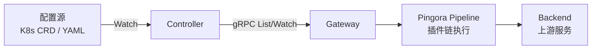

# Edgion：下一代开源 API 网关

## 痛点与方案

### 扩展能力受限 → 28 个插件 + 沙盒 DSL 引擎

传统网关的扩展方式通常只有两条路：编写 Lua 脚本嵌入 Nginx 运行时，或者开发原生插件接入私有 SDK。前者受限于脚本语言的调试和性能瓶颈，后者门槛高、开发周期长。当团队需要在网关层快速实现认证校验、Header 改写、条件路由等逻辑时，往往陷入"小需求大工程"的困境。

Edgion 提供了 **28 个开箱即用的插件**（26 个 HTTP + 2 个 Stream），覆盖认证、安全、流控、可观测四大领域，满足绝大多数生产场景。对于插件未覆盖的长尾需求，内置的沙盒 DSL 引擎提供了 47 个内置函数，无需编写插件即可在配置层实现自定义逻辑，沙盒隔离确保安全可控。

### 底层技术僵化 → Rust + Pingora

许多传统网关构建在 OpenResty / Nginx + Lua 之上。这套技术栈在过去十年功不可没，但如今正面临增长瓶颈：C 语言内核的内存安全隐患、Lua 协程调度的性能天花板、以及社区维护节奏的放缓，都在制约网关的进一步演进。

Edgion 选择 Rust 作为核心语言，基于 Cloudflare 开源的 Pingora 框架构建数据面。Rust 的所有权模型从编译期消除了数据竞争和内存泄漏，Pingora 则提供了经过 Cloudflare 全球网络验证的异步代理引擎。两者结合，使 Edgion 在保持高吞吐、低延迟的同时，具备了 C/C++ 网关难以企及的内存安全保障。

### 配置杂乱难管理 → Gateway API v1 声明式 + 双部署

传统网关的配置方式五花八门：有的依赖 Admin API 命令式推送，有的使用私有 DSL 格式，有的则需要手动编辑 Nginx conf 文件后 reload。配置缺乏统一标准，跨环境迁移困难，版本管理混乱。

Edgion 拥抱 Kubernetes Gateway API v1 标准，以声明式 CRD 作为配置的 Single Source of Truth。同时支持 Kubernetes 和独立部署双模式：在 K8s 环境中，Controller 直接 Watch CRD 变更；在非 K8s 环境中，Controller 监听 YAML 配置文件。两种模式共享相同的配置语义，确保开发、测试、生产环境的一致性。

### 安全合规拉锯 → 完善的认证与 TLS 体系

安全从来不是一个单点问题。传统网关通常只提供基础认证能力，高级安全特性要么缺失，要么需要额外集成第三方组件。团队不得不在网关之外叠加 WAF、认证代理等组件，增加了架构复杂度和运维成本。

Edgion 内置 7 种认证插件（BasicAuth、ForwardAuth、HeaderCertAuth、HMAC、JWT、KeyAuth、LDAP），覆盖从简单 API Key 到企业级 LDAP/JWT 认证的完整谱系。配合 TLS 终止、mTLS、SNI Proxy 等能力，构建起从传输层到应用层的纵深安全防线，无需拼凑外部组件即可满足大多数合规要求。

### 排查如黑盒 → 极致可观测性

当线上出现 P99 延迟飙升或间歇性 5xx 错误时，传统网关往往只能提供粗粒度的访问日志。缺乏结构化指标和链路追踪支持，使得问题定位依赖经验和猜测，MTTR（平均修复时间）居高不下。

Edgion 内建 21 个 Prometheus 指标，覆盖延迟、流量、错误率、饱和度四大黄金信号。每个请求在网关内部的生命周期都有对应的指标采集点，从连接建立到上游响应、从插件执行到错误分类，都可以通过 Grafana 面板实时观测。配合结构化日志输出，运维团队能够在分钟级别完成问题定位。

---

## 八大核心特性

### 1. 插件生态完整，开箱即用

Edgion 内置 28 个插件（26 个 HTTP + 2 个 Stream），覆盖认证、安全、流控、可观测四大核心领域。7 种认证方式（BasicAuth、JWT、HMAC、LDAP 等）、6 个安全插件（CORS、CSRF、IP 限制等）、7 个流量控制插件（限流、限速、请求镜像等）——生产环境所需的核心能力无需拼凑第三方组件，一个网关即可覆盖。配合 47 个 DSL 内置函数，长尾需求同样从容应对。

### 2. Rust + Pingora 性能底座

Edgion 的数据面完全使用 Rust 编写，基于 Pingora 的异步事件驱动模型处理请求。Rust 的零成本抽象确保高层逻辑不会引入运行时开销，Pingora 的连接池复用和多线程调度则最大化了硬件利用率。相比基于脚本语言的网关，Edgion 在相同硬件条件下能够处理更高的并发连接数，同时将尾延迟控制在更低的水平。

### 3. 沙盒 DSL 引擎

传统网关的自定义逻辑通常需要编写 Lua 脚本或开发原生插件，门槛高且调试困难。Edgion 提供了一套专为 API 网关设计的 DSL（Domain-Specific Language），支持变量声明（`let` / `let mut`）、条件分支（`if/else`）、循环控制（`for..in`、`for..range`、`while`、`break/continue`）、方法调用和字段访问等语言特性，内置 47 个函数覆盖请求读取（15 个）、请求修改（6 个）、响应读取（3 个）、响应修改（3 个）、上下文操作（3 个）和通用工具（17 个）。

以下示例展示了如何在 DSL 中实现认证校验与条件路由：

```
let auth = req.header("Authorization");
if auth == "" {
    return deny(401, "Unauthorized");
}
let path = req.path;
if path.starts_with("/admin") {
    req.set_header("X-Role", "admin");
}
return next();
```

DSL 运行在安全沙盒中，通过 `maxSteps`、`maxLoopIterations`、`maxStringLen`、`maxStackDepth` 四个维度限制资源消耗，确保用户脚本不会拖垮网关性能或造成安全隐患。编写 DSL 不需要了解 Rust，不需要编译插件，配置变更即时生效。

### 4. 双部署模式

Edgion 的 Controller-Gateway 分离架构天然支持两种部署形态。在 Kubernetes 环境中，Controller 以 Operator 形态运行，Watch Gateway API CRD 变更并通过 gRPC 流式推送至 Gateway 实例；在传统虚拟机或裸金属环境中，Controller 监听本地 YAML 文件变更，以相同的 gRPC 协议同步配置。Gateway 侧的代码完全一致，无需针对不同部署环境做任何适配。

### 5. 极致可观测性

21 个 Prometheus 指标覆盖四大黄金信号：请求延迟直方图精确到分位数，流量计数器按路由和状态码分维度聚合，错误率指标区分客户端错误与上游错误，饱和度指标反映连接池和线程池的利用率。所有指标通过标准的 `/metrics` 端点暴露，兼容任何 Prometheus-compatible 的监控系统。

### 6. 热重载一切

配置变更不需要重启进程，不需要断开已有连接。Controller 通过 gRPC List/Watch 流式协议将变更实时推送至 Gateway，Gateway 在内存中原子更新路由表、插件链和上游配置。整个过程对正在处理的请求完全透明，实现真正的零停机更新。

### 7. 安全纵深

从传输层的 TLS 终止和 mTLS 双向认证，到应用层的 7 种认证插件（BasicAuth、ForwardAuth、HeaderCertAuth、HMAC、JWT、KeyAuth、LDAP），再到流量层面的 IP 限制和速率控制，Edgion 构建了多层安全防线。每一层都可以独立启用和配置，安全策略以声明式方式定义，与业务配置统一管理，避免了安全规则散落在多个系统中的混乱局面。

### 8. 多协议支持

Edgion 不仅是 HTTP 网关。它原生支持 HTTP/1.1、HTTP/2、gRPC、TCP、UDP、WebSocket 和 SNI Proxy 七种协议，覆盖了现代微服务架构中几乎所有的通信场景。无论是 RESTful API、gRPC 服务间调用、WebSocket 长连接，还是需要四层转发的 TCP/UDP 流量，都可以通过同一个网关统一管理，减少基础设施的碎片化。

---

## 架构一览



Edgion 采用 Controller-Gateway 分离架构。**Controller** 负责配置的采集、校验与分发，是整个系统的控制面。它从配置源（Kubernetes CRD 或 YAML 文件）获取声明式配置，经过语义校验后，通过 gRPC 的 List/Watch 流式协议推送至下游的 Gateway 实例。

**Gateway** 是纯粹的数据面，负责实际的流量代理。它从 Controller 接收配置，构建路由表和插件链，基于 Pingora 的高性能代理引擎处理每一个请求。Gateway 本身不持有配置状态的权威副本，所有配置均来自 Controller 的推送，这使得 Gateway 可以无状态地水平扩展。

这种分离设计带来了清晰的职责边界：Controller 可以独立升级而不影响流量处理，Gateway 可以按需扩缩容而不影响配置管理。在 Kubernetes 环境中，Controller 通常以单副本 Deployment 运行，Gateway 则以 DaemonSet 或多副本 Deployment 部署在流量入口节点。

---

## 适用场景

### 企业 API 网关替换

如果你的团队正在寻找一款能够覆盖生产核心场景的现代网关，Edgion 是值得评估的选项。28 个内置插件覆盖认证、安全、流控、可观测四大领域，配合 Rust 带来的性能与安全保障、Gateway API v1 的标准化配置管理，能够满足绝大多数企业级网关的使用场景。

### Kubernetes 入口网关

Edgion 原生支持 Gateway API v1 标准，以 CRD 声明式管理路由和策略。相比传统的 Ingress Controller，Gateway API 提供了更精细的角色分离和更丰富的路由语义。配合 Controller 的 Watch 机制，配置变更秒级生效，无需 reload。

### 多协议统一代理

当你的架构中同时存在 HTTP API、gRPC 服务、WebSocket 长连接和 TCP/UDP 流量时，Edgion 可以作为统一的流量入口。一个网关覆盖七种协议，减少了运维多套代理组件的复杂度，统一了监控和安全策略的管理面。

### 需要自定义逻辑但不想写插件的团队

如果你需要在网关层实现请求校验、Header 改写、条件路由等自定义逻辑，但不想为此开发和维护原生插件，Edgion 的沙盒 DSL 引擎是理想选择。47 个内置函数覆盖了常见的请求/响应操作，沙盒机制保障安全，配置即代码的方式让变更快速上线。

---

## 下一步

- [快速上手指南](../getting-started/) — 五分钟内启动你的第一个 Edgion 实例
- [技术白皮书](./whitepaper.md) — 深入了解 Edgion 的架构设计与技术决策
