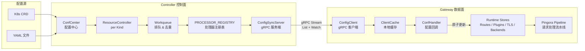
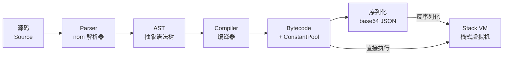

# Edgion 技术白皮书

> 本文档面向架构师和技术决策者，深入阐述 Edgion 的核心架构设计、关键技术选型（Rust / Pingora / Gateway API）的决策依据，以及各子系统的实现原理。如需产品功能概览，请参见 [GitHub README](../../../README.md)。

---

## 1. 摘要

Edgion 是一款完全开源的云原生 API 网关，基于 Rust 语言和 Cloudflare Pingora 框架构建。它原生遵循 Kubernetes Gateway API v1 标准，采用 Controller-Gateway 分离架构，通过 gRPC List/Watch 机制实现配置的实时同步与热重载。Edgion 内置自研的 DSL 脚本引擎，提供从源码到字节码的完整编译流水线和多层沙盒安全模型，使运维人员能够在不修改网关代码的前提下灵活编排请求处理逻辑。项目提供 28 个插件（26 个 HTTP 插件 + 2 个 Stream 插件），覆盖认证、安全、流量管控等核心场景，具备毫秒级配置生效、零重启热更新、Panic 隔离等生产级特性。

---

## 2. 背景与动机

### 2.1 API 网关市场现状与痛点

随着微服务架构和云原生技术的普及，API 网关已成为现代分布式系统的关键基础设施。然而，当前市场上的主流方案普遍存在以下痛点：

**扩展能力受限。** 传统网关的扩展方式通常局限于嵌入脚本或开发原生插件。前者受限于脚本语言的性能和调试瓶颈，后者门槛高、开发周期长。当团队需要快速实现自定义逻辑时，往往面临"小需求大工程"的困境，插件生态的碎片化进一步加剧了集成成本。

**技术债务。** 部分传统方案使用 C/C++ 编写核心模块，长期积累的代码库中内存安全问题（buffer overflow、use-after-free、data race）频发。即便通过严格的代码审查和 fuzzing 测试，仍难以从根本上消除此类隐患。另有方案依赖 Lua 脚本嵌入运行时，虽然提供了灵活性，但 Lua 脚本缺乏原生沙盒隔离，一段恶意或失控的脚本即可导致整个网关进程崩溃。

**配置混乱。** 不同网关产品定义了各自的配置模型和 CRD 格式，缺乏统一标准。运维团队在多集群、多网关环境下面临配置碎片化的困境。Kubernetes Ingress API 虽然提供了基本的路由抽象，但其功能有限，无法满足复杂的流量管理需求，导致各家通过 annotation 扩展形成事实上的"方言"。

**可观测性缺口。** 传统方案通常将可观测性作为附加模块，而非架构内生能力。监控指标的采集粒度不足、链路追踪的接入成本高、访问日志的结构化程度低等问题，使得故障排查和性能调优的效率大打折扣。

### 2.2 为什么选择 Rust + Pingora

Edgion 选择 Rust 作为核心开发语言，并基于 Cloudflare 开源的 Pingora 框架构建，这一技术选型基于以下考量：

**内存安全，编译期保证。** Rust 的所有权系统和借用检查器在编译期消除了数据竞争、空指针解引用、use-after-free 等内存安全问题。对于需要 7x24 小时稳定运行的 API 网关而言，这意味着从语言层面消除了一整类运行时崩溃的可能性。相比 C/C++ 方案需要依赖 ASan、Valgrind 等工具在运行时检测内存问题，Rust 将安全检查前移到了编译阶段。

**异步高性能。** Rust 的零成本抽象和 async/await 协程模型，在保证代码可读性的同时提供了接近 C 语言的运行时性能。Pingora 框架基于 Tokio 异步运行时，能够高效处理大量并发连接，其事件驱动架构天然适合网关的代理转发场景。

**生产级验证。** Pingora 由 Cloudflare 开发并在其全球 CDN 边缘网络中实际部署，日处理万亿级请求。Cloudflare 公开的性能数据显示，Pingora 相比其前代 Nginx 方案在资源消耗和延迟方面均有显著改善。Edgion 站在 Pingora 的肩膀上，继承了这套经过大规模生产环境验证的网络 I/O 和连接管理能力。

**对比其他技术路线。** 基于 Lua 嵌入的方案（如许多 Nginx 扩展）虽然灵活，但 Lua 运行时的 GC 停顿和缺乏类型系统会在高并发场景下引入不确定性延迟。基于 Go 的方案在并发编程方面表现良好，但 GC 的存在使其在极端延迟敏感场景（P99 尾延迟）下不如 Rust 可控。基于 C/C++ 的方案虽然性能优异，但开发效率和安全性的代价过高。Rust + Pingora 的组合在安全性、性能和工程效率之间取得了最佳平衡。

### 2.3 为什么基于 Gateway API v1

Edgion 选择 Kubernetes Gateway API v1 作为核心配置模型，而非传统的 Ingress API 或自定义私有格式：

**标准优于私有。** Gateway API 是 Kubernetes SIG-Network 主导的官方标准，代表了社区对下一代流量管理 API 的共识。遵循标准意味着用户的配置知识可在不同网关产品之间迁移，避免厂商锁定。

**角色分离模型。** Gateway API 引入了 GatewayClass、Gateway、HTTPRoute/GRPCRoute 等分层资源，天然支持基础设施提供者、集群管理员、应用开发者三种角色的职责分离。这种设计与企业内部的团队协作模式高度契合——平台团队管理 Gateway 实例和全局策略，业务团队自主管理各自服务的路由规则。

**面向未来。** Ingress API 自 Kubernetes 1.19 起虽已进入 GA 状态，但其功能局限性（如不支持 TCP/UDP 路由、无法表达复杂的匹配条件、缺乏标准的请求/响应变换能力）导致各家实现大量依赖非标准 annotation 进行扩展。Gateway API 从设计之初就考虑了这些高级场景，其可扩展的 Policy Attachment 机制和 ExtensionRef 模型为未来功能演进预留了充足空间。Edgion 对 Gateway API 的原生支持，确保了其配置体系与 Kubernetes 生态的长期演进方向保持一致。

---

## 3. 架构设计

### 3.1 Controller-Gateway 分离架构

Edgion 采用经典的控制面/数据面分离架构：

- **Controller（控制面）** 负责监听配置源（Kubernetes CRD、YAML 文件等），对配置进行验证、转换和分发。Controller 是配置的"真相之源"（source of truth），所有配置变更都经过 Controller 的校验流程后才下发到数据面。
- **Gateway（数据面）** 是无状态的代理节点，专注于请求的接收、路由、插件执行和转发。Gateway 从 Controller 获取配置，但不直接访问配置源。数据面的无状态特性使其可以水平扩缩容，且节点故障不会导致配置丢失。

这种分离设计带来的核心优势是：配置管理的复杂性被封装在 Controller 中，数据面保持简洁高效。Controller 可以独立升级，不影响正在运行的流量代理。

### 3.2 gRPC List/Watch 配置同步

Controller 与 Gateway 之间通过 gRPC 实现配置同步，采用类似 Kubernetes Informer 的 List/Watch 模式：

1. **全量同步（List）。** Gateway 节点启动或重连时，向 Controller 发起 ListRequest，获取当前所有配置资源的完整快照。这确保了 Gateway 在任何时刻都能从一致的配置状态开始工作。
2. **增量推送（Watch）。** 全量同步完成后，Gateway 与 Controller 之间建立长连接 gRPC stream。Controller 在配置变更时将增量更新推送至 Gateway，无需轮询，实现近实时的配置生效。
3. **断线恢复。** 当 Gateway 与 Controller 之间的连接中断时，Gateway 继续使用本地缓存的配置正常服务流量。重连后自动执行全量同步（List），恢复到最新配置状态。整个过程对业务流量完全透明。

### 3.3 统一资源注册表与处理器

Controller 内部采用统一的资源处理架构：

- **ResourceController。** 每种 Kubernetes 资源类型（Kind）对应一个 ResourceController 实例，负责该类型资源的 Watch、事件处理和状态管理。
- **Workqueue。** 资源变更事件进入 Workqueue 进行排队和去重，避免短时间内大量变更导致的重复处理。
- **PROCESSOR_REGISTRY。** 全局处理器注册表，将资源类型映射到对应的处理函数。新增资源类型时，只需实现处理器并注册到 Registry，无需修改框架代码。
- **ConfigSyncServer。** 处理完成的配置通过 gRPC ConfigSyncServer 推送到下游 Gateway 节点。

### 3.4 配置流转全景图



### 3.5 热重载原理

Edgion 的配置热重载机制无需重启进程：

1. ConfigClient 接收到来自 Controller 的增量配置更新。
2. 更新写入 ClientCache，触发 ConfHandler 回调。
3. ConfHandler 将新配置解析为运行时对象（Routes、Plugins、TLS 证书、Backend 列表等），通过原子操作（`Arc::swap` / `ArcSwap`）替换 Runtime Store 中的旧配置。
4. 后续请求读取到新配置，立即生效。正在处理中的请求继续使用旧配置完成，不受影响。

整个过程无锁竞争（读路径是 lock-free 的），对请求处理延迟的影响在纳秒级别。

---

## 4. DSL 引擎深潜

### 4.1 为什么自研 DSL

在 API 网关中嵌入可编程能力是实际生产需求驱动的——标准化的插件无法覆盖所有业务场景。Edgion 评估了以下方案后，决定自研领域特定语言（DSL）：

**Lua 嵌入方案的局限。** Lua 是网关领域最常见的脚本方案，但存在根本性的安全缺陷：Lua 运行时默认不提供沙盒隔离，脚本可以访问文件系统、网络和操作系统 API。虽然可以通过移除标准库来实现一定程度的限制，但这种"黑名单"方式容易遗漏，且 Lua 的 GC 机制在高并发场景下可能引入不可预测的延迟。

**WASM 方案的取舍。** WebAssembly 提供了良好的沙盒隔离和语言无关性，但其工具链复杂（需要将源语言编译为 WASM 模块），冷启动开销较高（模块实例化、内存分配），且对简单的请求处理逻辑而言"杀鸡用牛刀"。

**Edgion DSL 的定位。** 自研 DSL 专为 API 网关请求处理场景设计，具有以下特点：
- **语法简洁直观**——无需学习通用编程语言的复杂特性
- **编译期 + 运行时双重安全**——从解析到执行的每个阶段都有防护措施
- **零外部依赖**——DSL 引擎完全用 Rust 实现，无 FFI 调用
- **轻量级字节码**——编译后的脚本以 base64 JSON 格式存储，可跨版本分发

### 4.2 语言设计

EdgionDSL 的语法设计借鉴了 Rust 和 JavaScript 的习惯，降低学习门槛：

**变量声明。** 支持不可变和可变变量：

```
let ip = req.client_ip()
let mut count = 0
count = count + 1
```

**控制流。** 支持 `if/else if/else`、`for...in`、`for...in range()`、`while` 循环，以及 `break`/`continue`：

```
if req.method() == "POST" && req.path().starts_with("/api") {
    let token = req.header("Authorization")
    if token == nil {
        return deny(401, "Unauthorized")
    }
} else {
    return next()
}

for name in req.header_names() {
    if name.starts_with("x-internal-") {
        req.remove_header(name)
    }
}
```

**表达式。** 支持算术运算（`+`、`-`、`*`、`/`）、比较运算（`==`、`!=`、`<`、`>`、`<=`、`>=`）、逻辑运算（`&&`、`||`、`!`）、字符串拼接（`+`）。支持方法调用（`obj.method(args)`）、字段访问（`req.path`，等价于零参数方法调用）和自由函数调用（`log("msg")`、`len(s)`）。

**终止语句。** 两种方式结束脚本执行：
- `return next()` —— 放行请求，继续执行后续插件
- `return deny(status, body)` —— 拒绝请求，返回指定状态码和响应体

**47 个内置函数。** 按职责分为六类：

| 分类 | 数量 | 代表函数 |
|------|------|---------|
| 请求读取 | 15 | `req.header()`, `req.method()`, `req.path()`, `req.query()`, `req.cookie()`, `req.client_ip()`, `req.remote_ip()`, `req.path_param()`, `req.header_names()`, `req.scheme()`, `req.host()`, `req.uri()`, `req.content_type()`, `req.has_header()`, `req.query_string()` |
| 请求修改 | 6 | `req.set_header()`, `req.append_header()`, `req.remove_header()`, `req.set_uri()`, `req.set_host()`, `req.set_method()` |
| 响应读取 | 3 | `resp.status()`, `resp.header()`, `resp.has_header()` |
| 响应修改 | 3 | `resp.set_header()`, `resp.append_header()`, `resp.remove_header()` |
| 上下文操作 | 3 | `ctx.get()`, `ctx.set()`, `ctx.remove()` |
| 工具函数 | 17 | `log()`, `len()`, `substr()`, `to_int()`, `to_str()`, `to_upper()`, `to_lower()`, `base64_encode()`, `base64_decode()`, `url_encode()`, `url_decode()`, `sha256()`, `md5()`, `time_now()`, `regex_find()`, `regex_replace()`, `range()` |

此外，字符串对象支持 `.starts_with()`、`.ends_with()`、`.contains()`、`.matches()` 方法，其中 `.matches()` 接受正则表达式字面量，在编译期校验正则语法的合法性。

### 4.3 编译流水线

EdgionDSL 采用经典的多阶段编译流水线，将人类可读的源码转化为高效的字节码：



**阶段 1: 解析（Parser）。** 基于 nom 组合子解析器构建，采用 Pratt 解析算法（precedence climbing）处理运算符优先级。解析器内置四层防护：
- **源码大小限制**：最大 64KB（`MAX_SOURCE_LEN`）
- **解析预算**：全局计步器（默认 50,000 步），防止病态回溯导致的 CPU 占用
- **嵌套深度限制**：最大 64 层，防止栈溢出
- **AST 节点数限制**：最大 2,000 个节点，防止恶意构造的超大 AST

**阶段 2: AST。** 抽象语法树由 `Program`（顶层语句列表）、`Stmt`（语句）和 `Expr`（表达式）三个核心类型组成。语句类型包括 `Let`（变量声明）、`Assign`（赋值）、`If`（条件分支）、`ForIn`（迭代循环）、`ForRange`（范围循环）、`While`（条件循环）、`ReturnDeny`（拒绝终止）、`ReturnNext`（放行终止）、`Break`、`Continue` 和 `ExprStmt`（表达式语句）。

**阶段 3: 编译（Compiler）。** 编译器遍历 AST 生成扁平的字节码指令序列。关键技术包括：
- **局部变量解析**：作用域跟踪 + slot 分配，编译期检查可变性约束
- **短路求值**：`&&` 和 `||` 运算通过条件跳转实现短路语义
- **跳转回填（backpatching）**：if/else/while/for 的跳转偏移在编译后期回填
- **命名空间方法解析**：`req.header("X")` 被编译为 `CallBuiltin(ReqHeader, 1)`，直接映射到内置函数 ID
- **常量池去重**：相同的字符串和整数常量共享同一个常量池条目

**阶段 4: 字节码。** 编译产物 `CompiledScript` 包含四个字段：指令序列（`code: Vec<OpCode>`）、常量池（`constants: Vec<Constant>`）、局部变量槽数（`local_count`）和最大循环嵌套深度（`max_loop_depth`）。字节码附带版本号（当前 `BYTECODE_VERSION = 1`），序列化为 base64 编码的 JSON 格式，可在 Controller 和 Gateway 之间安全传输，也可持久化存储。反序列化时严格校验版本兼容性和载荷大小（最大 256KB 解码后）。

**阶段 5: 执行。** 栈式虚拟机（Stack-based VM）逐条执行字节码指令。指令集包括栈操作（LoadConst、LoadNil、LoadTrue、LoadFalse、Pop）、局部变量操作（GetLocal、SetLocal）、算术运算、比较运算、逻辑运算、字符串方法（StartsWith、EndsWith、Contains、Matches）、控制流跳转、列表操作以及内置函数调用。

### 4.4 沙盒安全模型

EdgionDSL 的安全设计贯穿从解析到执行的全部阶段，采用纵深防御策略：

**零能力原则。** DSL 脚本无法访问文件系统、网络、环境变量或操作系统 API。脚本能触达的全部外部世界仅限于 47 个经过审计的内置函数，这些函数只操作当前请求/响应的 header、path、query 等元数据。

**运行时资源限制。** VM 执行时受以下可配置参数约束：

| 参数 | 配置字段 | 默认值 | 用途 |
|------|----------|--------|------|
| 最大执行步数 | `maxSteps` | 10,000 | 防止无限循环和过度计算 |
| 最大循环迭代次数 | `maxLoopIterations` | 100 | 单个循环体的迭代上限 |
| 最大内置函数调用次数 | `maxCallCount` | 500 | 防止通过内置函数调用消耗过多资源 |
| 最大栈深度 | `maxStackDepth` | 128 | 防止深度嵌套表达式耗尽栈空间 |
| 最大字符串长度 | `maxStringLen` | 8,192 字节 | 防止字符串拼接消耗过多内存 |

此外，正则表达式模式长度限制为 1,024 字符，且正则语法在编译期（而非运行时）校验，避免了 ReDoS（正则拒绝服务）攻击。

**错误处理策略。** 当 DSL 脚本执行出错（运行时异常或 VM panic）时，行为由 `errorPolicy` 配置决定：

| 策略 | 行为 |
|------|------|
| `Ignore`（默认） | 忽略错误，放行请求继续执行后续插件（fail-open） |
| `Deny` | 向客户端返回 500 错误响应 |
| `DenyWith { status, body }` | 向客户端返回自定义状态码和响应体 |

**Panic 隔离。** VM 的 `execute_safe` 函数使用 Rust 的 `std::panic::catch_unwind` 包裹整个执行过程。即使 VM 内部发生了未预期的 panic，也不会传播到网关主进程，而是根据 errorPolicy 优雅降级。

### 4.5 实际用例

**用例 1：请求认证与条件路由。** 检查 API Key，对未认证请求直接拒绝，对特定路径设置上下文变量供下游插件使用：

```
let key = req.header("X-API-Key")
if key == nil {
    return deny(401, "Missing API key")
}

if key != "expected-secret-key" {
    return deny(403, "Invalid API key")
}

// 标记已认证，供下游插件读取
ctx.set("authenticated", "true")

if req.path().starts_with("/admin") {
    ctx.set("role", "admin")
}

return next()
```

**用例 2：响应头操作。** 根据请求路径为静态资源添加缓存控制头，并清理内部调试头：

```
if req.path().starts_with("/static/") {
    resp.set_header("Cache-Control", "public, max-age=86400")
    resp.set_header("X-Cache-Policy", "static-assets")
} else if req.path().starts_with("/api/") {
    resp.set_header("Cache-Control", "no-store")
}

// 移除内部调试头，避免信息泄露
resp.remove_header("X-Debug-Trace-Id")
resp.remove_header("X-Internal-Server")

return next()
```

**用例 3：内网 IP 限流豁免。** 从客户端 IP 判断是否为内网请求，若是则通过上下文变量标记，供后续 RateLimit 插件跳过限流：

```
let ip = req.client_ip()

// 内网 CIDR 段简单匹配
if ip.starts_with("10.") || ip.starts_with("192.168.") || ip.starts_with("172.") {
    ctx.set("rate_limit_bypass", "true")
    req.set_header("X-Internal-Request", "true")
}

// 记录请求来源用于审计
let method = req.method()
let path = req.path()
log("request from " + ip + ": " + method + " " + path)

return next()
```

---

## 5. 插件系统设计

### 5.1 HTTP 插件 Async Trait 生命周期

Edgion 的 HTTP 插件体系围绕 Pingora 的请求处理流水线设计，将插件执行划分为四个阶段，每个阶段对应一个独立的 trait：

**RequestFilter（请求阶段，异步）。** 在请求转发到上游之前执行。这是最常用的插件挂载点，认证、鉴权、限流、请求改写等插件均在此阶段运行。trait 定义：

```rust
#[async_trait]
pub trait RequestFilter: Send + Sync {
    fn name(&self) -> &str;
    async fn run_request(
        &self,
        session: &mut dyn PluginSession,
        log: &mut PluginLog,
    ) -> PluginRunningResult;
}
```

`PluginRunningResult` 是插件执行的返回值枚举，包括：`GoodNext`（放行，继续下一个插件）、`ErrResponse { status, body }`（中断插件链，直接返回错误响应给客户端）、`ErrTerminateRequest`（终止请求处理）等。

**UpstreamResponseFilter（上游响应头阶段，同步）。** 在收到上游响应头后、发送给客户端之前执行。用于响应头改写（添加 CORS 头、安全头、缓存控制头等）。此阶段是同步的，因为响应头的处理通常是纯计算操作，无需异步 I/O。

**UpstreamResponseBodyFilter（上游响应体阶段，同步）。** 在上游响应体的每个 chunk 到达时执行。用于带宽限制（BandwidthLimit 插件在此阶段控制下行速率）等流式处理场景。

**UpstreamResponse（上游响应阶段，异步）。** 在完整收到上游响应后执行。用于需要完整响应信息才能工作的插件，如基于响应状态码的条件逻辑。

所有阶段共享同一个 `PluginSession` trait 作为会话抽象。`PluginSession` 提供了统一的请求/响应读写接口，包括 header 读取（`header_value`、`get_path`、`get_query_param`、`get_cookie`）、header 修改（`set_request_header`、`set_response_header`、`remove_request_header`）、上下文变量（`get_ctx_var`、`set_ctx_var`）、客户端信息（`client_addr`、`remote_addr`、`client_cert_info`）等方法。这一设计使得 DSL 引擎和原生 Rust 插件共享同一套会话接口，保证了行为的一致性。

### 5.2 Stream 插件体系

除 HTTP 插件外，Edgion 还支持 TCP/UDP 层的 Stream 插件，用于非 HTTP 协议的流量处理（如数据库代理、消息队列协议等）。Stream 插件拥有独立的 trait 定义和运行时，与 HTTP 插件体系在架构上平行，互不干扰。

### 5.3 插件链组合与执行顺序

每条路由规则（HTTPRoute/GRPCRoute）可关联一个 `EdgionPlugins` 资源，其中定义了该路由需要执行的插件列表。插件按声明顺序依次执行，形成插件链。

关键机制：
- **顺序执行。** 插件严格按照 EdgionPlugins 中 `requestPlugins`、`upstreamResponseFilterPlugins`、`upstreamResponsePlugins`、`upstreamResponseBodyFilterPlugins` 列表的声明顺序执行。
- **短路中断。** 任何插件返回 `ErrResponse` 或 `ErrTerminateRequest`，将立即中断插件链，不再执行后续插件。这使得认证插件可以放在链首，未认证请求不会到达后续业务插件。
- **条件执行。** 每个插件条目支持 `conditions` 配置，运行时在执行插件前先评估条件（基于请求 method、path、header、cookie 等），条件不满足则跳过该插件。这相当于为每个插件添加了一个前置的 if 判断。
- **启用/禁用。** 每个插件条目支持 `enabled` 字段，设为 false 的插件会在构建 PluginRuntime 时被完全跳过。
- **跨路由复用。** 多条 HTTPRoute / GRPCRoute 可以通过 `ExtensionRef`（Gateway API 标准 filter）引用同一个 EdgionPlugins 资源，从而共享同一套插件链配置。该模型对标 Envoy ECDS：复用通过"多 Route 引用同一资源"表达，filter chain 自身保持扁平 list，不构成 graph。

### 5.4 Panic 隔离

Edgion 对插件执行采取防御性设计，确保单个插件的异常不会影响整个网关进程：

- **DSL 插件** 的执行被 `std::panic::catch_unwind` 包裹。VM panic 被捕获后，根据 `errorPolicy` 配置决定后续行为（忽略/拒绝/自定义响应），不会传播到 Pingora 工作线程。
- **原生 Rust 插件** 通过 Rust 的类型系统和 `Result` 错误处理模式，将可预见的错误通过 `PluginRunningResult` 返回值传递，避免 panic。
- **FFI 边界保护。** 在 BoringSSL mTLS 验证回调等跨 FFI 边界的场景中，同样使用 `catch_unwind` 防止 Rust panic 跨越 C FFI 边界导致未定义行为。

### 5.5 分类全览表

Edgion 提供 28 个内置插件（26 个 HTTP + 2 个 Stream），按功能分类如下：

| 分类 | 数量 | 插件名称 |
|------|------|---------|
| **认证** | 7 | BasicAuth, KeyAuth, JwtAuth, HmacAuth, LdapAuth, ForwardAuth, OpenidConnect |
| **安全** | 6 | Cors, Csrf, IpRestriction, RequestRestriction, JweDecrypt, HeaderCertAuth |
| **流量管控** | 7 | RateLimit, RateLimitRedis, BandwidthLimit, ProxyRewrite, Mock, DirectEndpoint, RequestMirror |
| **可编程** | 1 | DslPlugin（支持 request 和 upstream_response 两个阶段） |
| **请求/响应变换** | 4 | RequestHeaderModifier, ResponseHeaderModifier, URLRewrite, ResponseRewrite |
| **路由与上游** | 3 | DynamicInternalUpstream, DynamicExternalUpstream, RealIp |
| **辅助** | 2 | CtxSet, AllEndpointStatus |
| **调试** | 1 | DebugAccessLogToHeader |

此外，Gateway API 标准 Filter（RequestHeaderModifier、ResponseHeaderModifier、RequestRedirect、URLRewrite、RequestMirror、ExtensionRef）作为一等公民直接集成在路由层，无需额外配置为 EdgionPlugin。

---

## 6. 可观测性体系

可观测性是 Edgion 的架构内生能力，而非事后附加的外围模块。从请求接入到响应发出，每一跳都被结构化地记录和度量。Edgion 的可观测性体系围绕四个维度展开：统一 JSON 访问日志、Prometheus 指标体系、按 Listener 独立日志以及异步 Channel 派发机制。

### 6.1 统一 JSON 访问日志

Edgion 将每条请求的完整生命周期压缩为一行 JSON 日志。`AccessLogEntry` 结构体（定义于 `observe/access_log/entry.rs`）包含以下核心字段：

| 字段 | 类型 | 说明 |
|------|------|------|
| `ts` | i64 | 毫秒级 UTC 时间戳（`chrono::Utc::now().timestamp_millis()`） |
| `request_info` | RequestInfo | 请求元数据：method、path、status、client IP、协议、X-Trace-Id 等 |
| `match_info` | RouteMatchInfo | 路由匹配结果，支持 HTTP 和 gRPC 两种路由类型（`#[serde(untagged)]` 枚举） |
| `errors` | \[EdgionStatus\] | 请求生命周期中累积的错误列表 |
| `backend_context` | BackendContext | 后端上游信息：服务名、命名空间、上游 IP/端口、响应体大小、写入等待时间 |
| `stage_logs` | \[StageLogs\] | 各插件阶段的执行日志——哪些插件被执行、耗时多少、返回了什么结果 |
| `conn_est` | bool | 连接是否成功建立 |
| `ctx` | HashMap | 上下文变量映射，由插件和 DSL 脚本写入 |

每一行日志即是一次请求的完整档案。`stage_logs` 字段尤为关键——它记录了插件链中每个插件的执行情况，使得运维人员可以精确定位"请求在哪个插件被拦截"或"哪个插件耗时异常"。所有字段均使用 `#[serde(skip_serializing_if)]` 条件序列化，空字段不输出，减少日志体积。

在 `pg_logging.rs` 的 `logging` 函数中，日志条目通过 `AccessLogEntry::from_context(ctx)` 从请求上下文一次性构建，然后序列化为 JSON 字符串并通过 `access_logger.send()` 异步派发，整个过程不阻塞请求处理流水线。

### 6.2 Prometheus 指标体系

Edgion 定义了 21 个 Prometheus 指标，覆盖 Google SRE 四大黄金信号（Latency、Traffic、Errors、Saturation），并通过 `metrics` crate 实现线程安全的高性能采集。所有指标在 `GatewayMetrics` 全局单例中统一管理，通过 `LazyLock` 惰性初始化。

#### Latency（延迟）

| 指标名 | 类型 | 说明 |
|--------|------|------|
| `edgion_gateway_request_duration_ms` | Histogram | 端到端请求延迟直方图，支持可配置 label（gateway/route/backend/protocol/status），可按需关闭特定维度以降低基数 |

> 镜像请求只暴露 counter（`edgion_mirror_requests_total{status}`）；per-request 延迟记录在 mirror access log 的 `et` 字段而非 histogram——mirror 是 fire-and-forget，tail latency 不影响用户流量。

`edgion_gateway_request_duration_ms` 的 label 由 `RequestDurationConfig.labels` 配置驱动，每个 label 维度可独立启用或禁用。未启用的 label 不会写入（而非写入空字符串），从根源上控制时间序列基数。直方图的 bucket 边界同样支持自定义配置，并通过 `idle_timeout` 自动清理冷时间序列。

#### Traffic（流量）

| 指标名 | 类型 | 说明 |
|--------|------|------|
| `edgion_requests_total` | Counter | 已处理请求总数 |
| `edgion_ctx_created_total` | Counter | 创建的请求上下文总数 |
| `edgion_backend_requests_total` | Counter | 后端请求总数，携带 gateway/route/backend/protocol/status 等多维 label |
| `edgion_mirror_requests_total` | Counter | 镜像请求总数，按 status label 分组 |
| `edgion_gateway_request_bytes_total` | Counter | 下行到上游的请求字节总数 |
| `edgion_gateway_response_bytes_total` | Counter | 上游到下行的响应字节总数 |
| `edgion_config_reload_signals_total` | Counter | 从 Controller 接收的配置重载信号总数 |
| `edgion_config_relist_total` | Counter | 配置全量重新拉取次数 |
| `edgion_config_event_parse_errors_total` | Counter | watch 事件 JSON 解析失败次数（按资源 `kind` 打 label） |
| `edgion_status_update_total` | Counter | K8s Status 更新尝试总数 |
| `edgion_status_update_skipped_total` | Counter | K8s Status 更新跳过次数（无变更） |

`edgion_backend_requests_total` 是最丰富的流量指标，其 label 集包含 `gateway_namespace`、`gateway_name`、`route_namespace`、`route_name`、`backend_namespace`、`backend_name`、`protocol`、`status`，可以回答"哪条路由的哪个后端返回了多少 5xx"这类精细问题。

#### Errors（错误）

| 指标名 | 类型 | 说明 |
|--------|------|------|
| `edgion_requests_failed_total` | Counter | 失败请求总数 |
| `edgion_status_update_failed_total` | Counter | K8s Status 更新失败总数 |
| `edgion_access_log_dropped_total` | Counter | HTTP 访问日志丢弃条数（Channel 满） |
| `edgion_ssl_log_dropped_total` | Counter | SSL 日志丢弃条数 |
| `edgion_tcp_log_dropped_total` | Counter | TCP 日志丢弃条数 |
| `edgion_tls_log_dropped_total` | Counter | TLS 日志丢弃条数 |
| `edgion_udp_log_dropped_total` | Counter | UDP 日志丢弃条数 |
| `edgion_controller_schema_validation_errors_total` | Counter | Controller Admin API Schema 校验失败总数 |

五个 `*_log_dropped_total` 指标是日志子系统的"健康晴雨表"——当它们开始递增时，说明日志 Channel 容量不足，需要扩容或排查下游写入瓶颈。

#### Saturation（饱和度）

| 指标名 | 类型 | 说明 |
|--------|------|------|
| `edgion_ctx_active` | Gauge | 当前活跃的请求上下文数量（并发请求数） |
| `edgion_controller_connected_gateways` | Gauge | 通过 gRPC 长连接接入 Controller 的 Gateway 实例数量 |

`edgion_ctx_active` 是系统负载的实时指示器。每个请求进入时 +1，完成时 -1，其值直接反映当前并发处理量。`edgion_controller_connected_gateways` 则从控制面视角反映集群规模。

所有指标通过 `/metrics` 端点以 Prometheus text format（`text/plain; version=0.0.4`）暴露，可直接对接 Prometheus、Grafana、VictoriaMetrics 等主流监控栈。

### 6.3 按 Listener 独立日志

Edgion 为每种协议 Listener 维护独立的日志通道和日志文件：

| Listener | 日志模块 | 初始化函数 | 丢弃指标 |
|----------|----------|------------|----------|
| HTTP | `access_log` | `init_access_logger` | `edgion_access_log_dropped_total` |
| SSL | `ssl_log` | `init_ssl_logger` | `edgion_ssl_log_dropped_total` |
| TCP | `tcp_log` | `init_tcp_logger` | `edgion_tcp_log_dropped_total` |
| TLS | `tls_log` | `init_tls_logger` | `edgion_tls_log_dropped_total` |
| UDP | `udp_log` | `init_udp_logger` | `edgion_udp_log_dropped_total` |

这种隔离设计确保了：一个协议的日志写入瓶颈不会连锁影响其他协议。TCP 日志写入慢不会导致 HTTP 访问日志丢失。每个日志通道拥有独立的缓冲区，使用 `SmallVec` 实现栈上分配，减少堆内存压力。

### 6.4 异步 Channel 派发

日志的写入绝不应阻塞请求的处理。Edgion 通过异步 Channel 机制将日志生产与日志消费彻底解耦：

1. **生产端。** 请求处理完成后，`logging` 函数将 `AccessLogEntry` 序列化为 JSON 字符串，调用 `access_logger.send()` 将其推入 Channel。`send` 操作是非阻塞的——如果 Channel 已满，日志条目被丢弃并递增对应的 `*_log_dropped_total` 计数器。
2. **消费端。** `AccessLogger` 内部维护一组 `DataSender` 实例，日志发送到第一个健康的 Sender。Sender 可以是本地文件写入、远程日志服务等可插拔的后端。
3. **背压感知。** `*_log_dropped_total` 指标使运维人员能够感知背压——当丢弃计数持续增长时，说明日志消费速度跟不上生产速度，需要调整 Channel 容量或优化日志后端。

这种架构保证了即使日志后端完全不可用，网关的请求转发能力也不受任何影响。

---

## 7. 安全设计

安全是 API 网关的第一职责。Edgion 从传输层加密、应用层认证到脚本沙盒隔离，构建了多层纵深防御体系。

### 7.1 TLS 纵深

Edgion 的 TLS 实现覆盖从证书管理到握手控制的完整链路：

**多后端支持。** Edgion 通过 Cargo feature flag 支持三种 TLS 后端：`boringssl`（默认，Google 维护的 OpenSSL 分支，Cloudflare 和 Google 在生产中广泛使用）、`openssl`（传统 OpenSSL 库）。两种后端共享统一的 TLS Store 抽象层（`store.rs`），上层代码无需感知底层实现差异。此外，Pingora 框架层面还支持 rustls 作为纯 Rust TLS 实现，提供无 C 依赖的部署选项。

**per-domain TLS 控制。** 通过 `EdgionTls` CRD，运维人员可以为每个域名独立配置 TLS 版本范围（TLS 1.2/1.3）、密码套件列表和 ALPN 协议。不同域名可以采用不同的安全策略——面向公网的域名强制 TLS 1.3，内部服务允许 TLS 1.2 以兼容老旧客户端。

**mTLS 双向认证。** BoringSSL 后端实现了 `mtls_verify_callback`，在 TLS 握手阶段验证客户端证书的有效性。验证回调使用 `catch_unwind` 保护，确保证书验证逻辑的任何异常不会跨越 C FFI 边界导致未定义行为。客户端证书信息通过 `PluginSession` 的 `client_cert_info()` 方法暴露给插件层，`HeaderCertAuth` 插件即基于此实现基于证书的认证。

**证书热重载。** TLS 证书存储在全局 TLS Store 中，通过 `ArcSwap` 原子替换。当 Controller 推送新证书时，Gateway 无需重启即可生效。运行中的 TLS 连接继续使用旧证书完成握手，新连接使用新证书，实现零中断轮换。

**Gateway TLS Matcher。** Edgion 实现了 `GatewayTlsMatcher`，在 TLS SNI 阶段根据域名匹配对应的证书和 TLS 配置。支持精确匹配和通配符匹配，匹配逻辑在配置变更时预编译（`rebuild_gateway_tls_matcher`），握手路径上的开销降至最低。

### 7.2 认证矩阵

Edgion 提供 7 个认证插件，覆盖从简单到企业级的各种认证场景：

| 插件名 | 认证方式 | 适用场景 | 配置复杂度 |
|--------|----------|----------|------------|
| BasicAuth | HTTP Basic（用户名/密码） | 内部工具、简单 API 保护 | 低 |
| KeyAuth | API Key（Header/Query） | 第三方 API 接入、SaaS 服务 | 低 |
| JwtAuth | JWT Token 验证（RS256/HS256 等） | 微服务间认证、前端应用 | 中 |
| HmacAuth | HMAC 签名验证 | 开放平台 API、防篡改场景 | 中 |
| ForwardAuth | 转发至外部认证服务 | 集成现有认证系统（如 OAuth2 Proxy） | 中 |
| HeaderCertAuth | 客户端证书 Header 提取验证 | mTLS 环境下的证书身份映射 | 中 |
| LdapAuth | LDAP/AD 目录服务认证 | 企业内网、Active Directory 环境 | 高 |

所有认证插件均实现 `RequestFilter` trait，在请求阶段执行。认证失败时返回 `ErrResponse`，短路中断插件链，未认证请求不会到达后端服务。多个认证插件可组合使用——例如先用 `KeyAuth` 验证 API Key，再用 `JwtAuth` 验证 Token 中的权限声明。

### 7.3 沙盒隔离

DSL 引擎的安全设计已在第 4.4 节详述，此处从安全架构角度做补充总结：

**零能力原则。** DSL 脚本运行在完全封闭的沙盒中，无文件系统访问、无网络 I/O、无进程操作、无环境变量读取。脚本可触达的全部外部能力仅限于 47 个经过安全审计的内置函数，这些函数仅操作当前请求/响应的元数据。

**可配置资源限制。** 最大执行步数（默认 10,000）、最大循环迭代次数（默认 100）、最大栈深度（默认 128）、最大字符串长度（默认 8,192 字节）等参数均可通过 CRD 配置调整，既能适应简单脚本的低开销需求，也能为复杂逻辑提供足够空间。

**编译期安全。** 正则表达式模式在编译期校验语法合法性和长度限制（最大 1,024 字符），从根源上消除 ReDoS 攻击向量。变量的可变性约束在编译期检查，运行时不存在意外的变量覆盖。

**Panic 隔离。** `std::panic::catch_unwind` 包裹整个 VM 执行，panic 被捕获后根据 `errorPolicy` 优雅降级，不传播到网关主进程。同样的防护也应用于 BoringSSL FFI 回调等跨语言边界的场景。

---

## 8. 性能特征

Edgion 的性能优势源于技术栈每一层的精心选型和工程优化，而非单一银弹。

### 8.1 Rust 零成本抽象 + Pingora 事件驱动

Rust 的零成本抽象意味着高级语言特性（泛型、trait、迭代器适配器、async/await）在编译后生成与手写 C 代码同等效率的机器码，不引入运行时开销。没有垃圾回收器的存在确保了请求处理延迟的确定性——不会出现 GC 停顿导致的 P99 尾延迟抖动。

Pingora 的事件驱动架构基于 epoll/kqueue 多路复用，单线程即可高效管理数千并发连接。工作线程之间通过 work-stealing 调度器均衡负载，避免了传统 per-connection thread 模型的上下文切换开销。

### 8.2 可选内存分配器

内存分配是高并发网络服务的关键热路径。Edgion 支持三种内存分配器，通过编译 feature 选择：

| 分配器 | Feature Flag | 特点 | 推荐场景 |
|--------|-------------|------|---------|
| jemalloc | 默认 | 多线程优化，碎片率低，内置 arena 分区减少锁竞争 | 通用生产环境（推荐） |
| mimalloc | `mimalloc` | 微软研发，极低分配延迟，紧凑的内存布局 | 对分配延迟极度敏感的场景 |
| 系统分配器 | `system` | 操作系统默认（glibc malloc / macOS libmalloc） | 调试和性能基准对比 |

jemalloc 作为默认分配器，其 per-thread arena 设计与 Pingora 的多工作线程模型天然契合——每个线程在自己的 arena 中分配内存，几乎不产生跨线程的锁竞争。mimalloc 在小对象分配（<= 1KB）场景下表现尤为突出，适合请求体较小、QPS 极高的工作负载。

### 8.3 字节码预编译

DSL 脚本在配置下发阶段即完成编译，运行时直接执行字节码，避免了"每请求解析"的开销：

1. **Controller 端编译。** DSL 源码在 Controller 侧通过 Parser → AST → Compiler 流水线编译为 `CompiledScript`。
2. **序列化传输。** 编译产物序列化为 base64 JSON 格式，通过 gRPC 下发到 Gateway。这种格式可跨版本、跨平台传输，也可持久化到配置存储。
3. **Gateway 端执行。** Gateway 反序列化后直接获得字节码指令序列和常量池，无需任何解析步骤。栈式虚拟机逐条执行指令，每条指令的分发是一次 `match` 跳转，开销在纳秒级。
4. **常量池去重。** 相同的字符串常量共享同一个常量池条目，减少内存占用。

与解释型方案（每次请求都需要解析源码）相比，字节码预编译将脚本执行开销降低了一个数量级。

### 8.4 异步全链路

从连接接入到响应发送，Edgion 的整条请求处理链路都运行在 Tokio 异步运行时之上，不存在阻塞点：

- **连接接受。** `tokio::net::TcpListener::accept()` 异步等待新连接。
- **TLS 握手。** 异步 TLS 握手，不阻塞工作线程。
- **请求解析。** Pingora 的 HTTP 解析器以零拷贝方式异步读取请求头和请求体。
- **插件执行。** `RequestFilter` trait 的 `run_request` 方法是 `async fn`，插件可以进行异步 I/O（如 ForwardAuth 插件向外部认证服务发起 HTTP 请求）。
- **上游转发。** 连接池管理、请求发送、响应读取均为异步操作。
- **日志写入。** 通过异步 Channel 派发，不阻塞请求路径。
- **指标记录。** `metrics` crate 的 Counter/Gauge/Histogram 操作是 lock-free 的原子操作。

整条链路没有 `std::thread::sleep`、没有互斥锁等待、没有同步文件 I/O。工作线程永远不会被单个慢请求阻塞，始终保持对新请求的响应能力。

---

## 9. 与传统方案对比

以下从多个维度将 Edgion 与三类传统网关方案进行对比。为保持客观，不使用具体产品名称，而是按技术路线分类。

| 维度 | Edgion | 传统网关 A（Lua 系） | 传统网关 B（Go 系） | 传统网关 C（C++ 系） |
|------|--------|---------------------|--------------------|--------------------|
| **核心语言** | Rust（编译期内存安全，零 GC） | C + Lua（Lua 运行时有 GC 停顿风险） | Go（GC 管理内存，P99 尾延迟受 GC 影响） | C++（手动内存管理，内存安全依赖开发者纪律） |
| **扩展机制** | 原生 Rust 插件 + DSL 沙盒脚本 + Gateway API ExtensionRef | Lua 脚本（无原生沙盒，需手动限制标准库） | Go 插件或 WASM（工具链复杂，冷启动开销高） | C++ Filter 链（开发门槛高，编译部署周期长） |
| **配置管理** | Gateway API v1 原生支持，gRPC List/Watch 实时同步 | 自定义 CRD + annotation 扩展，部分兼容 Gateway API | 部分支持 Gateway API，依赖 xDS 协议 | xDS 协议为主，Gateway API 支持有限 |
| **部署模式** | Controller-Gateway 分离，Gateway 无状态可水平扩缩 | 单体或控制面/数据面分离（视发行版而定） | 控制面/数据面分离 | Sidecar 或独立部署，配置依赖控制面 |
| **可观测性** | 21 个 Prometheus 指标 + 结构化 JSON 日志 + per-Listener 日志隔离 | 基础 Prometheus 指标，日志结构化程度参差不齐 | Prometheus 指标较完善，日志依赖外部组件 | 指标丰富但接入成本高，需专用 Admin API |
| **TLS 控制粒度** | per-domain TLS 版本/密码套件，mTLS，证书热重载，多后端可选 | 全局 TLS 配置为主，per-domain 需额外配置 | 支持 per-domain，依赖 Secret Discovery Service | per-domain 支持完善，但配置复杂度高 |
| **插件完整度** | 28 个插件覆盖认证/安全/流控/可观测，开箱即用 | 插件生态丰富但分散，部分需社区维护 | 核心插件完整，高级场景需自行开发 | Filter 生态成熟但开发门槛高 |
| **自定义逻辑** | DSL 脚本：编译期类型检查 + 运行时沙盒 + 资源限制 + Panic 隔离 | Lua 脚本：灵活但无沙盒，错误可崩溃进程 | Go/WASM：类型安全但工具链复杂 | C++ Filter：性能最优但开发成本最高 |

Edgion 的核心差异在于：它是目前少数完全基于 Rust 构建的开源 API 网关，在内存安全和性能确定性方面拥有语言层面的结构性优势，同时通过自研 DSL 引擎在扩展灵活性与运行时安全之间找到了独特的平衡点。

---

## 10. 路线图展望

Edgion 正在积极演进，以下是近期和中期的重点方向：

**OpenTelemetry Tracing 集成。** 将 OpenTelemetry SDK 嵌入请求处理流水线，为每条请求生成分布式追踪 Span，覆盖从网关接入到上游转发的完整链路。Trace ID 将与现有的 JSON 访问日志关联，实现 Metrics-Logs-Traces 三支柱的统一。

**Circuit Breaker 熔断器。** 引入熔断器插件，当后端服务错误率超过阈值时自动切断流量，进入半开状态后逐步恢复。支持基于滑动窗口的错误率统计和可配置的熔断/恢复策略，防止故障级联扩散。

**gRPC 健康检查（已实现）。** 已实现 gRPC Health Checking Protocol（`grpc.health.v1.Health`），Gateway 能够对 gRPC 上游执行主动健康检查。通过 `type: grpc` 配置，支持可选的 `grpcServiceName` 参数指定检查的服务。与 HTTP/TCP 探针并行，通过 annotation 中的 `type` 字段选择探测方式。

**请求延迟直方图增强。** 在现有 `edgion_gateway_request_duration_ms` 基础上，引入 Native Histogram（Prometheus 原生直方图）支持，提供更高精度的延迟分布数据。同时增加上游连接建立耗时、TLS 握手耗时等细分阶段的独立直方图。

**联邦管理中心。** 构建多集群统一配置同步平台（Edgion Center），通过 gRPC 双向流连接多个 Controller 实例，实现跨集群的配置分发、状态聚合和统一运维。联邦中心提供 HTTP Admin API 用于全局配置管理，并内置调度器定期巡检各集群的配置一致性。

---

Edgion 是一个持续演进的开源项目。我们相信，基于 Rust 的内存安全保证、Pingora 的生产级网络引擎、Gateway API 的标准化配置模型，以及自研 DSL 引擎的安全可编程能力，Edgion 能够为云原生时代的 API 网关需求提供一个兼具安全性、性能和灵活性的答案。

返回 [Edgion 推广首页](./README.md) | [项目主页](../../../README.md)
