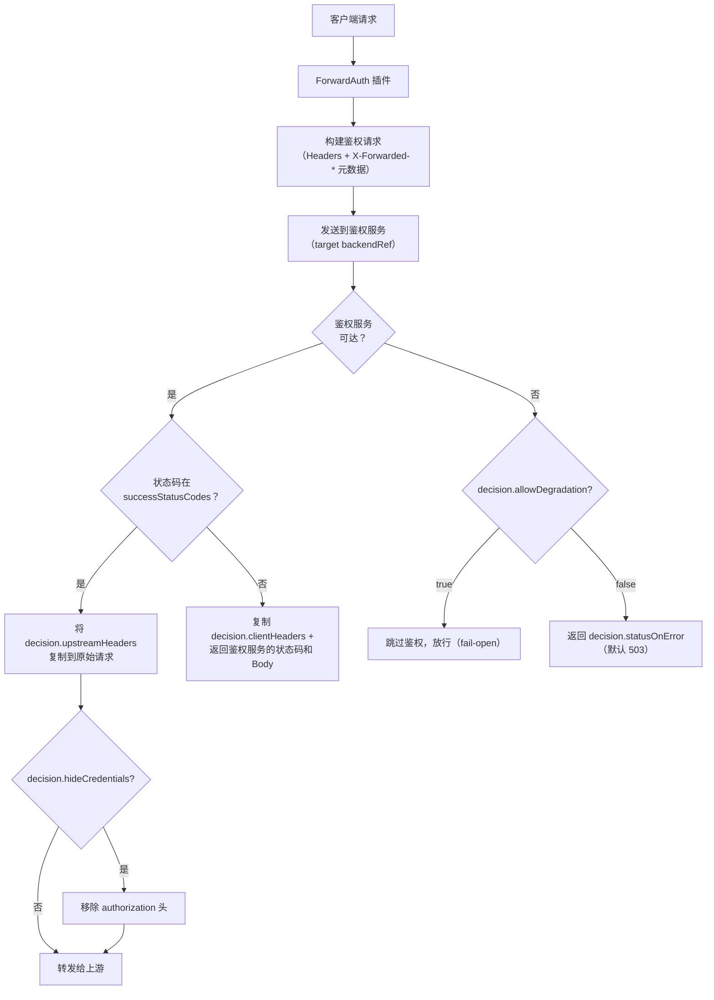

# ForwardAuth 插件

> **Edgion 扩展**
>
> ForwardAuth 是 `EdgionPlugins` CRD 提供的外部鉴权插件，不属于标准 Gateway API。

## 概述

ForwardAuth 插件将鉴权逻辑委托给外部服务。对于每个入站请求，插件构建一个出站鉴权请求（转发请求头并注入 `X-Forwarded-*` 元数据），发送到配置的后端。如果鉴权服务返回成功状态码（默认 2xx，或 `successStatusCodes` 中配置的状态码），原始请求被转发给上游；否则，鉴权服务的响应直接返回给客户端。

这是 API Gateway 的经典外部鉴权模式，对标：
- **Traefik**: `forwardAuth` middleware
- **nginx**: `auth_request` module
- **APISIX**: `forward-auth` plugin
- **Kong**: `forward-auth` plugin

## 功能特点

- **外部鉴权委托** — 鉴权逻辑完全由外部服务承载，网关无需了解鉴权细节
- **Header 转发** — 默认转发全部非 hop-by-hop 请求头（`forwardAll: true`），或按需选择特定子集
- **双向 Header 传递** — 鉴权成功时将身份信息复制到上游请求；鉴权失败时将错误信息复制到客户端响应
- **Secret 注入** — 通过 `${secretRef:ns/name:key}` 模板将 Kubernetes Secret 值注入为自定义请求头
- **优雅降级** — 鉴权服务不可达时，可选择放行（fail-open）或返回自定义错误码（fail-close）
- **自定义成功状态码** — 不限于 2xx，可指定任意状态码为鉴权成功
- **SSRF 防护** — target 为 Kubernetes Service `backendRef`；解析后的 Pod IP 在拨号前经 `validate_endpoint_backend_addr` 校验
- **暴力破解防护** — 可配置 `authFailureDelayMs` 在鉴权失败响应前增加延迟
- **热重载** — 无需重启网关，配置变更立即生效

## 核心流程



## 配置说明

### 完整配置示例

```yaml
apiVersion: edgion.io/v1
kind: EdgionPlugins
metadata: { name: forward-auth-basic, namespace: edgion-default }
spec:
  requestPlugins:
    - enable: true
      type: ForwardAuth
      config:
        target: { name: auth-svc, namespace: edgion-default, port: 30040 }
        timeoutMs: 5000                    # 连接层，默认 5000
        successStatusCodes: [200, 204]     # 连接层，默认 任意 2xx
        tls: { verify: true }              # 连接层，可选
        request:
          path:   { template: "/verify" }
          method: { template: "GET" }
          headers:
            forwardAll: true               # forward_auth 默认值
            origin:
              - { name: Authorization, presence: skipIfMissing }
            custom:
              - { name: X-Source, value: edgion }
        decision:
          upstreamHeaders: [X-User-ID, X-User-Role]
          clientHeaders:   [WWW-Authenticate]
          allowDegradation: false
          statusOnError:    503
          hideCredentials:  true
          authFailureDelayMs: 0
```

### 字段参考

#### 连接层字段（顶层）

| 字段 | 类型 | 默认值 | 说明 |
|------|------|--------|------|
| `target` | object | 必填 | Kubernetes Service 后端：`{name, namespace, port}`。端口必填；namespace 默认为插件所在命名空间。 |
| `timeoutMs` | integer | `5000` | 请求超时（毫秒）。 |
| `successStatusCodes` | array\<integer\> | `null` | 视为鉴权成功的状态码。默认：任意 2xx（200–299）。 |
| `tls` | object | `null` | 出向鉴权请求的 TLS 配置。字段：`verify`（默认 `true`；`false` 由运维人员负责）；`validation.caCertificateRefs`（CA 证书引用列表，每项 `{kind, name, namespace}`，Secret 或 ConfigMap，须包含 `ca.crt` 键）；`validation.wellKnownCACertificates: System`（内置 webpki 根证书）；`clientCertificateRef`（含 `tls.crt`/`tls.key` 的 Secret，用于客户端 mTLS）。内联 CA（`caCert`）已移除，请改用含 `ca.crt` 键的 Secret 或 ConfigMap。Phase 1 说明：`validation.hostname` 和 `validation.subjectAltNames`（SAN 固定）已暴露但暂不强制执行，配置后导致 `Accepted=False`。 |
| `retry` | object | `null` | 重试配置：`maxRetries`、`retryDelayMs`、`retryOnTimeout`、`retryOnConnectError`、`retryOnStatus`。 |
| `rateLimit` | object | `null` | 出向调用限速：`rate`（每窗口最大调用次数）+ `windowSec`。 |
| `healthCheck` | object | `null` | 健康检查：`active`（探针路径 + 间隔）和/或 `passive`（失败阈值）。 |

#### `request` — 出向请求规格

| 字段 | 类型 | 默认值 | 说明 |
|------|------|--------|------|
| `request.path` | object | `null` | 覆盖鉴权请求路径。`{ template: "/verify" }`。省略则复用入站路径。 |
| `request.method` | object | `null` | 覆盖 HTTP 方法。`{ template: "GET" }`。省略则复用入站方法。 |
| `request.headers.forwardAll` | boolean | **`true`** | 转发原始请求中所有非 hop-by-hop 请求头。这是 forward_auth 的默认值。 |
| `request.headers.origin` | array | `[]` | 从原始请求选择性转发的请求头列表。每项：`{ name, presence }`。presence 策略：`skipIfMissing`（默认）、`required`、`warnIfMissing`。 |
| `request.headers.custom` | array | `[]` | 从配置或 Secret 注入的自定义请求头。字面量：`{ name, value: "..." }`；模板：`{ name, template: "..." }`（可包含 `${secretRef:ns/name:key}`）。 |

#### `decision` — 鉴权后行为

| 字段 | 类型 | 默认值 | 说明 |
|------|------|--------|------|
| `decision.upstreamHeaders` | array\<string\> | `[]` | 鉴权成功时，从鉴权响应复制到上游请求的 Header 列表。如 `[X-User-ID, X-User-Role]`。 |
| `decision.clientHeaders` | array\<string\> | `[]` | 鉴权失败时，从鉴权响应复制到客户端响应的 Header 列表。如 `[WWW-Authenticate]`。 |
| `decision.allowDegradation` | boolean | `false` | fail-open：`true` 时，鉴权服务不可达则放行请求。 |
| `decision.statusOnError` | integer | `503` | `allowDegradation` 为 `false` 时，鉴权服务不可达返回的状态码。范围：200–599。 |
| `decision.hideCredentials` | boolean | `false` | 鉴权成功后，从上游请求中移除 `authorization` 头。 |
| `decision.authFailureDelayMs` | integer | `0` | 鉴权失败响应前的延迟（毫秒），增加暴力破解的时间成本。 |

### `request.headers.forwardAll` 默认语义

`ForwardAuthConfig` 默认将 `request.headers.forwardAll` 设为 `true`——鉴权服务将收到原始请求中**所有**非 hop-by-hop 请求头（包括 `Authorization`、`Cookie`、自定义头等）。这保留了经典的"透明透传"行为，并与 Traefik / Envoy 的默认策略一致。

如需选择性转发，请将 `forwardAll` 显式设为 `false`，并在 `request.headers.origin` 中列举所需请求头。

### 自动注入的 X-Forwarded-* 头

无论 `forwardAll` 设置如何，插件始终向鉴权请求注入以下元数据头：

| Header | 说明 | 示例 |
|--------|------|------|
| `X-Forwarded-Host` | 原始请求 Host | `api.example.com` |
| `X-Forwarded-Uri` | 原始请求 URI 路径 | `/api/v1/users` |
| `X-Forwarded-Method` | 原始请求 HTTP 方法 | `POST` |
| `X-Forwarded-Query` | 原始请求 Query 参数 | `page=1&size=20` |

### Hop-by-Hop 头过滤

`forwardAll: true` 时，以下 RFC 2616/7230 hop-by-hop 头会被自动排除：

`connection`, `keep-alive`, `proxy-authenticate`, `proxy-authorization`,
`te`, `trailers`, `transfer-encoding`, `upgrade`

### Secret 注入

通过 `template` 源类型 + `${secretRef:namespace/name:key}` 变量将 Kubernetes Secret 值注入为自定义请求头：

```yaml
request:
  headers:
    custom:
      - name: X-Api-Key
        template: "${secretRef:edgion-default/auth-credentials:apiKey}"
```

控制器在配置同步时解析 Secret 引用，并通过 conf_sync 将值下发给网关。该值在管理 API 输出中显示为 `[redacted]`。

Secret 路径格式：`namespace/secretName`（如 `edgion-default/auth-credentials`），键名为 Secret `data` 中的字段名。

### Fail-Open 与 Fail-Close

当鉴权服务不可达（连接拒绝、超时、限速、健康检查失败）时：

| `decision.allowDegradation` | 行为 |
|-----------------------------|------|
| `false`（默认）| 向客户端返回 `decision.statusOnError`（默认 503）—— **fail-close** |
| `true` | 跳过鉴权，将请求转发给上游 —— **fail-open** |

安全关键的 API 请保持 `allowDegradation: false`。`allowDegradation: true` 仅适用于鉴权不是硬性安全要求的场景（如 A/B 测试或内部分析类 API）。

### SSRF 防护

`target` 是 Kubernetes Service `backendRef`（name、namespace、port），不是自由格式的 URI。网关在运行时通过 EndpointSlice 将 Service 解析为 Pod endpoints，并在拨号前对每个解析出的 IP 调用 `validate_endpoint_backend_addr` 进行校验。该校验会拒绝回环地址（`127.x.x.x`）和链路本地地址（`169.254.x.x`），与 `request_mirror` 后端使用的保护机制相同。

集群内 DNS 名称（如 `auth-svc.production.svc.cluster.local`）在配置时无法按 IP 分类，因此绕过 IP 层校验——对这类路径的适当防护手段是 Kubernetes NetworkPolicy。

## 使用示例

### 示例 1：基础配置 — 转发所有 Header

```yaml
apiVersion: edgion.io/v1
kind: EdgionPlugins
metadata:
  name: forward-auth-basic
  namespace: production
spec:
  requestPlugins:
    - type: ForwardAuth
      config:
        target:
          name: auth-service
          namespace: production
          port: 8080
        request:
          path: { template: "/verify" }
        decision:
          upstreamHeaders:
            - X-User-ID
            - X-User-Role
            - X-User-Email
```

所有原始请求头（hop-by-hop 除外）被转发给鉴权服务。鉴权成功后，`X-User-ID`、`X-User-Role`、`X-User-Email` 从鉴权响应复制到上游请求。

### 示例 2：选择性转发 Header

```yaml
apiVersion: edgion.io/v1
kind: EdgionPlugins
metadata:
  name: forward-auth-selective
  namespace: production
spec:
  requestPlugins:
    - type: ForwardAuth
      config:
        target:
          name: auth-service
          namespace: production
          port: 8443
        tls:
          verify: true
        timeoutMs: 5000
        successStatusCodes: [200, 204]
        request:
          path: { template: "/verify" }
          method: { template: "POST" }
          headers:
            forwardAll: false
            origin:
              - { name: Authorization, presence: skipIfMissing }
              - { name: Cookie, presence: skipIfMissing }
              - { name: X-Request-ID, presence: skipIfMissing }
        decision:
          upstreamHeaders: [X-User-ID, X-User-Role]
          clientHeaders:   [WWW-Authenticate, X-Auth-Error-Code]
```

仅转发 `Authorization`、`Cookie`、`X-Request-ID` 给鉴权服务。使用 POST 方法、5 秒超时。200 和 204 视为成功。鉴权失败时将 `WWW-Authenticate` 和 `X-Auth-Error-Code` 返回给客户端。

### 示例 3：Secret 注入

```yaml
apiVersion: edgion.io/v1
kind: EdgionPlugins
metadata:
  name: forward-auth-with-secret
  namespace: production
spec:
  requestPlugins:
    - type: ForwardAuth
      config:
        target:
          name: auth-service
          namespace: production
          port: 8080
        request:
          path: { template: "/verify" }
          headers:
            custom:
              - name: X-Gateway-Token
                template: "${secretRef:production/gateway-token:token}"
        decision:
          upstreamHeaders: [X-User-ID]
```

每次鉴权请求都会注入 Kubernetes Secret 值作为 `X-Gateway-Token` 头。创建 Secret 命令：`kubectl create secret generic gateway-token -n production --from-literal=token=<value>`。

### 示例 4：优雅降级

```yaml
apiVersion: edgion.io/v1
kind: EdgionPlugins
metadata:
  name: forward-auth-degraded
  namespace: production
spec:
  requestPlugins:
    - type: ForwardAuth
      config:
        target:
          name: auth-service
          namespace: production
          port: 8080
        decision:
          allowDegradation: true
          statusOnError: 503
          upstreamHeaders: [X-User-ID]
```

鉴权服务不可用（网络错误、超时等）时跳过鉴权直接放行。适用于鉴权不是关键安全路径、优先保证可用性的场景。

### 示例 5：配合 HTTPRoute 使用

```yaml
apiVersion: gateway.networking.k8s.io/v1
kind: HTTPRoute
metadata:
  name: api-route
  namespace: production
spec:
  parentRefs:
    - name: edgion-gateway
  hostnames:
    - "api.example.com"
  rules:
    - matches:
        - path:
            type: PathPrefix
            value: /api
      filters:
        - type: ExtensionRef
          extensionRef:
            group: edgion.io
            kind: EdgionPlugins
            name: forward-auth-basic
      backendRefs:
        - name: api-backend
          port: 8080
```

## 与其他网关的对比

| 特性 | Edgion | Traefik | APISIX | nginx |
|------|--------|---------|--------|-------|
| 转发全部 Header | `request.headers.forwardAll: true` | 默认 | 仅列举头 | subrequest |
| 选择性转发 | `request.headers.origin` | `authRequestHeaders` | `request_headers` | 否 |
| 自定义注入头 | `request.headers.custom` | 否 | 否 | 否 |
| Secret 注入 | `${secretRef:ns/name:key}` | 否 | 否 | 否 |
| 上游 Header 传递 | `decision.upstreamHeaders` | `authResponseHeaders` | `upstream_headers` | `auth_request_set` |
| 客户端 Header 传递 | `decision.clientHeaders` | 否 | `client_headers` | 有限 |
| 自定义成功状态码 | `successStatusCodes` | 否（仅 2xx） | 否（仅 2xx） | 否（仅 2xx） |
| 优雅降级 | `decision.allowDegradation` | 否 | `allow_degradation` | 否 |
| 自定义错误状态码 | `decision.statusOnError` | 否 | `status_on_error` | 否 |
| 隐藏凭证 | `decision.hideCredentials` | 否 | 否 | 否 |
| 失败延迟 | `decision.authFailureDelayMs` | 否 | 否 | 否 |
| SSRF 防护 | backendRef + IP 校验 | 否 | 否 | 否 |
| Cookie 转发 | 通过 `forwardAll` 或 `origin` | 是 | 是 | 是 |
| TLS 支持 | 是（`tls` 块） | 是 | 是 | 是 |
| 转发 Body | 否 | `forwardBody` | 否 | 否 |

## 鉴权服务开发指南

### 接口约定

**网关发送给鉴权服务的请求：**
- 方法：`request.method.template`（默认：复用入站方法）
- 路径：`request.path.template`
- Header：原始请求头（或选择性子集）+ `X-Forwarded-*` 元数据 + `request.headers.custom`

**鉴权服务返回给网关的响应：**
- **成功**（状态码在 `successStatusCodes`，默认 2xx）：鉴权通过
  - `decision.upstreamHeaders` 中列举的响应头被复制到上游请求
  - 响应 Body 被忽略
- **失败**（其他任意状态码）：鉴权拒绝
  - 状态码和 Body 原样返回给客户端
  - `decision.clientHeaders` 中列举的响应头被复制到客户端响应

### 示例鉴权服务（Go）

```go
func authHandler(w http.ResponseWriter, r *http.Request) {
    token := r.Header.Get("Authorization")

    user, err := validateToken(token)
    if err != nil {
        w.Header().Set("WWW-Authenticate", "Bearer")
        w.WriteHeader(http.StatusUnauthorized)
        json.NewEncoder(w).Encode(map[string]string{
            "error":   "invalid_token",
            "message": err.Error(),
        })
        return
    }

    // Auth passed: return identity headers for upstream
    w.Header().Set("X-User-ID", user.ID)
    w.Header().Set("X-User-Role", user.Role)
    w.Header().Set("X-User-Email", user.Email)
    w.WriteHeader(http.StatusOK)
}
```

## 注意事项

1. **backendRef 目标**：`target` 字段是 Kubernetes Service 引用（`name`/`namespace`/`port`），不是 URI。网关通过 EndpointSlice 在调用时动态解析 Pod endpoints。
2. **SSRF 防护**：每个解析出的 Pod IP 在拨号前经 `validate_endpoint_backend_addr` 校验，回环地址和链路本地地址会被拒绝。
3. **不跟随重定向**：HTTP Client 不自动跟随重定向。鉴权服务返回 301/302 会被视为鉴权失败。
4. **Body 不转发**：当前版本不向鉴权服务转发原始请求 Body。大多数鉴权场景不需要。
5. **热重载**：更新 `EdgionPlugins` 资源后自动热重载，无需重启网关。
6. **forwardAll 默认值**：`request.headers.forwardAll` 对 forward_auth 默认为 `true`（与 webhook 插件默认 `false` 不同）。

## 常见问题

### Q: 该选择 forwardAll 还是选择性转发？

A:
- **`forwardAll: true`（默认）**：鉴权服务可使用任意请求头，配置简单。适合内部鉴权服务或安全要求不高的场景。
- **`forwardAll: false` + `origin` 列表**：仅传递必要的头，减少数据传输，更安全。适合外部鉴权服务或需要最小权限原则的场景。

### Q: Cookie 如何转发？

A: `forwardAll: true`（默认）时，`Cookie` 头会自动包含。`forwardAll: false` 时，将 `{ name: Cookie }` 加入 `request.headers.origin` 即可。

### Q: 鉴权服务返回的 Body 会传给客户端吗？

A: 鉴权**失败**时，鉴权服务的响应 Body 原样返回给客户端（适合传递错误详情）。鉴权**成功**时，Body 被忽略。

### Q: 多个 ForwardAuth 插件可以串联吗？

A: 可以。在 `requestPlugins` 中列举多个，按顺序依次执行。任意一个返回非成功状态码即终止请求链。

### Q: `allowDegradation: true` 安全吗？

A: 对安全关键的 API 不安全。开启后，网关与鉴权服务之间发生网络分区时，所有请求将无鉴权放行。仅在鉴权不是硬性安全要求时使用（如 A/B 测试基础设施或内部分析类 API）。

## 相关文档

- [BasicAuth 插件](../http-route/filters/edgion-plugins/basic-auth.md) — 基础用户名密码认证
- [JwtAuth 插件](../http-route/filters/edgion-plugins/jwt-auth.md) — JWT 令牌认证
- [OpenID Connect 插件](openid-connect.md) — OIDC/OAuth2 认证
- [HTTPRoute 总览](../http-route/overview.md) — HTTPRoute 配置总览
