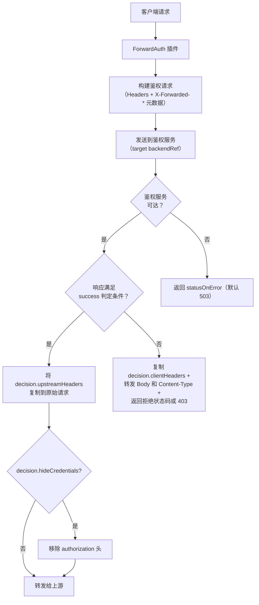

# ForwardAuth 插件

> **Edgion 扩展**
>
> ForwardAuth 是 `EdgionPlugins` CRD 提供的外部鉴权插件，不属于标准 Gateway API。

> ⚠️ **破坏性变更：`successStatusCodes` → `success.statusCodes`。ForwardAuth 现在总是失败关闭，返回 `statusOnError`。**
>
> - `successStatusCodes` 已不再是运行时可识别字段。仍设置它的 YAML 会继续被接纳，但 serde 会丢弃该字段，成功判定退化为“任意 2xx”。对 ForwardAuth 而言，这意味着**鉴权服务返回的任何 2xx 响应都会被视为鉴权成功**，即使运营者原本打算限制为更窄的状态码集合或某个 body 条件。Controller 会通过提示性的未知字段 warning、`UnknownConfigFields` 条件、diagnostics/metric，以及 Admin API 写入和 validate 响应报告精确路径；该发现不会改变 `Accepted`，也不会阻断同步。请将每个 ForwardAuth 配置迁移到嵌套的 `success:` 块（详见下文[字段参考](#连接层字段顶层)）。
> - `allowDegradation`（fail-open 模式）和 `allowDegradationTemplate`（按请求降级）已被移除。ForwardAuth 现在**总是失败关闭**：当鉴权服务不可达或超时时，网关向客户端返回 `statusOnError`（默认 503）。不再支持 fail-open 行为；如需高可用性，请为鉴权服务配置适当的冗余和故障转移。

## 概述

ForwardAuth 插件将鉴权逻辑委托给外部服务。对于每个入站请求，插件构建一个出站鉴权请求（转发请求头并注入 `X-Forwarded-*` 元数据），发送到配置的后端。如果鉴权服务的响应满足连接的 `success` 判定条件（默认任意 2xx，或 `success.statusCodes` / `success.body` 中配置的条件），原始请求被转发给上游；否则，鉴权服务的 body 和 `Content-Type`（如存在）会连同 `decision.clientHeaders` 选定的响应头一起返回给客户端。状态码判定失败时保留鉴权服务状态码；状态码通过但 `success.body` 断言失败时则返回 403。

这是 API Gateway 的经典外部鉴权模式，对标：
- **Traefik**: `forwardAuth` middleware
- **nginx**: `auth_request` module
- **APISIX**: `forward-auth` plugin
- **Kong**: `forward-auth` plugin

## 功能特点

- **外部鉴权委托** — 鉴权逻辑完全由外部服务承载，网关无需了解鉴权细节
- **Header 转发** — 默认转发全部非 hop-by-hop 请求头（`forwardAll: true`），或按需选择特定子集
- **双向 Header 传递** — 鉴权成功时将身份信息复制到上游请求；鉴权失败时将错误信息复制到客户端响应
- **Secret 注入** — 通过 `${secretRef:ns/name:key}` 模板将 Kubernetes Secret 值注入为自定义请求头
- **服务不可达时的失败关闭** — 当鉴权服务不可达时，网关向客户端返回 `statusOnError`（默认 503）；若需高可用性，请为鉴权服务配置冗余和故障转移
- **声明式成功判定** — 不限于 2xx 状态码，可选地通过 `success.body` 要求特定的 JSON body 字段（适用于返回 `200 OK` 但携带错误信息的鉴权服务）
- **可配置的重试退避** — 指数或固定退避、抖动、可选的 `Retry-After` 感知，以及（针对 ForwardAuth）默认在超时时重试——因为鉴权检查是幂等的
- **SSRF 防护** — target 为 Kubernetes Service `backendRef`；解析后的 Pod IP 在拨号前经 `validate_endpoint_backend_addr` 校验
- **暴力破解防护** — 可配置 `authFailureDelayMs` 在鉴权失败响应前增加延迟
- **热重载** — 无需重启网关，配置变更立即生效

## 核心流程



## 配置说明

### 完整配置示例

```yaml
apiVersion: edgion.io/v1
kind: EdgionPlugins
metadata: { name: forward-auth-basic, namespace: edgion-default }
spec:
  requestPlugins:
    - enable: true
      type: ForwardAuth
      config:
        target: { name: auth-svc, namespace: edgion-default, port: 30040 }
        timeoutMs: 5000                    # 连接层，默认 5000
        success:
          statusCodes: [200, 204]          # 连接层，默认 任意 2xx
        statusOnError:    503              # 连接层，鉴权服务不可达时返回（默认 503）
        tls: { verify: true }              # 连接层，可选
        request:
          path:   { template: "/verify" }
          method: { template: "GET" }
          headers:
            forwardAll: true               # forward_auth 默认值
            origin:
              - { name: Authorization, presence: skipIfMissing }
            custom:
              - { name: X-Source, value: edgion }
        decision:
          upstreamHeaders: [X-User-ID, X-User-Role]
          clientHeaders:   [WWW-Authenticate]
          hideCredentials:  true
          authFailureDelayMs: 0
```

### 字段参考

#### 连接层字段（顶层）

| 字段 | 类型 | 默认值 | 说明 |
|------|------|--------|------|
| `target` | object | 必填 | Kubernetes Service 后端：`{name, namespace, port}`。端口必填；namespace 默认为插件所在命名空间。 |
| `timeoutMs` | integer | `5000` | 请求超时（毫秒）。 |
| `forwardBody` | boolean | `false` | 将当前已提交的缓冲请求 body 原样转发给鉴权服务，包括此前插件的 body 重写。不能与 `request.body` 同时配置。启用时，网关移除 `Transfer-Encoding`，并将出站 `Content-Length` 设置为该 body 的实际字节数。 |
| `timeoutMsTemplate` | string | `null` | 渲染单次请求超时的模板，如 `"${ctx:desired_timeout_ms}"`。**只接受 `${ctx:...}`、`${remoteIp}` 以及匹配路由变量**——客户端可控的来源（`header`/`query`/`cookie`/`path`/`method`/`uri`）会在准入时被拒绝，因为它会让攻击者把鉴权服务的超时压得足够低，从而强制每次调用都超时。渲染结果非数字、为空或低于下限（< 50 毫秒）时回退到 `timeoutMs`；无论如何，渲染值都会被限幅到 60000 毫秒。在准入时编译并校验。 |
| `success` | object | `null` | 成功判定条件：`statusCodes`（数组，省略或非空时任意 2xx；显式的空列表会在准入时被拒绝）加上可选的 `body` 断言（`pointer` + **恰好一个** `equals`/`notEquals`/`exists`/`in`，在准入时强制校验），按与运算组合。**取代已移除的 `successStatusCodes`**——参见上方破坏性变更说明，以及 [运维指南 → 连接器 → Success](../../ops-guide/infrastructure/connectors.md#成功判定-success) 中的完整 schema、严格类型规则、指针缺失语义，以及 `body` 设置时 `maxResponseBytes >= 4096` 的要求。 |
| `statusOnError` | integer | `503` | 鉴权服务不可达时（连接失败、超时、服务宕机）返回的状态码，范围 200–599。总是失败关闭，不存在 fail-open 模式。 |
| `tls` | object | `null` | 出向鉴权请求的 TLS 配置。字段：`verify`（默认 `true`；`false` 由运维人员负责）；`validation.caCertificateRefs`（CA 证书引用列表，每项 `{kind, name, namespace}`，Secret 或 ConfigMap，须包含 `ca.crt` 键）；`validation.wellKnownCACertificates: System`（Gateway 的 System CA 包：固定路径的 OS CA 包）；`clientCertificateRef`（含 `tls.crt`/`tls.key` 的 Secret，用于客户端 mTLS）。内联 CA（`caCert`）已移除，请改用含 `ca.crt` 键的 Secret 或 ConfigMap。Phase 1 说明：`validation.hostname` 和 `validation.subjectAltNames`（SAN 固定）已暴露但暂不强制执行，配置后导致 `Accepted=False`。 |
| `retry` | object | `null` | 重试配置：`maxRetries`、`retryDelayMs`（退避曲线的基础延迟，不是固定间隔）、`backoffPolicy`（`exponential` 默认 \| `fixed`）、`maxDelayMs`（默认 1000，上限 10000）、`jitter`（默认 `true`）、`honorRetryAfter`（默认 `false`）、`retryOnTimeout`（**按消费方决定默认值：ForwardAuth 为 `true`**，因为鉴权检查是幂等的）、`retryOnConnectError`（默认 `true`）、`retryOnStatus`（默认 `[]`）、`retryOnBodyFailure`（默认 `false`）。完整 schema 见[运维指南 → 连接器 → Retry](../../ops-guide/infrastructure/connectors.md#重试)。 |
| `rateLimit` | object | `null` | 出向调用限速：`rate`（每窗口最大调用次数）+ `windowSec`。 |
| `healthCheck` | object | `null` | 健康检查：`active`（探针路径 + 间隔）和/或 `passive`（失败阈值）。 |

#### `request` — 出向请求规格

| 字段 | 类型 | 默认值 | 说明 |
|------|------|--------|------|
| `request.path` | object | `null` | 覆盖鉴权请求路径。`{ template: "/verify" }`。省略则复用冻结的入口路径；`${path}` 模板读取当前路径。 |
| `request.method` | object | `null` | 覆盖鉴权 HTTP 方法。`{ template: "GET" }`。省略则复用冻结的入口方法；`${method}` 模板读取当前方法。 |
| `request.headers.forwardAll` | boolean | **`true`** | 转发执行时请求中所有符合过滤规则的普通请求头。这是 forward_auth 的默认值；自动元数据另行注入。 |
| `request.headers.origin` | array | `[]` | 从执行时请求选择性转发的请求头列表。每项：`{ name, presence }`。presence 策略：`skipIfMissing`（默认）、`required`、`warnIfMissing`。`Content-Length` 和 `Transfer-Encoding` 由代理管理，配置时会被拒绝。 |
| `request.headers.custom` | array | `[]` | 从配置或 Secret 注入的自定义请求头。字面量：`{ name, value: "..." }`；模板：`{ name, template: "..." }`（可包含 `${secretRef:ns/name:key}`）。`Content-Length` 和 `Transfer-Encoding` 由代理管理，配置时会被拒绝。 |

缺失的 `warnIfMissing` 原始字段会被省略，每次鉴权调用最多合并写入一条 `warn outbound field missing` PluginLog 记录，不包含字段名或值。重试不会重复记录。`skipIfMissing` 仍保持静默，`required` 仍使调用失败。失败时的告警保留与日志容量边界见[存在性策略](../../ops-guide/infrastructure/connectors.md#存在性策略)。

#### `decision` — 鉴权后行为

`decision` 包含以下字段：

| 字段 | 类型 | 默认值 | 说明 |
|------|------|--------|------|
| `decision.upstreamHeaders` | array\<string\> | `[]` | 鉴权成功时，从鉴权响应复制到上游请求的 Header 列表。复制前会先从请求中删除列表里的每个头名，因此鉴权服务没有返回的头保持为空——包括客户端自己发送的同名头，例如 `Authorization`，链路中后续插件也看不到它。返回的值按原始字节复制（包括 UTF-8）。开启 `hideCredentials` 时会先删除客户端的 `Authorization`，因此鉴权服务返回的 `Authorization` 仍会转发。头名必须合法，且不能是 `Host` 或报文分帧/逐跳头（`Content-Length`、`Transfer-Encoding`、`TE`、`Trailer`、`Expect`、`Connection`、`Keep-Alive`、`Proxy-Connection`、`Upgrade`）（准入时拒绝）。若某个头无法清除或写入，或 `hideCredentials` 无法删除 `Authorization`，请求在 `authFailureDelayMs` 之后以固定的 `403 Forbidden` 拒绝（不带鉴权服务的响应体和响应头），诊断码为 `AuthHeaderMutationRejected`。如 `[X-User-ID, X-User-Role]`。 |
| `decision.clientHeaders` | array\<string\> | `[]` | 鉴权失败时，从鉴权响应复制到客户端响应的 Header 列表。如 `[WWW-Authenticate]`。 |
| `decision.hideCredentials` | boolean | `false` | 鉴权成功后，从上游请求中移除 `authorization` 头。 |
| `decision.authFailureDelayMs` | integer | `0` | 鉴权失败响应前的延迟（毫秒），增加暴力破解的时间成本。 |

### `request.headers.forwardAll` 默认语义

`ForwardAuthConfig` 默认将 `request.headers.forwardAll` 设为 `true`——鉴权服务将收到执行时请求中**所有符合下方过滤规则**的请求头（包括 `Authorization`、`Cookie`、自定义头等）。这保留了经典的"透明透传"行为，并与 Traefik / Envoy 的默认策略一致。四个自动元数据头会在最后覆盖同名值。

如需选择性转发，请将 `forwardAll` 显式设为 `false`，并在 `request.headers.origin` 中列举所需请求头。

### 自动注入的 X-Forwarded-* 头

无论 `forwardAll` 设置如何，插件始终向鉴权请求注入以下元数据头：

| Header | 说明 | 示例 |
|--------|------|------|
| `X-Forwarded-Host` | 执行时请求的 Host 头，缺失时为空 | `api.example.com` |
| `X-Forwarded-Uri` | 执行时请求的规范化路径，不包含 query | `/api/v1/users` |
| `X-Forwarded-Method` | 执行时请求的 HTTP 方法 | `POST` |
| `X-Forwarded-Query` | 执行时请求的原始 query 字符串，不含 `?`；缺失时为空 | `page=1&size=20` |

### 鉴权上下文与鉴权 HTTP 调用

ForwardAuth 鉴权的是插件执行时的请求。此前的可信重写会出现在元数据、普通转发头和 `forwardBody` 中；这些值不是客户端入口请求的完整快照。HTTPRoute 内联 `ExternalAuth` 使用同一实现，具有相同边界。

| 数据 | 身份与来源 |
|------|------------|
| 四个自动 `X-Forwarded-*` 头 | 执行时的当前 Host、规范化路径、方法和原始 query 字符串 |
| 转发的普通头与 cookie | 执行时请求中的值，受各自转发配置控制 |
| `forwardBody: true` | 当前已提交的完整请求体，受统一请求 body 上限约束；没有入口 body 副本 |
| 省略的鉴权调用 method/path | 冻结的入口方法和路径；不是自动元数据的来源 |
| 显式配置的鉴权调用 method/path | 按字面量或模板构建；`${method}`、`${path}` 读取当前值 |
| `request.body` | 配置生成的鉴权调用 body，与 `forwardBody` 互斥 |

例如，入口为 `GET /users/42?verbose=1`、Host 为 `entry.example.com`，在 ForwardAuth 前重写为 `POST /graphql?mode=rest`、Host 为 `rewritten.example.com`。四个自动头分别为 `rewritten.example.com`、`/graphql`、`POST`、`mode=rest`。未重写时则分别为 `entry.example.com`、`/users/42`、`GET`、`verbose=1`。鉴权调用自身仍可配置为 `GET /verify`；省略其 method/path 时则使用入口 `GET /users/42`。调用自身的 query 参数由 `request.args` 控制。

普通头先按 `forwardAll`、`origin`、`custom` 顺序构建，再插入四个自动元数据头。因此，客户端伪造头、`origin` 转发值和 `custom` 同名值都不能替换自动元数据。`forwardAll: false` 只限制普通头，不关闭自动注入；没有元数据注入开关。`required` 等普通字段构建规则仍先执行，不能通过自动注入补足缺失的 required 字段。

选择执行时契约是为了让鉴权服务检查已经完成前置适配的请求。需要按客户端入口对象鉴权时，应将鉴权放在相关重写之前。鉴权后的重写仍由配置顺序控制；该契约不冻结请求，也不承诺验证最终上游请求。

### Hop-by-Hop 头过滤

`forwardAll: true` 时，以下 RFC 2616/7230 hop-by-hop 头会被自动排除：

`connection`, `keep-alive`, `proxy-authenticate`, `proxy-authorization`,
`te`, `trailers`, `transfer-encoding`, `upgrade`

`Content-Length` 和 `Transfer-Encoding` 只描述当前这一跳的 HTTP 消息，因此不会从客户端请求继承，也不能在 `origin`/`custom` 中配置。网关根据鉴权请求的实际 body 生成分帧信息：无 body 时不声明这两个请求头；配置或转发的缓冲 body 则使用其实际字节数作为 `Content-Length`。

`forwardAll` 同样不会转发 `Expect`。它不属于 hop-by-hop 头，但它描述的是客户端请求的期望，网关在缓冲 body 时已自行处理该期望。鉴权请求自身通常不带 body，把 `Expect` 中继过去等于让鉴权服务等待永远不会到达的内容；严格实现该期望的服务会返回 `417 Expectation Failed`，而 forward_auth 会将其判定为鉴权拒绝。与两个分帧头不同的是，在 `origin` 中显式列出 `Expect` 仍然允许，并会照常转发。

但在 `forwardBody: true` 时请勿把该显式列举与 `presence: required` 组合使用：缓冲 body 的过程会消费掉该期望并移除请求头，导致 required 查找落空、鉴权调用按 `statusOnError` fail-close。

### Secret 注入

通过 `template` 源类型 + `${secretRef:namespace/name:key}` 变量将 Kubernetes Secret 值注入为自定义请求头：

```yaml
request:
  headers:
    custom:
      - name: X-Api-Key
        template: "${secretRef:edgion-default/auth-credentials:apiKey}"
```

控制器在配置同步时解析 Secret 引用，并通过 conf_sync 将值下发给网关。该值在管理 API 输出中显示为 `[redacted]`。

Secret 路径格式：`namespace/secretName`（如 `edgion-default/auth-credentials`），键名为 Secret `data` 中的字段名。

### SSRF 防护

`target` 是 Kubernetes Service `backendRef`（name、namespace、port），不是自由格式的 URI。网关在运行时通过 EndpointSlice 将 Service 解析为 Pod endpoints，并在拨号前对每个解析出的 IP 调用 `validate_endpoint_backend_addr` 进行校验。该校验会拒绝回环地址（`127.x.x.x`）和链路本地地址（`169.254.x.x`），与 `request_mirror` 后端使用的保护机制相同。

集群内 DNS 名称（如 `auth-svc.production.svc.cluster.local`）在配置时无法按 IP 分类，因此绕过 IP 层校验——对这类路径的适当防护手段是 Kubernetes NetworkPolicy。

## 使用示例

### 示例 1：基础配置 — 转发所有 Header

```yaml
apiVersion: edgion.io/v1
kind: EdgionPlugins
metadata:
  name: forward-auth-basic
  namespace: production
spec:
  requestPlugins:
    - type: ForwardAuth
      config:
        target:
          name: auth-service
          namespace: production
          port: 8080
        request:
          path: { template: "/verify" }
        decision:
          upstreamHeaders:
            - X-User-ID
            - X-User-Role
            - X-User-Email
```

执行时请求中符合过滤规则的头被转发给鉴权服务，四个自动元数据头最后注入。鉴权成功后，`X-User-ID`、`X-User-Role`、`X-User-Email` 从鉴权响应复制到上游请求。

### 示例 2：选择性转发 Header

```yaml
apiVersion: edgion.io/v1
kind: EdgionPlugins
metadata:
  name: forward-auth-selective
  namespace: production
spec:
  requestPlugins:
    - type: ForwardAuth
      config:
        target:
          name: auth-service
          namespace: production
          port: 8443
        tls:
          verify: true
        timeoutMs: 5000
        success:
          statusCodes: [200, 204]
        request:
          path: { template: "/verify" }
          method: { template: "POST" }
          headers:
            forwardAll: false
            origin:
              - { name: Authorization, presence: skipIfMissing }
              - { name: Cookie, presence: skipIfMissing }
              - { name: X-Request-ID, presence: skipIfMissing }
        decision:
          upstreamHeaders: [X-User-ID, X-User-Role]
          clientHeaders:   [WWW-Authenticate, X-Auth-Error-Code]
```

普通请求头仅转发 `Authorization`、`Cookie`、`X-Request-ID`，另行注入四个自动元数据头。使用 POST 方法、5 秒超时。200 和 204 视为成功。鉴权失败时将 `WWW-Authenticate` 和 `X-Auth-Error-Code` 返回给客户端。

### 示例 3：Secret 注入

```yaml
apiVersion: edgion.io/v1
kind: EdgionPlugins
metadata:
  name: forward-auth-with-secret
  namespace: production
spec:
  requestPlugins:
    - type: ForwardAuth
      config:
        target:
          name: auth-service
          namespace: production
          port: 8080
        request:
          path: { template: "/verify" }
          headers:
            custom:
              - name: X-Gateway-Token
                template: "${secretRef:production/gateway-token:token}"
        decision:
          upstreamHeaders: [X-User-ID]
```

每次鉴权请求都会注入 Kubernetes Secret 值作为 `X-Gateway-Token` 头。创建 Secret 命令：`kubectl create secret generic gateway-token -n production --from-literal=token=<value>`。

### 示例 4：配合 HTTPRoute 使用

```yaml
apiVersion: gateway.networking.k8s.io/v1
kind: HTTPRoute
metadata:
  name: api-route
  namespace: production
spec:
  parentRefs:
    - name: edgion-gateway
  hostnames:
    - "api.example.com"
  rules:
    - matches:
        - path:
            type: PathPrefix
            value: /api
      filters:
        - type: ExtensionRef
          extensionRef:
            group: edgion.io
            kind: EdgionPlugins
            name: forward-auth-basic
      backendRefs:
        - name: api-backend
          port: 8080
```

## 与其他网关的对比

| 特性 | Edgion | Traefik | APISIX | nginx |
|------|--------|---------|--------|-------|
| 转发全部 Header | `request.headers.forwardAll: true` | 默认 | 仅列举头 | subrequest |
| 选择性转发 | `request.headers.origin` | `authRequestHeaders` | `request_headers` | 否 |
| 自定义注入头 | `request.headers.custom` | 否 | 否 | 否 |
| Secret 注入 | `${secretRef:ns/name:key}` | 否 | 否 | 否 |
| 上游 Header 传递 | `decision.upstreamHeaders` | `authResponseHeaders` | `upstream_headers` | `auth_request_set` |
| 客户端 Header 传递 | `decision.clientHeaders` | 否 | `client_headers` | 有限 |
| 自定义成功状态码 / body 断言 | `success.statusCodes` / `success.body` | 否（仅 2xx） | 否（仅 2xx） | 否（仅 2xx） |
| 鉴权服务不可达时的错误状态码 | `statusOnError`（总是失败关闭） | 否 | `status_on_error` | 否 |
| 隐藏凭证 | `decision.hideCredentials` | 否 | 否 | 否 |
| 失败延迟 | `decision.authFailureDelayMs` | 否 | 否 | 否 |
| SSRF 防护 | backendRef + IP 校验 | 否 | 否 | 否 |
| Cookie 转发 | 通过 `forwardAll` 或 `origin` | 是 | 是 | 是 |
| TLS 支持 | 是（`tls` 块） | 是 | 是 | 是 |
| 转发 Body | `forwardBody` | `forwardBody` | 否 | 否 |

## 鉴权服务开发指南

### 接口约定

**网关发送给鉴权服务的请求：**
- 方法：`request.method.template`（默认：复用冻结的入口方法）
- 路径：`request.path.template`（默认：复用冻结的入口路径）
- Header：当前请求头（或选择性子集），随后应用 `request.headers.custom`，最后由四个自动 `X-Forwarded-*` 元数据头覆盖同名值
- Body：默认不发送；`forwardBody: true` 时发送当前已提交的完整缓冲 body，也可单独配置 `request.body`

**鉴权服务返回给网关的响应：**
- **成功**（满足 `success` 判定条件——状态码在 `success.statusCodes`，默认任意 2xx，与 `success.body` 断言按与运算组合）：鉴权通过
  - `decision.upstreamHeaders` 中列举的响应头被复制到上游请求
  - 响应 Body 被忽略
- **失败**（状态码或 `success.body` 断言未通过）：鉴权拒绝
  - 状态码判定失败时原样返回该状态码；仅 body 断言失败时向客户端返回 403
  - Body 和 `Content-Type`（如存在）被转发给客户端
  - `decision.clientHeaders` 中列举的响应头被复制到客户端响应

### 示例鉴权服务（Go）

```go
func authHandler(w http.ResponseWriter, r *http.Request) {
    token := r.Header.Get("Authorization")

    user, err := validateToken(token)
    if err != nil {
        w.Header().Set("WWW-Authenticate", "Bearer")
        w.WriteHeader(http.StatusUnauthorized)
        json.NewEncoder(w).Encode(map[string]string{
            "error":   "invalid_token",
            "message": err.Error(),
        })
        return
    }

    // Auth passed: return identity headers for upstream
    w.Header().Set("X-User-ID", user.ID)
    w.Header().Set("X-User-Role", user.Role)
    w.Header().Set("X-User-Email", user.Email)
    w.WriteHeader(http.StatusOK)
}
```

## 注意事项

1. **backendRef 目标**：`target` 字段是 Kubernetes Service 引用（`name`/`namespace`/`port`），不是 URI。网关通过 EndpointSlice 在调用时动态解析 Pod endpoints。
2. **SSRF 防护**：每个解析出的 Pod IP 在拨号前经 `validate_endpoint_backend_addr` 校验，回环地址和链路本地地址会被拒绝。
3. **不跟随重定向**：HTTP Client 不自动跟随重定向。鉴权服务返回 301/302 会被视为鉴权失败。
4. **可选 Body 转发**：默认不向鉴权服务发送请求 body。仅在鉴权决策确实需要时设置 `forwardBody: true`；这会读取当前已提交的 body，启用请求缓冲，并受网关统一的 body 大小上限约束。
5. **热重载**：更新 `EdgionPlugins` 资源后自动热重载，无需重启网关。
6. **forwardAll 默认值**：`request.headers.forwardAll` 对 forward_auth 默认为 `true`（与 webhook 插件默认 `false` 不同）。

## 常见问题

### Q: 该选择 forwardAll 还是选择性转发？

A:
- **`forwardAll: true`（默认）**：鉴权服务可使用任意请求头，配置简单。适合内部鉴权服务或安全要求不高的场景。
- **`forwardAll: false` + `origin` 列表**：普通头仅传递列举的必要值，另行注入四个自动元数据头。适合外部鉴权服务或需要最小权限原则的场景。

### Q: Cookie 如何转发？

A: `forwardAll: true`（默认）时，`Cookie` 头会自动包含。`forwardAll: false` 时，将 `{ name: Cookie }` 加入 `request.headers.origin` 即可。

### Q: 鉴权服务返回的 Body 会传给客户端吗？

A: 鉴权**失败**时，鉴权服务的响应 Body 原样返回给客户端（适合传递错误详情）。鉴权**成功**时，Body 被忽略。

### Q: 多个 ForwardAuth 插件可以串联吗？

A: 可以。在 `requestPlugins` 中列举多个，按顺序依次执行。任意一个返回非成功状态码即终止请求链。

## 相关文档

- [BasicAuth 插件](../http-route/filters/edgion-plugins/basic-auth.md) — 基础用户名密码认证
- [JwtAuth 插件](../http-route/filters/edgion-plugins/jwt-auth.md) — JWT 令牌认证
- [OpenID Connect 插件](openid-connect.md) — OIDC/OAuth2 认证
- [HTTPRoute 总览](../http-route/overview.md) — HTTPRoute 配置总览

## 响应头策略

配置的响应头目标遵循共享响应头限制。

[响应头策略](../http-route/filters/gateway-api/response-header-modifier.md#response-header-policy).
