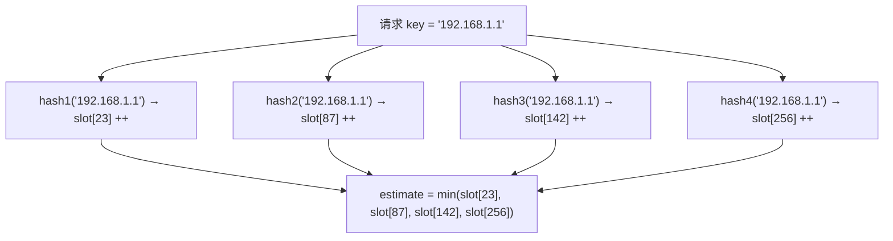
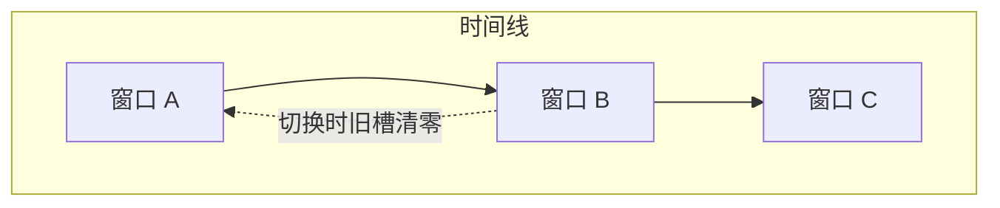

# RateLimitLocal 插件

> **🔌 Edgion 扩展**
> 
> RateLimitLocal 是 `EdgionPlugins` CRD 提供的请求速率限制插件，不属于标准 Gateway API。

## 概述

RateLimitLocal 插件提供高性能的请求速率限制功能，基于 Pingora 的 Count-Min Sketch (CMS) 算法实现。
支持多维度限流键、自定义响应头、以及集群级别的分布式限流。

该插件适用于 API 速率限制、防止暴力攻击、保护后端服务免受流量冲击等场景。

## 功能特点

- **Count-Min Sketch 算法** - 固定内存占用，无论 key 基数多大，内存开销恒定
- **滑动窗口** - 双槽（红/蓝）设计实现平滑的滑动窗口限流
- **多维度限流键** - 支持 Client IP、Header、Path 及组合键
- **集群限流** - Cluster 模式自动按 Gateway 实例数均分全局配额
- **自定义响应头** - 支持标准 `X-RateLimit-*` 和自定义 Header 名称
- **失败开放** - 配置错误或 key 缺失时默认放行请求

## 配置说明

### 基本配置

```yaml
apiVersion: edgion.io/v1
kind: EdgionPlugins
metadata:
  name: rate-limit-basic
  namespace: production
spec:
  requestPlugins:
    - type: RateLimitLocal
      config:
        rate: 100
        interval: "1s"
        key:
          - type: remoteIp
```

### 配置参数

| 参数 | 类型 | 默认值 | 说明 |
|------|------|--------|------|
| `rate` | Integer | `100` | 限流阈值（每个 interval 允许的最大请求数） |
| `interval` | String | `"1s"` | 时间窗口，支持 `ms`、`s`、`m`、`h`、`d` |
| `key` | Array\<Object\> | `[{type: remoteIp}]` | 限流键配置（单个键原样使用，多个键的组合方式见下文） |
| `scope` | Enum | `Instance` | 限流作用域。可选值：`Instance` | `Cluster` |
| `skewTolerance` | Float | `1.2` | 流量倾斜容忍度（仅 Cluster 模式生效，范围 1.0~2.0） |
| `onKeyMiss` | Enum | `Allow` | key 无法提取时的行为。可选值：`Allow` | `Deny` |
| `defaultKey` | String | 无 | key 无法提取时使用的默认 key |
| `rejectStatus` | Integer | `429` | 拒绝请求时的最终 HTTP 状态码（200–599） |
| `rejectMessage` | String | `"Rate limit exceeded"` | 拒绝请求时的响应消息 |
| `showLimitHeaders` | Boolean | `true` | 是否在响应中添加限流头 |
| `headerNames` | Object | 无 | 自定义限流响应头名称 |
| `estimatorSlotsK` | Integer | 无 | CMS 精度（K 单位），不设置则使用全局默认值 |

#### rate

每个 `interval` 时间窗口内允许的最大请求数。

- `scope: Instance` 时，表示**单个 Gateway 实例**的限额
- `scope: Cluster` 时，表示**整个集群**的总限额（自动按实例数均分）

#### interval

时间窗口长度，决定 CMS 滑动窗口的旋转周期。支持的格式：

| 格式 | 示例 | 含义 |
|------|------|------|
| `ms` | `500ms` | 毫秒 |
| `s` | `1s`、`10s` | 秒 |
| `m` | `1m`、`5m` | 分钟 |
| `h` | `1h` | 小时 |
| `d` | `1d` | 天 |
| 组合 | `1h30m`、`2d12h` | 多单位拼接（各分量求和） |

#### key

限流键决定了按什么维度进行限流。支持以下 key 类型：

| 类型 | 说明 | 需要 name |
|------|------|-----------|
| `remoteIp` | 按解析后的客户端 IP 限流 | 否 |
| `header` | 按请求头的值限流 | 是 |
| `path` | 按请求路径限流 | 否 |
| `remoteIpAndPath` | 按解析后的 IP + 路径组合限流 | 否 |

**空 key 列表**：不写 `key` 时套用默认值 `[{type: remoteIp}]`。显式写 `key: []` 表示「单一全局桶」——所有请求组合出同一个空键，仍然会被限流；它**不**算 key 提取失败，因此 `onKeyMiss` / `defaultKey` 对它不生效。

**多键组合**：只配置一个 key 时，其值原样作为限流键。配置多个 key 时，每个值以 `<字节长度>:<值>` 的形式带上长度前缀，再按配置顺序用 `_` 拼接，每个配置的 key 都占一个槽位（未取到值的槽位写 `-`）。长度前缀保证复合键无歧义：若没有它，值本身含 `_`（或某个 key 时有时无）会让两个不同的客户端落进同一个限流桶。

```yaml
# 按 IP + API Key 组合限流
key:
  - type: remoteIp
  - type: header
    name: "X-API-Key"
# 限流键示例：11:192.168.1.1_14:my-api-key-123
```

#### headerNames

自定义限流响应头名称。未配置时使用默认的 `X-RateLimit-*` 风格。
配置后**只显示明确指定的头**，未指定的不会出现在响应中。

| 子参数 | 说明 | 默认 Header |
|--------|------|-------------|
| `limit` | 限额 | `X-RateLimit-Limit` |
| `remaining` | 剩余配额 | `X-RateLimit-Remaining` |
| `reset` | 窗口重置时间戳 | `X-RateLimit-Reset` |
| `retryIn` | 重试等待时间（人类可读） | 无 |

每个已配置名称都必须是最长 256 字节的合法 HTTP 响应头字段名。名称按大小写不敏感
比较时必须唯一，并且不能使用 `Content-Length`、`Transfer-Encoding`、`Connection`、
`TE`、`Upgrade` 等 HTTP 帧控制或逐跳字段。空字符串按未配置处理。无效的
`headerNames` 会被报告为 `Accepted=False`，Gateway 会将受影响的插件链封闭为
fail-closed。

### 响应头

当请求被放行时，响应中会包含以下头（`showLimitHeaders: true` 时）：

```http
X-RateLimit-Limit: 100
X-RateLimit-Remaining: 73
X-RateLimit-Reset: 1707465600
```

当请求被拒绝时（HTTP 429）：

```http
HTTP/1.1 429 Too Many Requests
Content-Type: application/json
Retry-After: 1
X-RateLimit-Limit: 100
X-RateLimit-Remaining: 0
X-RateLimit-Reset: 1707465600

{"message":"Rate limit exceeded"}
```

## 集群限流模式（Cluster Scope）

### 什么是 Cluster 模式？

默认情况下（`scope: Instance`），每个 Gateway 实例各自独立限流。
如果你配置了 `rate: 1000`，而你有 4 个 Gateway 实例，那么集群总共允许
`4 x 1000 = 4000` 请求——这通常不是你想要的。

Cluster 模式解决这个问题：你配置的 `rate` 代表**整个集群的总配额**，
系统会自动按实例数均分到每个 Gateway。

### 核心公式

```
每实例实际限额 = ceil(rate x skewTolerance / 实例数)
```

### 工作原理

```text
scope: Cluster, rate: 1000, skewTolerance: 1.2, gateway_count: 4
---------------------------------------------------------------

Gateway Instance 1:  effective_rate = ceil(1000 x 1.2 / 4) = 300 req/s
Gateway Instance 2:  effective_rate = ceil(1000 x 1.2 / 4) = 300 req/s
Gateway Instance 3:  effective_rate = ceil(1000 x 1.2 / 4) = 300 req/s
Gateway Instance 4:  effective_rate = ceil(1000 x 1.2 / 4) = 300 req/s
                                                              ----------
                                       Max Total (均匀) = 1200 req/s (上界)
                                       实际 Total (70/30 倾斜) ≈ 1000 req/s
```

Gateway 启动后会通过 `WatchServerMeta` gRPC 流从 Controller 实时获取当前集群中的 Gateway 实例数量。
当实例数变化时（扩缩容），Controller 事件驱动推送新的计数，Gateway 通过全局原子变量即时更新，
数据面仅需一次 `AtomicU32::load` + 浮点运算（约 2ns），**零额外开销**。

### skewTolerance 详解

#### 为什么需要这个参数？

Cluster 模式将配额均分到每个实例，但实际环境中负载均衡器不可能把流量完美均分。

例如：2 个实例，配额 `1000 req/s`，每实例分得 `500`。如果实际流量是 70/30：
- 实例 1 收到 700 请求，允许 500，**拒绝 200**
- 实例 2 收到 300 请求，允许 300，**剩余 200 配额浪费**
- 总放行 800 / 配置 1000 = **80% 利用率**（少放了 200 个请求）

`skewTolerance` 给每个实例多分配一些配额余量，补偿这个浪费。

#### 效果对比（rate=1000, 2 实例）

| 流量分布 | skewTolerance=1.0 | skewTolerance=1.2（默认） | skewTolerance=1.5 |
|----------|-------------------|--------------------------|-------------------|
| 每实例限额 | 500 | 600 | 750 |
| **50/50 均匀** | 放行 1000 | 放行 1000 | 放行 1000 |
| **60/40 轻微倾斜** | 放行 900 | 放行 **1000** | 放行 1000 |
| **70/30 中等倾斜** | 放行 800 | 放行 **900** | 放行 1000 |
| **80/20 较大倾斜** | 放行 700 | 放行 **800** | 放行 950 |
| **均匀高流量上界** | 总放行 <=1000 | 总放行 <=**1200** | 总放行 <=1500 |

#### 如何选择合适的值？

| 值 | 含义 | 适用场景 |
|----|------|---------|
| `1.0` | 无余量，严格均分 | 需要严格不超限、流量非常均匀（如 round-robin） |
| `1.2` | **默认值**，20% 余量 | 大多数场景，标准 K8s Service / NLB 负载均衡 |
| `1.5` | 50% 余量 | sticky session、长连接导致的较大倾斜 |
| `2.0` | 100% 余量（上限） | 极端倾斜场景（此时考虑是否应使用 Instance 模式） |

#### 关键权衡

- **skewTolerance 越大** -> 配额利用率越高，但均匀高流量下可能超出配置的 rate
- **skewTolerance 越小** -> 不会超限，但倾斜时配额浪费越多
- **默认值 1.2** -> 在典型负载均衡场景（<=60/40 倾斜）下可达约 100% 利用率，最多超限 20%

### 降级策略

Cluster 模式在 Controller 不可用时会自动降级，保证服务不中断：

| 场景 | gateway_count | 行为 |
|------|---------------|------|
| Controller 正常推送 | 动态值（如 4） | 正常集群限流 |
| Controller 断开，YAML 配置了 `gateway_instance_count` | 静态值（如 4） | 使用静态 fallback |
| Controller 断开，无 YAML 配置 | 1 | 等同 Instance scope（skewTolerance 仍生效） |
| Gateway 刚启动，尚未连接 Controller | 1 或 YAML 值 | 优雅启动 |

### 响应头说明

Cluster 模式下，响应头中显示的是 **effective rate**（含 skewTolerance 的当前实例实际限额），
而非全局配置值。这样客户端能准确知道自己的可用配额。

```http
# Cluster scope, rate=1000, skewTolerance=1.2, 4 instances
X-RateLimit-Limit: 300
X-RateLimit-Remaining: 173
X-RateLimit-Reset: 1707465600
```

## 使用示例

### 示例 1：基本 IP 限流

```yaml
apiVersion: edgion.io/v1
kind: EdgionPlugins
metadata:
  name: rate-limit-by-ip
  namespace: production
spec:
  requestPlugins:
    - type: RateLimitLocal
      config:
        rate: 100
        interval: "1s"
        key:
          - type: remoteIp
```

每个客户端 IP 每秒最多 100 次请求。

### 示例 2：按 API Key 限流

```yaml
apiVersion: edgion.io/v1
kind: EdgionPlugins
metadata:
  name: rate-limit-by-api-key
  namespace: production
spec:
  requestPlugins:
    - type: RateLimitLocal
      config:
        rate: 1000
        interval: "1m"
        key:
          - type: header
            name: "X-API-Key"
        onKeyMiss: Deny
        rejectMessage: "API key required and rate limit exceeded"
```

每个 API Key 每分钟最多 1000 次请求。缺少 API Key 的请求直接拒绝。

### 示例 3：组合键限流

```yaml
apiVersion: edgion.io/v1
kind: EdgionPlugins
metadata:
  name: rate-limit-composite
  namespace: production
spec:
  requestPlugins:
    - type: RateLimitLocal
      config:
        rate: 50
        interval: "1s"
        key:
          - type: remoteIp
          - type: path
        defaultKey: "anonymous"
```

按 IP + 路径组合限流，每个 IP 对每个路径每秒最多 50 次请求。
key 无法提取时，使用 `anonymous` 作为默认 key 进行限流。

### 示例 4：集群限流（Cluster Scope）

```yaml
apiVersion: edgion.io/v1
kind: EdgionPlugins
metadata:
  name: rate-limit-cluster
  namespace: production
spec:
  requestPlugins:
    - type: RateLimitLocal
      config:
        rate: 1000
        interval: "1s"
        scope: Cluster
        key:
          - type: remoteIp
```

集群总配额 1000 req/s，按实例数自动均分，默认 20% 倾斜余量。

### 示例 5：集群限流 + 严格模式

```yaml
apiVersion: edgion.io/v1
kind: EdgionPlugins
metadata:
  name: rate-limit-cluster-strict
  namespace: production
spec:
  requestPlugins:
    - type: RateLimitLocal
      config:
        rate: 1000
        interval: "1s"
        scope: Cluster
        skewTolerance: 1.0
        key:
          - type: remoteIp
```

集群总配额 1000 req/s，严格均分，不超限（适合 round-robin 负载均衡）。

### 示例 6：集群限流 + sticky session

```yaml
apiVersion: edgion.io/v1
kind: EdgionPlugins
metadata:
  name: rate-limit-cluster-sticky
  namespace: production
spec:
  requestPlugins:
    - type: RateLimitLocal
      config:
        rate: 10000
        interval: "1m"
        scope: Cluster
        skewTolerance: 1.5
        key:
          - type: header
            name: "X-API-Key"
        showLimitHeaders: true
        headerNames:
          limit: "RateLimit-Limit"
          remaining: "RateLimit-Remaining"
          reset: "RateLimit-Reset"
```

按 API Key 做集群级限流，自定义 IETF 风格响应头，加大倾斜容忍度适配 sticky session。

### 示例 7：自定义拒绝响应

```yaml
apiVersion: edgion.io/v1
kind: EdgionPlugins
metadata:
  name: rate-limit-custom-reject
  namespace: production
spec:
  requestPlugins:
    - type: RateLimitLocal
      config:
        rate: 10
        interval: "1s"
        key:
          - type: remoteIp
        rejectStatus: 503
        rejectMessage: "Service temporarily unavailable, please try again later"
        showLimitHeaders: false
```

使用 503 状态码和自定义消息，不显示限流头。

## 全局配置（YAML）

在 Gateway 的 YAML 配置文件中可以设置 RateLimitLocal 的全局参数：

```yaml
rate_limit_local:
  # CMS 默认精度（K 单位，1K = 1024 slots，默认 64K ≈ 4MB）
  default_estimator_slots_k: 64

  # CMS 最大精度（K 单位，默认 1024K ≈ 64MB）
  max_estimator_slots_k: 1024

  # Cluster scope 静态 fallback（Controller 不可用时使用，默认 1）
  gateway_instance_count: 4
```

### CMS 精度与内存

| estimatorSlotsK | 实际 Slots | 内存/实例 | 适用场景 |
|-----------------|-----------|----------|---------|
| 1 | 1K | 约 64KB | 最小精度 |
| 8 | 8K | 约 512KB | 低基数 key |
| 64（默认） | 64K | 约 4MB | 通用场景 |
| 256 | 256K | 约 16MB | 高基数 key |
| 1024 | 1M | 约 64MB | 最大精度 |

每个 RateLimitLocal 插件实例会独立创建一个 CMS Rate 实例。
精度越高，hash 碰撞越少，限流越准确，但内存开销越大。

## 算法原理

### Count-Min Sketch

CMS 是一种概率数据结构，通过多个 hash 函数（默认 4 个）和固定大小的计数器数组实现频率估计：



- **空间效率**：固定内存，不随 key 数量增长
- **有界误差**：估计值 >= 真实值（只会高估，不会低估），适合限流场景
- **高并发**：使用无锁原子操作

### 滑动窗口

Pingora 的 Rate 使用双槽（红/蓝）设计实现平滑的滑动窗口：



在窗口切换时，旧的计数器槽被清零并复用，新的请求写入新槽。
查询时取当前活跃槽的计数值作为估计。

## 注意事项

1. **Cluster 模式依赖 Controller**：如果 Controller 不可用，gateway_count 回退为 1 或 YAML 静态值
2. **CMS 有界高估**：限流阈值附近可能有微小的误差（始终偏保守），精度可通过 `estimatorSlotsK` 调节
3. **scope 和 skewTolerance 验证**：`skewTolerance` 超出 1.0~2.0 范围会被自动截断；Cluster scope 要求 `rate >= 2`
4. **插件实例独立**：不同的 RateLimitLocal 插件实例有各自独立的 CMS 状态，互不影响
5. **实时生效**：更新 EdgionPlugins 资源后，配置自动热重载
6. **失败开放**：配置验证失败时，请求会被放行（fail-open），错误信息记录在插件日志中

## 常见问题

### Q: Instance 和 Cluster 模式该选哪个？

A:
- 如果你只关心单个实例的限流能力（例如保护后端不被单实例压垮），用 **Instance**
- 如果你需要控制整个 API 的全局配额（例如对外 SLA 承诺 1000 req/s），用 **Cluster**

### Q: Cluster 模式会精确限制到配置的 rate 吗？

A: 不完全精确。由于流量倾斜和 CMS 的概率特性，实际总放行量在
`rate` 到 `rate x skewTolerance` 之间浮动。选择 `skewTolerance: 1.0` 可以保证不超限，
但可能在倾斜时浪费配额。

### Q: 扩缩容时限流会抖动吗？

A: 实例数变化时，每个 Gateway 的 effective rate 会立即重新计算，但 CMS 中的历史计数不会清零。
通常在一个 `interval` 周期后自然平滑过渡。

### Q: 如何验证 Cluster 模式是否生效？

A: 查看响应头 `X-RateLimit-Limit`，Cluster 模式下显示的是 effective rate（均分后的值），
而非配置的全局 rate。例如 `rate: 1000`、4 实例、`skewTolerance: 1.2` 时，Header 显示 `300`。

### Q: estimatorSlotsK 设置多大合适？

A: 对大多数场景，默认的 64K（约 4MB）足够。如果你的限流键基数非常大
（例如按 IP 限流且有数百万不同 IP），可以适当增大到 256K。
内存开销 = `estimatorSlotsK x 64KB`。

### Q: 多个限流维度怎么配？

A: 创建多个 RateLimitLocal 插件实例，每个实例配置不同的 key：

```yaml
requestPlugins:
  # 全局 IP 限流
  - type: RateLimitLocal
    config:
      rate: 1000
      key:
        - type: remoteIp
  # 按路径的精细限流
  - type: RateLimitLocal
    config:
      rate: 50
      key:
        - type: remoteIp
        - type: path
```

## 相关文档

- [RateLimitLocal 插件（HTTPRoute 级）](../http-route/filters/edgion-plugins/rate-limit-local.md) - HTTPRoute 级别的限流配置
- [IP 限制插件](../http-route/filters/edgion-plugins/ip-restriction.md) - IP 黑白名单
- [CtxSet 插件](ctx-setter.md) - 构造自定义限流键
- [HTTPRoute 总览](../http-route/overview.md) - HTTPRoute 配置总览
## 本地超额后继续

`onLimitExceeded` 支持 `Reject`（默认）和 `Continue`。`Reject` 保持原有本地拒绝
行为；`Continue` 让超额请求继续，不写本地拒绝响应或额度响应头，但不会覆盖
`onKeyMiss: Deny`。本地计数仍包含超额尝试，现有 scope 和时间窗口规则不变。
仅配置 Continue 不会拒绝本地超额请求。

为本地条目设置 alias，并让后续 Redis 条目通过 `conditions.run` 的
`rateLimitExceeded` 引用它，可以仅在超额时消耗 Redis 补充额度。
参见[完整配置](../http-route/filters/edgion-plugins/rate-limit-redis.md#本地额度与-redis-补充准入)。
