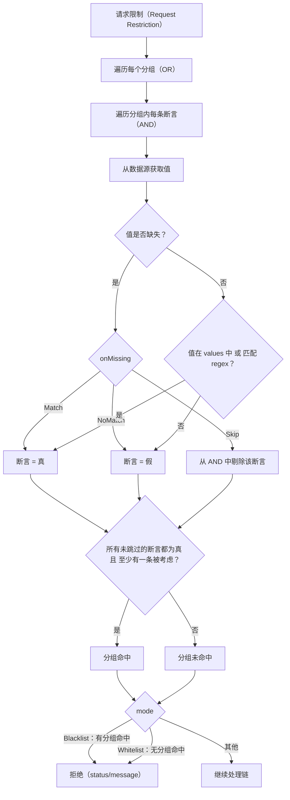

# Request Restriction 插件

> **🔌 Edgion 扩展**
> 
> RequestRestriction 是 `EdgionPlugins` CRD 提供的请求限制插件，不属于标准 Gateway API。

## 概述

`RequestRestriction` 插件用于基于请求属性限制访问，支持多种数据源和匹配方式。与 `IpRestriction` 插件专注于 IP 地址不同，本插件支持基于 Header、Cookie、Query 参数、Path、Method 和 Referer 的访问控制。

它是一个基于请求属性的**限制（restriction）**插件，不是 RBAC 引擎——没有角色、principal 或身份主体的概念，只是根据请求属性决定放行还是拒绝。

## 模型：规则分组（OR-of-AND）+ 全局 mode

插件按析取范式（DNF）求值一组**规则分组（rule groups）**：

- **`ruleGroups` 数组之间是 OR**——任一分组命中即生效。
- **每个分组内的 `rules` 之间是 AND**——分组内所有（未被跳过的）断言都为真，该分组才命中。
- 一个全局 **`mode`** 决定整份配置的极性：
  - `Blacklist`（默认）：任一分组命中 ⇒ **拒绝**；否则放行。
  - `Whitelist`：任一分组命中 ⇒ **放行**；否则拒绝。

**一条 rule 是纯断言**：当取到的值在 `values` 中**或**匹配 `regex` 时为真，自身不带 allow/deny——极性完全由全局 `mode` 决定。这样既能表达 `(A AND B) OR C`，又保持模型扁平（两层，不做更深嵌套、不做取反）。

## 功能特性

- **多数据源支持**：Header、Cookie、Query、Path、RequestPath、Method、Referer
- **精确匹配与正则匹配**：`values` 精确匹配，`regex` 正则匹配（任一命中断言即为真）
- **自动性能优化**：精确匹配列表超过 16 个值时自动使用 HashSet (O(1) 查找)
- **布尔组合**：分组内 AND、分组间 OR（DNF）
- **全局极性**：`mode: Blacklist | Whitelist`
- **缺失值处理**：可配置断言在值缺失时的结果（`Match` / `NoMatch` / `Skip`）
- **自定义响应**：可配置拒绝时的状态码和消息

## 与 Plugin Conditions 的区别

| 维度 | Plugin Conditions | Request Restriction |
|------|------------------|---------------------|
| **定位** | 条件执行框架，决定是否运行某个插件 | 独立插件，直接拒绝不符合规则的请求 |
| **返回行为** | 跳过插件（继续处理链） | 拒绝请求（返回错误响应） |
| **配置位置** | 挂在其他插件上作为条件 | 作为独立插件配置 |
| **使用场景** | 灰度发布、A/B测试、条件执行 | 访问控制、安全防护 |

## 配置参数

### RequestRestrictionConfig

| 参数 | 类型 | 必填 | 默认值 | 说明 |
|------|------|------|--------|------|
| `mode` | `string` | ❌ | `Blacklist` | 全局极性。`Blacklist`：任一分组命中即拒绝；`Whitelist`：任一分组命中即放行，否则拒绝 |
| `ruleGroups` | `RuleGroup[]` | ✅ | - | 规则分组列表，分组之间为 OR |
| `status` | `integer` | ❌ | `403` | 拒绝时的 HTTP 状态码 |
| `message` | `string` | ❌ | `Access denied...` | 拒绝时的响应消息 |

### RuleGroup

| 参数 | 类型 | 必填 | 默认值 | 说明 |
|------|------|------|--------|------|
| `name` | `string` | ❌ | - | 分组名称（用于日志） |
| `rules` | `RestrictionRule[]` | ✅ | - | 分组内的断言，断言之间为 AND |

### RestrictionRule（断言）

| 参数 | 类型 | 必填 | 默认值 | 说明 |
|------|------|------|--------|------|
| `name` | `string` | ❌ | - | 规则名称（用于日志） |
| `source` | `string` | ✅ | - | 数据源：`Header`、`Cookie`、`Query`、`Path`、`RequestPath`、`Method`、`Referer` |
| `key` | `string` | 视情况 | - | 键名（Header/Cookie/Query 必填，其余忽略） |
| `values` | `string[]` | ❌ | - | 精确匹配值；取到的值在列表中则断言为真 |
| `regex` | `string[]` | ❌ | - | 正则模式；取到的值匹配则断言为真（多个模式用 `\|` 合并） |
| `caseSensitive` | `boolean` | ❌ | `true` | 精确匹配是否大小写敏感 |
| `onMissing` | `string` | ❌ | `NoMatch` | 值缺失时断言的结果：`Match`、`NoMatch`、`Skip` |

> **注意**：每条断言必须至少配置 `values` 或 `regex` 之一，**除非**使用 `onMissing: Match` 作为纯粹的「存在/缺失」检查。

### 数据源说明

| 数据源 | 说明 | 需要 key | path 视图 |
|--------|------|----------|-----------|
| `Header` | HTTP 请求头 | ✅ | — |
| `Cookie` | HTTP Cookie | ✅ | — |
| `Query` | URL 查询参数 | ✅ | — |
| `Path` | 请求路径（规范化后 current 视图） | ❌ | current（规范化） |
| `RequestPath` | 请求路径（客户端入口 raw 视图） | ❌ | entry raw（冻结） |
| `Method` | HTTP 方法 | ❌ | — |
| `Referer` | Referer 请求头 | ❌ | — |

#### `Path` 与 `RequestPath` 的区别（path normalization）

| source | 视图 | 含义 | `values` 是否规范化 |
|--------|------|------|---------------------------|
| `Path` | current（规范化） | post-rewrite 规范化 path | ✅ 加载时规范化（与请求侧匹配同一空间） |
| `RequestPath` | entry raw（冻结） | 客户端原始 path，不受 rewrite 影响 | ❌ 不规范化（operator 按字面匹配） |

**推荐用法**：绝大多数 ACL 场景使用 `Path`，它覆盖 `%XX` 编码 / 双斜杠 / dot-segment / path-parameter 等所有绕过变体。`RequestPath` 仅用于需要按字面 raw 形态判断的特殊场景（如「只要含 `%2F` 就拒绝」）。`regex` 永远不会被规范化。

**`Path` + 白名单分组的 `;param` 副作用**：path normalization 会剥除每个 segment 中的 `;param=...`（例如 `/api/users;v=1/data` → `/api/users/data`）。若白名单配置了精确路径，迁移时注意检查含 `;` 的请求样本，确认规则仍按预期命中。

### 匹配方式说明

| 配置项 | 匹配方式 | 说明 | 示例 |
|--------|----------|------|------|
| `values` | 精确匹配 | 字符串完全相等 | `"GET"`、`"/health"` |
| `regex` | 正则匹配 | 使用正则表达式 | `"(?i).*Bot.*"`、`"^/api/v[0-9]+/.*"` |

> **提示**：正则表达式中使用 `(?i)` 前缀可实现不区分大小写匹配，如 `(?i).*bot.*`。

### `onMissing` 语义

| 取值 | 值缺失时断言的结果 |
|------|----------------------|
| `Match` | 断言为**真**（如「该 header 缺失时拒绝」） |
| `NoMatch`（默认） | 断言为**假** |
| `Skip` | 该断言从分组 AND 中**剔除**；若分组内所有断言都被剔除，则该分组不命中 |

> **只配 `Match`、不配 values/regex 的断言「仅在缺失时命中」。** `onMissing: Match` 且无
> `values`/`regex` 的规则，当值**缺失**时为真；值**存在**时没有可匹配的集合，断言为假。（"要求认证
> Header" 例子里的 `missing-token` 组就是这么工作的。）
>
> **Whitelist + `Skip` 是个坑。** 在 `mode: Whitelist` 下，若某分组的断言因 source 缺失而**全部被
> Skip 剔除**，该分组不命中，因此无法放行——请求会被拒。一个只由 `Skip` 断言组成的白名单分组会拒掉
> 所有请求。白名单里当 source 可能缺失时，请用 `NoMatch`/`Match`，不要用 `Skip`。

## 执行逻辑



## 使用场景

### 1. 阻止爬虫和机器人

```yaml
apiVersion: edgion.io/v1
kind: EdgionPlugins
metadata:
  name: block-bots
spec:
  requestPlugins:
    - type: RequestRestriction
      config:
        mode: Blacklist
        ruleGroups:
          - rules:
              - name: "block-bots"
                source: Header
                key: "User-Agent"
                regex:
                  - "(?i).*Bot.*"
                  - "(?i).*Spider.*"
                  - "(?i).*Crawler.*"
                  - "(?i).*curl.*"
                  - "(?i).*wget.*"
                onMissing: Match  # 无 UA 也拒绝
        status: 403
        message: "Bot access denied"
```

### 2. 路径白名单（只允许 API 路径）

```yaml
apiVersion: edgion.io/v1
kind: EdgionPlugins
metadata:
  name: api-whitelist
spec:
  requestPlugins:
    - type: RequestRestriction
      config:
        mode: Whitelist
        ruleGroups:
          - rules:
              - name: "api-only"
                source: Path
                values:
                  - "/health"
                  - "/ready"
                regex:
                  - "^/api/.*"
        status: 404
        message: "Not found"
```

### 3. 只读 API（只允许 GET/HEAD）

```yaml
apiVersion: edgion.io/v1
kind: EdgionPlugins
metadata:
  name: readonly-api
spec:
  requestPlugins:
    - type: RequestRestriction
      config:
        mode: Whitelist
        ruleGroups:
          - rules:
              - name: "readonly"
                source: Method
                values:
                  - "GET"
                  - "HEAD"
                  - "OPTIONS"
        status: 405
        message: "Method not allowed"
```

### 4. 要求认证 Header

当 token 是已知非法值**或** header 缺失时拒绝——两个分组之间 OR。

```yaml
apiVersion: edgion.io/v1
kind: EdgionPlugins
metadata:
  name: require-auth
spec:
  requestPlugins:
    - type: RequestRestriction
      config:
        mode: Blacklist
        ruleGroups:
          - rules:
              - name: "bad-token"
                source: Header
                key: "X-Auth-Token"
                values:
                  - "invalid"
                  - "expired"
                onMissing: NoMatch
          - rules:
              - name: "missing-token"
                source: Header
                key: "X-Auth-Token"
                onMissing: Match  # header 缺失 => 该分组命中 => 拒绝
        status: 401
        message: "Authentication required"
```

### 5. Referer 限制（防盗链）

只允许内部 Referer——白名单模式，缺失 Referer 视为不允许。

```yaml
apiVersion: edgion.io/v1
kind: EdgionPlugins
metadata:
  name: referer-check
spec:
  requestPlugins:
    - type: RequestRestriction
      config:
        mode: Whitelist
        ruleGroups:
          - rules:
              - name: "allow-internal"
                source: Referer
                regex:
                  - ".*example\\.com.*"
                  - ".*example\\.org.*"
                onMissing: NoMatch  # 无 Referer => 无分组命中 => 拒绝
        status: 403
        message: "Invalid referer"
```

### 6. 阻止调试参数

经 query **或** cookie 设置的调试标志都拦截——两个单断言分组（OR）。

```yaml
apiVersion: edgion.io/v1
kind: EdgionPlugins
metadata:
  name: block-debug
spec:
  requestPlugins:
    - type: RequestRestriction
      config:
        mode: Blacklist
        ruleGroups:
          - rules:
              - name: "block-debug-query"
                source: Query
                key: "debug"
                values:
                  - "true"
                  - "1"
          - rules:
              - name: "block-debug-cookie"
                source: Cookie
                key: "debug"
                values:
                  - "true"
                  - "1"
        status: 403
        message: "Debug mode not allowed in production"
```

### 7. 分组内 AND：仅拒绝对 /admin 的 DELETE

单个分组内两条断言 AND——只有**两者都满足**才拒绝。

```yaml
apiVersion: edgion.io/v1
kind: EdgionPlugins
metadata:
  name: protect-admin-writes
spec:
  requestPlugins:
    - type: RequestRestriction
      config:
        mode: Blacklist
        ruleGroups:
          - rules:
              - name: "is-delete"
                source: Method
                values: ["DELETE"]
              - name: "is-admin-path"
                source: Path
                regex: [".*/admin/.*"]
        status: 403
        message: "Deleting admin resources is not allowed"
```

### 8. 综合安全策略（多个 OR 分组）

```yaml
apiVersion: edgion.io/v1
kind: EdgionPlugins
metadata:
  name: security-policy
spec:
  requestPlugins:
    - type: RequestRestriction
      config:
        mode: Blacklist
        ruleGroups:
          # 阻止爬虫
          - rules:
              - name: "block-bots"
                source: Header
                key: "User-Agent"
                regex:
                  - "(?i).*Bot.*"
                  - "(?i).*Spider.*"
          # 阻止敏感路径
          - rules:
              - name: "block-sensitive"
                source: Path
                regex:
                  - ".*/admin/.*"
                  - ".*/internal/.*"
                  - ".*\\.php$"
                  - ".*\\.asp$"
          # 阻止 SQL 注入尝试
          - rules:
              - name: "block-sqli"
                source: Query
                key: "id"
                regex:
                  - ".*('|--|;|/\\*).*"
        status: 403
        message: "Access denied by security policy"
```

## 与其他网关对比

| 功能 | APISIX | Kong | Edgion |
|------|--------|------|--------|
| **User-Agent 限制** | ✅ ua-restriction | ✅ bot-detection | ✅ RequestRestriction |
| **Path/URI 限制** | ✅ uri-blocker | ❌ | ✅ RequestRestriction |
| **Referer 限制** | ✅ referer-restriction | ❌ | ✅ RequestRestriction |
| **Cookie 限制** | ❌ | ❌ | ✅ RequestRestriction |
| **Query 限制** | ❌ | ❌ | ✅ RequestRestriction |
| **Method 限制** | ✅ consumer-restriction | ❌ | ✅ RequestRestriction |
| **统一插件** | ❌ (多个分散) | ❌ (多个分散) | ✅ (单一插件) |

Edgion 的 `RequestRestriction` 插件将多种限制功能统一到一个插件中，配置更简洁，维护更方便。

## 注意事项

1. **分组顺序**：分组按配置顺序求值；`Blacklist` 模式在第一个命中的分组处停止（拒绝），`Whitelist` 模式在第一个命中的分组处停止（放行）。
2. **极性是全局的**：rule 是纯断言，命中意味着放行还是拒绝由 `mode` 统一决定，而非逐条规则决定。
3. **大小写敏感**：精确匹配（`values`）默认大小写敏感，可通过 `caseSensitive: false` 关闭；正则匹配使用 `(?i)` 前缀。
4. **正则性能**：多个正则模式会合并为一个正则表达式（用 `|` 连接），减少匹配开销。
5. **HashSet 优化**：精确匹配列表超过 16 个值时自动使用 HashSet，实现 O(1) 查找。
6. **Path 与 RequestPath**：`Path` 对比规范化后的 current path（`values` 在加载时一并规范化）；`RequestPath` 是入口 raw path（用于按字面 raw 形态判断的审计场景）。`regex` 永不规范化。
7. **缺失值处理**：「缺失即拒绝」用 `Match`；「缺失即忽略」用 `NoMatch`；要把断言从分组 AND 中剔除用 `Skip`。

## 常见问题

### Q1：如何表达黑名单 / 白名单？

**A**：设置全局 `mode`。`Blacklist`（默认）：任一分组命中即拒绝；`Whitelist`：除非有分组命中否则拒绝。rule 本身不带 allow/deny，它只是断言。

### Q2：如何表达 `(A AND B) OR C`？

**A**：把 `A`、`B` 作为同一分组里的两条断言（AND），`C` 作为另一个分组（OR）。插件恰好支持这种两层 DNF——不做更深嵌套、不做取反。

### Q3：`key` 字段何时为必填？

**A**：对于 `Header`、`Cookie`、`Query` 来源，需要通过名称查找值，因此 `key` 为必填。对于 `Path`、`RequestPath`、`Method`、`Referer`，值是请求固有的，`key` 会被忽略。

### Q4：`onMissing: Match` 有什么用？

**A**：值缺失时让断言为真——适合「该 header/参数缺失时拒绝」。配合默认的 `Blacklist` 模式，缺失值会使该分组命中并拒绝请求。

### Q5：如何让精确匹配不区分大小写？

**A**：在规则上设置 `caseSensitive: false`（对 `values` 精确匹配生效）。正则匹配请使用 `(?i)` 内联标志，例如 `(?i).*bot.*`。

---

## 获取帮助

如果遇到问题：

1. 查阅本文档的常见问题部分
2. 查看网关日志
3. 在 GitHub 上提交 Issue

---

## 相关链接

- [IpRestriction](./ip-restriction.md) — IP 访问控制
- [RateLimit](./rate-limit.md) — 速率限制
