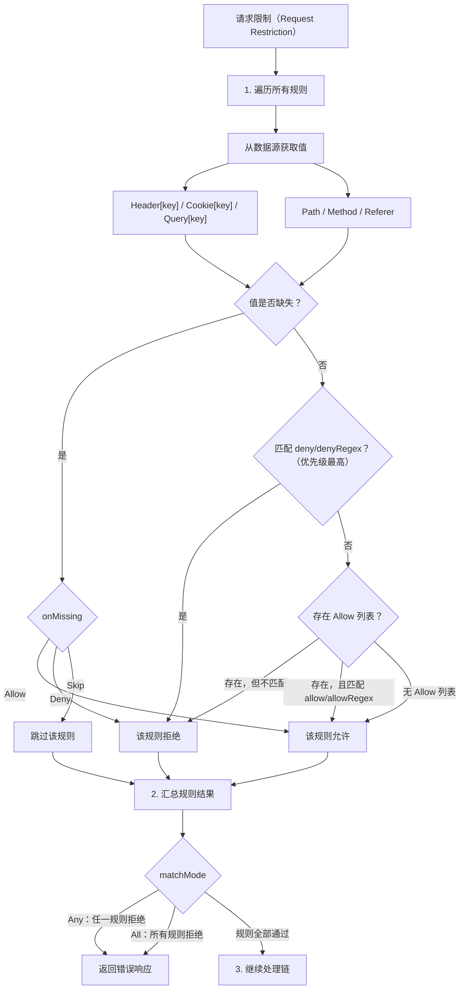

# Request Restriction 插件

> **🔌 Edgion 扩展**
> 
> RequestRestriction 是 `EdgionPlugins` CRD 提供的请求限制插件，不属于标准 Gateway API。

## 概述

`RequestRestriction` 插件用于基于请求属性限制访问，支持多种数据源和匹配方式。与 `IpRestriction` 插件专注于 IP 地址不同，本插件支持基于 Header、Cookie、Query 参数、Path、Method 和 Referer 的访问控制。

## 功能特性

- **多数据源支持**：Header、Cookie、Query、Path、Method、Referer
- **精确匹配与正则匹配**：`allow`/`deny` 用于精确匹配，`allowRegex`/`denyRegex` 用于正则匹配
- **自动性能优化**：精确匹配列表超过 16 个值时自动使用 HashSet (O(1) 查找)
- **灵活的规则组合**：支持 Allow/Deny 列表，Deny 优先级最高
- **缺失值处理**：可配置当目标值缺失时的行为（Allow/Deny/Skip）
- **多规则模式**：Any（任一规则触发即拒绝）或 All（所有规则触发才拒绝）
- **自定义响应**：可配置拒绝时的状态码和消息

## 与 Plugin Conditions 的区别

| 维度 | Plugin Conditions | Request Restriction |
|------|------------------|---------------------|
| **定位** | 条件执行框架，决定是否运行某个插件 | 独立插件，直接拒绝不符合规则的请求 |
| **返回行为** | 跳过插件（继续处理链） | 拒绝请求（返回错误响应） |
| **配置位置** | 挂在其他插件上作为条件 | 作为独立插件配置 |
| **使用场景** | 灰度发布、A/B测试、条件执行 | 访问控制、安全防护 |

## 配置参数

### RequestRestrictionConfig

| 参数 | 类型 | 必填 | 默认值 | 说明 |
|------|------|------|--------|------|
| `rules` | `RestrictionRule[]` | ✅ | - | 限制规则列表 |
| `matchMode` | `string` | ❌ | `Any` | 规则匹配模式：`Any`（任一触发）或 `All`（全部触发） |
| `status` | `integer` | ❌ | `403` | 拒绝时的 HTTP 状态码 |
| `message` | `string` | ❌ | `Access denied...` | 拒绝时的响应消息 |

### RestrictionRule

| 参数 | 类型 | 必填 | 默认值 | 说明 |
|------|------|------|--------|------|
| `name` | `string` | ❌ | - | 规则名称（用于日志） |
| `source` | `string` | ✅ | - | 数据源：`Header`、`Cookie`、`Query`、`Path`、`RequestPath`、`Method`、`Referer` |
| `key` | `string` | 视情况 | - | 键名（Header/Cookie/Query 必填，Path/Method/Referer 忽略） |
| `allow` | `string[]` | ❌ | - | 精确匹配允许列表（白名单） |
| `allowRegex` | `string[]` | ❌ | - | 正则匹配允许列表 |
| `deny` | `string[]` | ❌ | - | 精确匹配拒绝列表（黑名单，优先级最高） |
| `denyRegex` | `string[]` | ❌ | - | 正则匹配拒绝列表 |
| `caseSensitive` | `boolean` | ❌ | `true` | 精确匹配是否大小写敏感 |
| `onMissing` | `string` | ❌ | `Allow` | 值缺失时的行为：`Allow`、`Deny`、`Skip` |

> **注意**：`allow`、`allowRegex`、`deny`、`denyRegex` 至少需要配置一个。

### 数据源说明

| 数据源 | 说明 | 需要 key | path 视图 |
|--------|------|----------|-----------|
| `Header` | HTTP 请求头 | ✅ | — |
| `Cookie` | HTTP Cookie | ✅ | — |
| `Query` | URL 查询参数 | ✅ | — |
| `Path` | 请求路径（规范化后 current 视图） | ❌ | current（规范化） |
| `RequestPath` | 请求路径（客户端入口 raw 视图） | ❌ | entry raw（冻结） |
| `Method` | HTTP 方法 | ❌ | — |
| `Referer` | Referer 请求头 | ❌ | — |

#### `Path` 与 `RequestPath` 的区别（path normalization）

| source | 视图 | 含义 | `deny`/`allow` 值是否规范化 |
|--------|------|------|---------------------------|
| `Path` | current（规范化） | post-rewrite 规范化 path | ✅ 加载时规范化（与请求侧匹配同一空间） |
| `RequestPath` | entry raw（冻结） | 客户端原始 path，不受 rewrite 影响 | ❌ 不规范化（operator 按字面匹配） |

**推荐用法**：绝大多数 ACL 场景使用 `Path`，它覆盖 `%XX` 编码 / 双斜杠 / dot-segment / path-parameter 等所有绕过变体。`RequestPath` 仅用于需要按字面 raw 形态判断的特殊场景（如「只要含 `%2F` 就拒绝」）。

**`Path` + allow-list 的 `;param` 副作用**：path normalization 会剥除每个 segment 中的 `;param=...`（例如 `/api/users;v=1/data` → `/api/users/data`）。若 allow-list 配置了精确路径，迁移时注意检查含 `;` 的请求样本，确认规则仍按预期命中。

### 匹配方式说明

| 配置项 | 匹配方式 | 说明 | 示例 |
|--------|----------|------|------|
| `allow`/`deny` | 精确匹配 | 字符串完全相等 | `"GET"`、`"/health"` |
| `allowRegex`/`denyRegex` | 正则匹配 | 使用正则表达式 | `"(?i).*Bot.*"`、`"^/api/v[0-9]+/.*"` |

> **提示**：正则表达式中使用 `(?i)` 前缀可实现不区分大小写匹配，如 `(?i).*bot.*`。

## 执行逻辑



## 使用场景

### 1. 阻止爬虫和机器人

```yaml
apiVersion: edgion.io/v1
kind: EdgionPlugins
metadata:
  name: block-bots
spec:
  requestPlugins:
    - type: RequestRestriction
      config:
        rules:
          - name: "block-bots"
            source: Header
            key: "User-Agent"
            denyRegex:
              - "(?i).*Bot.*"
              - "(?i).*Spider.*"
              - "(?i).*Crawler.*"
              - "(?i).*curl.*"
              - "(?i).*wget.*"
            onMissing: Deny  # 无 UA 也拒绝
        status: 403
        message: "Bot access denied"
```

### 2. 路径白名单（只允许 API 路径）

```yaml
apiVersion: edgion.io/v1
kind: EdgionPlugins
metadata:
  name: api-whitelist
spec:
  requestPlugins:
    - type: RequestRestriction
      config:
        rules:
          - name: "api-only"
            source: Path
            allow:
              - "/health"
              - "/ready"
            allowRegex:
              - "^/api/.*"
        status: 404
        message: "Not found"
```

### 3. 只读 API（只允许 GET/HEAD）

```yaml
apiVersion: edgion.io/v1
kind: EdgionPlugins
metadata:
  name: readonly-api
spec:
  requestPlugins:
    - type: RequestRestriction
      config:
        rules:
          - name: "readonly"
            source: Method
            allow:
              - "GET"
              - "HEAD"
              - "OPTIONS"
        status: 405
        message: "Method not allowed"
```

### 4. 要求认证 Header

```yaml
apiVersion: edgion.io/v1
kind: EdgionPlugins
metadata:
  name: require-auth
spec:
  requestPlugins:
    - type: RequestRestriction
      config:
        rules:
          - name: "require-auth"
            source: Header
            key: "X-Auth-Token"
            deny:
              - "invalid"
              - "expired"
            onMissing: Deny  # 必须有此 Header
        status: 401
        message: "Authentication required"
```

### 5. Referer 限制（防盗链）

```yaml
apiVersion: edgion.io/v1
kind: EdgionPlugins
metadata:
  name: referer-check
spec:
  requestPlugins:
    - type: RequestRestriction
      config:
        rules:
          - name: "allow-internal"
            source: Referer
            allowRegex:
              - ".*example\\.com.*"
              - ".*example\\.org.*"
            onMissing: Deny
        status: 403
        message: "Invalid referer"
```

### 6. 阻止调试参数

```yaml
apiVersion: edgion.io/v1
kind: EdgionPlugins
metadata:
  name: block-debug
spec:
  requestPlugins:
    - type: RequestRestriction
      config:
        rules:
          - name: "block-debug-query"
            source: Query
            key: "debug"
            deny:
              - "true"
              - "1"
          - name: "block-debug-cookie"
            source: Cookie
            key: "debug"
            deny:
              - "true"
              - "1"
        matchMode: Any  # 任一规则触发即拒绝
        status: 403
        message: "Debug mode not allowed in production"
```

### 7. 综合安全策略

```yaml
apiVersion: edgion.io/v1
kind: EdgionPlugins
metadata:
  name: security-policy
spec:
  requestPlugins:
    - type: RequestRestriction
      config:
        matchMode: Any
        rules:
          # 阻止爬虫
          - name: "block-bots"
            source: Header
            key: "User-Agent"
            denyRegex:
              - "(?i).*Bot.*"
              - "(?i).*Spider.*"
          # 阻止敏感路径
          - name: "block-sensitive"
            source: Path
            denyRegex:
              - ".*/admin/.*"
              - ".*/internal/.*"
              - ".*\\.php$"
              - ".*\\.asp$"
          # 阻止 SQL 注入尝试
          - name: "block-sqli"
            source: Query
            key: "id"
            denyRegex:
              - ".*('|--|;|/\\*).*"
        status: 403
        message: "Access denied by security policy"
```

## 与其他网关对比

| 功能 | APISIX | Kong | Edgion |
|------|--------|------|--------|
| **User-Agent 限制** | ✅ ua-restriction | ✅ bot-detection | ✅ RequestRestriction |
| **Path/URI 限制** | ✅ uri-blocker | ❌ | ✅ RequestRestriction |
| **Referer 限制** | ✅ referer-restriction | ❌ | ✅ RequestRestriction |
| **Cookie 限制** | ❌ | ❌ | ✅ RequestRestriction |
| **Query 限制** | ❌ | ❌ | ✅ RequestRestriction |
| **Method 限制** | ✅ consumer-restriction | ❌ | ✅ RequestRestriction |
| **统一插件** | ❌ (多个分散) | ❌ (多个分散) | ✅ (单一插件) |

Edgion 的 `RequestRestriction` 插件将多种限制功能统一到一个插件中，配置更简洁，维护更方便。

## 注意事项

1. **规则顺序**：规则按配置顺序执行，但 `matchMode=Any` 时会在第一个拒绝规则触发后立即返回
2. **Deny 优先**：在单个规则内，deny/denyRegex 列表的优先级高于 allow/allowRegex 列表
3. **大小写敏感**：精确匹配默认大小写敏感，可通过 `caseSensitive: false` 关闭；正则匹配使用 `(?i)` 前缀
4. **正则性能**：多个正则模式会合并为一个正则表达式（用 `|` 连接），减少匹配开销
5. **HashSet 优化**：精确匹配列表超过 16 个值时自动使用 HashSet，实现 O(1) 查找
6. **缺失值处理**：根据安全需求选择合适的 `onMissing` 行为，认证场景通常使用 `Deny`

## 常见问题

### Q1：同一条规则同时设置了白名单和黑名单会怎样？

**A**：拒绝优先。在单条规则内，`deny` / `denyRegex` 先于 allow 列表求值——若值匹配拒绝条目，则无论白名单如何配置都会拒绝。若不匹配拒绝条目且存在白名单，值必须匹配 `allow` / `allowRegex` 才能通过；否则拒绝。若未配置白名单，任何未被拒绝的值均可通过。

### Q2：`key` 字段何时为必填？

**A**：对于 `Header`、`Cookie`、`Query` 来源，需要通过名称查找值，因此 `key` 为必填。对于 `Path`、`Method`、`Referer`，值是请求固有的，`key` 会被忽略。

### Q3：`matchMode` 中 `Any` 和 `All` 有何区别？

**A**：`Any`（默认）时，任意一条规则拒绝即立刻拒绝请求——处理在第一个拒绝处停止。`All` 时，仅当所有规则都拒绝时才拒绝请求。`Any` 适合分层黑名单，`All` 适合"仅在所有条件均满足时才拒绝"的策略。

### Q4：如何让精确匹配不区分大小写？

**A**：在规则上设置 `caseSensitive: false`（对 `allow` / `deny` 精确匹配生效）。正则匹配请使用 `(?i)` 内联标志，例如 `(?i).*bot.*`。

---

## 获取帮助

如果遇到问题：

1. 查阅本文档的常见问题部分
2. 查看网关日志
3. 在 GitHub 上提交 Issue

---

## 相关链接

- [IpRestriction](./ip-restriction.md) — IP 访问控制
- [RateLimit](./rate-limit.md) — 速率限制
