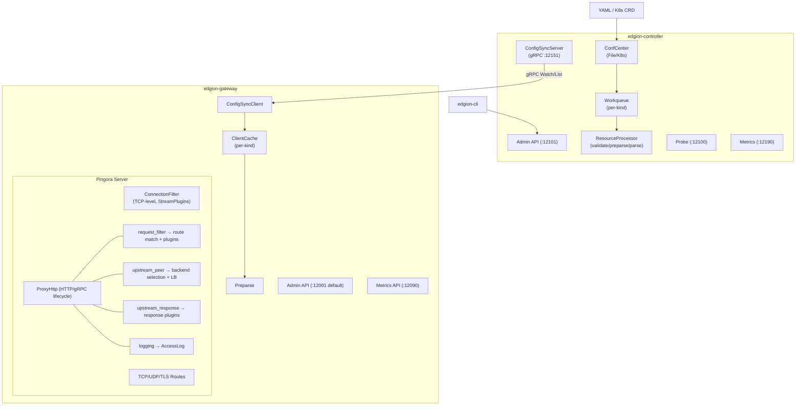

# Project overview

## High-level architecture



## Crate structure

A single Crate (not a workspace) with four `[[bin]]` targets:

| Binary | Entry file | Runtime model | Role |
|--------|---------|-----------|------|
| `edgion-gateway` | `src/bin/edgion_gateway.rs` | Synchronous entry; internally manages its own Tokio + Pingora main loop | Data plane |
| `edgion-controller` | `src/bin/edgion_controller.rs` | `#[tokio::main(multi_thread)]` | Control plane |
| `edgion-cli` | `src/bin/edgion_ctl.rs` | `#[tokio::main]` single-threaded | CLI tool |
| `edgion-center` | `src/bin/edgion_center.rs` | `#[tokio::main(multi_thread)]` | Federation Center |

Example binaries (used in testing): `test_server`, `test_client`, `test_client_direct`, `resource_diff`, `config_load_validator`.

Default features: `allocator-jemalloc` + `boringssl`.

## Code directory organization

```
src/
├── bin/                         # Thin entry wrappers
│   ├── edgion_gateway.rs        #   → EdgionGatewayCli::run()
│   ├── edgion_controller.rs     #   → EdgionControllerCli::run()
│   ├── edgion_ctl.rs            #   → Cli::run() (edgion-cli)
│   └── edgion_center.rs         #   → EdgionCenterCli::run()
├── lib.rs                       # Crate root: pub mod core, pub mod types
├── core/                        # All business logic
│   ├── controller/              # Code belonging to edgion-controller
│   │   ├── api/                 #   Admin API
│   │   ├── cli/                 #   CLI entry and startup
│   │   ├── conf_mgr/            #   ConfigCenter / Workqueue / ResourceProcessor
│   │   ├── conf_sync/           #   gRPC server + ServerCache
│   │   ├── observe/             #   Logging facade
│   │   └── services/            #   ACME and other services
│   ├── gateway/                 # Code belonging to edgion-gateway
│   │   ├── api/                 #   Admin API
│   │   ├── backends/            #   Backend discovery / health checks / BackendTLSPolicy
│   │   ├── cli/                 #   CLI entry and Pingora startup
│   │   ├── config/              #   GatewayClass / EdgionGatewayConfig
│   │   ├── conf_sync/           #   gRPC client + ClientCache
│   │   ├── lb/                  #   Load-balancing algorithms
│   │   ├── link_sys/            #   External systems (Redis/Etcd/ES/Webhook/File)
│   │   ├── observe/             #   AccessLog / Metrics / protocol logs
│   │   ├── plugins/             #   Plugin system (http / stream / runtime)
│   │   ├── routes/              #   HTTP / gRPC / TCP / TLS / UDP routes
│   │   ├── runtime/             #   Pingora runtime (server / matching / store)
│   │   ├── services/            #   ACME challenge service
│   │   └── tls/                 #   TLS runtime / certificate store / validation
│   ├── ctl/                     # Code belonging to edgion-cli
│   │   └── cli/                 #   commands / output / client
│   ├── center/                  # Code belonging to edgion-center (federation center)
│   │   ├── aggregator/          #   Multi-Controller state aggregation
│   │   ├── api/                 #   Center API
│   │   ├── commander/           #   Command dispatch toward Controllers
│   │   ├── db/                  #   Persistence
│   │   ├── fed_sync/            #   Federation gRPC sync
│   │   ├── metadata_store/      #   Metadata store
│   │   └── proxy/               #   Reverse proxy toward Controllers
│   └── common/                  # Cross-bin shared modules
│       ├── config/              #   Shared startup configuration (test mode, cache config)
│       ├── conf_sync/           #   gRPC proto / traits / shared types
│       ├── matcher/             #   Domain matching, IP Radix tree
│       └── utils/               #   metadata / net / duration / real_ip and other utilities
└── types/                       # Pure data definitions (no business logic)
    ├── resource/                # Resource system (define_resources!, ResourceKind, ResourceMeta)
    ├── resources/               # Per-kind resource structs (Gateway, HTTPRoute, EdgionPlugins, ...)
    ├── common/                  # KeyGet/KeySet unified accessors
    ├── constants/               # Annotations, labels, headers, Secret keys
    ├── ctx.rs                   # EdgionHttpContext (per-request state)
    ├── filters.rs               # PluginRunningResult, PluginRunningStage
    ├── schema.rs                # JSON Schema validation
    └── err.rs                   # Error types
```

**Design principles**: `types/` only holds pure data definitions; `core/` holds all logic. `core/` is layered by bin ownership (controller / gateway / ctl / center / common); no top-level shim modules are used.

## EdgionHttpContext — per-request state container

Defined in `src/types/ctx.rs`, the "backpack" carried through the entire HTTP request lifecycle:

| Field | Purpose |
|------|------|
| `start_time` | Request timing |
| `gateway_info` | Gateway metadata |
| `request_info` | Client address, hostname, path, trace ID, SNI, gRPC metadata |
| `edgion_status` | Error codes accumulated during processing |
| `route_unit` / `grpc_route_unit` | The matched routing rule (containing `PluginRuntime`) |
| `selected_backend` / `selected_grpc_backend` | The selected backend reference |
| `backend_context` | Service name, upstream attempt count, connection time |
| `stage_logs` | `Vec<StageLogs>` — plugin logs per execution phase |
| `plugin_running_result` | Current plugin chain execution result |
| `ctx_map` | `HashMap<String, String>` — variables set by plugins |
| `path_params` | Routing path parameters (lazily extracted) |
| `hash_key` | Consistent-hashing key |
| `try_cnt` | Upstream connection attempt counter |

Created in `new_ctx()` and consumed in `logging()`. Plugins interact with it through the `PluginSession` adapter.

## Testing infrastructure

| Component | Path | Purpose |
|------|------|------|
| `test_server` | `examples/code/server/test_server.rs` | Multi-protocol echo backend (HTTP, gRPC, WebSocket, TCP, UDP, auth) |
| `test_client` | `examples/code/client/test_client.rs` | Test runner based on the TestSuite trait |
| `resource_diff` | `examples/code/validator/resource_diff.rs` | Controller ↔ Gateway sync verification |
| `run_integration.sh` | `examples/test/scripts/integration/` | End-to-end integration test orchestration |
| Test configurations | `examples/test/conf/` | YAML resources organized by `Resource/Item/` |
| Port registry | `examples/test/conf/ports.json` | Unique port allocation per test suite |

## Key dependencies

| Category | Crate | Purpose |
|------|-------|------|
| **Proxy core** | `pingora-core`, `pingora-proxy`, `pingora-http`, `pingora-load-balancing` | HTTP proxy engine |
| **Async** | `tokio`, `tokio-stream`, `futures`, `async-trait` | Async runtime |
| **gRPC** | `tonic`, `tonic-reflection`, `prost` | Controller ↔ Gateway communication |
| **HTTP API** | `axum`, `tower-http`, `hyper-util` | Admin API |
| **K8s** | `kube`, `k8s-openapi`, `schemars` | K8s integration + CRD Schema |
| **Serialization** | `serde`, `serde_json`, `serde_yaml`, `toml` | Configuration parsing |
| **TLS** | `rustls`, `tokio-rustls`, `boring-sys` | TLS termination (rustls or BoringSSL) |
| **Observability** | `tracing`, `metrics` | Logging + metrics |
| **Security** | `jsonwebtoken`, `bcrypt`, `base64`, `sha1` | `bcrypt` is used by Controller `local_auth` only; gateway plugins use `jsonwebtoken` (jwt_auth), `sha1`/`md5` (basic_auth htpasswd), `base64` (everywhere) |
| **Performance** | `tikv-jemallocator`, `dashmap`, `arc-swap`, `smallvec` | Memory allocator, concurrent map, lock-free reads, stack buffers |
