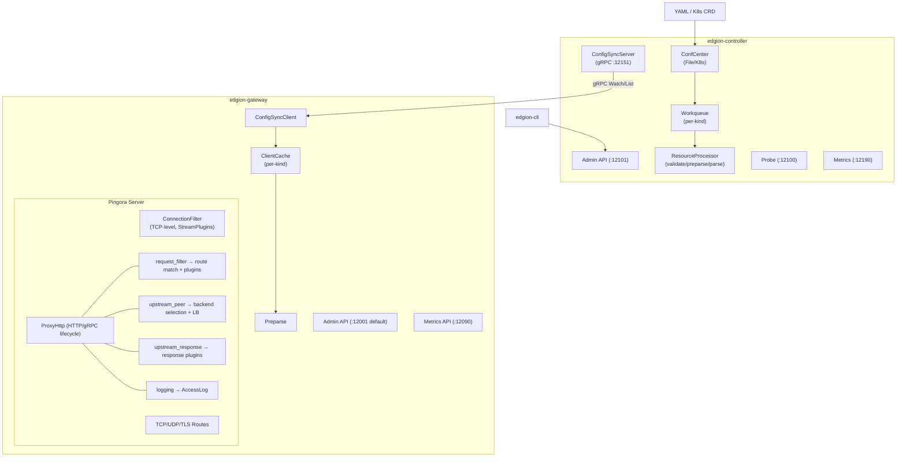

# Project overview

## High-level architecture



## Crate structure

Cargo workspace with crate-owned binary entry points:

| Binary | Entry file | Runtime model | Role |
|--------|---------|-----------|------|
| `edgion-gateway` | `edgion-gateway/src/bin/edgion_gateway.rs` | Synchronous entry; internally manages its own Tokio + Pingora main loop | Data plane |
| `edgion-controller` | `edgion-controller/src/bin/edgion_controller.rs` | `#[tokio::main(multi_thread)]` | Control plane |
| `edgion-cli` | `edgion-cli/src/bin/edgion_ctl.rs` | `#[tokio::main]` single-threaded | CLI tool |

> The federation Center binary (`edgion-center`) has been extracted to the separate EdgionCenter repository.

Example binaries (used in testing): `test_server`, `test_client`, `test_client_direct`, `resource_diff`, `config_load_validator`.

Default features: `allocator-jemalloc` + `boringssl`.

## Code directory organization

```
edgion-resources/                # Shared resource/config schemas and validation helpers
edgion-common/                   # Shared infra: config, observability, secret store, link system, proto codegen
edgion-controller/               # Control plane binary and library
edgion-gateway/                  # Data plane binary and library
edgion-cli/                      # CLI binary and library
edgion-tests/                    # Integration test assets, scripts, and validators
```

**Design principles**: `edgion-resources` is the schema leaf crate;
`edgion-common` holds backend-agnostic shared infrastructure; controller,
gateway, and CLI code stay in their owning crates. The in-repo dependency graph
remains a DAG (`resources → common → {controller, gateway, cli}`).

## EdgionHttpContext — per-request state container

Defined in `edgion-gateway/src/ctx.rs`, the "backpack" carried through the entire HTTP request lifecycle:

| Field | Purpose |
|------|------|
| `start_time` | Request timing |
| `gateway_info` | Gateway metadata |
| `request_info` | Client address, hostname, path, trace ID, SNI, gRPC metadata |
| `edgion_status` | Error codes accumulated during processing |
| `route_unit` / `grpc_route_unit` | The matched routing rule (containing `PluginRuntime`) |
| `selected_backend` / `selected_grpc_backend` | The selected backend reference |
| `backend_context` | Service name, upstream attempt count, connection time |
| `stage_logs` | `Vec<StageLogs>` — plugin logs per execution phase |
| `plugin_running_result` | Current plugin chain execution result |
| `ctx_map` | `HashMap<String, String>` — variables set by plugins |
| `path_params` | Routing path parameters (lazily extracted) |
| `hash_key` | Consistent-hashing key |
| `try_cnt` | Upstream connection attempt counter |

Created in `new_ctx()` and consumed in `logging()`. Plugins interact with it through the `PluginSession` adapter.

## Testing infrastructure

| Component | Path | Purpose |
|------|------|------|
| `test_server` | `edgion-tests/src/server/test_server.rs` | Multi-protocol echo backend (HTTP, gRPC, WebSocket, TCP, UDP, auth) |
| `test_client` | `edgion-tests/src/client/test_client.rs` | Test runner based on the TestSuite trait |
| `resource_diff` | `edgion-tests/src/validator/resource_diff.rs` | Controller ↔ Gateway sync verification |
| `run_integration.sh` | `edgion-tests/integration/scripts/integration/` | End-to-end integration test orchestration |
| Test configurations | `edgion-tests/integration/conf/` | YAML resources organized by `Resource/Item/` |
| Port registry | `edgion-tests/integration/conf/ports.json` | Unique port allocation per test suite |

## Key dependencies

| Category | Crate | Purpose |
|------|-------|------|
| **Proxy core** | `pingora-core`, `pingora-proxy`, `pingora-http`, `pingora-load-balancing` | HTTP proxy engine |
| **Async** | `tokio`, `tokio-stream`, `futures`, `async-trait` | Async runtime |
| **gRPC** | `tonic`, `tonic-reflection`, `prost` | Controller ↔ Gateway communication |
| **HTTP API** | `axum`, `tower-http`, `hyper-util` | Admin API |
| **K8s** | `kube`, `k8s-openapi`, `schemars` | K8s integration + CRD Schema |
| **Serialization** | `serde`, `serde_json`, `serde_yaml` | Configuration parsing |
| **TLS** | `rustls`, `tokio-rustls`, `boring-sys` | TLS termination (rustls or BoringSSL) |
| **Observability** | `tracing`, `metrics` | Logging + metrics |
| **Security** | `jsonwebtoken`, `base64`, `sha1`, `sha2` | Controller admin auth is token-only (SHA-256 token-hash compare, no password hashing); gateway plugins use `jsonwebtoken` (jwt_auth), `sha1`/`md5` (basic_auth htpasswd), `base64` (everywhere) |
| **Performance** | `tikv-jemallocator`, `dashmap`, `arc-swap`, `smallvec` | Memory allocator, concurrent map, lock-free reads, stack buffers |
