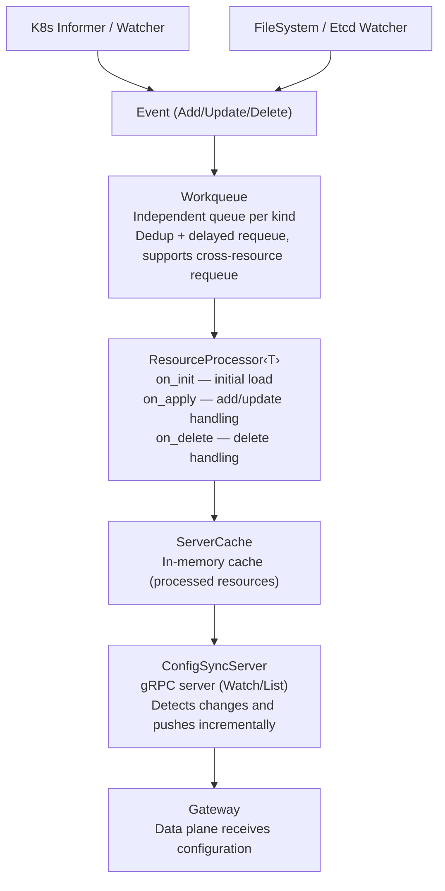

# Controller Overall Architecture

edgion-controller is the control-plane process of Edgion, running on the Tokio multi-threaded runtime. It receives resource changes from the file system, Kubernetes API, or Etcd, validates and processes them, and pushes the final configuration to the Gateway data plane via gRPC.

## ConfMgr Facade Pattern

`ConfMgr` is the unified entry point for configuration management, following the classic **Facade pattern**. It internally holds an `Arc<dyn ConfCenter>` trait object and delegates all CRUD and lifecycle operations to a concrete backend implementation.

```rust
pub struct ConfMgr {
    conf_center: Arc<dyn ConfCenter>,
}
```

`ConfCenter` is a super trait composed of two sub-traits:

```text
ConfCenter (super trait)
├── CenterApi        — CRUD operations (get_one, set_one, delete_one, list ...)
└── CenterLifeCycle  — Lifecycle (start, is_ready, leadership_status ...)
```

The `ConfMgr::create(config)` factory selects the backend based on the `ConfCenterConfig` enum:

| Config variant | Backend created | Description |
|----------------|-----------------|-------------|
| `ConfCenterConfig::FileSystem(fs_config)` | `FileSystemCenter` | Reads/writes YAML files from a local directory |
| `ConfCenterConfig::Kubernetes(k8s_config)` | `KubernetesCenter` | Watches CRDs and native resources via the K8s API |
| `ConfCenterConfig::Etcd(etcd_config)` | `EtcdCenter` | Stores resources/status in Etcd and consumes watch events |

After creation, `ConfMgr` also registers `CrossNsRevalidationListener` to ensure that ReferenceGrant changes can trigger re-validation of affected routes.

## Backend Implementations

### FileSystemCenter

- Recursively reads YAML configuration files from a specified directory
- Suitable for standalone deployments without Kubernetes or for local development
- Provides file-level CRUD via the `CenterApi` trait

### KubernetesCenter

- Uses the kube-rs client to connect to the K8s API Server
- Watches Edgion CRDs (HTTPRoute, Gateway, etc.) as well as native resources (Secret, Service, EndpointSlice, etc.)
- Supports Leader Election in HA mode
- Change events are pushed into the Workqueue of the corresponding resource via Informer/Watcher

### EtcdCenter

- Stores resource bodies and status under separate prefixes in Etcd
- Uses transactional create/update operations and revisioned watches
- Shares the non-Kubernetes controller spawn list and lifecycle helpers with FileSystemCenter
- Runs without Kubernetes leader election

## Workqueue + ResourceProcessor Architecture

Each resource type (kind) has its own **Workqueue** and **ResourceProcessor** instance, forming a complete event-processing pipeline.

### Workqueue

A Go controller-runtime style work queue with these core features:

- **Dedup**: the same key exists in the queue at most once
- **Delayed enqueue**: cross-resource requeue uses a built-in DelayQueue for coalescing
- **TriggerChain**: cascade-path tracking and cycle detection (similar to X-Forwarded-For)
- **Dirty re-enqueue**: new enqueue requests received during processing are not lost

### ResourceProcessor\<T\>

A generic processor with these core components:

| Component | Responsibility |
|-----------|---------------|
| `ServerCache<T>` | In-memory cache of resources; processed objects are stored here |
| `Workqueue` | Receives event keys and drives the processing loop |
| `ProcessorHandler<T>` | trait that defines resource-specific processing logic (on_init, on_apply, on_delete) |
| `HandlerContext` | Context passed to handlers; provides requeue, cache access, etc. |

Processing-result type `WorkItemResult<K>`:

```rust
enum WorkItemResult<K> {
    Processed { obj: K, status_changed: bool },
    Deleted { key: String },
    Skipped,
}
```

Each resource has a corresponding Handler implementation, e.g. `HttpRouteHandler`, `GatewayHandler`, `SecretHandler`, all registered into `ProcessorRegistry`.

## ControllerRuntime Ownership

Each ConfCenter owns an `Arc<ControllerRuntime>`. It aggregates the processor registry, Secret store, reference managers, route indexes, and other process-scoped controller state:

```rust
pub struct ControllerRuntime {
    pub processor_registry: ProcessorRegistry,
    pub secret_store: SecretStore,
    // reference managers, indexes, and stores
}
```

Handlers obtain these dependencies through `HandlerContext::runtime()`. Recovery and
leadership cleanup call `ControllerRuntime::reset()`; this is a selective reset,
not an indiscriminate clearing of process globals.

Core capabilities:

| Method | Description |
|--------|-------------|
| `register(processor)` | Register a processor at startup |
| `get(kind)` | Get a processor by kind name |
| `is_all_ready()` | Check whether all processors are ready (returns false for an empty registry) |
| `not_ready_kinds()` | Return the list of kinds not yet ready |
| `wait_kinds_ready(kinds, timeout)` | Wait for the specified kinds with a deadline (FS/etcd `wait_registry_ready`) |
| `wait_kinds_ready_unbounded(kinds)` | Phased-startup wait with no inner deadline; `cache_ready_deadline_secs` bounds the epoch |
| `all_watch_objs(no_sync_kinds)` | Collect WatchObjs for ConfigSyncServer registration (filters out kinds that should not sync) |
| `requeue(kind, key)` | Immediate cross-resource re-enqueue |
| `requeue_with_chain(kind, key, chain)` | Delayed re-enqueue with TriggerChain (coalescing + cycle detection) |
| `requeue_all()` | Full re-enqueue on Leader switchover, triggering status reconciliation |
| `ControllerRuntime::reset()` | Clear resource-epoch-scoped processors/stores while preserving explicitly process-scoped components |

## Module Layout

```text
edgion-controller/src/
├── api/                        # Admin REST API (Axum, :12101)
│   ├── mod.rs                  # Route registration and health-check handler
│   ├── types.rs                # AdminState, ApiResponse, ListResponse
│   ├── common.rs               # parse_kind, validate_resource, error mapping
│   ├── namespaced_handlers.rs  # Namespaced resource CRUD
│   ├── cluster_handlers.rs     # Cluster-scoped resource CRUD
│   └── configserver_handlers.rs # ConfigServer cache queries (used by edgion-cli)
├── cli/                        # Startup entry, CLI parsing, initialization flow
├── conf_mgr/                   # Configuration manager core
│   ├── manager.rs              # ConfMgr facade
│   ├── processor_registry.rs   # ProcessorRegistry type (owned by ControllerRuntime)
│   ├── schema_validator.rs     # JSON Schema validation
│   ├── conf_center/            # Configuration storage backends
│   │   ├── traits.rs           # ConfCenter / CenterApi / CenterLifeCycle traits
│   │   ├── file_system/        # FileSystemCenter implementation
│   │   ├── kubernetes/         # KubernetesCenter implementation
│   │   └── etcd/               # EtcdCenter implementation
│   ├── runtime.rs              # ControllerRuntime state owner
│   └── sync_runtime/           # Shared sync runtime
│       ├── workqueue.rs        # Workqueue (dedup, delayed requeue, TriggerChain)
│       ├── shutdown.rs         # ShutdownHandle for graceful shutdown
│       ├── metrics.rs          # Runtime metrics
│       └── resource_processor/ # ResourceProcessor framework
│           ├── processor.rs    # Core ResourceProcessor<T> implementation
│           ├── handler.rs      # ProcessorHandler<T> trait
│           ├── context.rs      # HandlerContext
│           ├── handlers/       # Per-resource Handler implementations
│           ├── ref_grant/      # Cross-namespace reference validation (ReferenceGrant)
│           ├── secret_utils/   # Runtime-owned Secret store and reference management
│           ├── service_ref.rs  # Service reference tracking
│           ├── attached_route_tracker.rs # Route attachment tracking
│           ├── gateway_route_index.rs    # Gateway↔Route index
│           ├── namespace_store.rs        # Namespace store
│           └── status_utils.rs           # Status condition utility functions
├── conf_sync/                  # gRPC configuration sync
│   ├── cache_server/           # ServerCache — in-memory cache layer
│   └── conf_server/            # ConfigSyncServer — gRPC server side
├── observe/                    # Observability (metrics, tracing)
└── services/                   # Auxiliary services
    └── acme/                   # ACME certificate automatic issuance and renewal
```

## Data Flow Overview

The complete data flow from event source to Gateway sync:



Key flow details:

1. **Event source**: K8s uses Informer/Watcher events, file-system mode polls recursive YAML paths, and Etcd uses revisioned watch events
2. **Workqueue**: receives resource keys, dequeues them in order after dedup; cross-resource requeue is coalesced via delayed enqueue (no exponential backoff — status-write failures self-heal on watcher relist)
3. **ResourceProcessor**: pulls a key from the queue, dispatches to the matching `ProcessorHandler`; the result is written into `ServerCache`
4. **ServerCache**: stores processed resource objects; changes are notified to the ConfigSyncServer via `CacheEventDispatch`
5. **ConfigSyncServer**: maintains a Watch stream for each Gateway client; detects `server_id` changes to trigger a full re-list, otherwise pushes incremental changes
6. **Cross-resource interactions**: handlers trigger reprocessing through the runtime-owned registry; TriggerChain bounds cyclic dependency propagation
