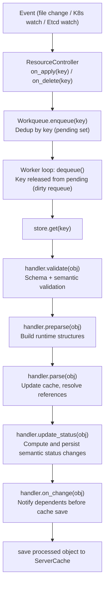
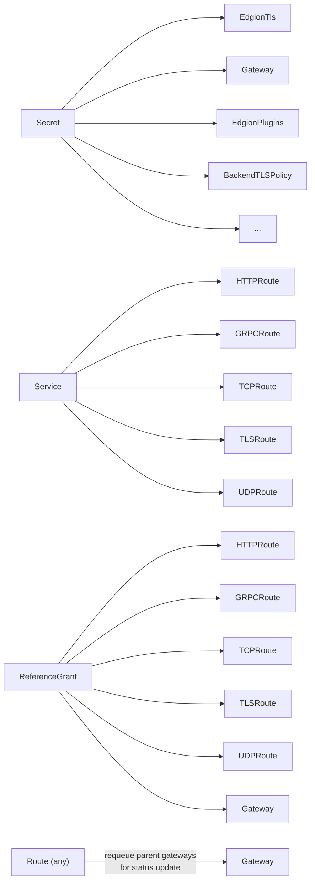

# ConfigCenter Architecture Overview

The ConfigCenter abstracts file-system, Kubernetes, and Etcd configuration sources into a unified trait system. All three use the same runtime-owned Workqueue + ResourceProcessor processing model.

## ConfCenter Trait Hierarchy

```
ConfMgr (facade, manager.rs)
└── Arc<dyn ConfCenter>
    ├── FileSystemCenter   — watches a local YAML directory
    ├── KubernetesCenter   — K8s API watchers + leader election
    └── EtcdCenter         — etcd KV store + watch events (active-passive HA via v3election leader election)
```

Trait composition:

| Trait | Responsibility | Key methods |
|-------|----------------|-------------|
| `CenterApi` | CRUD operations | `set_one`, `create_one`, `update_one`, `delete_one`, `get_one`, `get_list_by_kind`, `get_list_by_kind_ns`, `cnt_by_kind`, `cnt_by_kind_ns`, `list_all` |
| `CenterLifeCycle` | Lifecycle management | `start`, `is_ready`, `config_sync_server`, `is_k8s_mode`, `request_reload` |
| `ConfCenter` | Full interface | `= CenterApi + CenterLifeCycle` (blanket impl: any type that implements both automatically gets `ConfCenter`) |

`CenterApi` is implemented at the storage layer: `FileSystemStorage` (local file I/O), `KubernetesStorage` (K8s API calls), `EtcdStorage` (etcd KV I/O).
`CenterLifeCycle` is implemented at the center layer by `FileSystemCenter`, `KubernetesCenter`, and `EtcdCenter`.
The center layer delegates CRUD operations to the storage layer via the delegation pattern, focusing on lifecycle management itself.

Initialization uses three ordered phases in every backend: reference providers (including
EdgionConfigData and ReferenceGrant), then Gateway, then dependents. Provider readiness is a hard
gate; there is no parallel fallback. This ensures the first Gateway parse can resolve security
references deterministically before its typed snapshot is exposed to ConfigSync.

### ConfMgr Facade

`ConfMgr` is the unified entry point for external callers; internally it holds an `Arc<dyn ConfCenter>`.
The factory instantiates `FileSystemCenter`, `KubernetesCenter`, or `EtcdCenter` based on `conf_center.type`.
External modules (Admin API, gRPC server) access all configuration operations through `ConfMgr` without needing to know the underlying backend type.

## Unified Workqueue + ResourceProcessor Pipeline

All backends share the same processing model. Each resource type owns a `ResourceProcessor<K>` + `Workqueue` registered in its ConfCenter's `ControllerRuntime`:



The differences are only at the two ends:

| Difference | FileSystemCenter | KubernetesCenter | EtcdCenter |
|------------|-----------------|-----------------|------------|
| Event source | `notify` crate, inotify/kqueue file watching | K8s API Reflector watch stream | etcd watch stream |
| Status persistence | `.status` file (YAML) | K8s API `PATCH /status` (JSON Merge Patch) | `{prefix}/status/{kind}/{namespace}/{name}` keys (YAML; leadership-gated writes) |
| Leader election | None (single instance) | Lease-based distributed election | etcd `v3election` + self-managed lease keepalive (active-passive) |
| 410 Gone handling | N/A | Watcher obtains a fresh source LIST; commit its complete snapshot and resync source keys through the existing worker | N/A |
| Concurrent-write constraint | Single process; check-then-write is non-atomic | K8s API Server provides atomicity | **Single active writer, guaranteed by leader election**; check-then-write is non-atomic, but active-passive HA (etcd `v3election` + a pre-write leadership gate) ensures exactly one leader writes at a time. The single-writer assumption is now enforced by leader election, not by operator discipline |

The middle layers (Workqueue, ResourceProcessor, ProcessorHandler, ServerCache, reference managers, etc.) are fully reused.

### Etcd document ingress

The watcher tracks key presence independently of value decoding. Initial lists,
live Put events and compaction resync carry either decoded text or an explicit
invalid-UTF-8 marker through the existing per-kind channel. Invalid bytes are
not retained in events or diagnostics. Resync emits Delete only for absent keys.

The resource controller owns malformed-document policy under the authoritative
etcd key: initial failures use the pre-worker diagnostic path; runtime failures
remove raw state, retain a ParseError envelope and enqueue through on_event_key.
The single worker revokes the previous processed generation and writes error
status inline. Valid repair and actual Delete clear the invalid envelope. This
does not add a status-write retry or guarantee deletion of an old error sidecar
when the existing processor returns Skipped for an already-absent generation.
See [etcd ingress regression boundaries](../../../04-review/controller/regression-guards/etcd-key-content-identity.md)
for ARCH-086 coverage and limits.

### Etcd election diagnostics and term supervision

`EtcdLeaderElection` resolves its advertised `LeaderInfo` once at construction
and serializes that exact identity into the campaign value. While campaign is
pending, a bounded, session-reusing diagnostic future discovers the current
leader for follower Admin API responses. The campaign scope owns and polls this
future; returning from candidacy drops it before publishing the winner. There
is no independently scheduled diagnostic cache writer that can overwrite the
winner with a late result. A diagnostic polling panic stops only that diagnostic
future; the same campaign keeps observing shutdown and keepalive-driver exit.

On an acknowledged win, local publication stores the new term token, freshness
and cold identity before the leadership flag. Guard startup and timer/join/shutdown
supervision follow without a diagnostic network await. Local demotion invalidates
authority, clears the diagnostic cache and cancels that term's token before
asynchronous task cleanup and best-effort resign/revoke. Diagnostic changes must
not add network dependencies between publication and supervision. This preserves
the existing local pre-write gate; it does not add transaction-level fencing.
See the [diagnostic supervision regression boundary](../../../04-review/concurrency/regression-guards/etcd-leader-diagnostic-supervision.md)
for ARCH-081 evidence and verification limits.

### Requeue and Self-Healing

There is no exponential-backoff retry (`requeue_with_backoff` is intentionally not implemented).
A successful Kubernetes source relist commits its complete raw snapshot, then enqueues the union
of old and current keys through the existing per-kind workqueue. Current keys include unchanged
resourceVersions, allowing a previously failed status write to be attempted again when semantic
status differs. Missing keys reconcile as deletes. Other sources and kinds keep their state.

Relevant watch events, cross-resource requeues, and leadership-acquisition requeues also provide
reconciliation opportunities. A reconnect that only resumes WATCH does not force a full resync;
no recovery deadline or unrelated-source status recovery is promised. Inline status IO and the
decision against automatic write-error retry remain unchanged. Cross-resource requeue is
coalesced via delayed enqueue. See `04-workqueue.md` for details.

### Dirty Requeue

The key is removed from the `pending` set on dequeue (rather than after processing completes), so the same key can be re-enqueued during processing.
This ensures no events are lost — even if key A changes again while it is being processed, the new event is captured and will trigger another round of processing.

## BidirectionalRefManager — Generic Reference Tracking

The three reference managers share a single generic implementation `BidirectionalRefManager<V: RefValue>`:

```
BidirectionalRefManager<V>
├── Forward:  source_key → HashSet<V>         // which values reference a given source
├── Reverse:  value_key  → HashSet<source_key> // which sources a given value depends on
└── Methods:  add_ref, get_refs, get_dependencies, clear_value_refs, all_source_keys, stats, clear
```

| Type alias | Source key | Purpose |
|-----------|-----------|---------|
| `SecretRefManager` | Secret key (`"ns/name"`) | Secret change → requeue dependent resources |
| `ServiceRefManager` | Service key (`"ns/name"`) | Service change → requeue dependent routes |
| `CrossNamespaceRefManager` | Target namespace (`"ns"`) | ReferenceGrant change → requeue cross-namespace resources |

**Workflow:**

1. Handlers register reference relationships during the `parse()` phase (e.g., HTTPRoute references Secret `tls/cert`)
2. Handlers clean up reference relationships during the `on_delete()` phase
3. The source handler's `on_change()` calls `get_refs()` to find all dependents and requeue them

### Cross-resource Requeue Graph

The dependency graph includes intentional cycles (for example route delegation
and parent/status relationships). TriggerChain depth/cycle limits bound repeated
propagation; do not assume the graph is a DAG.



Treat each new dependency edge as a cycle-safety decision. The TriggerChain
records propagation and enforces configured cycle/depth limits.

## Secret Management — runtime-owned SecretStore

```
ControllerRuntime.secret_store
├── Map: "namespace/name" → Secret
├── get_secret(namespace, name) → Option<Secret>
├── update_secrets(upsert, remove)
└── replace_all_secrets()

SecretHandler
├── parse: update SecretStore
├── on_change: cascade requeue all dependents via SecretRefManager
└── on_delete: remove from SecretStore + cascade requeue
```

Each ConfCenter's `ControllerRuntime` owns the SecretStore that handlers query during `parse()`.
On Secret changes, `SecretHandler.on_change()` queries the runtime-owned SecretRefManager to obtain all resources referencing that Secret,
then triggers cascading reprocessing through `runtime.processor_registry.requeue()`.

## ProcessorRegistry — ControllerRuntime member

```rust
runtime.processor_registry
```

| Method | Purpose |
|--------|---------|
| `register(processor)` | Register a processor (at startup) |
| `get(kind)` | Look up a processor by kind name |
| `requeue(kind, key)` | Immediate cross-resource requeue |
| `requeue_with_chain(kind, key, chain)` | Cross-resource requeue carrying a trigger chain |
| `requeue_all()` | Full requeue (on leader switchover) |
| `is_all_ready()` | Check whether all caches are ready |
| `wait_kinds_ready(kinds, timeout)` | Wait for the specified kinds to finish initialization |
| `all_watch_objs(no_sync)` | Collect WatchObjs for the ConfigSyncServer |
| `ControllerRuntime::reset()` | Selectively reset processors and reload-scoped stores |

## Key Files

- `edgion-controller/src/conf_mgr/conf_center/traits.rs` — trait definitions
- `edgion-controller/src/conf_mgr/conf_center/file_system/center.rs` — `FileSystemCenter`
- `edgion-controller/src/conf_mgr/conf_center/kubernetes/center.rs` — `KubernetesCenter`
- `edgion-controller/src/conf_mgr/conf_center/etcd/center.rs` — `EtcdCenter`
- `edgion-controller/src/conf_mgr/manager.rs` — `ConfMgr` facade
- `edgion-controller/src/conf_mgr/runtime.rs` — `ControllerRuntime` ownership and reset semantics
- `edgion-controller/src/conf_mgr/sync_runtime/workqueue.rs` — `Workqueue`, `WorkItem`
- `edgion-controller/src/conf_mgr/sync_runtime/resource_processor/processor.rs` — `ResourceProcessor<K>`
- `edgion-controller/src/conf_mgr/sync_runtime/resource_processor/handler.rs` — `ProcessorHandler` trait
- `edgion-controller/src/conf_mgr/sync_runtime/resource_processor/ref_manager.rs` — `BidirectionalRefManager`
- `edgion-controller/src/conf_mgr/sync_runtime/resource_processor/secret_utils/secret_ref.rs` — Secret reference management
- `edgion-controller/src/conf_mgr/sync_runtime/resource_processor/service_ref.rs` — Service reference management
- `edgion-controller/src/conf_mgr/sync_runtime/resource_processor/ref_grant/cross_ns_ref_manager.rs` — cross-namespace references
- `edgion-controller/src/conf_mgr/processor_registry.rs` — `ProcessorRegistry`
