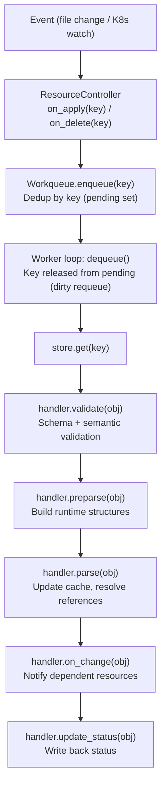
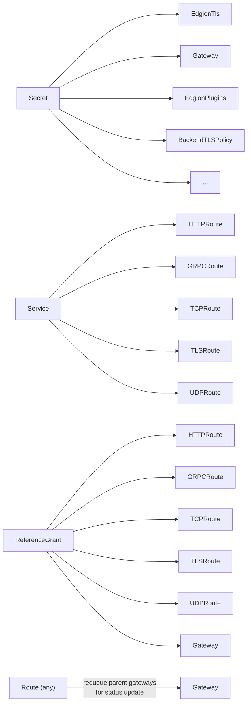

# ConfigCenter Architecture Overview

The ConfigCenter is a core Controller subsystem that abstracts configuration sources (file system / Kubernetes) into a unified trait system.
Both backends share an identical Workqueue + ResourceProcessor processing pipeline.

## ConfCenter Trait Hierarchy

```
ConfMgr (facade, manager.rs)
└── Arc<dyn ConfCenter>
    ├── FileSystemCenter   — watches a local YAML directory
    ├── KubernetesCenter   — K8s API watchers + leader election
    └── EtcdCenter         — etcd KV store + watch events (single-Controller only)
```

Trait composition:

| Trait | Responsibility | Key methods |
|-------|----------------|-------------|
| `CenterApi` | CRUD operations | `set_one`, `create_one`, `update_one`, `delete_one`, `get_one`, `get_list_by_kind`, `get_list_by_kind_ns`, `cnt_by_kind`, `cnt_by_kind_ns`, `list_all` |
| `CenterLifeCycle` | Lifecycle management | `start`, `is_ready`, `config_sync_server`, `is_k8s_mode`, `request_reload` |
| `ConfCenter` | Full interface | `= CenterApi + CenterLifeCycle` (blanket impl: any type that implements both automatically gets `ConfCenter`) |

`CenterApi` is implemented at the storage layer: `FileSystemStorage` (local file I/O), `KubernetesStorage` (K8s API calls), `EtcdStorage` (etcd KV I/O).
`CenterLifeCycle` is implemented at the center layer: `FileSystemCenter` and `KubernetesCenter`.
The center layer delegates CRUD operations to the storage layer via the delegation pattern, focusing on lifecycle management itself.

### ConfMgr Facade

`ConfMgr` is the unified entry point for external callers; internally it holds an `Arc<dyn ConfCenter>`.
The factory chooses to instantiate either `FileSystemCenter` or `KubernetesCenter` based on `conf_center.type`.
External modules (Admin API, gRPC server) access all configuration operations through `ConfMgr` without needing to know the underlying backend type.

## Unified Workqueue + ResourceProcessor Pipeline

Both backends share an identical processing pipeline. Each resource type owns its own `ResourceProcessor<K>` + `Workqueue`:



The differences are only at the two ends:

| Difference | FileSystemCenter | KubernetesCenter | EtcdCenter |
|------------|-----------------|-----------------|------------|
| Event source | `notify` crate, inotify/kqueue file watching | K8s API Reflector watch stream | etcd watch stream |
| Status persistence | `.status` file (YAML) | K8s API `PATCH /status` (JSON Merge Patch) | None (status is not persisted) |
| Leader election | None (single instance) | Lease-based distributed election | None (single instance) |
| 410 Gone handling | N/A | When detected, watcher reconnect triggers KubernetesController rebuild | N/A |
| Concurrent-write constraint | Single process; check-then-write is non-atomic | K8s API Server provides atomicity | **Single Controller exclusive**; check-then-write is non-atomic; by design does not support concurrent writes from multiple Controllers to the same etcd |

The middle layers (Workqueue, ResourceProcessor, ProcessorHandler, ServerCache, reference managers, etc.) are fully reused.

### Requeue and Self-Healing

There is no exponential-backoff retry (`requeue_with_backoff` is intentionally not implemented). Status-write
failures (e.g., transient K8s API unavailability) are self-healing: when the watcher reconnects after a
disconnect, a full cache rebuild is triggered, which reprocesses everything and rewrites all statuses.
Cross-resource requeue is coalesced via delayed enqueue. See `04-workqueue.md` for details.

### Dirty Requeue

The key is removed from the `pending` set on dequeue (rather than after processing completes), so the same key can be re-enqueued during processing.
This ensures no events are lost — even if key A changes again while it is being processed, the new event is captured and will trigger another round of processing.

## BidirectionalRefManager — Generic Reference Tracking

The three reference managers share a single generic implementation `BidirectionalRefManager<V: RefValue>`:

```
BidirectionalRefManager<V>
├── Forward:  source_key → HashSet<V>         // which values reference a given source
├── Reverse:  value_key  → HashSet<source_key> // which sources a given value depends on
└── Methods:  add_ref, get_refs, get_dependencies, clear_value_refs, all_source_keys, stats, clear
```

| Type alias | Source key | Purpose |
|-----------|-----------|---------|
| `SecretRefManager` | Secret key (`"ns/name"`) | Secret change → requeue dependent resources |
| `ServiceRefManager` | Service key (`"ns/name"`) | Service change → requeue dependent routes |
| `CrossNamespaceRefManager` | Target namespace (`"ns"`) | ReferenceGrant change → requeue cross-namespace resources |

**Workflow:**

1. Handlers register reference relationships during the `parse()` phase (e.g., HTTPRoute references Secret `tls/cert`)
2. Handlers clean up reference relationships during the `on_delete()` phase
3. The source handler's `on_change()` calls `get_refs()` to find all dependents and requeue them

### Cross-resource Requeue DAG

Cross-resource requeue must form a directed acyclic graph; circular triggering is forbidden:



Key constraint: Gateway must not trigger Route requeue, otherwise `Route → Gateway → Route` would form an infinite loop.
The TriggerChain mechanism records the path on each cross-resource requeue and stops once the depth exceeds `max_trigger_cycles`.

## Secret Management — GLOBAL_SECRET_STORE

```
GLOBAL_SECRET_STORE (LazyLock<SecretStore>)
├── Map: "namespace/name" → Secret
├── get_secret(namespace, name) → Option<Secret>
├── update_secrets(upsert, remove)
└── replace_all_secrets()

SecretHandler
├── parse: update SecretStore
├── on_change: cascade requeue all dependents via SecretRefManager
└── on_delete: remove from SecretStore + cascade requeue
```

`GLOBAL_SECRET_STORE` is implemented as a `LazyLock` global singleton that all handlers query during `parse()` to read Secret contents.
On Secret changes, `SecretHandler.on_change()` queries `SecretRefManager` to obtain all resources referencing that Secret,
then triggers cascading reprocessing through `PROCESSOR_REGISTRY.requeue()`.

## ProcessorRegistry — Global Registry

```rust
pub static PROCESSOR_REGISTRY: LazyLock<ProcessorRegistry> = LazyLock::new(ProcessorRegistry::new);
```

| Method | Purpose |
|--------|---------|
| `register(processor)` | Register a processor (at startup) |
| `get(kind)` | Look up a processor by kind name |
| `requeue(kind, key)` | Immediate cross-resource requeue |
| `requeue_with_chain(kind, key, chain)` | Cross-resource requeue carrying a trigger chain |
| `requeue_all()` | Full requeue (on leader switchover) |
| `is_all_ready()` | Check whether all caches are ready |
| `wait_kinds_ready(kinds, timeout)` | Wait for the specified kinds to finish initialization |
| `all_watch_objs(no_sync)` | Collect WatchObjs for the ConfigSyncServer |
| `clear_registry()` | Clear all processors (on restart / loss of leadership) |

## Key Files

- `src/core/controller/conf_mgr/conf_center/traits.rs` — trait definitions
- `src/core/controller/conf_mgr/conf_center/file_system/center.rs` — `FileSystemCenter`
- `src/core/controller/conf_mgr/conf_center/kubernetes/center.rs` — `KubernetesCenter`
- `src/core/controller/conf_mgr/manager.rs` — `ConfMgr` facade
- `src/core/controller/conf_mgr/sync_runtime/workqueue.rs` — `Workqueue`, `WorkItem`
- `src/core/controller/conf_mgr/sync_runtime/resource_processor/processor.rs` — `ResourceProcessor<K>`
- `src/core/controller/conf_mgr/sync_runtime/resource_processor/handler.rs` — `ProcessorHandler` trait
- `src/core/controller/conf_mgr/sync_runtime/resource_processor/ref_manager.rs` — `BidirectionalRefManager`
- `src/core/controller/conf_mgr/sync_runtime/resource_processor/secret_utils/secret_ref.rs` — Secret reference management
- `src/core/controller/conf_mgr/sync_runtime/resource_processor/service_ref.rs` — Service reference management
- `src/core/controller/conf_mgr/sync_runtime/resource_processor/ref_grant/cross_ns_ref_manager.rs` — cross-namespace references
- `src/core/controller/conf_mgr/processor_registry.rs` — `PROCESSOR_REGISTRY`
