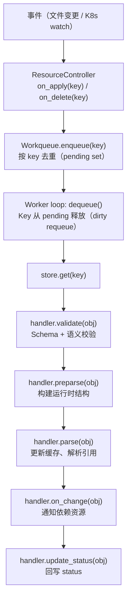
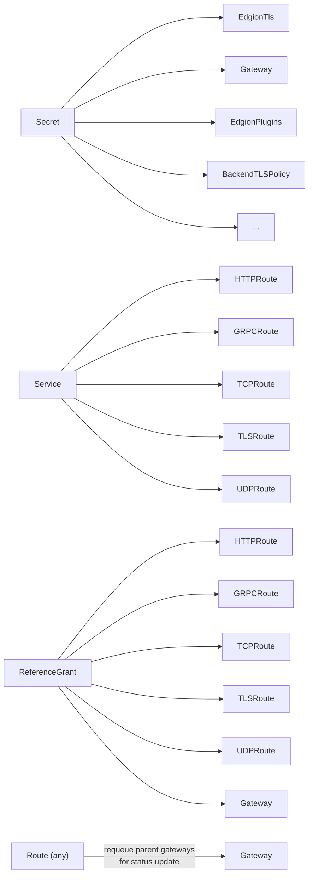

# 配置中心架构总览

配置中心是 Controller 的核心子系统，将配置来源（文件系统 / Kubernetes）抽象为统一的 trait 体系，
两种后端共享完全相同的 Workqueue + ResourceProcessor 处理管线。

## ConfCenter Trait 体系

```
ConfMgr (facade, manager.rs)
└── Arc<dyn ConfCenter>
    ├── FileSystemCenter   — 监听本地 YAML 目录
    ├── KubernetesCenter   — K8s API watchers + Leader Election
    └── EtcdCenter         — etcd KV 存储 + watch 事件（单 Controller 专用）
```

Trait 组合关系：

| Trait | 职责 | 关键方法 |
|-------|------|---------|
| `CenterApi` | CRUD 操作 | `set_one`, `create_one`, `update_one`, `delete_one`, `get_one`, `get_list_by_kind`, `get_list_by_kind_ns`, `cnt_by_kind`, `cnt_by_kind_ns`, `list_all` |
| `CenterLifeCycle` | 生命周期管理 | `start`, `is_ready`, `config_sync_server`, `is_k8s_mode`, `request_reload` |
| `ConfCenter` | 完整接口 | `= CenterApi + CenterLifeCycle`（blanket impl：任何同时实现两者的类型自动获得 `ConfCenter`） |

`CenterApi` 由存储层实现：`FileSystemStorage`（本地文件读写）、`KubernetesStorage`（K8s API 调用）、`EtcdStorage`（etcd KV 读写）。
`CenterLifeCycle` 由中心层实现：`FileSystemCenter` 和 `KubernetesCenter`。
Center 层通过委托模式将 CRUD 操作转发给 Storage 层，自身专注于生命周期管理。

### ConfMgr 门面

`ConfMgr` 是对外统一入口，内部持有 `Arc<dyn ConfCenter>`。
工厂方法根据配置 `conf_center.type` 选择实例化 `FileSystemCenter` 或 `KubernetesCenter`。
外部模块（Admin API、gRPC 服务）通过 `ConfMgr` 访问所有配置操作，无需知道底层后端类型。

## Workqueue + ResourceProcessor 统一管线

两种后端共享完全相同的处理管线。每种资源类型拥有独立的 `ResourceProcessor<K>` + `Workqueue`：



差异仅在两端：

| 差异点 | FileSystemCenter | KubernetesCenter | EtcdCenter |
|--------|-----------------|-----------------|------------|
| 事件源 | `notify` 库 inotify/kqueue 文件监听 | K8s API Reflector watch stream | etcd watch stream |
| Status 持久化 | `.status` 文件（YAML 格式） | K8s API `PATCH /status`（JSON Merge Patch） | 无（不持久化 status） |
| Leader Election | 无（单实例） | Lease-based 分布式选举 | 无（单实例） |
| 410 Gone 处理 | 不适用 | 检测到 watcher 重连，触发 KubernetesController 重建 | 不适用 |
| 并发写约束 | 单进程，check-then-write 非原子 | K8s API Server 保证原子性 | **单 Controller 独占**，check-then-write 非原子，设计上不支持多 Controller 并发写同一 etcd |

中间的 Workqueue、ResourceProcessor、ProcessorHandler、ServerCache、引用管理器等完全复用。

### Requeue with Backoff

失败的 work item 按指数退避重试：`initial_backoff * 2^retry_count`，上限为 `max_backoff`。
超过 `max_retries` 后该 item 被放弃，不再重新入队。

### Dirty Requeue

Key 在 dequeue 时从 `pending` set 中移除（而非处理完成后），因此同一 key 在处理期间可以被重新 enqueue。
这确保不会丢失任何事件——即使在处理 key A 的过程中 A 再次变更，新事件也会被捕获并触发下一轮处理。

## BidirectionalRefManager — 通用引用追踪

三种引用管理器共享同一个泛型实现 `BidirectionalRefManager<V: RefValue>`：

```
BidirectionalRefManager<V>
├── Forward:  source_key → HashSet<V>         // 一个 source 被哪些 value 引用
├── Reverse:  value_key  → HashSet<source_key> // 一个 value 依赖哪些 source
└── Methods:  add_ref, get_refs, get_dependencies, clear_value_refs, all_source_keys, stats, clear
```

| 类型别名 | Source Key | 用途 |
|----------|-----------|------|
| `SecretRefManager` | Secret key（`"ns/name"`） | Secret 变更 → requeue 依赖资源 |
| `ServiceRefManager` | Service key（`"ns/name"`） | Service 变更 → requeue 依赖路由 |
| `CrossNamespaceRefManager` | 目标 namespace（`"ns"`） | ReferenceGrant 变更 → requeue 跨命名空间资源 |

**工作流程：**

1. Handler 在 `parse()` 阶段注册引用关系（如 HTTPRoute 引用 Secret `tls/cert`）
2. Handler 在 `on_delete()` 阶段清理引用关系
3. Source handler 的 `on_change()` 查询 `get_refs()` 找到所有依赖者并 requeue

### 跨资源 Requeue DAG

跨资源 requeue 必须形成有向无环图，禁止循环触发：



关键约束：Gateway 不可以触发 Route requeue，否则 `Route → Gateway → Route` 形成无限循环。
TriggerChain 机制在每次跨资源 requeue 时记录路径，超过 `max_trigger_cycles` 深度则停止。

## Secret 管理 — GLOBAL_SECRET_STORE

```
GLOBAL_SECRET_STORE (LazyLock<SecretStore>)
├── Map: "namespace/name" → Secret
├── get_secret(namespace, name) → Option<Secret>
├── update_secrets(upsert, remove)
└── replace_all_secrets()

SecretHandler
├── parse: 更新 SecretStore
├── on_change: 通过 SecretRefManager 级联 requeue 所有依赖者
└── on_delete: 从 SecretStore 移除 + 级联 requeue
```

`GLOBAL_SECRET_STORE` 使用 `LazyLock` 实现全局单例，所有 Handler 在 `parse()` 阶段通过它查询 Secret 内容。
Secret 变更时，`SecretHandler.on_change()` 查询 `SecretRefManager` 获取所有引用该 Secret 的资源，
然后通过 `PROCESSOR_REGISTRY.requeue()` 触发级联重新处理。

## ProcessorRegistry — 全局注册表

```rust
pub static PROCESSOR_REGISTRY: LazyLock<ProcessorRegistry> = LazyLock::new(ProcessorRegistry::new);
```

| 方法 | 用途 |
|------|------|
| `register(processor)` | 注册处理器（启动时） |
| `get(kind)` | 按种类名获取 |
| `requeue(kind, key)` | 跨资源即时 requeue |
| `requeue_with_chain(kind, key, chain)` | 带触发链的跨资源 requeue |
| `requeue_all()` | 全量 requeue（leader 切换时） |
| `is_all_ready()` | 检查所有缓存是否就绪 |
| `wait_kinds_ready(kinds, timeout)` | 等待指定 kinds 初始化完成 |
| `all_watch_objs(no_sync)` | 收集 WatchObj 给 ConfigSyncServer |
| `clear_registry()` | 清空所有处理器（重启/失去 leadership） |

## 关键文件

- `src/core/controller/conf_mgr/conf_center/traits.rs` — trait 定义
- `src/core/controller/conf_mgr/conf_center/file_system/center.rs` — `FileSystemCenter`
- `src/core/controller/conf_mgr/conf_center/kubernetes/center.rs` — `KubernetesCenter`
- `src/core/controller/conf_mgr/manager.rs` — `ConfMgr` facade
- `src/core/controller/conf_mgr/sync_runtime/workqueue.rs` — `Workqueue`, `WorkItem`
- `src/core/controller/conf_mgr/sync_runtime/resource_processor/processor.rs` — `ResourceProcessor<K>`
- `src/core/controller/conf_mgr/sync_runtime/resource_processor/handler.rs` — `ProcessorHandler` trait
- `src/core/controller/conf_mgr/sync_runtime/resource_processor/ref_manager.rs` — `BidirectionalRefManager`
- `src/core/controller/conf_mgr/sync_runtime/resource_processor/secret_utils/secret_ref.rs` — Secret 引用管理
- `src/core/controller/conf_mgr/sync_runtime/resource_processor/service_ref.rs` — Service 引用管理
- `src/core/controller/conf_mgr/sync_runtime/resource_processor/ref_grant/cross_ns_ref_manager.rs` — 跨命名空间引用
- `src/core/controller/conf_mgr/processor_registry.rs` — `PROCESSOR_REGISTRY`
