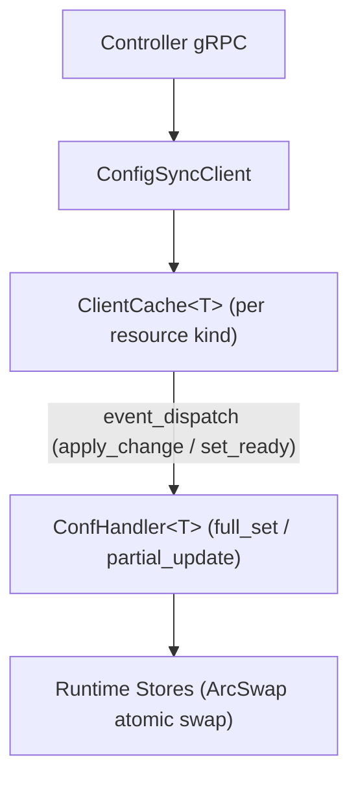

# Gateway overall architecture

edgion-gateway is Edgion's data plane, a high-performance reverse proxy built on Cloudflare Pingora. It receives Kubernetes-style resource configuration from the Controller via gRPC and translates it into runtime proxy behavior.

## AI implementation boundary

The AI data plane remains inside `edgion-gateway/src/ai/`. `ai/mod.rs` exports
named domain types and functions; internal consumers use the canonical modules:

| Module | Ownership |
|--------|-----------|
| `ai/context.rs` | Lazily allocated AI request state and its context methods |
| `ai/config.rs` | Strict startup conversion configuration and one immutable process-wide limits/admission runtime |
| `ai/runtime/` | Backend snapshots, proof-carrying AI selections, attempt scheduling, credential health and dispatch |
| `ai/routing/` | Model routing, candidate eligibility and adaptive selection |
| `ai/accounting/` | Usage observation and terminal attempt/usage/quota settlement |
| `ai/quota/` | AI quota compilation, admission and runtime accounting |
| `ai/protocols/` | Shared AI JSON spans and existing OpenAI wire/event/error helpers |
| `ai/conversion/chat_to_anthropic/` | Existing OpenAI Chat Completions to/from Anthropic Messages conversion, not native Messages ingress |
| `ai/connectors/` | Existing provider URI, host and credential/version header preparation |
| `ai/http/` | AI proxy implementation, provider cooldown handling and HTTP lifecycle integration |
| `ai/guards/` | Request guard and semantic response Guardrail implementations |

`plugins/http/{ai_proxy,ai_guard,guardrail}/mod.rs` are registration facades for
these implementations. `ctx.rs` retains `Option<Box<AiHttpState>>`, initialized
to `None`; ordinary HTTP requests do not construct AI state. Shared response
processors use `response/driver.rs` and `response/terminal.rs`, including ExtProc.
The single driver preserves AI, semantic and ordinary processor order, execution
leases, cancellation cleanup and trailer ownership. OpenAI terminal event rendering
stays in `ai/protocols/openai/terminal.rs`.

Generic proxy callbacks retain transport and retry control flow. The universal
logging callback first releases AI processor/exchange state through the existing
driver lease before any accounting await, then invokes AI settlement at its
existing position: active attempt
finalization, immutable usage summary/token metrics, then business quota settlement.
Guardrail summary cleanup remains at its later original position before access-log
assembly. Provider response cooldown and endpoint/auth preparation execute at their
original callback positions through AI helpers; this boundary adds no second client,
body cache or request-path wrapper. Explicit bounded unary conversion is described below.

Logical backend identities, shared backend policy/retry budgets, BodyStorage, the
SSE decoder/RawWindow, clients/TLS/egress/DNS, Redis limiter, key extraction,
conditions and observability retain their canonical shared owners. The refactor
introduces no provider support or new wire behavior. Native Responses, Messages,
Gemini and Bedrock support remain pending product tasks. Task 02 removed usage-only
JSON retention; Task 03 completed bounded unary conversion and final acceptance.

The [HTTP body rules](../../../AGENTS.md#http-body-handling-invariants) allow a
narrow, design-reviewed full-document exception for explicit non-streaming
Chat-to-Anthropic conversion. Its bytes, parsing complexity, per-exchange and
process-wide memory, lifetime and precommit failure behavior must be bounded.
The implemented Task 03 converter
uses capped input, selective preflight before DOM construction, borrowed output
serialization, one process-wide reservation pool and owner-tagged Pingora Hold.
Selected unary conversion finishes before final head/body commitment; invalid
conversion returns fixed 502, predispatch admission/conflict returns 503 and Hold
timeout returns 504. Defaults derive a 25 MiB reservation and ten slots; these
are capacity reservations, not process RSS limits. Exchange state and output
Bytes share a lease until both ownership branches release. Final-onion heads and
held trailers are freshly compacted under field/metadata bounds.

Native AI, passive usage observation, SSE and ordinary HTTP retain their streaming
paths. Header deferral remains opt-in at the transport seam; vendor parsing and
aggregation stay inside the AI conversion owner. No general response storage, disk
spool or whole-response RawWindow is introduced. Fresh unit and real-wire evidence
is recorded in Task 03; workspace/shared-topology checks passed and final Astra
code/evidence review returned APPROVE. The historical task attribution includes
the unrelated global WAF documentation exception. Its path was
`tasks/todo/ai-gateway-product-completion/03-bounded-anthropic-json-conversion.md`;
the task file is absent from the current tree, so that historical evidence is
not available here for independent inspection. The upstream-H2 wire wrapper is
test-only; production AI peers use H1.

## Canonical SSE substrate

`edgion-gateway/src/sse/` is the only production SSE framing and semantic
window substrate. `SseDecoder` preserves ordered raw records while exposing
callback-borrowed semantic event views; `sse::window::RawWindow` is the stable,
policy-neutral owned seam for bounded hold-and-release consumers. A consumer
must not retain a borrowed event across an `await`. It transfers raw slices and
stable fragment ranges into `RawWindow`, then consumes one explicit
release/replace/discard decision per generation and one final decision at EOS.

The window independently bounds logical raw bytes, visible resident capacity,
slice handles, ranges, lines, complete events, metadata, logical buckets,
fragments, semantic snapshots, replacement bytes, global overlap, and combined
residency. Handle pressure coalesces once per generation; other limit failures
are atomic and never silently truncate raw bytes. The bucket key is choice
index plus `Content`, `ReasoningContent`, or `ToolArguments(tool_call_index)`.

Window admission precedes allocation. Combined residency counts the live raw
storage and container capacities together with owned input metadata, replacement
Strings, staged append metadata, explicit token scratch, semantic results, edits,
and output while they coexist. Reused raw handle tables and ownership transfers
are charged once. `RawWindow.bucket_metadata` caches admitted bucket/fragment/range
capacity and is updated on commit or generation cleanup, avoiding repeated scans
of old ranges on each append. A rejected `try_retain` returns the original record
without translating or cloning its ranges. These are visible-capacity bounds,
not allocator/RSS bounds: fixed allocator/library control blocks and arbitrary
caller-owned Bytes backing are excluded; retained input is normalized, and
returned outputs transfer to the consumer's separately bounded ownership.

Overlap is derived from successful output decisions: Release appends decoded
current text, semantic Replace appends emitted replacement text, and Discard
preserves prior context. Opaque replacement or an unobservable raw release resets
continuity. Terminal decisions construct no next-generation overlap. Replacement
preview only computes encoded length over borrowed text; actual application still
validates edits and admits their allocation peak. See the SSE regression guards
for [context continuity](../../04-review/sse/regression-guards/window-emitted-context.md)
and [capacity admission](../../04-review/sse/regression-guards/window-capacity-admission.md).

ExtProc response STREAMED remains transport-chunk based. Semantic-window
integration requires explicit configuration plus a reviewed source-aware
wrapper or driver contract; placing an ordinary processor before the current
ExtProc processor is not sufficient because sink extras are invisible to later
processors.

## Dual runtime model

Two runtimes coexist within the Gateway process:

| Runtime | Responsibility | Lifecycle |
|---------|----------------|-----------|
| **Tokio** | gRPC Watch/List, configuration handling, auxiliary services (Admin API, Metrics API, health checks), all async tasks | Created at startup, moved to a shutdown-aware background thread, drained and joined after Pingora stops |
| **Pingora** | Proxy main loop: TCP connection accept, TLS handshake, HTTP/gRPC request handling, upstream connection reuse | Runs blocking on the main thread via `Server::run(RunArgs)`; on Unix the arguments carry the composite external/internal shutdown watcher |

The two runtimes share configuration data via an **ArcSwap** atomic pointer — the Tokio side writes, the Pingora side reads lock-free. This design ensures that hot configuration updates do not block proxy request handling.

## Configuration sync pipeline



Key components:

- **ConfigSyncClient** (`conf_sync/conf_client/grpc_client.rs`): manages the gRPC connection to the Controller, handles List/Watch calls, version tracking, and reconnection. Calls `get_server_info()` to obtain server_id and supported_kinds.
- **ClientCache\<T\>** (`conf_sync/cache_client/cache.rs`): one cache instance per resource kind, holding `CacheData<T>` (RwLock-protected) and a gRPC client reference. Implements the `DynClientCache` trait to enable type-erased unified dispatching.
- **event_dispatch** (`conf_sync/cache_client/event_dispatch.rs`): implements the `CacheEventDispatch<T>` trait, applying gRPC events (InitAdd/EventAdd/EventUpdate/EventDelete) to CacheData and compressing event batches.
- **ConfHandler\<T\>** (`edgion-common/src/conf_sync/traits.rs`): a resource-handler trait, one implementation per resource kind. Provides two callbacks, `full_set()` and `partial_update(add, update, remove)`, responsible for writing resources into runtime stores.
- **ConfigClient** (`conf_sync/conf_client/config_client.rs`): aggregates ClientCache instances of all resource kinds and exposes type-safe query interfaces such as `list_gateways()`, `get_gateway_class()`, `get_edgion_gateway_config()`, plus an `is_ready()` readiness check.

## Pingora proxy layer

### ConnectionFilter (TCP layer)

`StreamPluginConnectionFilter` implements Pingora's `ConnectionFilter` trait, filtering raw TCP connections before inbound PROXY parsing, TLS handshake, and HTTP parsing. The process-fatal PROXY-policy guard runs first. For each admission, the bridge captures one immutable `PluginPublication` snapshot and obtains the physical listener's `ConnectionView`. Publication has already compared the effective views of every serving Gateway: `Unavailable` fails closed, while `Ready` pins one `CompiledStreamPlugins` generation for the admission. The pre-PROXY physical peer remains `DirectPeerIp`; IPv4-mapped IPv6 is folded to canonical IPv4 before constructing `StreamContext`.

### ProxyHttp (HTTP/gRPC layer)

`EdgionHttpProxy` implements Pingora's `ProxyHttp` trait and handles the full lifecycle of HTTP and gRPC requests. With `EdgionHttpContext` as the per-request state carrier, requests pass through eight phases: early_request_filter → request_filter → upstream_peer → connected_to_upstream → upstream_response_filter → upstream_response_body_filter → response_filter → logging.

### TCP/TLS/UDP routes

Beyond HTTP/gRPC, the Gateway also supports:
- **TCPRoute**: TCP layer-4 proxy, matched per-listener (first-match, no SNI/hostname dimension).
- **TLSRoute**: SNI-based layer-4 proxy; supports Terminate (TLS→TCP) and Passthrough (encrypted forward) modes.
- **UDPRoute**: UDP proxy.

Each protocol has an independent `routes_mgr` (route manager) and `route_table`, both implemented with ArcSwap for lock-free hot updates.

## Module layout

```
edgion-gateway/src/
├── api/           # Admin API server (default :12001, configurable via admin_listen), exposes runtime state queries
├── backends/      # Backend management
│   ├── discovery/ # Backend discovery: EndpointSlice / Service stores
│   ├── health/    # Health checks, status store, manager scheduling
│   ├── policy/    # BackendTLSPolicy + EdgionBackendTrafficPolicy
│   └── validation.rs
├── cache/         # Retained LRU plus OIDC introspection TinyUFO TTL cache
├── cli/           # Startup entry (EdgionGatewayCli::run())
│   ├── config.rs  # EdgionGatewayConfig YAML configuration structure
│   └── pingora.rs # Pingora Server creation and run (two-phase)
├── conf_sync/     # Configuration sync
│   ├── cache_client/ # ClientCache<T>, CacheData, event_dispatch
│   └── conf_client/  # ConfigSyncClient (gRPC), ConfigClient (aggregated queries)
├── config/        # Resource configuration handlers
│   ├── edgion_gateway/ # EdgionGatewayConfig ConfHandler
│   └── gateway_class/  # GatewayClass ConfHandler
├── lb/            # Load balancing
│   ├── backend_selector/ # Backend selector (weighted round-robin)
│   ├── selection/        # Strategy implementations: ConsistentHash, EWMA, LeastConn
│   ├── ewma/             # EWMA metric collection
│   ├── leastconn/        # Least-connection state and cleaner
│   ├── compiled_selector.rs # immutable eager selector bundles
│   └── runtime_state/    # Runtime LB state (connection counts, Peak-EWMA)
├── link_sys/      # Gateway LinkSys providers/runtime; common core + Etcd live in edgion-common
│   ├── providers/ # Elasticsearch, Kafka, Redis, Webhook, LocalFile, OTLP
│   └── runtime/   # ConfHandler, DataSender
├── observe/       # Observability
│   ├── access_log/  # AccessLog: entry definition, logger, store
│   └── metrics/     # Prometheus metrics, global counters
│   └── logs/        # System logs, SSL/TCP/TLS/UDP logs
├── plugins/       # Plugin system
│   ├── http/      # HTTP plugin set
│   ├── stream/    # Stream plugins (ConnectionFilter bridge, TLS route plugins)
│   └── runtime/   # Plugin execution engine (PluginRuntime, SessionAdapter)
├── routes/        # Multi-protocol routing
│   ├── http/      # HTTPRoute: matching engine (radix + regex), route manager, ProxyHttp impl
│   ├── grpc/      # GRPCRoute: matching and upstream handling
│   ├── tcp/       # TCPRoute
│   ├── tls/       # TLSRoute
│   └── udp/       # UDPRoute
├── runtime/       # Pingora runtime
│   ├── server/    # GatewayBase, listener_builder, error_response, server_header
│   ├── matching/  # Gateway matching, TLS certificate matching (ArcSwap)
│   ├── store/     # GatewayStore, ListenerGatewayInfoStore (ArcSwap)
│   ├── handler.rs # ConfHandler implementation for the Gateway resource
│   └── gateway_info.rs # compiled Gateway/listener runtime information
├── services/      # Auxiliary services
│   └── acme/      # ACME automatic certificate issuance (challenge store)
└── tls/           # TLS certificate management
    ├── boringssl/ # BoringSSL custom callback support
    ├── runtime/   # TLS callbacks (SNI matching, certificate selection)
    ├── store/     # Certificate storage
    └── validation/ # Certificate validation
```

## Key data flows

### Configuration update flow

```
Controller pushes resource changes
  → ConfigSyncClient receives gRPC Watch event
    → ClientCache<T>.apply_change() updates CacheData
      → Event compression (compress_events)
        → ConfHandler<T>.full_set() or partial_update()
          → Writes to runtime store (ArcSwap.store())
            → Pingora proxy side picks it up on next read (lock-free)
```

### Request handling flow

```
Client TCP connection
  → ConnectionFilter: StreamPlugins filtering (IP restrictions, etc.)
    → TLS handshake: SNI-based certificate match (GatewayTlsMatcher via ArcSwap)
      → HTTP parsing
        → early_request_filter: timeout setup, keepalive management
          → request_filter: metadata extraction, ACME challenge, route matching, plugin execution
            → upstream_peer: backend selection, LB strategy
              → Proxy request to upstream
                → upstream_response_filter/body_filter: response handling
                  → response_filter: async response plugins
                    → logging: metric recording + AccessLog
```

## HTTPRoute gRPC JSON transcoding

`GrpcJsonTranscoder` is an HTTPRoute rule request plugin. It keeps the selected
backend/TLS/egress owners while sealing an upstream RPC plan before dial, requiring
H2 with a separate stable pool domain, and checking the actual attempt version and
reserved headers. Downstream H1.1/H2 protocol selection remains independent.
Descriptors compile in the runtime-independent resources crate; Controller resolves
same-namespace ConfigMap binaryData through the existing dependency/requeue mechanism.

The additional unary full-document exception is explicitly authorized in the
[HTTP body rules](../../../AGENTS.md#http-body-handling-invariants). It admits one
bounded message and uses the canonical Hold/Replace transport with per-exchange and
process-wide memory limits; no response BodyStorage or general whole-body API exists.
Server streaming uses canonical RawWindow binary message windows and bounded output
capacity. Finalization consumes immutable original grpc-status evidence after ordinary
trailer companions. The [operator guide](../../../docs/en/user-guide/http-route/filters/edgion-plugins/grpc-json-transcoder.md)
records scope, limits and lifetime/reuse limitations.

RPC ownership excludes streamed request-body mutators in either plugin order. A late
registration refusal records a persistent conflict, including when the companion uses
fail-open behavior. Cold descriptor admission walks a trusted protobuf/HTTP-options
schema before reflection; only standard options and resolved google.api.http values
are admitted. Encoded custom/uninterpreted options, unknown descriptor fields and
relative extension extendees are rejected; supplied reserved field shapes are checked
against the trusted schema. HTTP annotation descendants consume the cold depth/node
budget. The operator guide describes these descriptor restrictions.
