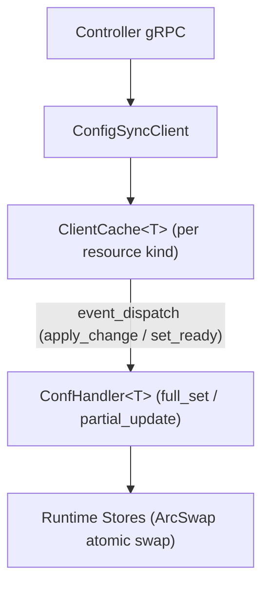

# Gateway overall architecture

edgion-gateway is Edgion's data plane, a high-performance reverse proxy built on Cloudflare Pingora. It receives Kubernetes-style resource configuration from the Controller via gRPC and translates it into runtime proxy behavior.

## Dual runtime model

Two runtimes coexist within the Gateway process:

| Runtime | Responsibility | Lifecycle |
|---------|----------------|-----------|
| **Tokio** | gRPC Watch/List, configuration handling, auxiliary services (Admin API, Metrics API, health checks), all async tasks | Created at startup, moved to a background thread before Phase 2, kept alive via `std::future::pending` permanent suspension |
| **Pingora** | Proxy main loop: TCP connection accept, TLS handshake, HTTP/gRPC request handling, upstream connection reuse | Runs blocking on the main thread via `Server::run_forever()` |

The two runtimes share configuration data via an **ArcSwap** atomic pointer — the Tokio side writes, the Pingora side reads lock-free. This design ensures that hot configuration updates do not block proxy request handling.

## Configuration sync pipeline



Key components:

- **ConfigSyncClient** (`conf_sync/conf_client/grpc_client.rs`): manages the gRPC connection to the Controller, handles List/Watch calls, version tracking, and reconnection. Calls `get_server_info()` to obtain server_id and supported_kinds.
- **ClientCache\<T\>** (`conf_sync/cache_client/cache.rs`): one cache instance per resource kind, holding `CacheData<T>` (RwLock-protected) and a gRPC client reference. Implements the `DynClientCache` trait to enable type-erased unified dispatching.
- **event_dispatch** (`conf_sync/cache_client/event_dispatch.rs`): implements the `CacheEventDispatch<T>` trait, applying gRPC events (InitAdd/EventAdd/EventUpdate/EventDelete) to CacheData and compressing event batches.
- **ConfHandler\<T\>** (`core/common/conf_sync/traits.rs`): a resource-handler trait, one implementation per resource kind. Provides two callbacks, `full_set()` and `partial_update(add, update, remove)`, responsible for writing resources into runtime stores.
- **ConfigClient** (`conf_sync/conf_client/config_client.rs`): aggregates ClientCache instances of all resource kinds and exposes type-safe query interfaces such as `list_gateways()`, `get_gateway_class()`, `get_edgion_gateway_config()`, plus an `is_ready()` readiness check.

## Pingora proxy layer

### ConnectionFilter (TCP layer)

`StreamPluginConnectionFilter` implements Pingora's `ConnectionFilter` trait, filtering raw TCP connections before TLS handshake and HTTP parsing. It references the `EdgionStreamPlugins` resource via the Gateway annotation `edgion.io/edgion-stream-plugins` and reads the latest configuration from the global `StreamPluginStore` (ArcSwap), supporting hot reload. Each connection invokes `should_accept(addr)` to execute all StreamPlugin chains.

### ProxyHttp (HTTP/gRPC layer)

`EdgionHttpProxy` implements Pingora's `ProxyHttp` trait and handles the full lifecycle of HTTP and gRPC requests. With `EdgionHttpContext` as the per-request state carrier, requests pass through eight phases: early_request_filter → request_filter → upstream_peer → connected_to_upstream → upstream_response_filter → upstream_response_body_filter → response_filter → logging.

### TCP/TLS/UDP routes

Beyond HTTP/gRPC, the Gateway also supports:
- **TCPRoute**: TCP layer-4 proxy, matched by port and SNI.
- **TLSRoute**: TLS passthrough proxy, matched by SNI and forwards encrypted traffic directly.
- **UDPRoute**: UDP proxy.

Each protocol has an independent `routes_mgr` (route manager) and `route_table`, both implemented with ArcSwap for lock-free hot updates.

## Module layout

```
src/core/gateway/
├── api/           # Admin API server (default :5810, configurable via admin_listen), exposes runtime state queries
├── backends/      # Backend management
│   ├── discovery/ # Backend discovery: Endpoint / EndpointSlice / Service stores
│   ├── health/    # Health checks: annotation-driven probes, status store, manager scheduling
│   ├── policy/    # BackendTLSPolicy handling
│   ├── preload.rs # Preload load balancers for all routes at startup
│   └── validation.rs
├── cache/         # LRU cache
├── cli/           # Startup entry (EdgionGatewayCli::run())
│   ├── config.rs  # EdgionGatewayConfig YAML configuration structure
│   ├── pingora.rs # Pingora Server creation and run (two-phase)
│   └── log_config.rs
├── conf_sync/     # Configuration sync
│   ├── cache_client/ # ClientCache<T>, CacheData, event_dispatch
│   └── conf_client/  # ConfigSyncClient (gRPC), ConfigClient (aggregated queries)
├── config/        # Resource configuration handlers
│   ├── edgion_gateway/ # EdgionGatewayConfig ConfHandler
│   └── gateway_class/  # GatewayClass ConfHandler
├── lb/            # Load balancing
│   ├── backend_selector/ # Backend selector (weighted round-robin)
│   ├── selection/        # Strategy implementations: ConsistentHash, EWMA, LeastConn
│   ├── ewma/             # EWMA metric collection
│   ├── leastconn/        # Least-connection state and cleaner
│   ├── lb_policy/        # LB policy configuration and types
│   └── runtime_state/    # Runtime LB state (increment/decrement/update_ewma)
├── link_sys/      # External system integration (LinkSys)
│   ├── providers/ # Elasticsearch, Etcd, Redis, Webhook, LocalFile
│   └── runtime/   # ConfHandler, DataSender
├── observe/       # Observability
│   ├── access_log/  # AccessLog: entry definition, logger, store
│   └── metrics/     # Prometheus metrics, global counters
│   └── logs/        # System logs, SSL/TCP/TLS/UDP logs
├── plugins/       # Plugin system
│   ├── http/      # HTTP plugin set
│   ├── stream/    # Stream plugins (ConnectionFilter bridge, TLS route plugins)
│   └── runtime/   # Plugin execution engine (PluginRuntime, SessionAdapter)
├── routes/        # Multi-protocol routing
│   ├── http/      # HTTPRoute: matching engine (radix + regex), route manager, ProxyHttp impl
│   ├── grpc/      # GRPCRoute: matching and upstream handling
│   ├── tcp/       # TCPRoute
│   ├── tls/       # TLSRoute
│   └── udp/       # UDPRoute
├── runtime/       # Pingora runtime
│   ├── server/    # GatewayBase, listener_builder, error_response, server_header
│   ├── matching/  # Gateway matching, TLS certificate matching (ArcSwap)
│   ├── store/     # GatewayStore, GatewayConfigStore, ListenerGatewayInfoStore (ArcSwap)
│   ├── handler.rs # ConfHandler implementation for the Gateway resource
│   └── gateway_info.rs
├── services/      # Auxiliary services
│   └── acme/      # ACME automatic certificate issuance (challenge store)
└── tls/           # TLS certificate management
    ├── boringssl/ # BoringSSL backend
    ├── openssl/   # OpenSSL backend
    ├── runtime/   # TLS callbacks (SNI matching, certificate selection)
    ├── store/     # Certificate storage
    └── validation/ # Certificate validation
```

## Key data flows

### Configuration update flow

```
Controller pushes resource changes
  → ConfigSyncClient receives gRPC Watch event
    → ClientCache<T>.apply_change() updates CacheData
      → Event compression (compress_events)
        → ConfHandler<T>.full_set() or partial_update()
          → Writes to runtime store (ArcSwap.store())
            → Pingora proxy side picks it up on next read (lock-free)
```

### Request handling flow

```
Client TCP connection
  → ConnectionFilter: StreamPlugins filtering (IP restrictions, etc.)
    → TLS handshake: SNI-based certificate match (GatewayTlsMatcher via ArcSwap)
      → HTTP parsing
        → early_request_filter: timeout setup, keepalive management
          → request_filter: metadata extraction, ACME challenge, route matching, plugin execution
            → upstream_peer: backend selection, LB strategy
              → Proxy request to upstream
                → upstream_response_filter/body_filter: response handling
                  → response_filter: async response plugins
                    → logging: metric recording + AccessLog
```
