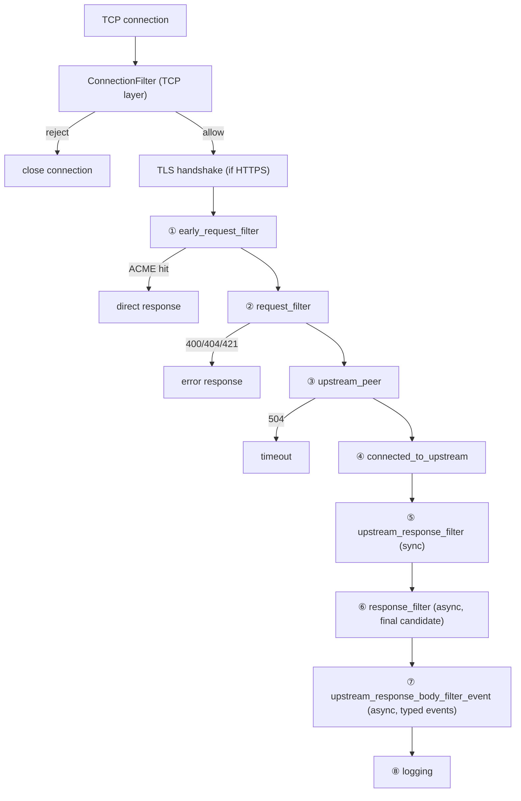

# Pingora ProxyHttp lifecycle

`EdgionHttpProxy` (`routes/http/proxy_http/mod.rs`) implements Pingora's `ProxyHttp` trait with `EdgionHttpContext` as the per-request context type (`type CTX = EdgionHttpContext`). Each callback phase is split into an independent `pg_*.rs` submodule for maintainability.

Before Phase 1, `new_ctx` loads one immutable `EdgionGatewayConfig` generation
from the listener's prebound `GatewayConfigHandle`, without a resource-table lookup. It copies
the resolved request-body limits and global preflight mode/status into the request
context. Consumers borrow the validated upstream RemoteIp header from the
request-pinned immutable configuration snapshot. These values come from one
publication generation and remain pinned for the request;
an EGC hot update affects only contexts created afterward and does not require
rebuilding the listener.

Pingora rejects duplicate HTTP/1.1 Host fields during protocol parsing, before
either ordinary or redirect request contexts are created. The dedicated
HTTP-to-HTTPS redirect proxy retains a shared EGC handle and loads one snapshot
in `new_ctx` for its configurable policies.

## ProxyHttp 8-phase callback chain



### Phase 1: early_request_filter

**File**: `pg_early_request_filter.rs`
**Signature**: `async fn early_request_filter(session, ctx) -> Result<()>`

Runs after HTTP header parsing completes, before Pingora's module request-header filter and route matching:

1. **Client timeout setup**: set `read_timeout` and `write_timeout` from the pre-parsed `ParsedTimeouts.client`.
2. **Keepalive management**: apply the configured timeout only while the transport still permits reuse; during shutdown (`is_process_shutting_down()`) set it to None to aid draining.
3. **gRPC-Web bridge initialization**: classify the raw downstream headers through `detect_request_protocol`, preserving WebSocket precedence. Initialize `GrpcWebBridge` only for gRPC-Web before Pingora's module request-header filter rewrites its headers to gRPC. This early classification preserves the original protocol identity; full request metadata extraction remains in Phase 2.

### Phase 2: request_filter

**File**: `pg_request_filter.rs`
**Signature**: `async fn request_filter(session, ctx) -> Result<bool>` (returns true to indicate the response has been sent)

Before route matching and plugin execution, it builds the full request-level metadata (client/remote/host/trace/raw URI/normalized path) and then handles local short-circuits. Protocol detection is called here as part of `build_request_metadata`, but it is a no-op when Phase 1 already froze the raw-header classification needed by the gRPC-Web bridge:

1. **ACME HTTP-01 challenge**: check the global `ChallengeStore` (fast path: the `is_empty()` check has zero overhead in 99.99% of requests). On a hit, send a 200 response directly and return `Ok(true)` to terminate the proxy pipeline; the access log retains metadata and the raw URI.

The most complex phase, responsible for request parsing and route matching:

1. **Metadata extraction** (`build_request_metadata`):
   - Protocol detection: call the same idempotent `detect_request_protocol` helper for WebSocket/gRPC-Web/gRPC; retain any Phase-1 classification instead of reclassifying rewritten gRPC-Web headers as native gRPC.
   - Address extraction: `direct_peer_ip` (`DirectPeerIp`, physical transport peer), `remote_ip` (`RemoteIp`, resolved client identity after the applicable PROXY/RealIp processing).
     The shared transport extractor copies the already canonical effective-IP text when the raw and effective binary IPs are equal. Both identity strings remain independently owned, and their ports remain independent; different IPs still use canonical formatting separately.
   - Hostname normalization: URI host → Host header → :authority header, all stripped of port, trailing dot removed, lowercased.
   - TLS metadata: extract `tls_id`, `sni`, and `client_cert_info` from `SslDigestExtension`.
   - Security checks: SNI-Host consistency check, Listener hostname isolation, X-Forwarded-For length limit.

2. **Route matching**:
   - Dynamically load the GatewayInfo list for the current Listener from `ListenerGatewayInfoStore` (looked up via `EdgionHttpProxy.listener_key`).
   - gRPC requests first try GRPCRoute matching (`try_match_grpc_route`).
   - HTTP requests are matched via `port_routes.match_route()` (radix tree + regex engine).
   - Match failure returns 404.

3. **Preflight handling**: CORS preflight requests are handled along two paths:
   - **Native `type: CORS` filter**: skips the preflight handler; Step 4's `GapiCorsFilter` handles it (builds the 204 response directly).
   - **EdgionPlugins CORS**: the preflight handler detects the request from the
     request-pinned policy, then delegates configured CORS to the normal route
     plugin pipeline. Only the no-CORS fallback replies with the pinned status.
     Detection and fallback use the same copied policy value, so a concurrent
     EGC update cannot mix generations within one request.

4. **Plugin execution** (RequestFilter phase):
   - Run global plugins first (`EdgionGatewayConfig.spec.global_plugins_ref`).
   - Then run route-level plugins (`route_unit.rule.plugin_runtime.run_request_plugins()`).
   - If any plugin returns `ErrTerminateRequest`, the request is terminated.

5. **Header handling**: set `X-Real-IP`, append `X-Forwarded-For`.

6. **Freeze request-body policy**: after the global, Gateway, and route
   request-plugin chain completes, the context closes request-body capability
   installation. BackendRef-stage plugins may read an already captured
   snapshot, but cannot first install full-body capture, mutation, an observer,
   or a streamed handler. The first HTTP backend request dispatch has a separate
   adapter-local permission to install a read-only mirror tee before the body
   pump starts; it changes neither framing nor replay policy. Pingora freezes the request-scoped
   `RequestRelayPlan` before the upstream attempt loop. Ordinary requests keep
   replayable framing; any installed per-chunk handler selects the streamed,
   non-replayable plan. Retry decisions use Pingora's live
   `request_relay_retry_state()` rather than a second Edgion predicate.

### Phase 3: upstream_peer

**File**: `pg_upstream_peer.rs`
**Signature**: `async fn upstream_peer(session, ctx) -> Result<Box<HttpPeer>>`

Selects the upstream backend and builds an HttpPeer. After strict-jump checks
and URI finalization, an installed AI plan delegates to
`ai/http/attempt.rs::select_peer`. That operation owns AI admission/scan policy
while reusing shared DNS, egress, TLS, timeout and address bookkeeping. It checks
request then gRPC deadlines before plan mutation and after I/O; an endpoint skip
remains predispatch. The list below describes ordinary route selection:

1. **Request timeout check**: check the route-level `request_timeout`; on timeout return 504.
2. **Route routing**: gRPC routes go to `upstream_peer_grpc()`, HTTP routes go to `upstream_peer_http()`.
3. **HTTP backend selection** (in priority order):
   - `DirectEndpoint`: an exact address specified by a plugin, bypassing LB.
   - `ExternalJump`: an external domain requiring DNS resolution (rejects localhost).
   - `InternalJump`: looks up the BackendRef by name.
   - Regular path: `RouteRules::select_backend()` performs weighted round-robin BackendRef selection, then `get_peer()` selects a specific endpoint via LB.
4. **BackendTLSPolicy lookup**: look up the TLS policy by Service namespace.
5. **Backend-level plugin execution**: `backend_ref.plugin_runtime.run_backend_request_plugins()`.
   The adapter permits mirror installation only for canonical Pingora attempt 1.
   That permission expires with the adapter; all other frozen body gates remain closed.
6. **Peer configuration**:
   - Timeouts: route-level `backend_request_timeout` overrides global `request_timeout`; uniformly sets connection / read / write timeout.
   - Idle timeout: uses the global `idle_timeout`.
   - gRPC forces HTTP/2: `peer.options.set_http_version(2, 2)`.
7. **Metric updates**: increment `try_cnt`, record upstream IP/port, capture the first upstream timestamp only for `Latency` test metrics. The typed
   request-local test owner is allocated on demand and survives backend replacement;
   only `Lb` test mode retains a hash key. Ordinary retry counters remain inline.

### Phase 4: connected_to_upstream

**File**: `pg_connected_to_upstream.rs`
**Signature**: `async fn connected_to_upstream(session, reused, peer, fd, digest, ctx) -> Result<()>`

Callback after the upstream connection is established:

1. **Connect time recording**: compute `ct` (connect time, in milliseconds, from upstream attempt start to connection establishment).
2. **Attempt-owned LB accounting**: after backend SAN validation succeeds, call `lb::commit_attempt` on the current `UpstreamInfo`. For both LeastConn and EWMA, it increments the selected backend's outstanding count and stores a move-only `LbCommitGuard` in `lb_committed`. Other policies or attempts without an LB backend do not acquire a guard. Repeated commit while the guard is present is a no-op.
3. **Streaming protocol log**: gRPC-Web and WebSocket requests immediately emit a `conn_est` AccessLog entry.

HTTP and gRPC peer selection both call `begin_upstream_attempt`; before pushing
the next attempt, it finalizes the previous guard through `lb::finalize_attempt`.
The AI retry transition performs the same prior-attempt cleanup. Named connect,
transport-failure and raw-response operations in `ai/http/attempt.rs` own feature
policy; the common hooks retain transport accounting and vetoes. Raw status retry
advances exactly once, and the proxy-error operation only acknowledges that
transition when Pingora can replay. Terminal logging
finalizes the last attempt. Finalization consumes the guard and is idempotent;
if cancellation bypasses logging, dropping an unresolved guard decrements exactly
once. Failed connects that never commit do not decrement another request's count.
These guards own outstanding-load accounting only, not EWMA latency sampling.
See [the attempt guard](../../../edgion-gateway/src/lb/attempt.rs) and
[peer transitions](../../../edgion-gateway/src/routes/http/proxy_http/pg_upstream_peer.rs).

### Phase 5: upstream_response_filter (sync)

**File**: `pg_upstream_response_filter.rs`
**Signature**: `fn upstream_response_filter(session, upstream_response, ctx) -> Result<()>` (note: not async)

Called when upstream response headers are received; interim 1xx are skipped (101 remains terminal):

1. **Per-attempt status recording**: write the received code to the current `UpstreamInfo`. After retry decisions and response-stage normalization, snapshot the pre-plugin status and select the candidate final downstream status. Do not mutate `request_info.status` here.
2. **Server header**: inject the custom Server header via `ServerHeaderOpts::apply_to_response()`.
3. **Header time and EWMA sampling**: compute `ht` from attempt start to final response headers. Separately, `record_lb_latency_sample` records the EWMA backend's attempt-to-header latency before retry arbitration and normalization. A subsequently retried attempt retains its sample; connection establishment (`ct`), body streaming, and terminal cleanup do not sample latency. A connect failure with no headers produces no sample. Error/retryable responses use the canonical useful-work classification, preventing fast failures from improving the score; see [Peak-EWMA sampling](../../12-algorithms/lb-peak-ewma.md#sample-point--response-headers).
4. **Sync plugin execution**:
   - Rule level: `route_unit.rule.plugin_runtime.run_upstream_response_plugins_sync()`.
   - Backend level: `selected_backend.plugin_runtime.run_upstream_response_plugins_sync()`.

### Phase 6: response_filter (async)

**File**: `pg_response_filter.rs`
**Signature**: `async fn response_filter(session, upstream_response, ctx) -> Result<()>`

Async response handling, can perform operations that need to await:

1. **Initial hop-by-hop sanitization**: for ordinary final responses that have not
   already settled on a response-stage denial or local reply, remove the
   canonical static fields and every valid field nominated across all repeated
   `Connection` lines. Interim 100/102/103 headers are sanitized before their
   early return; 101 upgrade handshakes bypass the sanitizer and retain their
   connection metadata.
2. **Server header**: applied again (covers framework-generated error responses such as 502).
3. **Async plugin execution** (UpstreamResponse phase):
   - Rule level: `run_upstream_response_plugins_async()`.
   - Backend level: `run_upstream_response_plugins_async()`.
4. **Final hop-by-hop sanitization**: after stream-processor framing repair,
   repeat the same cleanup while the response remains unsettled so an async
   plugin cannot reintroduce connection-scoped metadata. Preserve whether
   either pass observed `Transfer-Encoding` when deciding compression, even
   though the field itself has been removed.
5. **Request ID reconciliation**: stamp active response-enabled IDs and remove managed suppressed names at final header write, after response plugins. Core W3C context and default `x-trace-id` are initialized in the earliest parsed-header callback.
6. **Select the final candidate and freeze processors**: this phase no longer
   claims that the candidate header has reached the downstream writer. After
   the onion returns, Pingora calls `response_head_commit_plan` on the final
   post-filter header. The default is allocation-free `Immediate`; an active,
   eligible Guardrail first-window claim may select a hard-bounded `Hold`.
   Only `response_head_will_commit`, after Release or Replace has chosen the
   actual header, records the writer claim. Hold boundaries resolve explicitly
   through Release, Replace, or non-retryable Fail before header preparation.

Pingora owns downstream connection reuse and wire framing. During graceful
shutdown, the Phase-1 `set_keepalive(None)` decision makes Pingora's H1 codec
emit `Connection: close`; this response filter does not copy or synthesize that
field.

### Phase 7: upstream_response_body_filter_event (async, per typed event)

**File**: `pg_upstream_response_body_filter.rs`
**Signature**: `async fn upstream_response_body_filter_event(session, body, event, sink, ctx) -> Result<Option<Duration>>`

Called once per upstream response body or terminal event; returning
`Some(Duration)` enables bandwidth limiting. A request-local
`ResponseProcessorDriver` freezes the selected AI, semantic, ordinary body,
and trailer processors after the response onion, then serializes body/trailer
leases across callbacks. Cancellation closes only the affected processor group
and releases its in-flight resources; the durable driver handle remains
available to the logging finalizer.
When a final Header task already ends the upstream representation, the Edgion
Pingora fork calls this hook exactly once after Phase 6 `response_filter`
completes, with `body = None` and `event = TerminalWithoutTrailers`. This
terminal call is driven by the transport's actual end-of-stream state for H1,
H2, and custom upstreams; a
`Content-Length: 0` header alone is not sufficient on H2. It lets streaming processors finalize or
replace a bodyless upstream response without a provider-specific header-stage workaround.
Unlike an ordinary body task, the terminal event is initially carried by the header. Pingora
therefore defers this synthetic call until that header's Phase 6 `response_filter` has completed.
This preserves the ordinary lifecycle invariant that final response classification, async plugins,
local replies, and denials run before the body hook. If `response_filter` rejects or writes a local
reply, the synthetic body hook is not called.

If that synthetic call emits bytes, Pingora rewrites the task sequence to
`Header(..., false)` followed by emitted body chunks with EOS only on the last chunk. The same
sequence is used for cache admission and downstream delivery. Both the live sequence and cache-hit
replay pass through the same downstream `response_body_filter`; cache hits do not invoke the
upstream hook again. Output is discarded for `HEAD`, 1xx,
204, and 304 responses, including when the final `response_filter` creates that bodyless status;
cache hits then end on the header instead of replaying the stored body. 101/informational upstream
headers do not trigger the synthetic call.

Cache policy evaluation still runs on the upstream-filtered header before Phase 6. Admission waits
for terminal body synthesis so the stored metadata can reconcile `Content-Length` with the actual
cached representation. Internal cache-control responses consumed by revalidation or stale serving
(for example, an origin 304 merged into an existing cached response) are not forwarded response
representations and do not enter this body lifecycle.

Even when no hook emits bytes, Pingora materializes the terminal body boundary so the downstream
`response_body_filter` receives one EOS call. Streaming miss readback and cache hits preserve this
same EOS callback. If terminal synthesis changes the body length, Pingora removes a stale upstream
`Content-Length` and selects consistent downstream framing; it never relies on `Content-Length: 0`
as the bodyless detector.

Downstream completion is independent from upstream completion. If the final header filter changes
a bodyful response to 204/304, Pingora may finish the downstream response at the header but keeps
draining and caching the upstream body until the source's real EOS. Suppressed follow-up tasks are
dropped and never converted into a second `Done` terminal event. A source failure after the
downstream terminal boundary prevents upstream reuse without replacing the already-complete
downstream response. It also aborts any incomplete cache admission so the miss writer and cache
lock cannot survive a swallowed post-terminal source error.

The normal processing order remains:

1. **Body time recording**: compute `bt` (body time) on the first chunk.
2. **Route-level body filter plugins**: bandwidth limiting, etc.
3. **Global body filter plugins**: loaded from `EdgionGatewayConfig.spec.global_plugins_ref`.
4. **Limit merging**: when multiple plugins return delays, the maximum is taken.

### Response terminal and trailer companion lifecycle

Response completion is a typed boundary, not only a body callback with an EOS
boolean. The Edgion Pingora fork reports one of these events to the Gateway:

- `Data { end_of_stream }` for an ordinary body task;
- `TerminalWithoutTrailers` when the representation ends and no trailer task
  follows;
- `TerminalBeforeTrailers` when bounded body processors must flush before a
  real trailer task is delivered.

The distinction prevents a trailer-aware processor from closing its protocol
transaction at the pre-trailer boundary. Legacy bounded body processors still
receive an EOS-compatible callback and flush normally. The request-local
`UpstreamTrailerLifecycle` gate moves `Open -> AwaitingTrailers -> Dispatched`
for a trailer-bearing response, or directly `Open -> Dispatched` for a
trailer-free response. This makes a Trailer followed by Done, duplicate
transport evidence, and logging fallback exactly-once.

Request-stage plugins install `UpstreamResponseTrailer` companions in resolved
plugin order. The Gateway awaits them serially, passing the current mutable
`HeaderMap` to each companion so a later companion observes its predecessor's
committed mutation. `None` means a real no-trailers terminal observation; it is
never converted into an empty map. Fail-close stops the chain and preempts the
remaining companions before Pingora forwards trailers. Implementations must
keep any retained trailer state and mutations bounded; the canonical driver
does not aggregate the response body.

This lifecycle depends on two APIs committed in Edgion Pingora
`af9e1ac057c6ed454b5348beb34e14df1d435410` and selected by the current
git-source entries in `Cargo.lock`:
`upstream_response_body_filter_event` supplies the typed terminal evidence,
and the asynchronous `upstream_response_trailer_filter` is awaited before the
transport writes the trailer block. Replacing the fork with upstream Pingora
or reverting either hook without disabling trailer consumers would break the
contract. H1
parsing/serialization and H2/custom trailer tasks converge on the same Gateway
companion chain.

### Phase 8: logging

**File**: `pg_logging.rs`
**Signature**: `async fn logging(session, error, ctx)`

Wrap-up phase after the request completes:

1. **Upstream metric collection**:
   - Response body size: `session.upstream_body_bytes_received()`.
   - Write pending time: `session.upstream_write_pending_time()` (HTTP/1.x backpressure).
   - Global bandwidth counters: `add_request_bytes()` + `add_response_bytes()`.
2. **LB attempt cleanup**: `lb_runtime_cleanup` calls `lb::finalize_attempt` on the last `UpstreamInfo`, releasing its outstanding count for both LeastConn and EWMA. Prior attempts were released on retry transitions. Repeated cleanup is a no-op, and guard drop covers cancellation. No EWMA latency sample is recorded here; that belongs to Phase 5.
3. **Response status update**: obtain the final response status code via `session.response_written()`.
4. **Prometheus metrics**: `record_backend_request()` records along the gateway/route/backend/protocol/status_group dimensions.
5. **AccessLog generation**: `AccessLogEntry::from_context(ctx)` → `to_json()` → `access_logger.send()`.
6. **Mirror cleanup**: `ctx.mirror_state.take()` drops the JoinHandle to detach the mirror task.
7. **Integration testing storage**: when `integration_testing_mode` is enabled and the request carries an `access_log: test_store` header, store into the Access Log Store.

## ConnectionFilter (TCP layer)

**File**: `plugins/stream/connection_filter_bridge.rs`

`StreamPluginConnectionFilter` filters raw TCP connections before TLS handshake and HTTP parsing:

- Implements Pingora's `ConnectionFilter` trait method `should_accept(addr: Option<&SocketAddr>) -> bool`.
- Runs after the process-fatal PROXY-policy guard and before inbound PROXY parsing.
- Captures one immutable `PluginPublication` snapshot and reads the physical listener's `ConnectionView`.
- Uses the view that publication derived by comparing every serving Gateway's effective connection policy; `Unavailable` fails closed and `Ready` pins one `CompiledStreamPlugins` generation.
- Preserves the pre-PROXY physical peer as `DirectPeerIp`, folding only IPv4-mapped IPv6 to its canonical IPv4 representation before constructing `StreamContext`.
- Executes `StreamPluginRuntime.run(&ctx)` and obtains `StreamPluginResult::Allow` or `StreamPluginResult::Deny`.
- After policy availability is established, missing address information (`addr == None`) retains the narrow non-inet allow behavior.
- Allows when the shared listener view is `Empty` or its pinned runtime has no active plugin.

Typical uses: IP allow/deny lists, geolocation filtering, connection rate limiting.

## EdgionHttpContext: per-request state carrier

**Definition**: `types/ctx.rs`

`EdgionHttpContext` is created in `new_ctx()`, threaded through all ProxyHttp phases, and finally consumed in the `logging()` phase.

### Core fields

| Field | Type | Description |
|-------|------|-------------|
| `start_time` | `Instant` | Request start time |
| `gateway_info` | `GatewayInfo` | Matched Gateway metadata |
| `request_info` | `RequestInfo` | Request metadata: direct_peer_ip, remote_ip, hostname, path, status, trace_id (W3C and correlation IDs), sni, tls_id, listener_port, discover_protocol |
| `diagnostics` | `RequestDiagnostics` | Bounded, ordered information/error diagnostic history |
| `pre_plugin_response_status` | `Option<u16>` | Upstream status snapshot used by response-body admission |
| `final_downstream_status` | `Option<u16>` | Selected downstream status before terminal logging; private ownership state |
| `route_unit` | `Option<Arc<HttpRouteRuleUnit>>` | Matched HTTP route rule |
| `grpc_route_unit` | `Option<Arc<GrpcRouteRuleUnit>>` | Matched gRPC route rule |
| `selected_backend` | `Option<HTTPBackendRef>` | LB-selected HTTP backend |
| `selected_grpc_backend` | `Option<GRPCBackendRef>` | LB-selected gRPC backend |
| `backend_context` | `Option<BackendContext>` | Backend service info + upstream attempt history (UpstreamInfo list) |
| `stage_logs` | `Vec<StageLogs>` | Plugin phase execution logs |
| `plugin_running_result` | `PluginRunningResult` | Plugin execution result |
| `try_cnt` | `u32` | Number of backend connection attempts |
| `ctx_map` | `HashMap<String, String>` | Context variables for inter-plugin communication |
| `direct_endpoint` | `Option<DirectEndpointPreset>` | Exact upstream address set by the DirectEndpoint plugin |
| `internal_jump` | `Option<InternalJumpPreset>` | Internal jump target set by the DynamicInternalUpstream plugin |
| `external_jump` | `Option<ExternalJumpPreset>` | External jump target set by the DynamicExternalUpstream plugin |
| `mirror_state` | `Option<MirrorState>` | Request mirror state |

### UpstreamInfo time metrics

Each upstream attempt creates an `UpstreamInfo` recording fine-grained timings:
- `ct`: Connect Time — from attempt start to connection established.
- `ht`: Header Time — from attempt start to receiving response headers.
- `bt`: Body Time — from attempt start to receiving the first body chunk.
- `et`: Elapsed Time — total elapsed time.
- `wpt`: Write Pending Time — upstream write backpressure time (HTTP/1.x).

## Access Log: zero-copy JSON

**Definition**: `observe/access_log/entry.rs`

`AccessLogEntry` is built by borrowing fields from `EdgionHttpContext` (`&'a RequestInfo`, `&'a BackendContext`, `&'a [RequestDiagnostic]`, `&'a [StageLogs]`), avoiding data copying.

```rust
pub struct AccessLogEntry<'a> {
    pub timestamp: i64,                      // millisecond timestamp
    pub request_info: &'a RequestInfo,        // borrowed
    pub match_info: Option<MatchInfoChain<'a>>, // array root -> leaf, HTTP or gRPC
    pub diagnostics: &'a [RequestDiagnostic], // borrowed
    pub diagnostics_full: bool,
    pub backend_context: Option<&'a BackendContext>, // borrowed (includes upstreams list)
    pub stage_logs: &'a [StageLogs],          // borrowed
    pub conn_est: Option<bool>,               // WebSocket/gRPC-Web connection-established marker
    pub ext: LogExt,                          // AccessLogExtern-declared fields
}
```

`ext` is populated at serialization time (inside `logging()`, not by any request-stage filter) by resolving up to three tiers of `AccessLogExtern` declarations (`EdgionGatewayConfig.spec.globalPluginsRef` → Gateway `edgion.io/edgion-plugins` → route `ExtensionRef`) against the live plugin store; a `ctx` field within it is masked unless whitelisted in `EdgionGatewayConfig.spec.accessLogExtern.unmaskedKeys`, and known-sensitive ctx keys (`jwt_claims`/`oidc_claims`/`jwe_payload`) stay hard-blocked: naming one is reported on the `EdgionPlugins` resource's `Accepted=False` status condition at ingest, and the gateway separately drops the field when it loads the resource. See `skills/03-coding/observability/00-access-log.md`.

It is serialized to a JSON string directly via `serde_json`'s `to_string()`, producing the output in a single allocation. The `#[serde(skip_serializing_if)]` annotation omits empty fields to reduce log volume.

## Error responses

The Gateway provides standardized error response generators, all defined in `runtime/server/error_response.rs`:

| Function | Status code | Trigger |
|----------|-------------|---------|
| `end_response_400` | 400 | Hostname missing, XFF header too long |
| `end_response_404` | 404 | Route match failed |
| `end_response_421` | 421 | SNI-Host mismatch, Listener hostname isolation failure |
| `end_response_500` | 500 | Internal error, backend selection failed, plugin termination |
| `end_response_503` | 503 | Service unavailable |

All error responses inject a custom Server header via `ServerHeaderOpts`.

## Terminal gRPC local replies

`runtime/server/error_response.rs::prepare_grpc_terminal_headers` owns ordered
preparation of fresh HTTP-200 terminal envelopes: drain queued response-header
operations once, reconcile request identity, remove Content-Length and
Transfer-Encoding, then restore application/grpc. Framework writers apply
ServerHeaderOpts before preparation, so queue conditions see those defaults;
adapter exact-status and HTTP-mapped writers start without those defaults.
Claims, selected HTTP/gRPC outcomes and adapter termination/delivery diagnostics
remain with the callers. The separate `send_grpc_trailers_only_frame` owns
canonical status/message replacement and native versus gRPC-Web encoding.
This boundary adds no body aggregation or protocol-pump ownership (ARCH-003).
