# Pingora ProxyHttp lifecycle

`EdgionHttpProxy` (`routes/http/proxy_http/mod.rs`) implements Pingora's `ProxyHttp` trait with `EdgionHttpContext` as the per-request context type (`type CTX = EdgionHttpContext`). Each callback phase is split into an independent `pg_*.rs` submodule for maintainability.

## ProxyHttp 8-phase callback chain

```mermaid
flowchart TD
    TCP["TCP connection"] --> CF["ConnectionFilter (TCP layer)"]
    CF -->|"reject"| CLOSE["close connection"]
    CF -->|"allow"| TLS["TLS handshake (if HTTPS)"]
    TLS --> S1["① early_request_filter"]
    S1 -->|"ACME hit"| ACME["direct response"]
    S1 --> S2["② request_filter"]
    S2 -->|"400/404/421"| ERR["error response"]
    S2 --> S3["③ upstream_peer"]
    S3 -->|"504"| TIMEOUT["timeout"]
    S3 --> S4["④ connected_to_upstream"]
    S4 --> S5["⑤ upstream_response_filter (sync)"]
    S5 --> S6["⑥ upstream_response_body_filter (sync, per chunk)"]
    S6 --> S7["⑦ response_filter (async)"]
    S7 --> S8["⑧ logging"]
```



### Phase 1: early_request_filter

**File**: `pg_early_request_filter.rs`
**Signature**: `async fn early_request_filter(session, ctx) -> Result<()>`

Runs after HTTP header parsing completes, before route matching:

1. **Client timeout setup**: set `read_timeout` and `write_timeout` from the pre-parsed `ParsedTimeouts.client`.
2. **Keepalive management**: set keepalive_timeout normally; during shutdown (`is_process_shutting_down()`) set it to None to disable keepalive and aid traffic draining.

### Phase 2: request_filter

**File**: `pg_request_filter.rs`
**Signature**: `async fn request_filter(session, ctx) -> Result<bool>` (returns true to indicate the response has been sent)

Before route matching and plugin execution, it first builds request-level metadata (client/remote/host/trace/raw URI/normalized path) and then handles local short-circuits:

1. **ACME HTTP-01 challenge**: check the global `ChallengeStore` (fast path: the `is_empty()` check has zero overhead in 99.99% of requests). On a hit, send a 200 response directly and return `Ok(true)` to terminate the proxy pipeline; the access log retains metadata and the raw URI.

The most complex phase, responsible for request parsing and route matching:

1. **Metadata extraction** (`build_request_metadata`):
   - Protocol detection: WebSocket (Upgrade header), gRPC-Web/gRPC (Content-Type header).
   - Address extraction: `direct_peer_ip` (`DirectPeerIp`, physical transport peer), `remote_ip` (`RemoteIp`, resolved client identity after the applicable PROXY/RealIp processing).
   - Hostname normalization: URI host → Host header → :authority header, all stripped of port, trailing dot removed, lowercased.
   - TLS metadata: extract `tls_id`, `sni`, and `client_cert_info` from `SslDigestExtension`.
   - Security checks: SNI-Host consistency check, Listener hostname isolation, X-Forwarded-For length limit.

2. **Route matching**:
   - Dynamically load the GatewayInfo list for the current Listener from `ListenerGatewayInfoStore` (looked up via `EdgionHttpProxy.listener_key`).
   - gRPC requests first try GRPCRoute matching (`try_match_grpc_route`).
   - HTTP requests are matched via `port_routes.match_route()` (radix tree + regex engine).
   - Match failure returns 404.

3. **Preflight handling**: CORS preflight requests are handled along two paths:
   - **Native `type: CORS` filter**: skips the preflight handler; Step 4's `GapiCorsFilter` handles it (builds the 204 response directly).
   - **EdgionPlugins CORS**: intercepted by the preflight handler before plugin execution; CORS configuration is extracted from the matched route's EdgionPlugins.

4. **Plugin execution** (RequestFilter phase):
   - Run global plugins first (`EdgionGatewayConfig.spec.global_plugins_ref`).
   - Then run route-level plugins (`route_unit.rule.plugin_runtime.run_request_plugins()`).
   - If any plugin returns `ErrTerminateRequest`, the request is terminated.

5. **Header handling**: set `X-Real-IP`, append `X-Forwarded-For`.

### Phase 3: upstream_peer

**File**: `pg_upstream_peer.rs`
**Signature**: `async fn upstream_peer(session, ctx) -> Result<Box<HttpPeer>>`

Selects the upstream backend and builds an HttpPeer:

1. **Request timeout check**: check the route-level `request_timeout`; on timeout return 504.
2. **Route routing**: gRPC routes go to `upstream_peer_grpc()`, HTTP routes go to `upstream_peer_http()`.
3. **HTTP backend selection** (in priority order):
   - `DirectEndpoint`: an exact address specified by a plugin, bypassing LB.
   - `ExternalJump`: an external domain requiring DNS resolution (rejects localhost).
   - `InternalJump`: looks up the BackendRef by name.
   - Regular path: `RouteRules::select_backend()` performs weighted round-robin BackendRef selection, then `get_peer()` selects a specific endpoint via LB.
4. **BackendTLSPolicy lookup**: look up the TLS policy by Service namespace.
5. **Backend-level plugin execution**: `backend_ref.plugin_runtime.run_request_plugins()`.
6. **Peer configuration**:
   - Timeouts: route-level `backend_request_timeout` overrides global `request_timeout`; uniformly sets connection / read / write timeout.
   - Idle timeout: uses the global `idle_timeout`.
   - gRPC forces HTTP/2: `peer.options.set_http_version(2, 2)`.
7. **Metric updates**: increment `try_cnt`, record upstream IP/port, set `upstream_start_time`.

### Phase 4: connected_to_upstream

**File**: `pg_connected_to_upstream.rs`
**Signature**: `async fn connected_to_upstream(session, reused, peer, fd, digest, ctx) -> Result<()>`

Callback after the upstream connection is established:

1. **Connect time recording**: compute `ct` (connect time, in milliseconds, from upstream attempt start to connection establishment).
2. **LeastConn counting**: if the LB strategy is LeastConn, call `runtime_state::increment()` to add to the active connection count.
3. **Streaming protocol log**: gRPC-Web and WebSocket requests immediately emit a `conn_est` AccessLog entry.

### Phase 5: upstream_response_filter (sync)

**File**: `pg_upstream_response_filter.rs`
**Signature**: `fn upstream_response_filter(session, upstream_response, ctx) -> Result<()>` (note: not async)

Called when the upstream response headers are received:

1. **Per-attempt status recording**: write the received code to the current `UpstreamInfo`. After retry decisions and response-stage normalization, snapshot the pre-plugin status and select the candidate final downstream status. Do not mutate `request_info.status` here.
2. **Server header**: inject the custom Server header via `ServerHeaderOpts::apply_to_response()`.
3. **Header time recording**: compute `ht` (header time, in milliseconds, from upstream attempt start to receiving response headers).
4. **Sync plugin execution**:
   - Rule level: `route_unit.rule.plugin_runtime.run_upstream_response_plugins_sync()`.
   - Backend level: `selected_backend.plugin_runtime.run_upstream_response_plugins_sync()`.

### Phase 6: upstream_response_body_filter (sync, per chunk)

**File**: `pg_upstream_response_body_filter.rs`
**Signature**: `fn upstream_response_body_filter(session, body, end_of_stream, ctx) -> Result<Option<Duration>>`

Called once per upstream response body chunk; returning `Some(Duration)` enables bandwidth limiting.
When Phase 7 accepts the final header, the Edgion Pingora fork also calls this hook exactly once
with `body = None` and `end_of_stream = true` when that upstream header task already ends the response. This terminal
call is driven by the transport's actual end-of-stream state for H1, H2, and custom upstreams; a
`Content-Length: 0` header alone is not sufficient on H2. It lets streaming processors finalize or
replace a bodyless upstream response without a provider-specific header-stage workaround.
Unlike an ordinary body task, the terminal event is initially carried by the header. Pingora
therefore defers this synthetic call until that header's Phase 7 `response_filter` has completed.
This preserves the ordinary lifecycle invariant that final response classification, async plugins,
local replies, and denials run before the body hook. If `response_filter` rejects or writes a local
reply, the synthetic body hook is not called.

If that synthetic call emits bytes, Pingora rewrites the task sequence to
`Header(..., false)` followed by emitted body chunks with EOS only on the last chunk. The same
sequence is used for cache admission and downstream delivery. Both the live sequence and cache-hit
replay pass through the same downstream `response_body_filter`; cache hits do not invoke the
upstream hook again. Output is discarded for `HEAD`, 1xx,
204, and 304 responses, including when the final `response_filter` creates that bodyless status;
cache hits then end on the header instead of replaying the stored body. 101/informational upstream
headers do not trigger the synthetic call.

Cache policy evaluation still runs on the upstream-filtered header before Phase 7. Admission waits
for terminal body synthesis so the stored metadata can reconcile `Content-Length` with the actual
cached representation. Internal cache-control responses consumed by revalidation or stale serving
(for example, an origin 304 merged into an existing cached response) are not forwarded response
representations and do not enter this body lifecycle.

Even when no hook emits bytes, Pingora materializes the terminal body boundary so the downstream
`response_body_filter` receives one EOS call. Streaming miss readback and cache hits preserve this
same EOS callback. If terminal synthesis changes the body length, Pingora removes a stale upstream
`Content-Length` and selects consistent downstream framing; it never relies on `Content-Length: 0`
as the bodyless detector.

Downstream completion is independent from upstream completion. If the final header filter changes
a bodyful response to 204/304, Pingora may finish the downstream response at the header but keeps
draining and caching the upstream body until the source's real EOS. Suppressed follow-up tasks are
dropped and never converted into a second `Done` terminal event. A source failure after the
downstream terminal boundary prevents upstream reuse without replacing the already-complete
downstream response. It also aborts any incomplete cache admission so the miss writer and cache
lock cannot survive a swallowed post-terminal source error.

The normal processing order remains:

1. **Body time recording**: compute `bt` (body time) on the first chunk.
2. **Route-level body filter plugins**: bandwidth limiting, etc.
3. **Global body filter plugins**: loaded from `EdgionGatewayConfig.spec.global_plugins_ref`.
4. **Limit merging**: when multiple plugins return delays, the maximum is taken.

### Phase 7: response_filter (async)

**File**: `pg_response_filter.rs`
**Signature**: `async fn response_filter(session, upstream_response, ctx) -> Result<()>`

Async response handling, can perform operations that need to await:

1. **Server header**: applied again (covers framework-generated error responses such as 502).
2. **Trace ID injection**: add `x-trace-id` to the response header.
3. **Graceful shutdown**: add the `Connection: close` response header during shutdown.
4. **Async plugin execution** (UpstreamResponse phase):
   - Rule level: `run_upstream_response_plugins_async()`.
   - Backend level: `run_upstream_response_plugins_async()`.

### Phase 8: logging

**File**: `pg_logging.rs`
**Signature**: `async fn logging(session, error, ctx)`

Wrap-up phase after the request completes:

1. **Upstream metric collection**:
   - Response body size: `session.upstream_body_bytes_received()`.
   - Write pending time: `session.upstream_write_pending_time()` (HTTP/1.x backpressure).
   - Global bandwidth counters: `add_request_bytes()` + `add_response_bytes()`.
2. **LB runtime state update**:
   - LeastConn: `runtime_state::decrement()` decrements the active connection count.
   - EWMA: `runtime_state::update_ewma()` updates the latency metric.
3. **Response status update**: obtain the final response status code via `session.response_written()`.
4. **Prometheus metrics**: `record_backend_request()` records along the gateway/route/backend/protocol/status_group dimensions.
5. **AccessLog generation**: `AccessLogEntry::from_context(ctx)` → `to_json()` → `access_logger.send()`.
6. **Mirror cleanup**: `ctx.mirror_state.take()` drops the JoinHandle to detach the mirror task.
7. **Integration testing storage**: when `integration_testing_mode` is enabled and the request carries an `access_log: test_store` header, store into the Access Log Store.

## ConnectionFilter (TCP layer)

**File**: `plugins/stream/connection_filter_bridge.rs`

`StreamPluginConnectionFilter` filters raw TCP connections before TLS handshake and HTTP parsing:

- Implements Pingora's `ConnectionFilter` trait method `should_accept(addr: Option<&SocketAddr>) -> bool`.
- References the `EdgionStreamPlugins` resource via the Gateway annotation `edgion.io/edgion-stream-plugins`.
- Reads the latest plugin configuration from the global `StreamPluginStore` (ArcSwap), supporting hot reload.
- Executes `StreamPluginRuntime.run(&ctx)` and obtains `StreamPluginResult::Allow` or `StreamPluginResult::Deny`.
- When address information is missing (`addr == None`), allows by default.
- Allows by default when no configuration or no active plugin exists.

Typical uses: IP allow/deny lists, geolocation filtering, connection rate limiting.

## EdgionHttpContext: per-request state carrier

**Definition**: `types/ctx.rs`

`EdgionHttpContext` is created in `new_ctx()`, threaded through all ProxyHttp phases, and finally consumed in the `logging()` phase.

### Core fields

| Field | Type | Description |
|-------|------|-------------|
| `start_time` | `Instant` | Request start time |
| `gateway_info` | `GatewayInfo` | Matched Gateway metadata |
| `request_info` | `RequestInfo` | Request metadata: direct_peer_ip, remote_ip, hostname, path, status, x_trace_id, sni, tls_id, listener_port, discover_protocol |
| `diagnostics` | `RequestDiagnostics` | Bounded, ordered information/error diagnostic history |
| `pre_plugin_response_status` | `Option<u16>` | Upstream status snapshot used by response-body admission |
| `final_downstream_status` | `Option<u16>` | Selected downstream status before terminal logging; private ownership state |
| `route_unit` | `Option<Arc<HttpRouteRuleUnit>>` | Matched HTTP route rule |
| `grpc_route_unit` | `Option<Arc<GrpcRouteRuleUnit>>` | Matched gRPC route rule |
| `selected_backend` | `Option<HTTPBackendRef>` | LB-selected HTTP backend |
| `selected_grpc_backend` | `Option<GRPCBackendRef>` | LB-selected gRPC backend |
| `backend_context` | `Option<BackendContext>` | Backend service info + upstream attempt history (UpstreamInfo list) |
| `stage_logs` | `Vec<StageLogs>` | Plugin phase execution logs |
| `plugin_running_result` | `PluginRunningResult` | Plugin execution result |
| `try_cnt` | `u32` | Number of backend connection attempts |
| `ctx_map` | `HashMap<String, String>` | Context variables for inter-plugin communication |
| `direct_endpoint` | `Option<DirectEndpointPreset>` | Exact upstream address set by the DirectEndpoint plugin |
| `internal_jump` | `Option<InternalJumpPreset>` | Internal jump target set by the DynamicInternalUpstream plugin |
| `external_jump` | `Option<ExternalJumpPreset>` | External jump target set by the DynamicExternalUpstream plugin |
| `mirror_state` | `Option<MirrorState>` | Request mirror state |

### UpstreamInfo time metrics

Each upstream attempt creates an `UpstreamInfo` recording fine-grained timings:
- `ct`: Connect Time — from attempt start to connection established.
- `ht`: Header Time — from attempt start to receiving response headers.
- `bt`: Body Time — from attempt start to receiving the first body chunk.
- `et`: Elapsed Time — total elapsed time.
- `wpt`: Write Pending Time — upstream write backpressure time (HTTP/1.x).

## Access Log: zero-copy JSON

**Definition**: `observe/access_log/entry.rs`

`AccessLogEntry` is built by borrowing fields from `EdgionHttpContext` (`&'a RequestInfo`, `&'a BackendContext`, `&'a [RequestDiagnostic]`, `&'a [StageLogs]`), avoiding data copying.

```rust
pub struct AccessLogEntry<'a> {
    pub timestamp: i64,                      // millisecond timestamp
    pub request_info: &'a RequestInfo,        // borrowed
    pub match_info: Option<RouteMatchInfo<'a>>, // HTTP or gRPC match info
    pub diagnostics: &'a [RequestDiagnostic], // borrowed
    pub diagnostics_full: bool,
    pub backend_context: Option<&'a BackendContext>, // borrowed (includes upstreams list)
    pub stage_logs: &'a [StageLogs],          // borrowed
    pub conn_est: Option<bool>,               // WebSocket/gRPC-Web connection-established marker
    pub ext: LogExt,                          // AccessLogExtern-declared fields
}
```

`ext` is populated at serialization time (inside `logging()`, not by any request-stage filter) by resolving up to three tiers of `AccessLogExtern` declarations (`EdgionGatewayConfig.spec.globalPluginsRef` → Gateway `edgion.io/edgion-plugins` → route `ExtensionRef`) against the live plugin store; a `ctx` field within it is masked unless whitelisted in `EdgionGatewayConfig.spec.accessLogExtern.unmaskedKeys`, and known-sensitive ctx keys (`jwt_claims`/`oidc_claims`/`jwe_payload`) stay hard-blocked: naming one is reported on the `EdgionPlugins` resource's `Accepted=False` status condition at ingest, and the gateway separately drops the field when it loads the resource. See `skills/03-coding/observability/00-access-log.md`.

It is serialized to a JSON string directly via `serde_json`'s `to_string()`, producing the output in a single allocation. The `#[serde(skip_serializing_if)]` annotation omits empty fields to reduce log volume.

## Error responses

The Gateway provides standardized error response generators, all defined in `runtime/server/error_response.rs`:

| Function | Status code | Trigger |
|----------|-------------|---------|
| `end_response_400` | 400 | Hostname missing, XFF header too long |
| `end_response_404` | 404 | Route match failed |
| `end_response_421` | 421 | SNI-Host mismatch, Listener hostname isolation failure |
| `end_response_500` | 500 | Internal error, backend selection failed, plugin termination |
| `end_response_503` | 503 | Service unavailable |

All error responses inject a custom Server header via `ServerHeaderOpts`.
