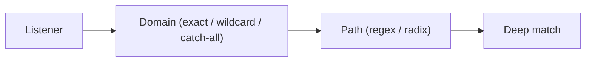
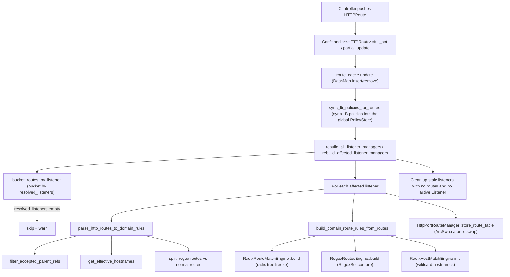

# Route matching overview

## Multi-stage matching pipeline

After a request reaches the Gateway, route matching proceeds through these layers in order:



1. **Listener isolation**: based on the connection's listening address and protocol (`ListenerKey`, formatted as `"{addr}/{protocol}"`), pick the corresponding per-listener route table.
2. **Domain match**: look up `RouteRules` by hostname in `DomainRouteRules`.
3. **Path match**: try the regex engine first within `RouteRules`, then the radix engine.
4. **Deep match**: run Gateway/Listener constraints, HTTP method, headers, and query-param exact checks against candidate routes.

## Per-listener isolation

Each listener owns an independent route table, managed by `GlobalHttpRouteManagers`:

```
GlobalHttpRouteManagers
├── route_cache: DashMap<String, HTTPRoute>                    # global route cache
└── by_listener: DashMap<ListenerKey, Arc<HttpPortRouteManager>>
    └── HttpPortRouteManager
        └── route_table: ArcSwap<DomainRouteRules>             # per-listener snapshot
```

- `route_cache` holds the canonical copy of every HTTPRoute (`resource_key -> HTTPRoute`).
- `by_listener` keeps an `HttpPortRouteManager` per `ListenerKey`; the `ArcSwap<DomainRouteRules>` inside enables lock-free reads.
- When the route table is updated, only affected listeners are rebuilt; other listeners are not disturbed.
- `pg_request_filter` calls `load_route_table()` per request to obtain the current snapshot, and the reference stays stable for the entire request lifetime.

The global managers for other protocols (gRPC / TCP / TLS / UDP) follow the same `Global*RouteManagers → per-listener manager → ArcSwap` pattern.

## Domain match

`DomainRouteRules` contains a three-tier hostname lookup structure:

| Tier | Data structure | Complexity | Description |
|------|----------------|------------|-------------|
| Exact match | `ArcSwap<HashMap<String, Arc<RouteRules>>>` | O(1) | Hostname is lowercased and looked up directly in the HashMap |
| Wildcard match | `ArcSwap<Option<RadixHostMatchEngine<RouteRules>>>` | O(log n) | Wildcard hostnames such as `*.example.com`, using RadixHostMatchEngine |
| Catch-all | `ArcSwap<Option<Arc<RouteRules>>>` | O(1) | Fallback when an HTTPRoute does not specify `spec.hostnames` |

The match priority strictly follows the Gateway API spec: exact > wildcard > catch-all.

## Path match

Each `RouteRules` holds two engines internally:

### RadixRouteMatchEngine (Exact / Prefix)

- Based on a radix tree (`RadixTreeBuilder` + `RadixTree`); all routes are inserted at initialization and frozen into an immutable tree.
- A single `match_all_ext` traversal returns all candidates with their `MatchKind` (`FullyConsumed` / `SegmentBoundary` / `PartialSegment`).
- Exact routes accept only `FullyConsumed`; Prefix routes accept `FullyConsumed` or `SegmentBoundary` (rejecting partial-segment matches like `/v2` matching `/v2example`).
- Candidates are sorted by `priority_weight` in descending order, then deep-matched in turn.

### RegexRoutesEngine (RegularExpression)

- Uses `regex::RegexSet` to batch-match all regex patterns at once, with O(M) complexity (M is path length), independent of route count.
- Routes are sorted by regex pattern length in descending order (longer patterns are preferred).
- Match order: regex engine runs before the radix engine.

## RadixPath priority

`RadixPath`'s `priority_weight` formula (uses character count per the Gateway API spec):

```
priority_weight = path_char_count * 4 + type_bonus
```

`type_bonus` values:

| Type | is_prefix | has_params | type_bonus |
|------|-----------|------------|------------|
| Static exact | false | false | 3 |
| Param exact | false | true | 2 |
| Static prefix | true | false | 1 |
| Param prefix | true | true | 0 |

Sort rules: higher `priority_weight` wins; on a tie, the full Gateway API priority chain runs via `MatchSpecificity::cmp_precedence()` — method match → header count → query param count → creation timestamp → route namespace/name lexicographic order → rule/match index.

Example: `/api/users` (static exact, 10 chars, weight = 43) wins over `/api/users` (static prefix, weight = 41). For the same path and type, a route with method match wins over a route without.

## Deep match

After path matching, candidate routes go through `deep_match_common` for exact validation:

1. **Gateway/Listener constraints** (`check_gateway_listener_match`):
   - Verify that the parentRef's namespace + name match the Gateway.
   - Verify that sectionName matches the Listener (if specified).
   - Verify that the request hostname matches the Listener hostname (HTTP Listener Isolation).
   - Reject if a more specific Listener on the same port also matches the hostname (prevents fuzzy matching).
   - Verify AllowedRoutes (namespace and kind restrictions).
2. **HTTP method**: `match_item.method` is compared with the request method.
3. **Headers**: all header match conditions must be satisfied (AND logic); supports `Exact` and `RegularExpression` (precompiled regex).
4. **Query params**: all query-param match conditions must be satisfied (AND logic); supports `Exact` and `RegularExpression`.

## Route registration flow



Throughout the update, in-flight requests hold the old snapshot reference and are not interrupted. New requests automatically pick up the latest snapshot.

## Multi-Gateway Listener sharing

When listeners from multiple Gateways bind to the same address/protocol combination (the same `ListenerKey`), all Gateways' routes are merged into the same per-listener `DomainRouteRules`. During deep match, `check_gateway_listener_match` walks `gateway_infos` (from `ListenerGatewayInfoStore`) to verify that each route belongs to the Gateway/Listener matched by the current request, achieving logical Listener isolation.

## Key source files

| File | Responsibility |
|------|----------------|
| `src/core/gateway/routes/http/routes_mgr.rs` | `GlobalHttpRouteManagers`, `DomainRouteRules`, `RouteRules` |
| `src/core/gateway/routes/http/conf_handler_impl.rs` | `ConfHandler<HTTPRoute>` implementation, route parsing and construction |
| `src/core/gateway/routes/http/match_engine/radix_route_match.rs` | `RadixRouteMatchEngine` |
| `src/core/gateway/routes/http/match_engine/regex_routes_engine.rs` | `RegexRoutesEngine` |
| `src/core/gateway/routes/http/match_engine/radix_path.rs` | `RadixPath` priority calculation |
| `src/core/gateway/routes/http/match_unit.rs` | `HttpRouteRuleUnit`, `deep_match_common` |
| `src/core/gateway/runtime/matching/route.rs` | `check_gateway_listener_match`, `hostname_matches_listener` |
