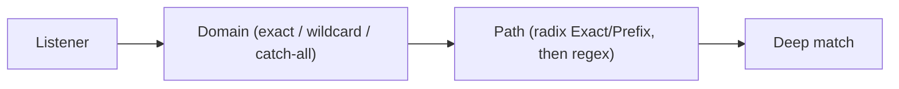
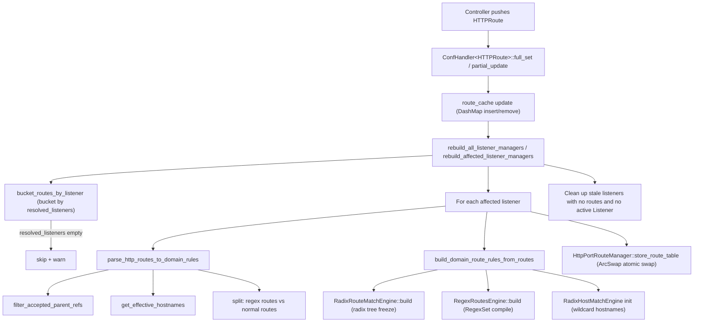

# Route matching overview

## File list

| File | Topic |
|------|-------|
| [01-http-route.md](01-http-route.md) | HTTP route engine — RadixPath, RegexSet, per-listener ConfHandler, proxy implementation |
| [02-grpc-route.md](02-grpc-route.md) | gRPC route engine — Service/Method matching, gRPC-Web support, HTTP pipeline integration |
| [03-tcp-route.md](03-tcp-route.md) | TCP route — per-listener route table, TCP proxy implementation, ConfHandler |
| [04-tls-route.md](04-tls-route.md) | TLS route — SNI matching, per-listener route table, terminate vs passthrough proxies |
| [05-udp-route.md](05-udp-route.md) | UDP route — per-listener route table, per-client session pinning, ConfHandler |

## Multi-stage matching pipeline

After a request reaches the Gateway, route matching proceeds through these layers in order:



1. **Listener isolation**: based on the connection's listening address and protocol (`ListenerKey`, formatted as `"{addr}/{protocol}"`), pick the corresponding per-listener route table.
2. **Domain match**: look up `RouteRules` by hostname in `DomainRouteRules`.
3. **Path match**: try radix Exact/PathPrefix candidates first; only if none deep-match, try RegularExpression candidates.
4. **Deep match**: run Gateway/Listener constraints, HTTP method, headers, and query-param exact checks against candidate routes.

## Per-listener isolation

Each listener owns an independent route table, managed by `GlobalHttpRouteManagers`:

```
GlobalHttpRouteManagers
├── route_cache: DashMap<String, Arc<HTTPRoute>>               # global route cache
└── by_listener: DashMap<ListenerKey, Arc<HttpPortRouteManager>>
    └── HttpPortRouteManager
        └── route_table: ArcSwap<DomainRouteRules>             # per-listener snapshot
```

- `route_cache` holds the canonical shared copy of every HTTPRoute
  (`resource_key -> Arc<HTTPRoute>`).
- `by_listener` keeps an `HttpPortRouteManager` per `ListenerKey`; the `ArcSwap<DomainRouteRules>` inside enables lock-free reads.
- When the route table is updated, only affected listeners are rebuilt; other listeners are not disturbed.
- `pg_request_filter` calls `load_route_table()` per request to obtain the current snapshot, and the reference stays stable for the entire request lifetime.

The global managers for other protocols (gRPC / TCP / TLS / UDP) follow the same `Global*RouteManagers → per-listener manager → ArcSwap` pattern.

### Shared L4 per-listener management (TCP / TLS / UDP)

The TCP, TLS, and UDP route docs all share the same listener-bucketing, rebuild, and ConfHandler mechanics. Canonical description (the per-protocol docs only call out their deltas):

- **Layout**: `Global*RouteManagers { route_cache: DashMap<String, Arc<*RouteUnit>>, by_listener: DashMap<ListenerKey, Arc<*PortRouteManager>> }`, with each per-listener manager holding `route_table: ArcSwap<*RouteTable>` for lock-free reads. The TCP, TLS, and UDP caches own compiled companion units rather than raw schema resources.
- **Listener bucketing**: `bucket_routes_by_listener` distributes routes to listeners via `resolved_listeners` (Controller-precomputed). A route with no `resolved_listeners` logs a warning and is skipped.
- **Rebuild strategy**: `rebuild_all_listener_managers` fully rebuilds every listener table and cleans up stale listeners with no routes; `rebuild_affected_listener_managers` rebuilds only affected listeners (incremental updates).
- **ConfHandler**: `full_set` clears `route_cache`, replaces it in full, and calls `rebuild_all_listener_managers`; `partial_update` computes affected listeners, updates `route_cache`, and calls `rebuild_affected_listener_managers`. TCP/TLS connections already matched against an old snapshot continue with their selected unit. New UDP sessions load the latest snapshot, while established UDP sessions remain pinned to their selected upstream until removal or expiry.

Per-protocol deltas: **TCP** = first-match over a flat `Vec` (no hostname dimension); **TLS** = SNI-indexed `HashHost` + two proxies (terminate-to-TCP vs passthrough); **UDP** = first-packet route match and weighted backend selection when creating a client session, followed by a pinned-session fast path.

## Domain match

`DomainRouteRules` contains a three-tier hostname lookup structure:

| Tier | Data structure | Complexity | Description |
|------|----------------|------------|-------------|
| Exact match | `ArcSwap<HashMap<String, Arc<RouteRules>>>` | O(1) | Hostname is lowercased and looked up directly in the HashMap |
| Wildcard match | `ArcSwap<Option<RadixHostMatchEngine<RouteRules>>>` | O(log n) | Wildcard hostnames such as `*.example.com`, using RadixHostMatchEngine |
| Catch-all | `ArcSwap<Option<Arc<RouteRules>>>` | O(1) | Fallback when an HTTPRoute does not specify `spec.hostnames` |

The match priority strictly follows the Gateway API spec: exact > wildcard > catch-all.

## Path match

Each `RouteRules` holds two engines internally:

### RadixRouteMatchEngine (Exact / Prefix)

- Based on a radix tree (`RadixTreeBuilder` + `RadixTree`); all routes are inserted at initialization and frozen into an immutable tree.
- A single `match_all_ext` traversal returns all candidates with their `MatchKind` (`FullyConsumed` / `SegmentBoundary` / `PartialSegment`).
- Exact routes accept only `FullyConsumed`; Prefix routes accept `FullyConsumed` or `SegmentBoundary` (rejecting partial-segment matches like `/v2` matching `/v2example`).
- Candidate ordering is resolved at build time, not per request: the whole snapshot is ranked once
  into a per-`RadixPath` `precedence_rank`, so the request path only sorts `(rank, path_idx)`
  integers before deep-matching candidates in turn.

### RegexRoutesEngine (RegularExpression)

- Uses `regex::RegexSet` to batch-match all regex patterns at once, with O(P * M) complexity, where P is the combined pattern-set size and M is the input path length.
- Routes are sorted by regex pattern length in descending order (longer patterns are preferred).
- Match order: the radix engine runs first; the regex engine is the fallback, preserving
  Gateway API precedence `Exact > PathPrefix > RegularExpression`.

## RadixPath priority

`RadixPath`'s `priority_weight` formula (uses character count per the Gateway API spec):

```
priority_weight = path_char_count * 4 + type_bonus
```

`type_bonus` values:

| Type | is_prefix | has_params | type_bonus |
|------|-----------|------------|------------|
| Static exact | false | false | 3 |
| Param exact | false | true | 2 |
| Static prefix | true | false | 1 |
| Param prefix | true | true | 0 |

Sort rules: higher `priority_weight` wins; on a tie, the full Gateway API priority chain runs via `MatchSpecificity::cmp_precedence()` — method match → header count → query param count → creation timestamp → route namespace/name lexicographic order → rule/match index. `path_idx` is the final tie-break, making the order strict.

This chain reads only immutable snapshot data, so it is evaluated once during `build` (see `assign_precedence_ranks`) and materialized as `RadixPath::precedence_rank`. Ordering a request's candidate subset by that rank is equivalent to running the chain per request, because a strict total order restricted to a subset is that subset's order.

Example: `/api/users` (static exact, 10 chars, weight = 43) wins over `/api/users` (static prefix, weight = 41). For the same path and type, a route with method match wins over a route without.

## Deep match

After path matching, candidate routes go through `deep_match_common` for exact validation:

1. **Gateway/Listener constraints** (`check_gateway_listener_match`):
   - Verify that the parentRef's namespace + name match the Gateway.
   - Verify that sectionName matches the Listener (if specified).
   - Verify that the request hostname matches the Listener hostname (HTTP Listener Isolation).
   - Reject if a more specific Listener on the same port also matches the hostname (prevents fuzzy matching).
   - Verify AllowedRoutes (namespace and kind restrictions).
2. **HTTP method**: `match_item.method` is compared with the request method.
3. **Headers**: all header match conditions must be satisfied (AND logic); supports `Exact` and `RegularExpression` (precompiled regex).
4. **Query params**: all query-param match conditions must be satisfied (AND logic); supports `Exact` and `RegularExpression`.

## Route registration flow



Throughout the update, in-flight requests hold the old snapshot reference and are not interrupted. New requests automatically pick up the latest snapshot.

## Multi-Gateway Listener sharing

When listeners from multiple Gateways bind to the same address/protocol combination (the same `ListenerKey`), all Gateways' routes are merged into the same per-listener `DomainRouteRules`. During deep match, `check_gateway_listener_match` walks `gateway_infos` (from `ListenerGatewayInfoStore`) to verify that each route belongs to the Gateway/Listener matched by the current request, achieving logical Listener isolation.

## Key source files

| File | Responsibility |
|------|----------------|
| `edgion-gateway/src/routes/http/routes_mgr.rs` | `GlobalHttpRouteManagers`, `DomainRouteRules`, `RouteRules` |
| `edgion-gateway/src/routes/http/conf_handler_impl.rs` | `ConfHandler<HTTPRoute>` implementation, route parsing and construction |
| `edgion-gateway/src/routes/http/match_engine/radix_route_match.rs` | `RadixRouteMatchEngine` |
| `edgion-gateway/src/routes/http/match_engine/regex_routes_engine.rs` | `RegexRoutesEngine` |
| `edgion-gateway/src/routes/http/match_engine/radix_path.rs` | `RadixPath` priority calculation |
| `edgion-gateway/src/routes/http/match_unit.rs` | `HttpRouteRuleUnit`, `deep_match_common` |
| `edgion-gateway/src/runtime/matching/route.rs` | `check_gateway_listener_match`, `hostname_matches_listener` |
