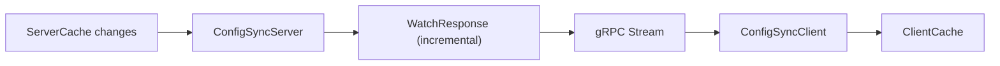
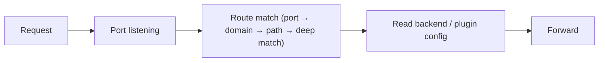

# Common resource processing flow

> Every resource follows the same baseline flow from source to final activation. This document describes the common flow; resource-specific details live in their individual documents.

## Stage 1: Resource source

Resource change events come from three ConfCenter backends:

- **Kubernetes mode**: K8s API Server → Reflector (long-lived Watch) → emits Added/Modified/Deleted events
- **FileSystem mode**: recursive YAML paths → polling watcher → local add/update/delete events
- **Etcd mode**: revisioned key/value List + Watch events

Events emitted by the two modes share a unified format, and subsequent processing is identical.

## Stage 2: Controller processing (ResourceProcessor)

Once an event enters the Controller, it goes through the following processing chain:

ResourceProcessor performs the following ordered steps for each resource:

1. **namespace filter** — skip objects outside the configured namespace set
2. **handler.filter()** — filter resources not owned by this controller
3. **metadata cleaning** — apply context-wide and handler-specific metadata filters
4. **handler.validate()** — collect schema/semantic errors without aborting status computation
5. **handler.preparse()** — compile configuration-independent runtime structures
6. **handler.parse()** — resolve references through `HandlerContext` and runtime-owned stores
7. **capture old status + handler.update_status()** — compute conditions from collected errors
8. **semantic status diff** — compare status with kind-aware rules, not the entire resource JSON
9. **handler.should_publish()** — status-only outcomes retain persistence but withdraw any
   cached object through normal cleanup, without on_change/after_publish
10. **handler.on_change()** — update indexes and trigger dependent requeues; this intentionally runs
   before the current object is saved to ServerCache
11. **ServerCache save** — publish the processed object to the sync cache

Delete events run **on_delete()** instead of parse/on_change, cleaning up all registered references and indexes.

After initialization completes, **on_init_done()** runs, used by resources such as Secret to perform a one-time full replacement.

## Stage 3: gRPC sync (Controller → Gateway)

- **Watch mode** (steady state): once ServerCache detects a change, incremental events (add/update/remove) are pushed via the gRPC bidirectional stream, each carrying a `sync_version`
- **List mode** (initialization / reconnection): on Gateway startup or after a disconnect, the Gateway fetches the full snapshot via List, then switches back to Watch
- **no_sync_kinds**: the default exclusion is `["ReferenceGrant", "Secret"]`; explicit
  configuration replaces this list. Gateway also intentionally has no ConfigMap cache even if the
  Controller advertises it.

## Stage 4: Gateway receives

After ClientCache receives an event, EventDispatch dispatches it to the `ConfHandler` registered for the corresponding resource type:

- **full_set()** — corresponds to List mode; receives the full snapshot and rebuilds runtime state in full
- **partial_update(add, update, remove)** — corresponds to Watch mode; updates runtime state incrementally

## Stage 5: Gateway runtime activation

ConfHandler writes data into runtime storage:

- Route-like resources: written to per-listener route managers (`GlobalHttpRouteManagers`, `GlobalTcpRouteManagers`, etc.), indexed by `ListenerKey` (formatted `"{addr}/{protocol}"`), with the route table swapped atomically via `ArcSwap`
- TLS resources: written to `TlsStore`, updating the SNI certificate match table
- Backend resources: written to backend discovery storage, updating the load-balancing target list
- Plugin resources: written to plugin configuration storage, referenced from routes via ExtensionRef

Request handling reads directly from runtime storage with lock-free access:

## Cross-resource coordination

Resources have dependency relationships; on change, cascading updates are triggered via the requeue mechanism:

- **SecretRefManager**: when a Secret changes, requeue every owner registered against it; consult
  [19-resource-dependency.md](19-resource-dependency.md) rather than maintaining a closed list here
- **ServiceRefManager**: when a Service changes, requeue all routes referencing that Service
- **CrossNsRefManager**: when a ReferenceGrant changes, requeue all resources whose cross-namespace references are affected
- **GatewayRouteIndex**: when a Gateway changes, requeue all routes and EdgionTls referencing that Gateway via parentRef
- **AttachedRouteTracker**: when a route changes, update the Gateway's attachedRoutes count and requeue the Gateway to refresh Status
- **TriggerChain**: limits repeated-kind cycles and total depth (defaults: 5 visits per kind,
  depth 20) to bound cyclic propagation

## Status write-back

After processing completes, the Controller updates the resource's Status:

- **Kubernetes mode**: write back via the K8s API status subresource
- **FileSystem mode**: write to a `.status` file
- In Kubernetes HA mode only the Leader writes status; FileSystem and Etcd persist status through
  their backend-specific paths
- Status change detection: write-back runs only when Status actually changes, avoiding meaningless API calls
