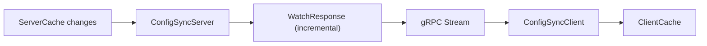
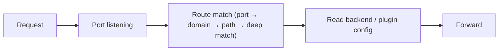

# Common resource processing flow

> Every resource follows the same baseline flow from source to final activation. This document describes the common flow; resource-specific details live in their individual documents.

## Stage 1: Resource source

Resource change events come from two sources:

- **Kubernetes mode**: K8s API Server → Reflector (long-lived Watch) → emits Added/Modified/Deleted events
- **FileSystem mode**: local YAML file directory → inotify/kqueue watching → file changes are converted into equivalent Added/Modified/Deleted events

Events emitted by the two modes share a unified format, and subsequent processing is identical.

## Stage 2: Controller processing (ResourceProcessor)

Once an event enters the Controller, it goes through the following processing chain:

ResourceProcessor performs the following ordered steps for each resource:

1. **filter()** — filter out resources that do not belong to this controller (e.g., GatewayClass filtered by controllerName, Gateway filtered by gatewayClassName)
2. **validate()** — validate the resource configuration, producing a `validation_errors` list
3. **preparse()** — pre-parse: build runtime structures at the resource type level (e.g., `PluginRuntime` for HTTPRoute, regex pre-compilation). This step is implemented by the type's own `preparse()` method, not in the Handler
4. **parse()** — resolve references: resolve Secret references (read from GLOBAL_SECRET_STORE and fill in), register references in SecretRefManager/CrossNsRefManager, resolve hostname/port, mark rejected cross-namespace references
5. **update_status()** — based on validate and parse results, set Gateway-API standard Status Conditions (Accepted, ResolvedRefs, Conflicted, etc.)
6. **check change** — compare old and new resource JSON to detect substantive changes (covers both spec and status)
7. **on_change()** — only runs when there is a substantive change: update dependency indexes (gateway_route_index, attached_route_tracker), trigger requeue of related resources
8. **Update ServerCache** — write the final resource data into ServerCache, triggering gRPC sync

Delete events run **on_delete()** instead of parse/on_change, cleaning up all registered references and indexes.

After initialization completes, **on_init_done()** runs, used by resources such as Secret to perform a one-time full replacement.

## Stage 3: gRPC sync (Controller → Gateway)

- **Watch mode** (steady state): once ServerCache detects a change, incremental events (add/update/remove) are pushed via the gRPC bidirectional stream, each carrying a `sync_version`
- **List mode** (initialization / reconnection): on Gateway startup or after a disconnect, the Gateway fetches the full snapshot via List, then switches back to Watch
- **no_sync_kind**: some resources are not synced to the Gateway. The default is `["ReferenceGrant", "Secret"]`. These are processed only on the Controller side; the Gateway does not need them

## Stage 4: Gateway receives

After ClientCache receives an event, EventDispatch dispatches it to the `ConfHandler` registered for the corresponding resource type:

- **full_set()** — corresponds to List mode; receives the full snapshot and rebuilds runtime state in full
- **partial_update(add, update, remove)** — corresponds to Watch mode; updates runtime state incrementally

## Stage 5: Gateway runtime activation

ConfHandler writes data into runtime storage:

- Route-like resources: written to per-listener route managers (`GlobalHttpRouteManagers`, `GlobalTcpRouteManagers`, etc.), indexed by `ListenerKey` (formatted `"{addr}/{protocol}"`), with the route table swapped atomically via `ArcSwap`
- TLS resources: written to `TlsStore`, updating the SNI certificate match table
- Backend resources: written to backend discovery storage, updating the load-balancing target list
- Plugin resources: written to plugin configuration storage, referenced from routes via ExtensionRef

Request handling reads directly from runtime storage with lock-free access:

## Cross-resource coordination

Resources have dependency relationships; on change, cascading updates are triggered via the requeue mechanism:

- **SecretRefManager**: when a Secret changes, requeue all resources referencing it (Gateway, EdgionTls, EdgionPlugins, EdgionAcme, BackendTLSPolicy)
- **ServiceRefManager**: when a Service changes, requeue all routes referencing that Service
- **CrossNsRefManager**: when a ReferenceGrant changes, requeue all resources whose cross-namespace references are affected
- **GatewayRouteIndex**: when a Gateway changes, requeue all routes and EdgionTls referencing that Gateway via parentRef
- **AttachedRouteTracker**: when a route changes, update the Gateway's attachedRoutes count and requeue the Gateway to refresh Status
- **TriggerChain**: limits requeue chain depth (default 3 levels) to prevent loops

## Status write-back

After processing completes, the Controller updates the resource's Status:

- **Kubernetes mode**: write back via the K8s API status subresource
- **FileSystem mode**: write to a `.status` file
- Only the Leader node performs Status write-back
- Status change detection: write-back runs only when Status actually changes, avoiding meaningless API calls
