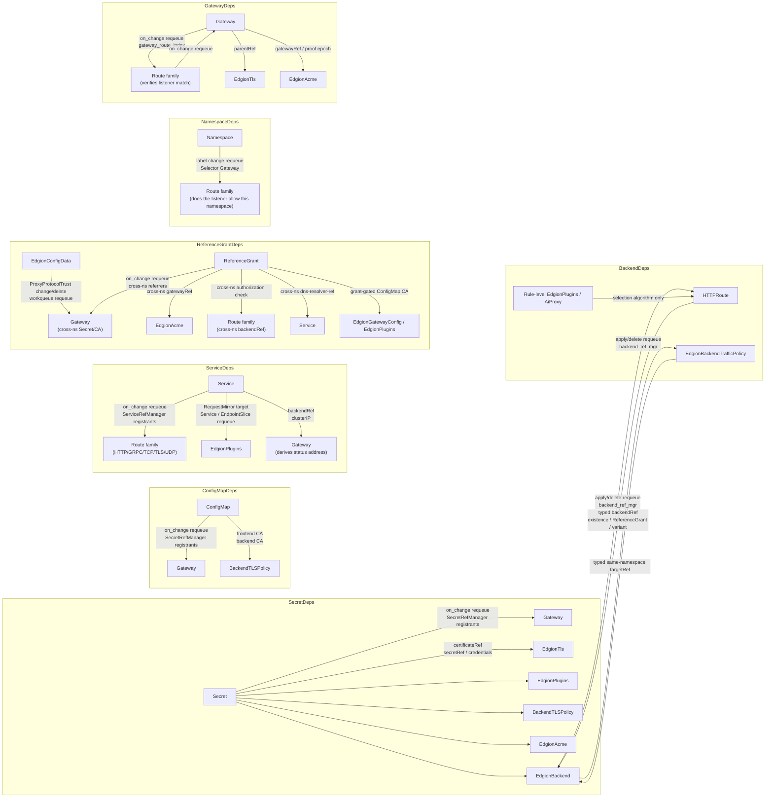

# Inter-resource dependencies

> Field identity and permission contracts are documented in [ReferenceGrant](11-reference-grant.md) and the owning resource pages. This index distinguishes material dependencies from authorization.

## Dependency relationship index

## Stores: writers and readers

| Store | Writer | Reader |
|-------|--------|--------|
| **SecretStore** | SecretHandler | Gateway, EdgionTls, EdgionPlugins, BackendTLSPolicy, EdgionAcme, EdgionBackend, LinkSys, and EdgionGatewayConfig material acquisition |
| **ConfigMapStore** | ConfigMapHandler | Gateway (frontend CA), BackendTLSPolicy (policy-local backend CA), EdgionPlugins (field-specific outbound CA), and EdgionGatewayConfig (explicit cluster-administrative selection) |
| **NamespaceStore** | K8s Namespace informer | Route family (allowedRoutes Selector) |
| **ReferenceGrantStore** | ReferenceGrantHandler | Gateway, Route family, Service, EdgionAcme, LinkSys, EdgionPlugins and EdgionStreamPlugins under their finite cross-namespace policies; EdgionGatewayConfig material selection does not derive authority from this store |
| **SecretRefManager** | Gateway certificate/EdgionTls/EdgionPlugins/BackendTLSPolicy/EdgionAcme/EdgionBackend/LinkSys/EdgionGatewayConfig (register material dependencies during parse; ConfigMap material uses `ConfigMap/ns/name` keys to preserve kind; Gateway frontend CA uses the separate manager below) | SecretHandler/ConfigMapHandler (look up dependents on on_change using their kind-specific key) |
| **FrontendCaRefManager** (`frontend_ca_ref_manager`) | Gateway frontend CA acquisition (kind-qualified Secret/ConfigMap keys) | SecretHandler/ConfigMapHandler requeue registered Gateways on source changes/deletes |
| **ServiceRefManager** | Route family (register forwarding and mirror targets during parse), EdgionPlugins (register enabled mirror targets during parse) | ServiceHandler and EndpointSliceHandler (look up dependents on apply/delete), BackendTLSPolicy (read forwarding-only keys in resolve_ancestor_gateways) |
| **CrossNsRefManager** | Gateway / Route family / Service / EdgionAcme / LinkSys / EdgionPlugins / EdgionStreamPlugins (clear-before-add and register applicable cross-ns references during parse; EGC clears obsolete registrations but its administrative material selection adds no Grant source) | ReferenceGrantHandler (look up dependents on on_change) |
| **EdgionConfigDataRefManager** | Gateway and plugin resources (clear-before-add during parse) | EdgionConfigData handler (requeue dependents on apply/delete) |
| **ProxyProtocolListenerPolicyManager** | Gateway (atomic whole-Gateway contribution replacement) | Gateway handler (requeue only peers affected by a net physical-listener declaration change) |
| **GatewayRouteIndex** | Route family / EdgionTls / EdgionAcme (write on reconcile) | GatewayHandler (requeue route and attachment-proof consumers), BackendTLSPolicy (read in resolve_ancestor_gateways) |
| **RouteDelegationIndex** (`route_delegation_index`) | HTTPRoute (register delegation edges during parse: named children + wildcard namespaces, transitive) | HTTPRoute (on_change/on_delete: `parents_of()` requeues delegating parents; update_status: child-side `Accepted` for `kind: HTTPRoute` parentRefs) |
| **RouteDelegationIndex** (`grpc_route_delegation_index`, second instance, same type, disjoint `"ns/name"` keys) | GRPCRoute (register delegation edges during parse: named children + wildcard namespaces, transitive) | GRPCRoute (on_change/on_delete: `parents_of()` requeues delegating parents; update_status: child-side `Accepted` for `kind: GRPCRoute` parentRefs) |
| **BackendTLSPolicyTargetManager** | BackendTLSPolicy (register targetRef during parse) | BackendTLSPolicy (conflict detection in update_status) |
| **BackendRefManager** (`backend_ref_mgr`) | HTTPRoute, BackendTLSPolicy, and EdgionBackendTrafficPolicy (clear-before-add typed refs during parse) | EdgionBackend handler (requeue typed dependents on apply/delete); HTTPRoute recomputes current AI capability semantics |
| **PluginRefManager** | Gateway, HTTPRoute, and GRPCRoute (register rule- and backend-level EdgionPlugins ExtensionRefs during parse) | EdgionPlugins handler (requeue typed dependents on apply/delete) |
| **AiBackendStore** (Gateway ArcSwap runtime store) | EdgionBackend ConfigClient handler | AI attempt planner (single-snapshot typed backend lookup) |

Material registration follows successful field/source and dependency-owner validation,
and precedes authorization/lookup for valid missing or denied targets. Clearing old
registrations and material happens earlier where required for generation replacement.
Grant authorization remains field-specific: same-namespace needs no Grant, BTP
material is policy-local, EGC requires explicit administrative targets, and
Cluster-visible ConfigData needs no matching Grant even if a reader consults the
store. Apply/delete events requeue through existing per-kind workers; this adds no
queue or direct handler invocation.

`HTTPRoute.backendRefs` is the only typed EdgionBackend destination graph. Route reconcile validates
supported kind, object existence, cross-namespace authorization, and current variant semantics.
AI rules additionally enforce homogeneous AI forwarding and exactly one rule-level AiProxy.
Delegation carries terminal typed targets and
their resolved namespace. Plugins do not own a service reference or a second dependency graph.

An existing EdgionBackend satisfies the route's `ResolvedRefs` independently of the service's
credential status. The service reports partial-good or zero-good credential resolution on its own
conditions; the Gateway fails closed per request if the captured runtime snapshot has no usable
credential.

## Resources without external dependencies

ConfigMap, EndpointSlice, Namespace

EdgionConfigData provides Gateway inbound PROXY protocol `resourceRef` policies and plugin data.
Provider changes/deletes requeue its registered consumers. Those incoming dependencies do not
by themselves establish whether a particular ConfigData variant has outgoing references.
