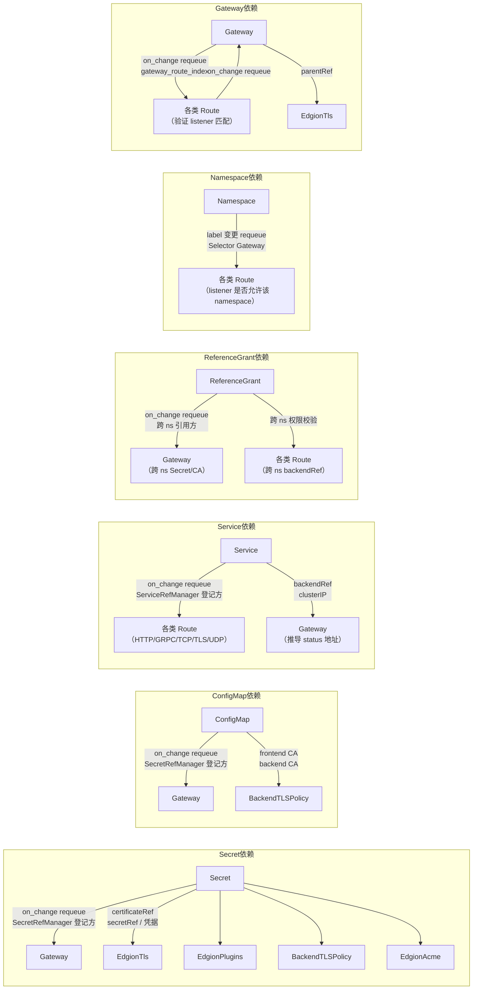

# 资源间依赖关系

> 详细分析见 [tasks/references/resource-dependency-map.md](../../../../tasks/references/resource-dependency-map.md)

## 依赖关系索引图

## Store 与写入/读取方

| Store | 写入方 | 读取方 |
|-------|--------|--------|
| **SecretStore** | SecretHandler | Gateway、EdgionTls、EdgionPlugins、BackendTLSPolicy、EdgionAcme |
| **ConfigMapStore** | ConfigMapHandler | Gateway（frontend CA）、BackendTLSPolicy（backend CA） |
| **NamespaceStore** | K8s Namespace informer | 各类 Route（allowedRoutes Selector） |
| **ReferenceGrantStore** | ReferenceGrantHandler | Gateway、各类 Route（跨 ns 权限） |
| **SecretRefManager** | Gateway/EdgionTls/EdgionPlugins/BackendTLSPolicy/EdgionAcme（parse 时注册） | SecretHandler/ConfigMapHandler���on_change 时查依赖方） |
| **ServiceRefManager** | ��类 Route（parse 时注册 backend） | ServiceHandler（on_change 时查依赖方）、BackendTLSPolicy（resolve_ancestor_gateways 时读取） |
| **CrossNsRefManager** | Gateway/各类 Route（parse 时注册跨 ns 引用） | ReferenceGrantHandler（on_change 时查依赖方） |
| **GatewayRouteIndex** | 各类 Route/EdgionTls（on_change 时写入） | GatewayHandler（on_change 时查关联 Route）、BackendTLSPolicy（resolve_ancestor_gateways 时读取） |
| **BackendTLSPolicyTargetManager** | BackendTLSPolicy（parse 时注册 targetRef） | BackendTLSPolicy（update_status 时冲突检测） |

## 无外部依赖的资源

EdgionGatewayConfig、EdgionStreamPlugins、LinkSys、PluginMetaData、Endpoints/EndpointSlice、Namespace
