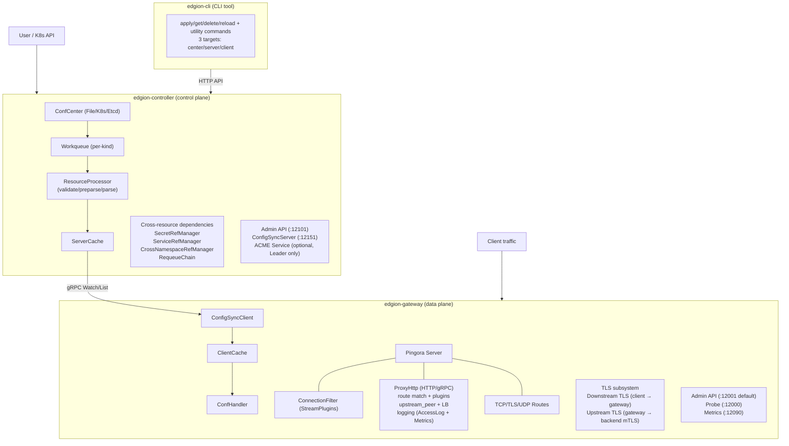

# 01 Architecture and core features

> Edgion is a Kubernetes Gateway built on Pingora, using a Controller–Gateway split architecture.

## Overall architecture

Edgion is a multi-crate Cargo workspace with three in-repo main binaries. **Controller decides, Gateway executes, CLI operates.** The federation Center is maintained in the separate EdgionCenter repository.

## Fine-grained locator

| What you want to learn | Start here |
|-----------|-----------|
| Project at a glance, code organization, conventions shared by the in-repo binaries | [00-common/](00-common/SKILL.md) |
| How the Controller processes resources internally | [01-controller/](01-controller/SKILL.md) |
| Controller authentication & authorization (bearer tokens, CLI token persistence, RBAC, 403/503 debugging) | [01-controller/11-authentication-authorization.md](01-controller/11-authentication-authorization.md) |
| How the Gateway processes requests | [02-gateway/](02-gateway/SKILL.md) |
| How Controller and Gateway sync | [03-controller-gateway-link/](03-controller-gateway-link/SKILL.md) |
| edgion-cli commands and target modes | [04-ctl/](04-ctl/SKILL.md) |
| The full processing chain for a specific resource | [05-resources/](05-resources/SKILL.md) |
| CRD ↔ struct ↔ conf_sync field and secret-redaction rules | [05-resources/00-schema-transport-contract.md](05-resources/00-schema-transport-contract.md) |
| Troubleshoot route mismatch | [02-gateway/03-routes/](02-gateway/03-routes/SKILL.md) |
| Troubleshoot TLS certificate issues | [02-gateway/04-tls/](02-gateway/04-tls/SKILL.md) |
| Troubleshoot gRPC sync issues | [03-controller-gateway-link/00-overview.md](03-controller-gateway-link/00-overview.md) |
| **Develop a new resource type** | [01-controller/09-add-new-resource/](01-controller/09-add-new-resource/00-guide.md) |
| **Develop an HTTP plugin** | [02-gateway/12-edgion-plugin-dev.md](02-gateway/12-edgion-plugin-dev.md) |
| **Develop a Stream plugin** | [02-gateway/13-stream-plugin-dev.md](02-gateway/13-stream-plugin-dev.md) |
| **Develop a LinkSys connector** | [02-gateway/14-link-sys-dev.md](02-gateway/14-link-sys-dev.md) |
| **Implement a ConfHandler** | [02-gateway/11-conf-handler-guidelines.md](02-gateway/11-conf-handler-guidelines.md) |
| **Implement update_status** | [01-controller/10-status-management.md](01-controller/10-status-management.md) |
| **Understand EdgionBackend internals** | [05-resources/22-edgion-backend.md](05-resources/22-edgion-backend.md) |

---

## Directory overview

### [00-common/](00-common/SKILL.md) — Common conventions

Foundational conventions shared by the in-repo binaries: project overview, command line / directory / config-path conventions, crate layering, and the resource system (`define_resources!` macro).

### [01-controller/](01-controller/SKILL.md) — edgion-controller architecture

Internal architecture of the control plane, broken down by module:

| Module | Keywords |
|------|--------|
| Overall architecture | ConfMgr facade, ProcessorRegistry |
| Startup / shutdown | Leader election, HA mode, event-driven main loop |
| Admin API | port :12101, CRUD, health/ready |
| ConfigCenter | ConfCenter trait, FileSystem / Kubernetes / Etcd implementations |
| Workqueue | deduplication, delayed (coalesced) requeue, dirty requeue |
| ResourceProcessor | Processing pipeline and registry-defined Handler kinds |
| Requeue | cross-resource linkage, TriggerChain cycle detection |
| CacheServer | ServerCache + EventStore, gRPC data source |
| ACME | Let's Encrypt automated certificates, Leader only |
| Adding a new resource | workflow + 4 template categories (route-like / controller-only / plugin-like / cluster-scoped) |
| Status management | update_status implementation conventions, known pitfalls |
| Authentication & authorization | token-only admin authn (Istio-style bearer), CLI token RBAC, Role/Verb/CenterPolicy, middleware onion, default federation policy |

### [02-gateway/](02-gateway/SKILL.md) — edgion-gateway architecture

Internal architecture of the data plane, broken down by subsystem:

| Subsystem | Keywords |
|--------|--------|
| Overall architecture | dual-runtime model (Tokio + Pingora) |
| Startup / shutdown | 14-step startup sequence, two-phase Pingora integration |
| Pingora lifecycle | 7-phase ProxyHttp callbacks, ConnectionFilter |
| [Routes](02-gateway/03-routes/) | multi-stage matching pipeline, separate engines for HTTP/gRPC/TCP/TLS/UDP |
| [TLS](02-gateway/04-tls/) | downstream/upstream TLS, SNI matching, BoringSSL/OpenSSL |
| Plugin system | Multi-phase execution, `EdgionPlugin` variants, conditional execution |
| Load balancing | RoundRobin/EWMA/LeastConn/ConsistentHash/Weighted |
| Backends | Service/EndpointSlice discovery, health checks |
| Observability | AccessLog (zero-copy JSON), Prometheus Metrics |
| LinkSys | Gateway providers plus shared-core providers for external integrations |
| Runtime store | Gateway/Route configuration, ArcSwap atomic swap |
| ConfHandler development | full_set/partial_update conventions, incremental update constraints |
| HTTP plugin development | EdgionPlugin phase selection, runtime wiring, ExtensionRef |
| Stream plugin development | ConnectionFilter / TlsRoute two phases |
| LinkSys development | external system connector development, LinkSysStore bridging |

### [03-controller-gateway-link/](03-controller-gateway-link/SKILL.md) — Bidirectional gRPC sync

The ConfigSync protocol (GetServerInfo / List / Watch / WatchServerMeta), the Controller-side ConfigSyncServer and the Gateway-side ConfigSyncClient implementation.

### [04-ctl/](04-ctl/SKILL.md) — edgion-cli architecture

CLI tool with three target modes (`center` = Controller ConfCenter API, `server` = Controller cache, `client` = Gateway cache), resource commands, certificate generation, and token utilities. This `center` target is unrelated to the external federation Center binary.

### [05-resources/](05-resources/SKILL.md) — Resource architecture

Common processing flow, special handling, and cross-resource links for the resource kinds declared by `edgion-resources/src/resource/defs.rs`.
For resource Schema (field definitions, default values) see [02-features/03-resources/](../02-features/03-resources/SKILL.md); stable numbers align where counterpart pages exist.

| Category | Resources |
|------|------|
| Core configuration | Gateway, GatewayClass, EdgionGatewayConfig |
| Routes | HTTPRoute, GRPCRoute, TCPRoute, TLSRoute, UDPRoute |
| Security / policy | EdgionTls, Secret, ReferenceGrant, BackendTLSPolicy |
| Plugins / extensions | EdgionPlugins, EdgionStreamPlugins, EdgionConfigData |
| Backends / services | Service, EndpointSlice, ConfigMap, EdgionBackendTrafficPolicy |
| AI Gateway | HTTPRoute-owned AI candidates, EdgionBackend credential pools, and AiProxy attempt runtime |
| Automation | EdgionAcme |
| Infrastructure | LinkSys |

### [06-gateway-api.md](06-gateway-api.md) — Gateway API conformance

Gateway API v1.5.0 supported scope, conformance tests, Edgion extension points, intentional deviations.
