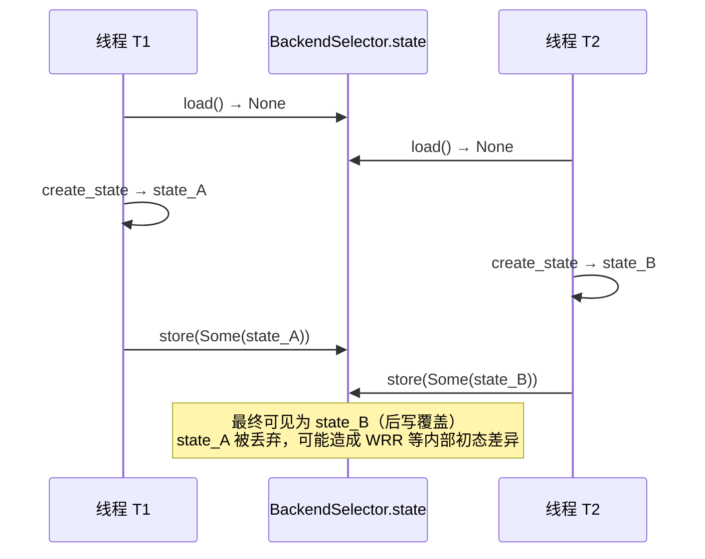
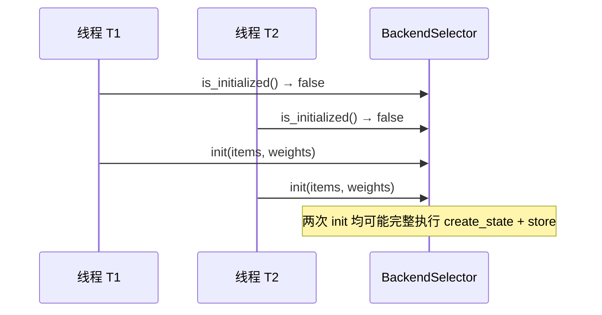

# [P2] BackendSelector 的 ArcSwap 初始化竞态条件

## 问题描述

`BackendSelector::init` 采用「先 `load` 判断是否已初始化，再 `store` 写入新状态」的模式，未在单次原子操作中完成「从未初始化到已初始化」的转移。这与调用方常见的「先 `is_initialized()` 再 `init()`」组合在一起时，形成典型的 **TOCTOU（Time-of-check to time-of-use）** 窗口：多个线程可能同时认为自己负责初始化，从而多次执行 `create_state` 并多次 `store`，后写覆盖先写。在配置参数在逻辑上应一致的前提下，多数情况下仅造成多余计算与实现上的不确定性；一旦存在不同参数或未来调用方式变化，可能出现难以复现的行为。此外，类型设计为「初始化后不可变」，与路由热更新场景存在张力。

## 影响范围

| 类别 | 说明 |
|------|------|
| **核心实现** | `BackendSelector`：`selector.rs` 中 `init`、`state` 字段及文档所述「lazy init」语义。 |
| **调用路径** | 各协议在 **请求路径** 上延迟初始化：`http/routes_mgr.rs`、`grpc/routes_mgr.rs` 的 `select_backend` 使用 `is_initialized()` + `init()`；TCP/TLS/UDP 在 `conf_handler_impl` 中于配置处理时 `init`（并发模式需结合具体运行时确认）。 |
| **资源类型** | 持有 `BackendSelector` 的 `HTTPRouteRule`、`GRPCRouteRule`、`TCPRouteRule`、`TLSRouteRule`、`UDPRoute` 等规则结构（见 `types/resources/*_route.rs`）。 |
| **运维/演进** | 路由或后端列表、权重热更新时，若复用同一规则对象上的 `BackendSelector`，当前实现无法反映新配置，除非替换整条规则或新建选择器。 |

## 严重程度

**P2（中）**

- **正确性**：在「所有并发 `init` 使用同源配置」这一隐含前提下，覆盖写入后最终状态通常仍与配置一致，内存安全由 `ArcSwap` 保证，一般不归类为内存损坏级缺陷。
- **风险点**：语义上「谁先谁后」未定义；若 `WeightedRoundRobin` 等内部含可变调度状态，两次构造的等价配置仍可能对应不同初始调度顺序；API 未禁止「不同参数」的二次 `init` 意图（虽当前会 no-op 或竞态覆盖，行为不清晰）。
- **工程性**：高并发下重复 `create_state` 与无效 `store` 存在可观测的 CPU 浪费；调试时「为何是这份后端集合」更难推理。

## 代码位置

| 文件 | 说明 |
|------|------|
| [`src/core/gateway/lb/backend_selector/selector.rs`](../../../src/core/gateway/lb/backend_selector/selector.rs) | `BackendSelector` 定义、`init`、`is_initialized`、`select`。 |
| [`src/core/gateway/routes/http/routes_mgr.rs`](../../../src/core/gateway/routes/http/routes_mgr.rs) | `RouteRules::select_backend`：`is_initialized` 与 `init` 组合。 |
| [`src/core/gateway/routes/grpc/routes_mgr.rs`](../../../src/core/gateway/routes/grpc/routes_mgr.rs) | `GrpcRouteRules::select_backend`：同上。 |
| [`src/core/gateway/routes/tcp/conf_handler_impl.rs`](../../../src/core/gateway/routes/tcp/conf_handler_impl.rs) 等 | 配置路径上的 `backend_finder.init(...)`。 |

### 关键实现摘录

```63:71:Edgion/src/core/gateway/lb/backend_selector/selector.rs
    pub fn init(&self, items: Vec<T>, weights: Vec<Option<i32>>) {
        // Already initialized, skip
        if self.state.load().is_some() {
            return;
        }

        let state = Self::create_state(items, weights);
        self.state.store(Arc::new(Some(state)));
    }
```

HTTP 侧请求路径上的调用模式（双重检查、均未原子化）：

```54:67:Edgion/src/core/gateway/routes/http/routes_mgr.rs
    pub fn select_backend(rule: &Arc<HTTPRouteRule>) -> Result<HTTPBackendRef, EdError> {
        // Initialize selector if not yet initialized
        if !rule.backend_finder.is_initialized() {
            let (items, weights) = match &rule.backend_refs {
                Some(refs) if !refs.is_empty() => {
                    let items: Vec<HTTPBackendRef> = refs.clone();
                    // Default weight to 1 if not specified
                    let weights: Vec<Option<i32>> = refs.iter().map(|br| br.weight.or(Some(1))).collect();
                    (items, weights)
                }
                _ => (vec![], vec![]),
            };
            rule.backend_finder.init(items, weights);
        }
```

## 详细分析

### 1. TOCTOU：`init` 内部的 load → store

`ArcSwap::store` 本身是原子的，不会出现「撕裂」的 `Arc` 指针。问题在于 **决策与写入非原子**：

1. 线程 A `load()` 得到 `None`，进入初始化分支。
2. 线程 B `load()` 得到 `None`，同样进入初始化分支。
3. A 构造 `state_A` 并 `store`。
4. B 构造 `state_B` 并 `store`，覆盖 A。

若 `state_A` 与 `state_B` 来自同一份 `rule.backend_refs` 推导逻辑，通常等价；若将来存在不同代码路径、或调用方误以为可「用新参数再次 init」，则 **最终存活的是最后一次 `store`**，与「第一次 init 生效」的注释心理模型冲突。

### 2. 与 `is_initialized()` 叠加的二次 TOCTOU

`select_backend` 先调用 `is_initialized()`（内部再次 `load`），再调用 `init()`（再次 `load`）。两个检查之间、以及检查与 `store` 之间均无互斥，因此：

- 多个请求线程可同时通过 `!is_initialized()`；
- 随后均可进入 `init()`，放大上述重复初始化与覆盖问题。

在高 QPS 下，这是实实在在的 **惊群式重复初始化** 风险点。

### 3. 缺少 `compare_and_swap`

更稳妥的做法是：在 **一次** 原子操作中，仅当当前仍为 `None`（或仍为某预期快照）时才写入成功，否则丢弃本地构造结果。`arc_swap::ArcSwap` 提供 `compare_and_swap`（或与 `load` 配对的 CAS 语义），可将「最多一次从 None 变为 Some」钉死在原子步骤上，避免无意义的第二份 `SelectorState` 被 `store` 上去（或明确处理 CAS 失败）。

### 4. API 语义：`init` 无返回值与「仅第一次生效」

文档写明 *If already initialized, this is a no-op*，但：

- 调用者无法区分「本次执行完成了初始化」还是「已是 no-op」；
- 无法区分「因竞态本线程的初始化被丢弃」——从类型上一切「成功」都是静默的；
- 易与「用新 items/weights 更新选择器」的需求混淆；当前实现下第二次及以后的 `init` 在串行语义下会被忽略，在竞态语义下则可能出现「以为没生效但实际被别的线程写过」的认知负担。

### 5. 单次初始化与配置热更新

当前结构在首次 `store(Some(...))` 后，没有公开的 `update` / `reinit`。若同一条 `HTTPRouteRule`（或共享其 `BackendSelector` 的实例）在运行时被原地更新后端列表或权重，**已缓存的 `SelectorState` 不会自动刷新**，除非：

- 上层用新配置 **替换整条规则对象**（新 `BackendSelector`），或  
- 扩展 API 支持在一致性和并发策略明确的前提下刷新内部状态。

这是与「竞态修复」正交但同属 **生命周期语义** 的缺口，应在设计文档或 API 中写清。

## 竞态时序图

下列场景描述两个工作线程对同一 `BackendSelector` 几乎同时执行「检查 + 初始化」（简化：省略调用方第一层 `is_initialized`，仅展示 `init` 内部；两层叠加时窗口更大）。



调用方双重检查时的扩展意图（逻辑时间与上图可重叠）：



## 修改建议

1. **在 `init` 内使用 CAS**  
   用 `compare_and_swap`（或循环 CAS 直至当前为 `Some` 或成功写入）保证「从 `None` 到 `Some`」仅有一个线程的写入被采纳；失败方丢弃本地 `state` 或直接使用已存在状态，避免无意义覆盖。

2. **或改用 `std::sync::OnceLock`（及合适的内部类型）**  
   若确定 **永远不需要热更新、仅单次初始化**，用 `OnceLock<SelectorState<T>>`（或 `Arc<OnceLock<...>>` 等组合）可在类型层面表达「只设一次」，API 更清晰；需注意与当前 `ArcSwap` 读路径、`select` 的接口是否要保持一致。

3. **调用方去掉冗余外层的 TOCTOU**  
   在 `init` 内部 CAS 足够安全的前提下，可考虑将 `select_backend` 简化为直接 `init`（由内部 CAS 去重），或保留 `is_initialized` 仅作快速路径优化，但应在注释中说明 **优化非同步保证**。

4. **`init` 返回值**  
   返回 `bool`（是否由本调用完成首次安装）或 `Result<(), InitError>`，便于日志、测试与排查；若保留 no-op 语义，文档中明确「已初始化时参数被忽略」。

5. **热更新**  
   若产品需要原地更新后端集合，单独设计 `replace` / `update`（通常需 `ArcSwap` 整体替换 `SelectorState` 或版本化配置），与「一次性 init」语义分离，并在文档中说明与路由刷新的关系。

## 代码示例

### 示例 A：`init` 内使用 `compare_and_swap`（思路示意）

下列代码为说明意图的伪代码级示例，具体需按 `arc_swap`  crate 版本 API 调整（如 `compare_and_swap` 的返回值类型、`Ordering` 等）。

```rust
use arc_swap::ArcSwap;
use std::sync::Arc;

pub fn init(&self, items: Vec<T>, weights: Vec<Option<i32>>) -> bool {
    let current = self.state.load();
    if current.is_some() {
        return false;
    }

    let new_state = Self::create_state(items, weights);
    let new_arc = Arc::new(Some(new_state));

    loop {
        let cur = self.state.load();
        if cur.is_some() {
            return false;
        }
        match self
            .state
            .compare_and_swap(&cur, new_arc.clone())
        {
            Ok(_) => return true,
            Err(_) => continue,
        }
    }
}
```

要点：仅当 `load` 仍为「未初始化」快照时才 CAS；成功后返回 `true`；若他线程已写入，本线程应 **不再** 对胜出结果做二次 `store`。

### 示例 B：`OnceLock` 表达单次初始化（思路示意）

```rust
use std::sync::OnceLock;

pub struct BackendSelector<T> {
    state: OnceLock<SelectorState<T>>,
}

impl<T: Clone> BackendSelector<T> {
    pub fn init(&self, items: Vec<T>, weights: Vec<Option<i32>>) -> Result<(), ()> {
        let state = Self::create_state(items, weights);
        self.state.set(state).map_err(|_| ())
    }

    pub fn select(&self) -> Result<T, u32> {
        match self.state.get() {
            Some(SelectorState::Error(err)) => Err(*err),
            Some(SelectorState::Single(backend)) => Ok(backend.clone()),
            Some(SelectorState::Multiple(selector)) => Ok(selector.select().clone()),
            None => Err(ERR_NO_BACKEND_REFS),
        }
    }
}
```

迁移时需评估：`OnceLock::set` 失败时是否要与现有 `init` no-op 对齐（静默忽略 vs 返回错误）。

### 示例 C：热更新——整体替换状态（与 init 分离）

```rust
/// 用新配置原子替换选择器状态（需单独定义并发与错误语义）
pub fn replace(&self, items: Vec<T>, weights: Vec<Option<i32>>) {
    let state = Self::create_state(items, weights);
    self.state.store(Arc::new(Some(state)));
}
```

若引入 `replace`，应明确：是否与 `init` 并存、是否在配置线程单线程调用、以及 `WeightedRoundRobin` 上是否在途请求与新旧状态切换的边界。

---

**结论**：当前实现依赖「并发 init 使用相同配置」这一隐含约定，在 HTTP/gRPC 请求路径上与 `is_initialized` 组合后存在明确的 TOCTOU 与重复初始化问题。建议以 CAS 或 `OnceLock` 收紧初始化语义，并视产品需求补齐返回值与热更新策略的显式设计。
