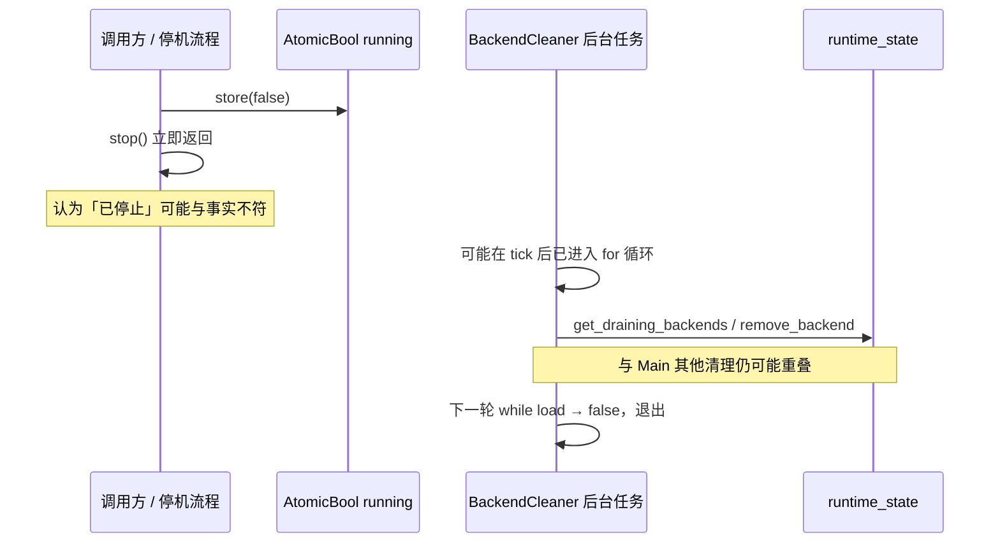
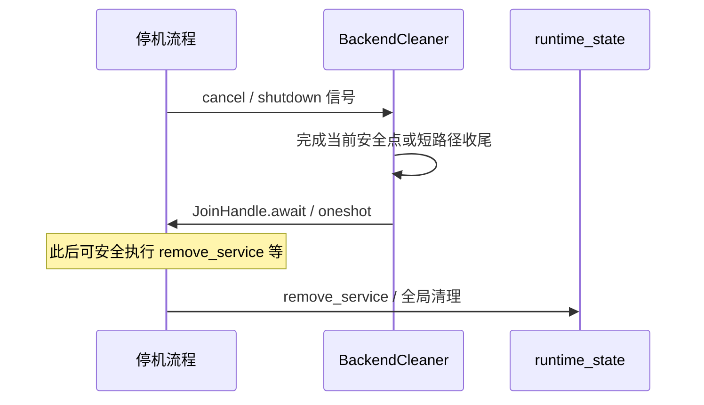

# [P2] BackendCleaner 停止不等待任务完成且缺少优雅关闭

## 严重程度定义（本文档约定）

| 级别 | 含义 |
|------|------|
| **P0** | 数据丢失 / 进程崩溃 |
| **P1** | 功能异常 / 内存泄漏（含长期资源无法回收） |
| **P2** | 性能问题、关闭顺序风险、可观测性不足（不立即导致线上事故但放大其他缺陷） |
| **P3** | 代码质量、可维护性 |

**本文档归类：P2** — 当前网关主路径中**未调用** `BackendCleaner::stop()`，进程长期运行时问题主要表现为「无法按序收口」与「未来接入优雅停机时的竞态窗口」。与发现层 `remove_service` / `remove_backend` 的交叉影响取决于调用时序，属于**关闭语义不完整 + 潜在竞态**，而非单一热路径性能瓶颈。

---

## 问题描述

`BackendCleaner` 在 Least Connection 负载均衡场景下周期性扫描全局 `runtime_state`，对 **处于 draining 且连接数为 0** 的后端调用 `remove_backend`，以回收 EWMA / 连接计数等状态。

其实现通过 `AtomicBool running` 控制后台 `tokio` 任务启停，但存在以下缺口：

1. **`stop()` 仅写标志位**，不等待后台任务退出；调用方无法得知「最后一轮清理」是否已结束。
2. **`start()` 丢弃 `JoinHandle`**，无法在优雅关闭路径中 `await` 任务完成。
3. **固定 10 秒 tick**，在延迟与扫描成本之间不可调，也不利于不同部署规模下的运维策略。
4. **取消语义未文档化**：`running` 置 `false` 后，可能仍执行完当前 `while` 迭代内的整轮 service 遍历。
5. **后台任务无 panic 隔离**：任一步骤 panic 会导致该任务终止且**无重启、无集中日志**，后续 draining 后端可能长期得不到清理（与 [01-runtime-state-memory-leak](01-runtime-state-memory-leak.md) 中描述的内存/陈旧状态风险形成叠加）。

---

## 影响范围

| 区域 | 说明 |
|------|------|
| **LeastConn / runtime_state** | 与 `get_draining_backends`、`remove_backend`、`all_service_keys` 并发读写同一套全局状态 |
| **发现层 / 控制面** | 若在 `stop()` 之后立刻 `remove_service` 或大规模 `remove_backend`，与 cleaner 最后一轮迭代存在时间窗口重叠（当前主程序未调用 `stop()`，但 API 已暴露） |
| **进程退出** | Tokio runtime 随网关线程模型常驻；未 `await` 退出时，依赖 runtime drop 或进程退出终止任务，关闭顺序不可证明 |
| **可运维性** | 无法配置清理周期；无法在升级/滚动前「排空 cleaner 再切流量」 |

---

## 代码位置

| 符号 | 文件 |
|------|------|
| `BackendCleaner` | `Edgion/src/core/gateway/lb/leastconn/cleaner.rs` |
| 构造并 `start()`，**未** `stop()` | `Edgion/src/core/gateway/cli/mod.rs`（`start_auxiliary_services`） |
| 模块导出 | `Edgion/src/core/gateway/lb/leastconn/mod.rs` |

当前启动侧用法（cleaner 为局部变量，spawn 后无句柄保存）：

```62:66:Edgion/src/core/gateway/cli/mod.rs
    async fn start_auxiliary_services(config_client: Arc<ConfigClient>, config: &EdgionGatewayConfig) {
        // Start backend cleaner
        let cleaner = BackendCleaner::new();
        cleaner.start();
        tracing::info!("Backend cleaner task started for LeastConnection LB");
```

---

## 详细分析

### 1. `stop()` 只设置标志位，不等待任务退出

```64:67:Edgion/src/core/gateway/lb/leastconn/cleaner.rs
    pub fn stop(&self) {
        self.running.store(false, Ordering::SeqCst);
        tracing::info!("BackendCleaner stopped");
    }
```

`running = false` 之后，后台任务可能仍处在：

- `tick.tick().await` 之后、进入 `for service_key in runtime_state::all_service_keys()` 的循环中；
- 或对某个 `service_key` 调用 `get_draining_backends` / `remove_backend` 的过程中。

此时若其他协程或同步路径对同一 `service_key` 做 **service 级拆除**（`remove_service`）或 **并发修改后端集合**，理论上存在与 cleaner 读写交错的风险窗口。DashMap / 内部结构的具体安全性取决于 `runtime_state` 各 API 的实现，但**从关闭协议角度**，「stop 返回」并不等于「cleaner 已不参与全局状态」，调用方无法基于返回值做下一阶段清理。

### 2. 缺少 `JoinHandle`，无法 await 退出

```22:59:Edgion/src/core/gateway/lb/leastconn/cleaner.rs
    pub fn start(&self) {
        if self.running.swap(true, Ordering::SeqCst) {
            tracing::warn!("BackendCleaner already running");
            return;
        }

        let running = self.running.clone();

        tokio::spawn(async move {
            let mut tick = interval(Duration::from_secs(10));

            while running.load(Ordering::SeqCst) {
                tick.tick().await;

                for service_key in runtime_state::all_service_keys() {
                    let draining = runtime_state::get_draining_backends(&service_key);
                    for addr in draining {
                        let count = runtime_state::get_count(&service_key, &addr);

                        if count == 0 {
                            tracing::info!(
                                service_key = %service_key,
                                backend = %addr,
                                "Backend fully drained, removing state"
                            );
                            runtime_state::remove_backend(&service_key, &addr);
                        } else {
                            tracing::debug!(
                                service_key = %service_key,
                                backend = %addr,
                                count = count,
                                "Backend still draining"
                            );
                        }
                    }
                }
            }
        });

        tracing::info!("BackendCleaner started");
    }
```

`tokio::spawn` 的 `JoinHandle` 被丢弃，因此：

- 无法在 `shutdown` 流程中 `handle.await`；
- 无法在测试中断言清理任务已结束；
- Runtime 关闭时，任务可能被取消或随 runtime drop，行为依赖 Tokio 版本与关闭顺序，**缺少显式契约**。

### 3. 固定 10 秒间隔的粒度问题

```30:31:Edgion/src/core/gateway/lb/leastconn/cleaner.rs
        tokio::spawn(async move {
            let mut tick = interval(Duration::from_secs(10));
```

- **偏长**：后端已完全 drain（`count == 0`）后，最坏需再等约一个周期才 `remove_backend`，拉长全局表中陈旧条目存活时间（与内存与指标噪声相关，参见 [01-runtime-state-memory-leak](01-runtime-state-memory-leak.md)）。
- **偏短（相对超大规模）**：若 `all_service_keys()` 与 per-service draining 集合很大，固定高频全量扫描可能带来 CPU 与锁竞争；应允许通过配置或自适应策略折中。
- **不可配置**：与网关其他组件（如 `EdgionGatewayConfig`）未打通，运维无法按集群规模调参。

### 4. `running` 与循环边界的语义（原子性正确，语义需说明）

`start()` 使用 `swap(true, SeqCst)` 防止重复启动，这一点是**原子的、正确的**。

后台循环为：

```33:58:Edgion/src/core/gateway/lb/leastconn/cleaner.rs
            while running.load(Ordering::SeqCst) {
                tick.tick().await;

                for service_key in runtime_state::all_service_keys() {
                    // ...
                }
            }
```

当 `running` 在 `tick.tick().await` 等待期间被置为 `false` 时，下一次 `load` 为 false，循环退出，**可能跳过**原计划在「本轮」执行的清理——这是「标志位 + 间隔」模型的常见取舍。

当 `running` 在 **已进入 `for service_key` 之后** 被置为 `false` 时，当前迭代会**继续跑完**整个 `all_service_keys` 内层逻辑。该行为通常是可接受的（避免半轮状态），但必须在文档与 API 注释中明确，否则调用方会误以为 `stop()` 后立刻无 cleaner 活动。

### 5. 错误处理与 panic

异步块内未使用 `std::panic::AssertUnwindSafe` + `futures::FutureExt::catch_unwind`（或等价手段），也未对 `get_draining_backends` / `remove_backend` 等调用包一层 `Result` 聚合。若未来某处引入 `unwrap`、断言失败或下游 panic：

- 该 spawn 任务会终止；
- `running` 可能仍为 `true`（若 panic 发生在未重置路径），或整体状态与「仍在运行」的日志不一致；
- **无自动重启**，后续 draining 清理停滞，直到进程重启。

---

## 优雅关闭时序分析

### 当前实现（理想化调用 `stop()` 时）



**问题归纳**：`stop()` 返回点与「后台不再访问 `runtime_state`」之间**无同步点**，优雅关闭若按「先 stop cleaner → 再 remove_service」编写，仍可能在窄窗口内并发。

### 期望的关闭时序（目标语义）



---

## 修改建议

1. **保存 `JoinHandle`**（或内部 `AbortHandle` + 单独完成信号），提供：
   - 同步 `stop()`：发取消信号；
   - 异步 `shutdown()`：`async fn shutdown(self)` 内 `handle.await`，并处理 `JoinError`（取消 vs panic）。
2. **使用 `tokio_util::sync::CancellationToken`**（项目已依赖 `tokio-util`）替代或配合 `AtomicBool`：
   - `select! { _ = token.cancelled() => break, _ = tick.tick() => ... }` 可更快响应停止；
   - 子任务可克隆 `child_token()`，便于未来拆分 per-service 任务时一并取消。
3. **清理周期可配置**：在 `EdgionGatewayConfig`（或 lb 子配置）中增加 `backend_cleaner_interval_secs`，默认保持 10，文档注明与内存回收延迟的权衡。
4. **Panic 隔离**：在 spawn 的最外层用 `catch_unwind` 记录 error 日志，并视策略选择 `running = false` + 告警，或受控重启（需防止重启风暴，建议加退避）。
5. **文档与注释**：在 `stop()` / `shutdown()` 上明确「返回后是否仍有一轮清理在执行」的契约；若保留「跑完当前迭代」行为，在模块级 `//!` 中说明。

---

## 代码示例

以下示例仅作设计示意，与现有结构对齐时需接入配置、错误类型与网关实际停机流程。

### A. `JoinHandle` + 可 await 的 shutdown

```rust
use std::sync::Arc;
use tokio::sync::Mutex;
use tokio::task::JoinHandle;

pub struct BackendCleaner {
    running: Arc<std::sync::atomic::AtomicBool>,
    join: Arc<Mutex<Option<JoinHandle<()>>>>,
}

impl BackendCleaner {
    pub async fn shutdown(&self) {
        self.running.store(false, std::sync::atomic::Ordering::SeqCst);
        if let Some(h) = self.join.lock().await.take() {
            if let Err(e) = h.await {
                tracing::error!(error = ?e, "BackendCleaner task join error");
            }
        }
    }
}
```

`start()` 中在 `spawn` 后将 `JoinHandle` 写入 `join`（注意与「重复 start」互斥，可用 `Option` 或内部状态机）。

### B. `CancellationToken` + `select!`

```rust
use tokio::time::{interval, Duration};
use tokio_util::sync::CancellationToken;

// 字段示例：cancel: CancellationToken, join: JoinHandle<()>

async fn cleaner_loop(cancel: CancellationToken) {
    let mut tick = interval(Duration::from_secs(10));
    loop {
        tokio::select! {
            _ = cancel.cancelled() => break,
            _ = tick.tick() => {
                // 一轮 all_service_keys 扫描，与现逻辑相同
            }
        }
    }
}

// stop: cancel.cancel(); await join
```

### C. Panic 隔离的可行方向（示意）

对 **async 块** 直接使用 `std::panic::catch_unwind` 并不可靠（Future 需持续 poll）。可选做法包括：

1. **将易 panic 段拆成同步函数**，仅对该段 `catch_unwind` 并记录 `tracing::error!`。
2. **使用 `futures::FutureExt::catch_unwind`**（若工作区已引入 `futures`）包裹 `async { ... }`，再在 `tokio::spawn` 内 `await` 其结果。
3. **进程级 `std::panic::set_hook`**，在 hook 中根据 backtrace / 线程名区分 `BackendCleaner` 任务，保证「静默终止」至少留下日志与指标。

示意（依赖 `futures` 时）：

```rust
use futures::FutureExt;
use std::panic::AssertUnwindSafe;

tokio::spawn(async move {
    match AssertUnwindSafe(cleaner_loop(cancel)).catch_unwind().await {
        Ok(()) => {}
        Err(_) => {
            tracing::error!("BackendCleaner panicked; draining cleanup may stall until restart");
        }
    }
});
```

具体选型需与当前 `Cargo.toml` 依赖及 Tokio 版本对齐，并在测试中验证 panic 后进程其余部分仍符合 SLO。

---

## 小结

| 项 | 结论 |
|----|------|
| **根因** | 停止信号与任务生命周期解耦，无 `JoinHandle` / 无 await 契约 |
| **风险** | 关闭顺序竞态、runtime 退出时行为不透明、panic 后清理静默失效 |
| **优先级** | P2（建议在与全局 `runtime_state` 生命周期治理、网关优雅停机方案一并落地） |
| **依赖** | 已有 `tokio-util`，可优先采用 `CancellationToken`；配置项需与 `EdgionGatewayConfig` 对齐 |

---

## 参考

- 同目录：[01-runtime-state-memory-leak.md](01-runtime-state-memory-leak.md)（`BackendCleaner` 与内存/陈旧状态的关系）
- 启动文档：`Edgion/skills/01-architecture/02-gateway/01-startup-shutdown.md`（提及 `BackendCleaner::start()`，可与未来 `shutdown` 章节同步更新）
