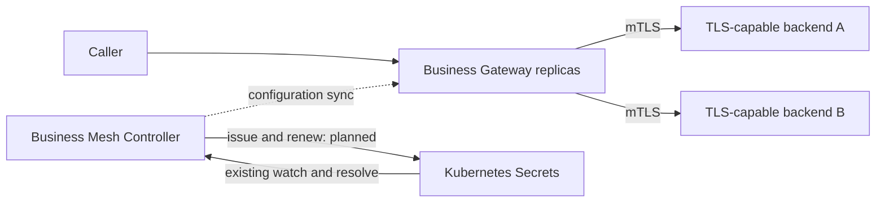

# Business Mesh Gateway: Overall Specification

- Date: 2026-09-25
- Status: Draft; implementation and deployment validation pending
- Initial strategy: Configuration and reuse of existing capabilities
- Certificate strategy: Mesh Controller-managed issuance and renewal; no cert-manager dependency

## 1. Goal and initial decision

Let a business operate a dedicated Edgion Controller and a shared pool of Gateway
replicas for multiple Services in a fixed set of namespaces. Reuse normal gateway
traffic governance and TLS configuration.

The initial route requires no new production feature, Mesh CRD, request plugin,
mesh enable/disable switch, certificate issuer, or node component. First describe
and validate an ordinary deployment using existing resources. Add implementation
work only when a concrete requirement exposes a verified gap.

The intended next capability is automatic TLS/mTLS management by the business
Mesh Controller. It owns issuance, renewal, and desired TLS resource configuration.
The configuration-only baseline verifies the existing data-plane foundation; it
does not mean operators must manually manage certificates in the intended product.

## 2. Baseline traffic path

The caller deliberately reaches the Gateway. Automatic Service takeover, DNS
rewriting, and transparent interception are not part of this baseline. Backend
references must resolve to the actual application endpoints, without routing back
to the Gateway. A concrete service naming and entry arrangement remains to be
selected for the deployment example.

Backends must already terminate TLS and verify the Gateway client certificate.
BackendTLSPolicy cannot make a plaintext application accept mTLS. The caller-to-
Gateway hop has its own TLS policy; securing only the backend hop does not secure
the whole path. The backend sees the Gateway's TLS identity, not automatically
the original caller's workload identity.

## 3. Existing resource mapping

| Concern | Existing mechanism |
| --- | --- |
| Dedicated control plane | Controller configuration and namespace watch scope |
| Gateway ownership and configuration | GatewayClass, EdgionGatewayConfig, Gateway |
| HTTP and gRPC routing | HTTPRoute and GRPCRoute with Gateway parents |
| Backend discovery | Service and EndpointSlice |
| Gateway-to-backend TLS validation | BackendTLSPolicy |
| Gateway client certificate | Existing `edgion.io/client-certificate-ref` annotation; existing Gateway backend client certificate fallback where applicable |
| Caller-to-Gateway TLS and client verification | Existing Gateway TLS and EdgionTls configuration |
| Certificate delivery | Referenced Secrets and existing controller-to-gateway sync |
| Load balancing and backend resilience | EdgionBackendTrafficPolicy |
| HTTP governance and authentication | Existing route filters and EdgionPlugins |

Here, BTP means BackendTLSPolicy. EdgionBackendTrafficPolicy is a different
resource. Its health probe TLS configuration must be checked separately from
normal upstream TLS; neither name refers to eBPF.

## 4. Deployment and ownership

- Configure the fixed namespace watch list and matching Kubernetes RBAC. Watch
  filtering alone is not an authorization boundary.
- Include all namespaces needed for supported resource references; honor
  allowedRoutes and ReferenceGrant requirements where applicable.
- Use distinct controller identity and matching GatewayClass ownership for
  independent deployments. Scope deployment names, leader election, and control
  plane credentials appropriately.
- GatewayClass and EdgionGatewayConfig are cluster-scoped; platform provisioning
  and permissions remain necessary for a namespace-scoped business deployment.
- A shared Gateway pool consumes its Controller's configuration. This design does
  not assume per-replica partitioning of Services or Secrets. Treat the pool as one
  configuration and credential trust boundary.
- Existing deployment manifests use fixed names. Preparing a concrete business
  deployment requires checking and adapting configuration; there is no assumed
  ready-made business Mesh installer.

## 5. Controller-managed certificates and TLS policy

### Ownership

The business owns the trust domain. Its Mesh Controller is intended to bootstrap
or import a private CA, issue leaf certificates, renew them before expiry, and
reconcile the existing TLS resources and Secret references. No cert-manager is
required. A CA-signed leaf is distinct from independently self-signing every leaf.
Manual test certificates may validate the current baseline; automatic management
is a planned Controller responsibility.

The Controller selects explicitly enrolled Services within its allowed namespaces
and configures the requested protection: TLS verifies the server; mTLS additionally
provides a client certificate and requires verification by the receiving endpoint.
Use existing BackendTLSPolicy, Gateway/EdgionTls, and Secret representations where
applicable. The enrollment and management configuration surface remains to be
designed; a new Mesh CRD is not assumed.

Certificate generation and configuration do not terminate network connections.
Gateways, TLS-capable applications, or a future destination proxy perform the
handshakes. For an application exposing only HTTP, a destination-side TLS endpoint
is still needed; Controller automation alone cannot secure the last network hop.

| Material | Owner and destination |
| --- | --- |
| Business CA signing key | Restricted persistent signing storage accessible to the authorized Mesh Controller; never distributed to serving Gateways |
| Backend server certificate and key | Backend TLS endpoint |
| Gateway upstream client certificate and key | Referenced Kubernetes TLS Secret |
| Gateway frontend certificate and key, if enabled | Existing frontend certificate reference |
| Caller client certificate, if frontend mTLS is enabled | Authorized caller |
| Public trust bundles | Each verifying peer through its supported configuration |

Certificates must have appropriate SANs, usages, validity, and peer identity
checks. A trusted signature alone does not define all authorization. Keep signing
keys and leaf private keys out of source control and diagnostic output.

The existing `edgion-cli gen-certs` and Controller auto-CA facilities serve
conf_sync. They are not evidence of an existing general business certificate
issuer. Keep business traffic credentials separate from conf_sync credentials;
evaluate their reusable signing and lifecycle mechanisms before implementation.
Their business-facing extension is planned work, not an existing supported path.

### Rotation

1. Generate a replacement leaf and key under the intended CA.
2. Update the matching `tls.crt` and `tls.key` together in the referenced Secret.
3. Let the existing dependency requeue and configuration sync paths propagate it.
4. Verify new handshakes on every Gateway replica and independently verify backend
   certificate reload. A Secret update alone does not prove either occurred.
5. For CA rollover, install overlapping old and new trust first, rotate leaves,
   verify convergence, then retire old trust after the chosen transition period.

The intended Controller executes issuance and renewal automatically. Its design
must persist the CA across restarts, coordinate replicas so they do not create
competing CAs, retry failed issuance, and recover without silently changing trust.
Only explicitly managed resources may be reconciled; user-owned credentials and
policies must not be overwritten. Define ownership and conflict behavior before
implementation. Never fall back to plaintext when issuance or renewal fails.

Implement scheduling, signing, and Kubernetes writes outside the existing resource
processing handlers, following their nonblocking workqueue contract. Publish
Secret/resource changes through existing watch and requeue paths. Hot reload
consumes credentials produced by this planned automation. Backend installation
and reload require an explicit supported delivery mechanism; writing a Secret
alone does not configure an arbitrary application.

Existing upstream TLS pool isolation distinguishes effective TLS credentials and
policy. Rotation does not forcibly revoke existing connections, active streams,
or already captured request snapshots. Emergency revocation is a separate
requirement from routine renewal.

## 6. Current implementation boundaries

These are source-inspected constraints, not fresh integration-test results:

- Namespace-scoped watches, policy processing, and certificate dependency updates
  already exist; their combined business deployment still needs verification.
- Routes and referenced certificate material can update dynamically. The listener
  port set is fixed at Gateway startup; adding or removing ports requires restart.
  Gateway deletion and recreation also has a documented restart boundary.
- A Gateway resource does not provision the Gateway Deployment. Existing handling
  rejects `spec.infrastructure`.
- Gateway `Programmed` status is not an acknowledgement that every replica has
  installed every policy and completed a handshake with new credentials.
- This route makes no claim of transparent capture, Service-parent GAMMA support,
  HBONE interoperability, or application-independent workload mTLS.
- Authentication governs traffic that actually traverses the Gateway. Preventing
  direct backend bypass requires an explicit network and backend enforcement
  arrangement. Removing protection must not silently create a plaintext or
  unauthenticated fallback.

## 7. Initial roadmap

See the [implementation task index](03-subtasks.md) for executable task scopes,
dependencies, status, and acceptance criteria. All implementation tasks are pending.

### Stage 0: Record the design

Produce this specification and the Ambient investigation. No runtime changes,
infrastructure deployment, or real credential generation in this stage.

### Stage 1: Configure an existing-capability baseline

Prepare one business Controller, a shared Gateway pool, a fixed namespace set,
and at least two TLS-capable backends. Generate business test certificates without
cert-manager. Configure the intended listener ports before starting the Gateway.
Reuse existing routes, policies, plugins, and Secret references.

### Stage 2: Verify the complete path

Verification is pending. Check:

- HTTP and gRPC reach the correct backend without routing loops.
- Namespace scope, ownership, and cross-namespace reference restrictions hold.
- Missing, untrusted, expired, and wrong-identity certificates are rejected as
  required on each protected hop.
- BTP and client certificate/key updates affect new traffic on every replica
  without process restart; distinguish HTTP/1 connection reuse and HTTP/2 streams.
- CA overlap, leaf rollover, and old trust removal behave as intended.
- Backend and frontend certificate reload are independently demonstrated.
- Health probe TLS remains correct after relevant rotations.
- Authentication failures do not fall back to an unprotected route; document
  whether direct backend access is permitted or prevented.

Record actual versions, configuration, observed handshakes, and failures. Open
implementation tasks only for concrete gaps discovered during this validation.

### Stage 3: Add Controller-owned TLS/mTLS automation

Design and implement CA persistence, scoped enrollment, authorized certificate
issuance, automatic renewal, and reconciliation of existing TLS resources. Reuse
the validated Gateway TLS and Secret reload paths. Verify restart recovery,
replica coordination, ownership conflicts, renewal failure, and trust rollover.
This stage is planned functionality, not a claim that the current Controller
already implements business certificate automation.

### Stage 4: Decide whether Ambient is needed

Use [the Ambient investigation](02-ambient.md) to evaluate transparent application
access and workload identity. This is an independent decision, not a prerequisite
for the business Gateway baseline.

## 8. Open decisions

- Entry naming and whether preserving the original Service address is required.
- Controller signing storage, replica coordination, enrollment configuration, and
  delivery/reload contracts for application-owned TLS endpoints.
- Required identity granularity: shared Gateway, Service, or individual workload.
- Whether emergency revocation must terminate already established connections.
- Whether an Ambient extension should integrate an existing system or introduce
  separately designed node components.

## 9. Project references

- [Controller configuration](../../../../skills/02-features/02-config/00-controller-config.md)
- [BackendTLSPolicy configuration](../../../../skills/02-features/03-resources/12-backend-tls-policy.md)
- [EdgionTls architecture](../../../../skills/01-architecture/05-resources/09-edgion-tls.md)
- [Backend TLS pool isolation](../../../../skills/04-review/tls/regression-guards/backend-tls-pool-isolation.md)
- [Listener port lifecycle](../../../../skills/04-review/listeners/compatibility-constraints/listener-port-set-frozen-at-startup.md)
- [Gateway recreation boundary](../../../../skills/04-review/listeners/intentional-design/gateway-recreation-requires-restart.md)
- [Existing conf_sync certificate generator](../../../../edgion-cli/src/certs/mod.rs)
