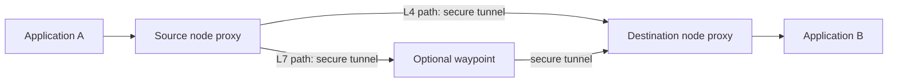

# Ambient Layer Investigation

- Date: 2026-09-25
- Status: Initial research; no implementation commitment
- Baseline: [Business Mesh Gateway specification](01-spec.md)
- Source versions: Official Istio documentation consulted on the date above;
  pin a concrete release before interoperability testing.

## 1. What Ambient adds

The business Gateway baseline requires callers to reach Edgion deliberately and
backends to terminate TLS. An Ambient-style extension would let applications keep
their ordinary sockets while infrastructure supplies secure transport and
authenticated workload identity.

Istio separates a node-level L4 proxy, ztunnel, from an optional L7 waypoint.
Ztunnel handles secure transport and L4 policy using workload identities. A
waypoint supplies HTTP-aware processing outside application Pods. A node proxy
may represent multiple local workload identities; that does not mean all those
workloads share one identity. See the
[official data-plane architecture](https://istio.io/latest/docs/ambient/architecture/data-plane/).

The two branches are alternative paths. Local application connections need not
themselves use TLS. Existing application HTTPS stays encrypted unless an explicit
termination arrangement gives the L7 proxy access to its HTTP content.

## 2. Responsibilities beyond a Gateway

| Responsibility | Question for an Edgion extension |
| --- | --- |
| Enrollment and capture | Which Pods join, and how are their connections redirected? |
| Node transport proxy | Who handles secure traffic without requiring application TLS? |
| Workload identity | How is an identity bound to an authorized workload and issued? |
| Tunnel handling | How are original destinations and authenticated peer identities preserved? |
| Optional L7 processing | Can Edgion satisfy the selected waypoint protocol and policy contracts? |
| Destination enforcement | How are direct Pod-IP and alternative-path bypasses handled? |
| Lifecycle | What happens on enrollment, restart, failure, and protected removal? |

Current Istio uses its CNI component and ztunnel to arrange redirection inside Pod
network namespaces. Ambient does not inherently require eBPF. Our earlier EBTP
discussion referred to an Edgion policy resource, not packet interception.
See [traffic redirection](https://istio.io/latest/docs/ambient/architecture/traffic-redirection/).

Istio's HBONE transport uses HTTP/2 CONNECT protected by mTLS. Ordinary upstream
TLS configured through BackendTLSPolicy does not implement HBONE. Reusing Edgion
as an interoperable waypoint therefore needs explicit protocol and control-plane
analysis and tests. See [HBONE architecture](https://istio.io/latest/docs/ambient/architecture/hbone/).

## 3. Certificate ownership and workload identity

The Mesh Controller is intended to generate, renew, and distribute business
certificates automatically, without cert-manager. This can also supply a future
Ambient layer. An Ambient issuer must additionally establish which workload a
requester may represent before signing a certificate.

Controller automation handles credentials and policy; data-plane endpoints handle
TLS connections. Transparent protection of plaintext applications still requires
traffic capture and a destination-side transport proxy.

Any future design must restrict node-proxy credential access to authorized local
workloads, define identity and trust-domain formats, and cover Pod lifecycle and
rotation. It must not accept arbitrary requested identities or distribute every
business private key to every node. Control-plane transport credentials remain
separate from workload traffic credentials.

## 4. Business scope remains useful

A business can still own a fixed namespace set and its L7 Gateway pool. Node-level
capture introduces additional ownership questions: which component controls each
Pod's rules, which node agents are shared, and how independent controllers avoid
conflicting rules. Namespace watches alone do not solve these questions.

Before implementation, define:

- One owner for each workload's capture and cleanup lifecycle.
- An authenticated mapping from workloads to identities and intended destinations.
- Unambiguous service naming; short names such as `orders` can collide across
  namespaces when forwarded to a shared listener.
- Destination enforcement for direct Pod IPs and skipped waypoints.
- Behavior for same-node traffic, DNS, probes, headless Services, long-lived
  streams, and node restarts.
- Safe removal when authorization depends on the secure path; disabling a mesh
  label must not be assumed to preserve equivalent protection.

## 5. Candidate directions

| Direction | Work and decision boundary |
| --- | --- |
| Existing business Gateway | Configuration and end-to-end verification; explicit entry and TLS-capable backends |
| Integration with an existing Ambient system | Interoperability investigation; distinguish ordinary ingress integration from implementing a waypoint |
| Edgion-owned Ambient layer | New capture, node transport, workload identity, lifecycle, and Linux integration work requiring a separate specification |

Edgion's current HTTP governance is a plausible reusable L7 component. It does
not establish drop-in compatibility with Istio waypoints. That is our design
assessment, not a verified support claim.

A later prototype should first demonstrate workload mTLS between two unchanged
applications on different nodes, then add Edgion L7 processing and demonstrate
unauthorized and bypass-path rejection. Measure failure behavior, operational
cost, and latency before deciding whether new resource abstractions are needed.
